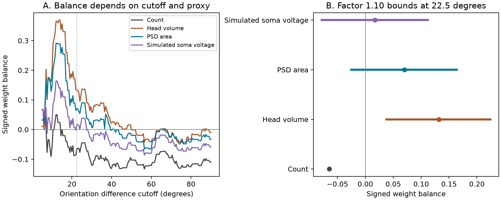

# Direction balance depends on the weight proxy and orientation cutoff in 155 released ferret spine records

Anatomical weights do not give a stable direction contrast across the tested orientation cutoffs. In one subset of 62 spines, weight by postsynaptic density (PSD) area changes an opposite-direction count excess into a same-direction weight excess. This small reversal can disappear under a factor 1.073 error bound on each weight. It also disappears after some two-row deletions. This is a result for a released table, not a rule across cells or animals.



## Question and prior work

Does weight by anatomical size give a consistent direction contrast among inputs with similar orientation preference to their parent soma?

Scholl and colleagues linked calcium imaging and electron microscopy in ferret visual cortex (doi:10.1038/s41586-020-03044-3). Their study found no systematic relation between input strength and spine-soma tuning similarity. Wilson and colleagues studied excitatory and inhibitory contributions to direction selectivity in ferret cortex (doi:10.1038/s41586-018-0354-1). They showed that counts of preferred and null inputs did not explain the degree of somatic direction selectivity. These findings motivate a test that keeps orientation match separate from direction match.

The new analysis tests a finite-table weight contrast and its exact sensitivity to weight error. It does not test the source papers' full circuit models. It does not infer trial responses from preference angles. The campaign search and related publication notes are in files/prior_work.txt. Broad scans were stopped after the relevant reports were read; files/campaign_search.json records the partial cache coverage. The search is not an exhaustive novelty check. A related campaign study of ferret spines tested calcium adjustment of a mitochondrial volume relation (SCI sha256:13fb5cc648428677daaa16889da5ae607841ddca24b80031fdabf808aa1c7ba6). It uses different tables and does not test direction balance.

Two other campaign reports use the same 155-row export. Report a4f78b1d tested geometry models for tuning-correlation prediction and found no gain under its fixed models. Report c6b62c56 tested prediction of stored simulated voltages and found that square-root PSD area predicted them better than linear area. It also audited a square-root area conductance rule in the associated example code. These reports reinforce the need to distinguish anatomical area from modeled voltage. Our analysis tests weighted group contrasts rather than row prediction. We reuse no prior analysis code.

This study is exploratory. We examined group counts and medians at 15, 22.5, 30, 45, and 90 degrees before choosing this question. We report all five cutoffs and a sweep from 5 to 90 degrees in steps of 0.5 degrees. The 22.5-degree example was selected after this inspection. No result is a registered hypothesis test. We report no p-values or population confidence intervals.

## Data and checks

The input is FigureData.mat from the public StructFuncEM2020 repository, commit fe01cad8cee781192153e0296ef4c5facf45f6f8. The source README identifies 155 spines from five cells. The study reports three ferrets. The eight exported columns have the same length and no missing values. They include orientation difference, direction difference, ocular dominance difference, tuning correlation, head volume, PSD area, neck length, and simulated soma voltage.

We use the first two angle columns to define groups. We use head volume, PSD area, and the released simulated soma voltage as three alternative positive weights. Head volume is in cubic micrometres and PSD area is in square micrometres. Each balance is dimensionless. The simulated voltage is a model output, not an independent physiological measurement. We do not use neck length as a weight.

The exact shared input is:

`/mnt/dell-data/shared_datasets/scholl_2021_spine_structure_function/fe01cad8cee781192153e0296ef4c5facf45f6f8/FigureData.mat`

Its size is 8,938 bytes. Its SHA-256 is:

`79379fc7096ccacb8411b6d7d8ba82b37a8cd21431be17436904190850c37fce`

files/provenance.json gives the source URL, version, path, hash, size, and software versions. files/source_metadata.json records the hash of the shared source README inspected during selection. The code refuses a different input hash. The raw measurements remain in the shared store. The package contains group labels and derived results, not a copy of the raw MATLAB file. The source repository has no identified license; its original terms remain. The baseline license covers this new text, figure, code, and derived analysis outputs. It does not grant new rights to the source measurements.

The export has no animal, cell, branch, or trial labels. We do not infer them from row order. Each angle is already relative to the corresponding parent soma. Pooling these relative coordinates does not create a single biological neuron. The sample is selected for visual responses. It is not a full sample of excitatory inputs.

## Method and exact bound

Let d be the absolute direction difference in radians, in [0, pi]. Let o be the absolute orientation difference. The data satisfy `o = min(d, pi-d)` to a maximum error of 4.44e-16 radians. Thus orientation match combines two distinct direction groups.

For a cutoff c, retain `o <= c`. Assign sign +1 when `d < pi/2` and -1 otherwise. At c = 22.5 degrees, these groups have d at most 22.5 degrees and at least 157.5 degrees. At c = 90 degrees, they are the two half-circles. No row lies on the direction boundary.

For positive weights w, compute same-direction sum A and opposite-direction sum B. Define signed balance `S = (A-B)/(A+B)`. Positive values mean a larger same-direction weight total. Negative values mean a larger opposite-direction total. Equal weights give a count contrast. This statistic does not estimate direction selectivity, firing rate, synaptic current, or a calcium response.

Suppose each true weight can independently lie in `[w/r, r*w]`, where r is at least 1. The exact smallest and largest balances are:

`L = (A/r - r*B)/(A/r + r*B)`

`U = (r*A - B/r)/(r*A + B/r)`.

To prove this, note that the balance increases with every positive-group weight and decreases with every negative-group weight. Set all weights to their adverse endpoints to attain L, and to the other endpoints to attain U. A nonzero sign is guaranteed only for `r < sqrt(max(A,B)/min(A,B))`. Equality permits zero. Common multiplication of all weights cannot change S. The adverse error must differ between groups. The factor is an assumed error bound, not measured uncertainty or an error probability. Counts are exact and receive no error interval in the figure. The count critical_factor column in balances.csv is only the algebraic result for hypothetical perturbations of unit weights; it is not uncertainty in the observed counts.

We also remove each row and each pair of rows within every cutoff. We keep the cutoff and the surviving row weights fixed and recompute S. These ranges describe finite-table sensitivity. They cannot address cell dependence or unobserved spines.

## Results

| Cutoff, degrees | Same / opposite count | Count balance | Head-volume balance | PSD-area balance | Simulated-voltage balance |
| ---: | ---: | ---: | ---: | ---: | ---: |
| 15 | 24 / 24 | 0.0000 | 0.3564 | 0.2776 | 0.1305 |
| 22.5 | 29 / 33 | -0.0645 | 0.1321 | 0.0698 | 0.0169 |
| 30 | 33 / 42 | -0.1200 | 0.0588 | 0.0071 | -0.0393 |
| 45 | 43 / 56 | -0.1313 | 0.0097 | -0.0164 | -0.0620 |
| 90 | 69 / 86 | -0.1097 | -0.0102 | -0.0328 | -0.0586 |

At 22.5 degrees, same-direction PSD area totals 9.894368 square micrometres and opposite-direction area totals 8.602433. The PSD balance is 0.069846. Its critical error factor is 1.072466. A factor 1.073 thus permits reversal, and factor 1.10 permits both signs. Head volume has a larger critical factor of 1.142099. Simulated voltage has a factor of only 1.017077. These are correlated proxies, not independent replications.

The PSD balance stays positive after every single-row deletion: 0.024974 to 0.132603. With two deletions, the range is -0.014907 to 0.189178. The count balance stays negative after every two-row deletion: -0.100000 to -0.033333. Head-volume balance stays positive after every two-row deletion: 0.034220 to 0.242054. Simulated-voltage balance can change sign after one deletion: -0.012276 to 0.047174.

The PSD contrast becomes negative at both 45 and 90 degrees. Head-volume and voltage results also depend on cutoff. Thus the data do not give a single stable direction-count reversal under all tested choices. The scan shows the full cutoff dependence, without selection of a best cutoff. Files balances.csv, cutoff_sweep.csv, weight_bounds.csv, delete_one.csv, and deletion_ranges.csv give full precision results. membership.csv gives the original one-based row numbers and each group assignment.

## Meaning and limits

Orientation match alone cannot specify whether an input prefers the soma's direction or the opposite direction. Within a selected orientation range, size weights can change a count contrast. In this table that change is sensitive to the weight proxy, cutoff, and small adverse weight error. This is a useful diagnostic for proposed anatomical accounts of a functional representation.

The result does not refute the source paper's conclusions. A contrast of total morphological proxies is not a response model. Stimulus response amplitudes, response reliability, inhibition, synaptic timing, and nonlinear dendritic integration can all change computation. Simulated voltage already depends on modeling assumptions. Preference estimates also contain uncertainty that this fixed-angle analysis does not propagate. Small angle errors can move rows across a cutoff; the cutoff sweep is not a formal bound for those errors.

The five cells and three animals cannot be separated in this export. We cannot tell whether within-cell effects agree, whether one cell drives the result, or whether pooling creates the contrast. Row deletions do not solve this problem. The new result is a bounded sensitivity analysis for this table, with no claim of a population effect, mechanism, or transfer across animals, regions, or behavioral states. A stronger test needs cell labels and trial responses, then validation on held-out cells and animals. Allen resources were considered during data selection, but no valid same-cell join to these ferret records was available. No cross-dataset join was made.

## Reproduce

Use a writable copy of the publication and Python 3.12. Software versions are in files/requirements.txt and provenance.json. In the assigned worktree, run:

```sh
python work/result/files/analyze.py
python work/result/files/validate.py --data datasets/scholl_2021_spine_structure_function/fe01cad8cee781192153e0296ef4c5facf45f6f8/FigureData.mat --out work/result/files
```

Outside the campaign, retrieve the pinned source into a new scratch folder:

```sh
python files/retrieve.py scratch
python files/analyze.py --data scratch/FigureData.mat --out reproduced
python files/validate.py --data scratch/FigureData.mat --out reproduced
```

Retrieval checks the hash and refuses to overwrite a file. The independent validator uses scalar sums and direct endpoint perturbations. It also recomputes all two-row deletions at 22.5 degrees without the aggregate subtraction formula. All 48 checks passed at tolerance 1e-11. Compare numerical outputs with tolerance 1e-10. Figure bytes can vary with graphics software. files/repeat_check.json records byte-identical results for seven numerical files after retrieval and repeat analysis. The exact bound is proved above; it needs only positive weights and fixed group membership.

## Campaign record

Campaign: 11_07_2026. Job: sci-1107-syam2-neural-structure-and-computation-f63a4d665a2c. Topic: neural-structure-and-computation. Machine: syam2. Account: codex-myxtap. Model: gpt-6.1-sol, high reasoning effort, through the Codex harness in T3 Code. Work used the assigned isolated worktree with no other agents. Source measurements are credited to Scholl and colleagues. The campaign-machine signature records bundle integrity. It is not a personal authorship claim. The signed bundle is saved locally only.
