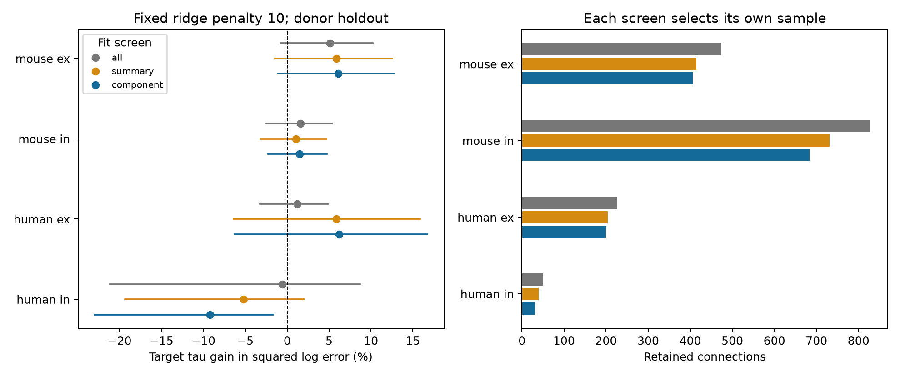

# Target membrane time increased decay prediction error in 31 screened Allen human inhibitory connections at ridge penalty 10

We tested whether component fit screening changes a published membrane-time prediction benchmark in Allen Synaptic Physiology r2.1 small. We linked 1,576 connections to accepted current-clamp fit components and refit models with no screen, a summary screen, and a component screen. All models left out one inferred donor at a time. At ridge penalty 10, the component-screened human inhibitory sample had 31 connections from 18 inferred donors. Adding target membrane time increased mean donor squared log error by 9.23%. Its gain interval was -22.97% to -1.69% after adjustment for four primary panels. The other three panels had intervals that included zero. Component screening removed 68 connections beyond summary screening across the four samples. This result applies to a fixed model and selected slice data. It does not show that membrane time has no role in synaptic computation. We preserve the source links, raw-data checks, extraction code, model code, predictions, and fit flags.



## Question and prior work

Does the use of accepted component fits change a membrane-time prediction benchmark? Circuit models often assign one decay time to each measured connection. A fitted decay can reflect synaptic currents, cell filtering, and recording or fit errors. Better prediction from a cell property does not by itself identify a biological mechanism.

[Campagnola, Seeman, and colleagues](https://doi.org/10.1126/science.abj5861) measured connections and response timing in mouse and human cortical slices. The [Allen registry](https://registry.opendata.aws/allen-synphys/) describes the public source. The dataset links connections, cells, intrinsic measurements, and response fits in the same recorded tissue. It does not require a match between animals.

Two campaign publications supply the starting point. SCI 0c2867f8d195910c320574c3d279fe73104ed60039b61b003aca110f6c223111 tested target membrane time as a predictor of voltage decay. Its result depended on the ridge penalty. SCI a443f362023321dce7c87648e74704c4aefa19332dca93b64cb657ad3bbee0a7 showed that interior decay summaries can hide accepted components near default fit limits. We combine these published results. The new contribution is a measured prediction benchmark after component screening, with a direct raw-data check. This is a follow-up on the same release, not an independent replication or a new membrane-filtering theory.

Before the precise question was fixed, we ran `sci search "connectome" --in ./campaign` and a search for synphys. Both full-folder searches were stopped after several minutes without output. We then read publication metadata in the campaign ZIPs, read the two selected publications with SCI, and verified both complete bundles. A focused SCI search over links to those two published bundles completed. We did not read private worker files. An initial geometry question was replaced because published work had already tested closely related models. No geometry prediction scores were computed.

The [inspected synapse pipeline](https://raw.githubusercontent.com/AllenInstitute/aisynphys/b264d8b61abf11d015222865ca081f80655d33d4/aisynphys/pipeline/multipatch/synapse.py) defines summaries as weighted means of accepted component fits. The [inspected fit source](https://raw.githubusercontent.com/AllenInstitute/neuroanalysis/c2fd909b73cc3167fb65d55edb3de0ab3e245ce9/neuroanalysis/fitting/psp.py) gives default voltage-decay limits. These commits are not established database build commits. Thus we say near default limits, not proven optimizer censoring.

## Data and selection

Raw source: `/mnt/dell-data/shared_datasets/allen_synphys/r2.1_small_2023-01-26/synphys_r2.1_small.sqlite`.
Version: r2.1 small, schema 22, last modified 2023-01-26. Source URL: https://allen-synphys.s3-us-west-2.amazonaws.com/synphys_r2.1_small.sqlite . Size: 176771072 bytes. Verified SHA-256:

`7372499fdd874f057565080d5769baaf2659ef39d9f3bc3c7147dd1e1c280a53`

We reused `connections.csv` from the benchmark and `edge_audit.csv` from the fit audit. Both source bundles passed complete SCI verification. `files/provenance.json` records their identifiers and the reused file hashes. The raw extraction reproduced all 1,576 connection rows exactly. It independently reproduced all selected component and summary flags. We made no shared-data changes and no downloads.

The benchmark requires a detected monosynaptic connection, positive voltage decay and both source and target membrane times, a manually passed current-clamp fit, and cell-body distance from zero to 500 micrometres. Requiring source membrane time preserves the prior selection even though source time is not a predictor here. This selection can exclude weak or poorly measured connections. Mouse samples are mainly visual cortex; human samples are mainly temporal cortex. These are not matched regions across species.

The three screens are: all selected connections; removal when the scalar summary is near a default limit; and removal when any contributing accepted component is near a default limit. A component must have positive decay, positive response count, and manual QC pass. For limit b and decay t, near means abs(t/b - 1) <= 0.000001. The two voltage limits are 0.005 and 0.5 seconds. The component screen removes all summary flags in these selected data and also removes hidden flags. We did not use pulse-train arrays.

## Model and uncertainty

We adapted the published benchmark design. The base model predicts natural log voltage decay from additive source and target nonsynaptic class, Cre label, target layer, region, cell-body distance, absolute cell-depth difference, and cell-depth sum. Missing category values use an unknown level. Numeric values use training medians, missing indicators, and training standardization. Training category levels determine the reference encoding. The target model adds natural log target membrane time. No cell or donor identity is a feature.

Primary ridge penalty is 10 for all coefficients except the intercept. No parameter is tuned on test outcomes. We leave one whole inferred donor out, refit, and predict its connections. Mouse donor names use the six-digit specimen token; human names use their first three fields. These are inferred groups rather than independently checked donor IDs. Slices from one group stay together.

Each donor contributes its mean squared log error. Donors receive equal weight in the score. Training connections receive equal weight. Gain is 100 times (base error minus target error) divided by base error. A negative gain means the target feature increased error. It is not variance explained.

We resample fixed donor loss pairs 9,999 times with seed 110708. The four primary tests are the component-screen panels. Their 98.75% percentile intervals use endpoints 0.00625 and 0.99375. This is a Bonferroni adjustment aimed at 95% family coverage if marginal coverage is valid. The intervals are approximate. They condition on the saved predictions, omit refit uncertainty, and do not fully address overlapping training sets. Intervals for the other screens are descriptive and use the same endpoints. They are not a separate claim of family coverage for all 12 displayed contrasts. We also preserve ordinary 95% intervals.

Each screen selects its own training and test population. We do not test a difference between screen effects. Smaller errors after exclusion can result from removal of difficult outcomes. They do not show that screening improved prediction on a fixed test set.

## Results

In the table, ex means excitatory and in means inhibitory synapse type.

| Group | Screen | Connections | Inferred donors | Gain (%) | Adjusted interval (%) |
|---|---|---:|---:|---:|---|
| mouse ex | all | 473 | 247 | 5.12 | -0.83 to 10.23 |
| mouse ex | summary | 414 | 223 | 5.88 | -1.44 to 12.56 |
| mouse ex | component | 406 | 222 | 6.10 | -1.15 to 12.75 |
| mouse in | all | 828 | 346 | 1.59 | -2.49 to 5.30 |
| mouse in | summary | 731 | 323 | 1.02 | -3.17 to 4.66 |
| mouse in | component | 684 | 315 | 1.47 | -2.27 to 4.72 |
| human ex | all | 225 | 48 | 1.22 | -3.27 to 4.81 |
| human ex | summary | 204 | 46 | 5.87 | -6.40 to 15.84 |
| human ex | component | 200 | 46 | 6.20 | -6.28 to 16.71 |
| human in | all | 50 | 22 | -0.60 | -21.15 to 8.71 |
| human in | summary | 40 | 19 | -5.20 | -19.34 to 1.97 |
| human in | component | 31 | 18 | -9.23 | -22.97 to -1.69 |

The component screen removed 8, 47, 4, and 9 extra connections beyond the summary screen in mouse ex, mouse in, human ex, and human in samples. The total is 68. Thus summary-only screening retains additional near-limit component fits within the prediction benchmark, as expected from the prior audit.

For human inhibitory connections, adding target membrane time raised error from 1.7954 to 1.9612 in the component-screen sample. The gain was -9.23%, with adjusted interval -22.97% to -1.69%. Thirteen of 18 donor losses increased. If one saved donor loss pair is omitted at a time, gain remains negative, from -10.63% to -6.43%. This is a fixed-loss influence check, not a new model refit or an independent confirmation.

The other primary intervals include zero. They do not establish equivalence or no membrane effect. In mouse excitatory connections, component-screen gain was 6.10% at penalty 10. Sensitivity penalties 1 and 100 gave 5.36% and 10.66%. Their descriptive intervals were -1.43% to 11.54% and 3.53% to 17.39%. These sensitivity results preserve the earlier model dependence. They are not corrected for a search over penalties. Human inhibitory penalties other than 10 were not tested in this study.

## Checks and limits

The evidence check reconstructed all 6,872 prediction errors, 3,259 donor loss rows, 18 score rows, and interval endpoints. It also checked all selected fit flags and weighted decay summaries against the raw database. All checks passed. Eight selected donor/model design matrices matched the original benchmark encoding to absolute tolerance 1e-14. The new implementation uses array operations to reduce repeated encoding work. The all-screen point gains match the published benchmark. The figure was checked against the results table.

Near-limit fits are not proven failures. Removing them can change cell classes, response sizes, conditions, and donor coverage. Interior fits can also be uncertain. We did not refit raw traces, estimate fit confidence intervals, or establish true decay values outside any bounds. The human inhibitory result has only 31 connections and 18 inferred donors. Fixed-loss bootstrap coverage can be poor in a small sample. The result is limited to the stated feature encoding, selection, and penalty.

The analysis supplies a quality-screened benchmark for assigning temporal properties to circuit edges. It does not establish a causal membrane rule, an intact-brain activity model, a species difference, or a result about reliable behavioral representations. Slice damage, incomplete cell labels, different regions, voltage recording limits, and detection all restrict generalization. A useful next test would fix the model and screen in advance and measure an independent set with trace-level uncertainty.

## Reproduce

Use Python 3.12 with the versions in `files/requirements.txt`. The full raw database is external. From the unpacked publication, rebuild the numerical results and figure from bundled extracts:

```sh
sh files/reproduce.sh reproduced
```

Inspect the saved evidence without model refits:

```sh
OPENBLAS_NUM_THREADS=1 python files/check.py
```

To recreate inputs directly from the immutable Allen source, use the shared path as DB, or retrieve the exact object with the campaign helper under a new dataset name:

```sh
campaign-dataset allen-synphys-r21-screen-rebuild --url https://allen-synphys.s3-us-west-2.amazonaws.com/synphys_r2.1_small.sqlite --filename synphys_r2.1_small.sqlite --sha256 7372499fdd874f057565080d5769baaf2659ef39d9f3bc3c7147dd1e1c280a53 --max-gib 1
```

Set DB to the completed file returned by the helper. Then run:

```sh
OPENBLAS_NUM_THREADS=1 python files/extract.py --db "$DB" --out raw_inputs
OPENBLAS_NUM_THREADS=1 python files/analyze.py --inputs raw_inputs --out raw_results
OPENBLAS_NUM_THREADS=1 python files/check.py --db "$DB"
```

Keep all outputs outside the shared store. The extract writes only the main-tolerance current-clamp flags needed for this analysis. The bundled audit includes the original extra modes and tolerances for provenance. Their unused rows do not affect the scores. Code, inputs, record selection, predictions, losses, source hashes, and validation records are included.

## Job and rights

Job: sci-1107-dell-neural-structure-and-computation-a9d8928bc8ae. Topic: neural-structure-and-computation. Campaign: 11_07_2026. Machine: dell. Account: codex-andrii. Model: gpt-6.1-sol, high reasoning effort, through Codex in T3 Code. No child agents were launched. All computation used this worktree. The machine signing key is not a personal authorship claim. This publication is stored locally only.

Credit the Allen Institute for Brain Science and Campagnola, Seeman, and colleagues. Raw source data retain the [Allen Institute Terms of Use](https://alleninstitute.org/legal/terms-use/). The baseline license applies to new text, figures, code, and derived material to the extent allowed by source terms. It does not replace them. The model and extraction code adapt MIT-licensed code in SCI 0c2867f8d195910c320574c3d279fe73104ed60039b61b003aca110f6c223111. The source is a campaign-machine publication with no personal authorship claim. `prior_model.py` preserves the reused encoding function. No private keys are included.
