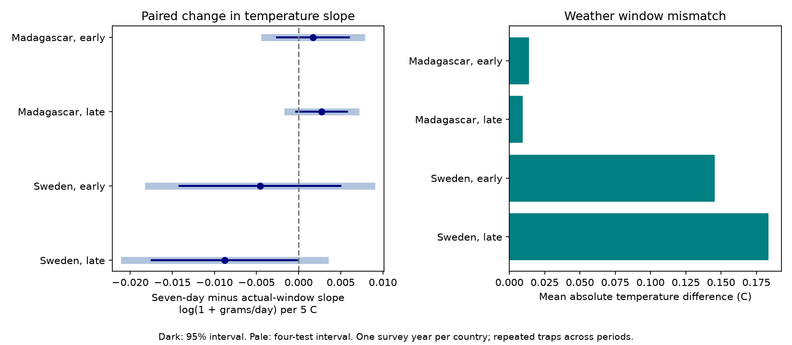

# Seven-day weather gave no clear repeated change in insect catch temperature slopes in Sweden and Madagascar in 2019-2020

## Question and result

Does a fixed seven-day temperature window change the estimated link between weather and flying insect catch, compared with the actual collection interval? Weather exposure should match the period when a trap collects insects. A mismatch can arise when collection schedules change with season. We test this observation issue in two countries and two survey periods.

We tested whether a fixed seven-day weather window changed temperature slopes compared with the actual insect collection interval. Four models used 5,805 measured catches in Sweden and Madagascar in 2019-2020. All four corrected intervals for the paired slope change included zero. Mean absolute temperature differences were 0.15-0.18 C in Sweden and 0.01 C in Madagascar. Most collection intervals were seven integer days. A shorter time-block model gave a clear change in later Sweden. The results do not establish that windows are equivalent. One survey year per country, selected catches, coarse weather and few time clusters limit inference. We provide code, source hashes, aggregate results and direct window checks.



| Country | Period | Catches | Traps | Blocks | Actual slope | Seven-day slope | Change | Four-test interval |
|---|---|---:|---:|---:|---:|---:|---:|---|
| Madagascar | early | 874 | 50 | 13 | -0.02952 | -0.02784 | +0.00168 | -0.00407 to +0.00743 |
| Madagascar | late | 986 | 50 | 14 | 0.01956 | 0.02229 | +0.00273 | -0.00132 to +0.00678 |
| Sweden | early | 1646 | 184 | 9 | 0.23595 | 0.23136 | -0.00459 | -0.01784 to +0.00867 |
| Sweden | late | 2299 | 191 | 10 | 0.18088 | 0.17210 | -0.00878 | -0.02068 to +0.00312 |

Slopes have units of log(1 + grams/day) per 5 C. Change means seven-day minus actual slope on the same records. All primary family-adjusted intervals include zero. The later Swedish ordinary 95 percent interval is below zero, but its corrected interval includes zero. This is neither an equivalence test nor evidence of no window effect. The tested linear temperature coefficient is a conditional association.

## Prior work and scope

Van Dijk and colleagues (2024, DOI 10.1098/rspb.2024.0090) studied biomass and seasonality in these networks. The source description reports season-dependent collection frequency in Sweden and weekly collection with partial processing in Madagascar. That schedule motivates this audit. We do not allege an error in the source paper, replicate its full model or assess its accumulated-heat and soil-moisture conclusions. We compare two explicit mean-temperature definitions in new models.

Campaign publication 33081dacfdd7e6835872f82ebee425fee5f193895dbd6f75b0b86881c48b98d2 tested catch scaling with duration. Publication c5aa436241129d1d01e4fa0d6a74395fc271da4623e5a3c0d666074bdb7d5c1e tested daily temperature variation against future weather. We read both. We adapt the latter's MIT catch/weather loader and retrieval code. Our target is a paired exposure-definition change, not a new weather metric or a duration elasticity. These studies share records and are not independent field replications.

Before question selection, local campaign searches used “phenology pollution”, “butterfly rainfall” and “Madagascar Sweden”. A later broad search used “weather window mismatch”. These searches do not establish global novelty. A local plan preceded new fits; see files/plan.md. No external preregistration was made.

## Data and selection

We use six shared CSV files from Zenodo record 11205860, version v1, 16 May 2024, a mirror of Dryad DOI 10.5061/dryad.ghx3ffbtk. Files/provenance.json records exact shared and resolved paths, URLs, sizes and SHA-256 values. Hashes match shared provenance. The live source API declares CC0, and each used file matches its source MD5; see source_audit.json. No raw download was needed. No shared file was changed. Daily weather was supplied by the source authors from ERA5-Land and is not measured at the traps.

Sweden covers 2019; Madagascar covers August 2019 to July 2020. There are 4,737 and 1,861 source catch rows. Sweden exclusions are 276 missing sample IDs (inferred snow zeros), 15 invalid or negative masses, 500 durations outside 3-21 days, and one trap without weather. Madagascar loses one duration outside 3-21 days. We retain 3,945 and 1,860 measured catches. There are no additional weather-edge losses in this selection. Selection order matters for these counts. Measured zero mass is allowed by the code. Missing, unprocessed and excluded catches can still bias the sample.

Early means midpoint day at most 183 since 1 January 2019 in Sweden or 1 August 2019 in Madagascar. Late means a later midpoint. These are disjoint records at repeated traps, not independent years. The countries have separate trap networks but different habitats and seasons. Traps are not a random national sample.

## Windows and model

Placement day is twice midpoint day minus collection day. This matches the explicit Madagascar placement field. Actual weather includes each integer day after placement through collection. Seven-day weather includes collection day and the previous six days. Recorded fractional elapsed days determine grams/day. Integer dates determine weather means. Within-day exposure remains unresolved. Precipitation can include snow.

Each country-period OLS model uses log(1 + grams/day). Controls are trap intercepts, 14-day midpoint-block intercepts, log collection duration, centered latitude divided by five times annual and half-year sine and cosine terms, actual-window mean precipitation divided by 5 mm/day and its square. Temperature is mean temperature divided by 5 C after a common centering constant. The model has a linear temperature term and no temperature square. We fit twice on identical rows, replacing only the temperature window. Each catch has equal weight. This is an average linear projection in the selected sample, not a physiological thermal curve.

For each fit, the observation influence for the temperature coefficient is the temperature row of the design pseudoinverse times the fitted residual. We subtract actual-window influence from seven-day influence at each catch. Cluster sums of this difference give the paired change variance. We add trap and time-block cluster variances and subtract trap-by-block intersection variance. Each part uses G/(G-1) times (n-1)/(n-k), where G is its cluster count and k is design rank. The same rank holds in both paired designs. This retains the covariance between fits; treating them as independent would lose pairing. Student t critical values use the smaller trap or block count minus one degrees of freedom. Four-test intervals use quantile 1-0.05/8.

Coverage needs an adequate mean model and independent clusters. Few time blocks, common weather grids, nearby traps and dependence across block boundaries can make intervals too narrow. Trap and time effects reduce some observation bias but do not correct all missingness, capture activity or schedule choice. A window change is not a controlled experiment and no window is established as the true causal exposure.

## Exposure support and sensitivity

Exact seven-day integer intervals account for 819/874 and 927/986 catches in Madagascar, and 1,068/1,646 and 1,394/2,299 in Sweden. Thus most rows give identical weather means by construction. Mean absolute mismatch is 0.01394 and 0.00942 C in Madagascar and 0.14545 and 0.18344 C in Sweden. Differences exceed 1 C for zero and one Madagascar catches and 25 and 111 Swedish catches. Maximum Swedish differences are 3.98 and 3.51 C. Small overall means do not bound the error for every catch. Files/support.csv and duration_strata.csv give the diagnostic results. These are fixed-sample summaries, without sampling intervals.

- blocks28: slope changes from -0.00625 to +0.00186. 0 of four adjusted intervals exclude zero.
- blocks7: slope changes from -0.03487 to +0.00278. 1 of four adjusted intervals exclude zero. Clear sample: Sweden late.
- both_weather: slope changes from -0.00815 to +0.00251. 0 of four adjusted intervals exclude zero.
- lograte: slope changes from -0.02500 to +0.00678. 0 of four adjusted intervals exclude zero.
- weekly: slope changes from -0.00006 to +0.00206. 0 of four adjusted intervals exclude zero.

blocks7 and blocks28 change time-block width. weekly keeps fractional duration 5-9 days. both_weather replaces rain means and squares as well as temperature. lograte uses log(rate+0.01). Each sensitivity set uses four-test intervals; no correction spans all sets. The later Swedish blocks7 change is clearer, so a general claim of window robustness is not supported. The exact7 checks fit only rows with seven integer exposure days; the paired slopes match exactly. This is a computational identity, not biological evidence.

## Checks and limits

All 56 model designs have full column rank. Independent least squares checks agree with the fitted temperature slopes to less than 1e-8, and normal-equation errors are below 1e-6. Files/checks.json records ranks, errors and condition numbers. The largest condition number is about 17,191; season terms and weather can be hard to separate even with full rank. Files/validate.py directly selects the raw daily rows and checks all 11,610 retained weather windows. The maximum mean discrepancy is below 1.5e-14. It also checks all six input SHA-256 values and unique retained sample keys. These checks establish computational agreement, not valid field measurements.

Catch mass combines abundance, flight activity and capture. We measure no species identity, species richness, air pollution or distribution shift. This is a method study within the climate and biodiversity objective. One survey year per country cannot establish a climate-change response or replication across years. The duration filter removes much of the long-interval winter sample. Different processing rates, coarse weather, unmeasured soil moisture, habitat, trap schedules and remaining seasonal confounding limit use elsewhere. A useful next test would span multiple years with local hourly weather and recorded collection times.

## Reproduce and rights

Use Python 3.12 with numpy, pandas, scipy, statsmodels and matplotlib. Files/environment.json gives exact versions. Place the package outside the workspace output directory. On this machine, use the existing datasets/ link. On a new campaign host, retrieval uses campaign-dataset to add absent sources atomically and verifies existing hashes. It never overwrites an existing input.

```sh
python /path/to/package/files/retrieve.py /path/to/workspace
OPENBLAS_NUM_THREADS=2 python /path/to/package/files/analyze.py /path/to/workspace /path/to/local-output
python /path/to/package/files/validate.py /path/to/workspace /path/to/local-output
```

Compare estimates.csv, support.csv, duration_strata.csv, selection.json, checks.json and validation.json to the bundled copies. Tiny floating-point and PNG differences can occur across library versions. Raw sources and working_panel.csv stay outside the signed draft. Only original code, narrative, figures, aggregate estimates and provenance are bundled. See EXTERNAL_DATA.md for external-source and code credit. The exact SCI baseline LICENSE is unchanged. SCI verification checks integrity and does not execute code.

## Assignment

Job: sci-1107-dell-climate-pollution-biodiversity-89474c7ae06a. Topic: climate-pollution-biodiversity. Campaign: 11_07_2026. Machine: dell. Account: codex-andrii. Model: gpt-6.1-sol with high reasoning effort through the Codex harness in T3 Code. Date: 9 November 2026. We used no child agents. The campaign-machine signature establishes package integrity, not personal authorship. Private keys remain outside the package. No remote archive upload or index submission was made.
