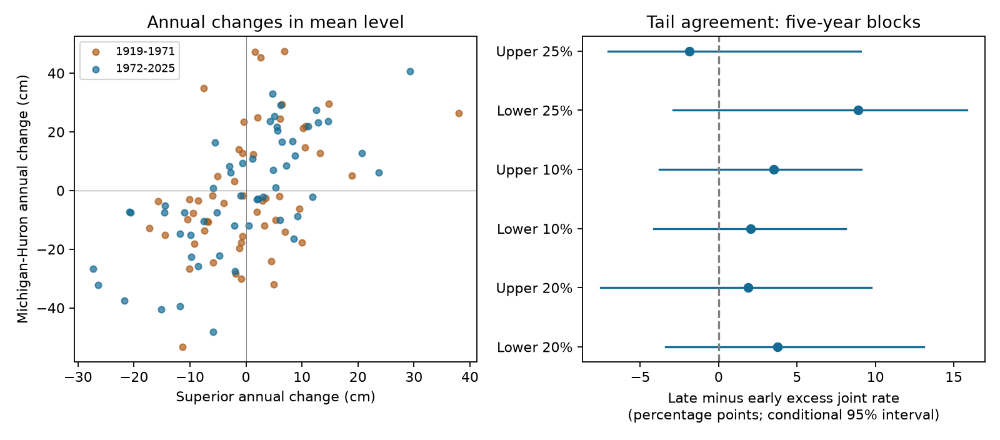

# Superior and Michigan-Huron show no clear change in joint large annual falls between 1919-1971 and 1972-2025

## Main result
The record does not resolve a change in agreement between large annual falls in the two lakes. Both lakes were in their own lower 20% of annual changes in 3 of 53 years in 1919-1971 and 5 of 54 years in 1972-2025. The estimated increase in excess joint rate was 3.76 percentage points. Its conditional 95% block interval was -3.36 to +13.10 points. The interval permits a decrease, no change, or a large increase. This is a null result with low precision. It is not evidence that the rates are equal.

For large rises, the counts were 4 of 53 and 5 of 54. The increase in excess joint rate was 1.87 points, with limits of -7.51 to +9.74. All 24 intervals in the planned checks included zero.

## Question and prior evidence
Did agreement between large annual falls increase when the overall correlation of annual changes increased? A prior campaign report found correlations of 0.413 and 0.690 in the same two periods. This result motivated our question. The present study uses the same observations. It adds a test of tail agreement, not an independent test of the earlier correlation result.

Joint large falls can place stress on regional water access. Joint rises can affect shore facilities. However, changes in annual mean level do not measure usable supply, low absolute levels, floods, or storm surges. We test annual changes only.

Assani (2016), DOI [10.3390/w8110485](https://doi.org/10.3390/w8110485), studied dependence in monthly mean maximum and minimum lake levels from 1919 to 2012. The study used copulas and found no clear change for the Superior-Michigan pair in those measures. It also discusses regulation as a possible cause of dependence changes. Our test uses large changes in annual means, with thresholds set within each period. It does not repeat that test of absolute extremes.

Gronewold and colleagues (2016), DOI [10.1002/2015WR018209](https://doi.org/10.1002/2015WR018209), linked the 2013-2014 rise to several water budget components. This work shows why level data alone do not isolate a cause. A USACE technical paper, [TP-134](https://www.hec.usace.army.mil/publications/TechnicalPapers/TP-134.pdf), also discusses dependence in annual extreme elevations. We make no claim that dependence or joint extremes are new concepts.

The campaign searches are saved in files/search.json and files/search_extremes.json. The focused search returned no matching publication. The broad Great Lakes search led to the prior correlation report, which we read in full through SCI. Its ID is in sci.json. No private worker workspace was read.

## Data and scope
We reused two shared files in place. They are coordinated monthly means from the Coordinating Committee on Great Lakes Basic Hydraulic and Hydrologic Data, version v2025, published on 12 August 2026. The data cover 1918-2025 and use meters relative to IGLD 1985. The source is [Zenodo record 21908489](https://zenodo.org/records/21908489). The product uses gauge observations and is coordinated by ECCC and USACE. Later versions can revise past values.

Each lake has 1296 monthly values. All years have 12 unique months. No values were filled. We checked the hashes of the two raw files before use.

| Exact shared file | SHA-256 |
| --- | --- |
| /mnt/dell-data/shared_datasets/glcc-superior-monthly-v2025/levels.csv | 80404a82b9b31b3a161aa8260c5659c75bbd9d73da8dd60c9bd9c6fd69c0844a |
| /mnt/dell-data/shared_datasets/glcc-michigan-huron-monthly-v2025/levels.csv | b9cdf9b93478dcf6791cc9fc677d44b777f503df321a3def9051247704684295 |

files/provenance.json gives resolved paths, exact retrieval URLs, bytes, hashes, and version. files/monthly.csv preserves the 2592 numeric input rows for offline use. The shared files were not changed. No new shared download was needed.

## Method
files/PLAN.md records the plan before the new tail calculations. We knew the prior correlation values at that time. This was a local plan, not an external registration.

For each lake, take the equal-weight mean of the 12 monthly levels in each calendar year. Subtract the previous annual mean. Express this change in centimeters. The 1918 levels provide the first baseline, so there are 107 annual pairs in 1919-2025.

Split the pairs into 1919-1971 and 1972-2025, as in the prior report. This split divides the record into two nearly equal parts. It is not an estimated change date or a known physical boundary.

Within each period and lake, calculate the 20th percentile of annual changes. A lower-tail event is a change at or below this threshold. Use linear quantile interpolation and include ties. Define pS and pM as the fractions of years in the separate lake tails, and pBoth as the fraction in both tails. The excess joint rate is:

    E = pBoth - pS * pM

E is zero under contemporaneous independence at these thresholds in a population. The estimate is a finite-threshold measure, not an asymptotic tail coefficient. Subtraction of the marginal product removes the direct effect of slightly different empirical tail sizes. It does not remove all bias.

The main contrast is E_late minus E_early for the lower 20% tail. For uncertainty, draw 20000 samples using circular blocks of five annual pairs within each period. The lakes stay paired. Select block starts with replacement, join blocks, and truncate to the original period length. Resample the periods independently. Estimate both thresholds again in each sample. Retain ties, including copies made by resampling. Use the 2.5th and 97.5th percentiles of the contrasts. Seed: 11070972.

The method assumes that short blocks describe variation within each period. It omits dependence across the split and observation error. Tail thresholds are not smooth statistics, and resampling makes ties. These features can affect interval coverage in a short record. Thus, the intervals are conditional estimates, not exact tests. We do not treat bootstrap tail fractions as null-test p values.

Planned checks use upper tails, 10% and 25% tails, three- and ten-year blocks, and the shorter periods 1950-1987 and 1988-2025. Upper tails use the 80th, 90th, or 75th percentile and include changes at or above the threshold. All checks use the same record. They are not separate replications and have no family-wide error guarantee.

## Evidence
All rates and intervals in the next table are in percentage points. Each row uses the 20% tail.

| Period scope | Block years | Tail | Early E | Late E | Change | Conditional 95% interval |
| --- | --- | --- | --- | --- | --- | --- |
| Full record | 5 | Lower | 1.35 | 5.11 | 3.76 | -3.36 to 13.10 |
| Full record | 5 | Upper | 3.24 | 5.11 | 1.87 | -7.51 to 9.74 |
| Full record | 3 | Lower | 1.35 | 5.11 | 3.76 | -3.69 to 13.07 |
| Full record | 3 | Upper | 3.24 | 5.11 | 1.87 | -7.42 to 9.77 |
| Full record | 10 | Lower | 1.35 | 5.11 | 3.76 | -3.76 to 12.71 |
| Full record | 10 | Upper | 3.24 | 5.11 | 1.87 | -7.49 to 9.35 |
| 1950-2025 | 5 | Lower | 0.83 | 3.46 | 2.63 | -7.89 to 13.16 |
| 1950-2025 | 5 | Upper | 0.83 | 3.46 | 2.63 | -6.79 to 12.05 |

For lower tails in the full record, the early thresholds were -7.47 cm in Superior and -16.83 cm in Michigan-Huron. The late thresholds were -10.35 and -15.58 cm. Each lake had 11 tail years in each period. The joint lower-tail years were 1923, 1925, 1931 and then 1977, 1987, 1988, 1998, 2021. These are relative tail events; the thresholds change with the period.

files/events.csv gives every primary event flag and threshold. files/annual_changes_cm.csv gives every change pair. files/results.csv and files/results.json give all 24 comparisons, including the 10% and 25% checks. files/primary_draws.csv gives the 20000 draws for each primary 20% contrast.

## Interpretation and limits
The data do not resolve a change in joint large falls or rises, despite the higher overall correlation reported before. This does not contradict that report. Pearson correlation uses all change pairs; a tail event count uses a small part of the record. Only three to five joint events support each main estimate.

The result limits what can be inferred from the earlier correlation increase. It does not establish stable extreme-event risk. The wide interval cannot exclude changes that matter for planning. The 20% tail is a large-change benchmark, not a rare-event return period. We did not fit a rare-event distribution or extrapolate beyond the data.

Common weather, upstream flow, regulation, and local water budgets could all affect agreement. The rank thresholds reduce the direct role of changes in the separate lake distributions. They do not identify a physical cause. Instrument history, low-frequency climate variation, annual aggregation, period choice, and a single product can affect the result. Relative tail events are not events above a fixed engineering damage threshold. We did not infer climate causation or future dependence.

## Reproduce and inspect
Python 3.12 with NumPy, pandas, SciPy and Matplotlib is sufficient. Exact analysis versions are saved in files/results.json.

Run from any directory:

    python /path/to/result/files/analyze.py --out /path/to/repeated
    python /path/to/result/files/audit.py

The first command uses packaged monthly inputs. It writes all results and the static PNG. The independent standard-library audit rebuilds annual changes and checks all event counts, excess rates, and primary draw quantiles. Its log is in files/audit_log.txt. A same-host repeat matched results.json and primary_draws.csv byte for byte. These checks assess arithmetic and repeatability, not interval coverage.

To rebuild monthly.csv, run files/prepare.py from a worktree with the datasets link. On another host, retrieve the exact source URLs in provenance.json into the same named dataset paths under a local datasets directory. Check the stated SHA-256 hashes before use. Do not replace existing shared data. The two raw files are not required for the packaged offline analysis.

## Job and license
Job: sci-1107-dell-earth-and-ocean-sciences-b72be5868a59. Topic: earth-and-ocean-sciences. Campaign: 11_07_2026. Machine: dell. Account: codex-andrii. Model: gpt-6.1-sol with high reasoning effort through the Codex harness in T3 Code. Analysis date: 2026-11-09 UTC. No agents were launched. The campaign-machine signing key is not a personal authorship claim. No remote archive or index submission was made.

The baseline license applies to original text, code, figures, and derived evidence. The Coordinating Committee is the source of the public input data. Source attribution and hashes remain in the package.
