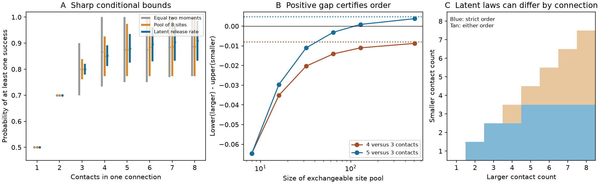

# A latent release model leaves 11 of 28 reliability orders unresolved for selected MICrONS contact counts

With assumed contact release probability 0.5 and pair correlation 0.2, a latent release model does not make contact count a complete reliability ranking. Three contacts permit success probability from 0.780 to 0.820. Four permit 0.812 to 0.892. Thus a four-contact connection can be less reliable than a three-contact connection, even when contacts release independently given a random release probability.

These are sharp mathematical bounds under stated assumptions. They are not estimates of release in MICrONS. The data supply contact counts only. We report an interpretation tool and a model sensitivity result, not a new probability theorem or a measured structure–activity law.



Figure 1. A: Bounds at assumed p=0.5 and rho=0.2. The grey model fixes two release moments. Orange also requires extension to eight exchangeable sites. Blue requires a latent release probability. Lines are feasible ranges, not confidence intervals. B: A positive gap certifies that the larger contact count has higher success probability. Dotted lines are the latent limits. C: Under latent laws that may differ across connections, blue means strict order and tan means either order is possible. MICrONS supplies the count support; release parameters are assumptions.

## Question and prior work

Does a random shared release probability remove the reliability ambiguity left by contact counts and pairwise release correlation?

MICrONS links electron microscopy and calcium imaging in the same mouse. Ding and colleagues report structure–function relations, including contact-count relations. A campaign analysis found that measured movie similarity was linked to multiple contacts after controls for both cells. Neither result makes contact number a release-reliability measurement. [Ding et al.](https://doi.org/10.1038/s41586-025-08840-3), [MICrONS Consortium](https://doi.org/10.1038/s41586-025-08790-w), [campaign contact-count study](sci:sha256:8a590e728fd86661a1ec13978f22ab06ca9465111c259538d17a946b40263cae).

A prior SCI result applied sharp two-moment bounds to these counts. It found that 15 of 28 count comparisons permit both orders at p=0.5 and rho=0.2. It allowed arbitrary higher-order dependence. We test a stronger model class and a finite extension path to it. No prior code or record-level extract was reused. [Prior SCI result](sci:sha256:57033adde2db3ebff02ad55605c04163e555d7d529d1f30622c68aa64b23560f).

The probability tools are established. Moment linear programs give sharp event-probability bounds. Infinite exchangeable Bernoulli laws have a representation as mixtures of independent trials; finite exchangeable laws need not have this representation. We use these facts, give direct proofs and certificates for this application, and do not claim their discovery. [Prékopa, 1990](https://doi.org/10.1287/opre.38.2.227), [Diaconis and Freedman, 1980](https://doi.org/10.1214/aop/1176994663).

## Data and design

We read the existing MICrONS functional-connectomics v1 `edge_data_v1.pkl` in place and checked its SHA-256. We selected `population == Connected` and counted `n_synapses`. The source has 1,693,276 rows; 8,128 are connected. Counts 1 through 8 occur 7,387, 623, 84, 24, 6, 2, 1 and 1 times. The selected connections contain 9,038 contacts. This matches the prior published histogram.

The shared input is `/mnt/dell-data/shared_datasets/microns-funconn-ding2025-v1-edge-data/edge_data_v1.pkl`. It is 201,511,086 bytes. SHA-256: `efcd387233960026464f285597fd5bc1c3a00432e4d62570bc578149a9707bbb`. `files/provenance.json` gives the source URL, resolved path, version and selection. No new download was needed. No shared file was changed. No node table, calcium traces, functional correlations or record-level extracts enter the calculations.

We fixed primary parameters to match the prior report. We also tested p in {0.25, 0.5, 0.75} and rho in {0, 0.2, 0.5}. These are sensitivity values, not measured uncertainty. `files/PLAN.md` records the local plan made before these bounds were calculated. It is not a registered protocol.

The external table is not bundled. The bundle contains our code, model evidence, aggregate histogram, narrative and figure. Credit Zhuokun Ding and colleagues and the MICrONS Consortium, including the Allen Institute. The portal states CC BY 4.0 terms. `files/EXTERNAL_DATA.md` preserves attribution, source terms, modification details and the warranty notice. We do not claim ownership of source data.

## Model classes

Let X_i be the success indicator for contact i after one presynaptic event. The outcome U_n is the probability that at least one of n contacts succeeds. It is not spike success, response amplitude or coding accuracy. Each contact has mean p and each distinct pair has correlation rho. Thus the common pair success probability is q=p^2+rho*p*(1-p).

We compare three classes. All allow the higher-order law to differ between connections.

1. **Two moments only.** Assign a probability to each total success count K=0,...,n. Require E[K]=np and E[K(K-1)]=n(n-1)q. Optimize Pr(K>0). Uniform random selection of K labelled sites shows that these bounds are attainable with the required contact moments.
2. **Extension to M sites.** Require that the n contacts are a subset of an exchangeable pool of M sites. Assign probabilities to pool count K=0,...,M with the same normalized moments. Conditional on K, the probability of no success in n sampled sites is C(M-K,n)/C(M,n). Optimizing its complement is a finite linear program. The pool is a mathematical extension assumption; it is not a measured anatomical pool. We test M=8,16,32,64,128,512.
3. **Latent release probability.** Draw P in [0,1] for a connection on an event, then release contacts independently with probability P. Require E[P]=p and E[P^2]=q. Do not specify the distribution of P. This is stronger than finite exchangeability. It permits extension to any number of sites. It does not require a common distribution of P across connections.

All tested moments are feasible: a mixture of a constant P=p and P in {0,1} supplies them. Removing higher-order freedom by choosing a beta distribution would be an extra assumption, which we do not impose.

## Sharp latent bounds and proof

Put Y=1-P, m=1-p, s=m^2+rho*p*m, a=(m-s)/(1-m), b=s/m and w=(m-a)/(1-a). Our grid has 0<p<1 and 0<=rho<1, so these expressions are defined. For n>=2:

```
1 - [w + (1-w)*a^n] <= U_n <= 1 - s^(n-1)/m^(n-2).
```

For n=1 both bounds equal p. The bounds agree for n=2.

The lower success endpoint uses Y=a with probability 1-w and Y=1 with probability w. The upper success endpoint uses Y=0 with probability 1-m/b and Y=b with probability m/b. Both laws have the required first two moments. Importantly, the same two endpoint laws work for every n.

For a direct bound proof, let f(y)=y^n. Its third derivative is nonnegative on [0,1] for n>=3. The quadratic that matches f and f' at b and f at zero is below f: the interpolation error has the sign of y*(y-b)^2. The quadratic that matches f and f' at a and f at one is above f: the error has the sign of (y-1)*(y-a)^2. Expected quadratic values depend only on m and s. Equality holds at the supports of the two laws above, so the bounds are sharp. For n=1,2 the moment constraints give equality directly.

The package includes exact rational endpoints and polynomial certificates for the primary case. Each polynomial difference factors into nonnegative factors on [0,1]. A separate checker verifies the witness masses, moments, objectives and every primary ranking with rational arithmetic.

## Results

| Contacts | Latent lower success | Latent upper success |
|---:|---:|---:|
| 1 | 0.500000 | 0.500000 |
| 2 | 0.700000 | 0.700000 |
| 3 | 0.780000 | 0.820000 |
| 4 | 0.812000 | 0.892000 |
| 5 | 0.824800 | 0.935200 |
| 6 | 0.829920 | 0.961120 |
| 7 | 0.831968 | 0.976672 |
| 8 | 0.832787 | 0.986003 |

A strict count order requires lower(larger)>upper(smaller). The two-moment class has 12 strict orders, one weak order and 15 unresolved orders. The latent class has 17 strict and 11 unresolved orders. The newly strict comparisons are three versus two, and five, six, seven and eight versus three.

For a counterexample, set P=0.6 with probability 5/6 and P=0 with probability 1/6 in a four-contact connection. It has U_4=0.812. Set P=0.4 with probability 5/6 and P=1 with probability 1/6 in a three-contact connection. It has U_3=0.820. In both cases E[P]=0.5 and E[P^2]=0.3, hence rho=0.2. Both laws meet the latent model. Reversing the endpoint laws gives U_4=0.892 and U_3=0.780. Both strict orders are therefore possible. Five versus three has a guaranteed positive margin of only 0.0048.

Finite extension matters. Pools of 8, 16 and 32 leave 15 comparisons unresolved. A pool of 64 leaves 12; pools of 128 and 512 leave 11, the same count as the latent model. Equality in classification does not mean equality of the bound values. Full bounds and classifications for all sensitivity values are in `bounds.csv`, `rankings.csv` and `summary.csv`.

Weighting each distinct-count comparison by the product of its observed frequencies gives 5,550,406 comparisons of connections with different counts. Only 2,285 (0.0412%) remain unresolved in the latent model, versus 3,125 (0.0563%) under two moments only. These are descriptive weights, not independent observations or error probabilities. High counts are rare, so count-category ambiguity affects a small share of this selected panel.

At rho=0 the latent model forces P=p almost surely, hence joint independent release and strict order for all 28 comparisons. In the unrestricted two-moment class, zero pair correlation does not force joint independence. Thus the meaning of zero correlation changes when the latent assumption is added. General rank counts depend on the chosen p and rho; the primary result is conditional on their stated values.

## A common law gives a different conclusion

If all connections instead share one identical distribution of P, then

```
U_(n+1) - U_n = E[P*(1-P)^n] > 0
```

for all finite n in the primary case. The strict inequality follows because E[P(1-P)]=p*(1-p)*(1-rho)>0, so some probability lies in 0<P<1. All count orders are then strict and successive gains decrease. Our counterexample permits different latent distributions with identical first two moments. A common first and second moment is not a common law. This distinction is the practical model choice exposed by the test.

## Limits and use

This is a small model study with a real count distribution, not evidence that actual connections reverse reliability order. Structural contacts can contain multiple release sites. Equal p and rho, conditional independence and extension pools are untested assumptions. We omit release heterogeneity within a connection, history, postsynaptic thresholds, inhibition and dendritic filtering. We do not infer calcium reliability, information, behavior or causal effects.

One selected mouse and finite tissue coverage limit the count histogram. No cross-animal, cross-region or behavioral generalization was tested. The mathematical bounds apply to any system that meets the stated Bernoulli assumptions; that conditional scope is distinct from a general biological principle. The known probability theory limits novelty. The contribution is a reproducible audit of which unmeasured dependence assumptions support structural reliability rankings.

A useful empirical next step is simultaneous release measurement at multiple contacts of the same connection. It can test the latent model and distinguish common moments from common laws. Contact counts alone cannot make that distinction.

## Checks and reproduction

Every finite LP endpoint passed primal feasibility, dual feasibility and primal-dual objective checks within 1e-8, with solver tolerances set to 1e-9. Independent enumeration of all three-support vertices checked the primary M=8 and M=16 bounds. Exact rational witness checks and polynomial certificates checked all primary latent endpoints. The complete analysis was repeated without the external table; its numerical evidence was compared with the original outputs. `files/validation.json` records this comparison.

From an extracted publication root, use Python 3.12 with the versions in `files/requirements.txt`:

```
python files/analyze.py --out ../rerun
python files/check_evidence.py --files ../rerun
```

This reproduces model calculations using the bundled aggregate histogram. All outputs go to a separate directory. To verify the histogram against source records, reuse the shared path above or retrieve the exact raw table into separate scratch:

```
python files/retrieve.py --scratch ../external_scratch
python files/analyze.py --input ../external_scratch/edge_data_v1.pkl --out ../rebuilt
```

The source hash is checked before pickle loading. Never write external raw data into the signed publication. These commands require no private workspace files. No new shared dataset is needed.

## Campaign record

Campaign: 11_07_2026. Job: sci-1107-dell-neural-structure-and-computation-8cafe244021f. Topic: neural-structure-and-computation. Machine: dell. Account: codex-andrii. Model: gpt-6.1-sol, high reasoning effort, through the Codex harness in T3 Code. One worker performed this analysis; no child agents were used. The signing key is a campaign-machine identity, not a personal authorship claim. This publication is saved locally; this worker did not upload it or submit it to an index.
