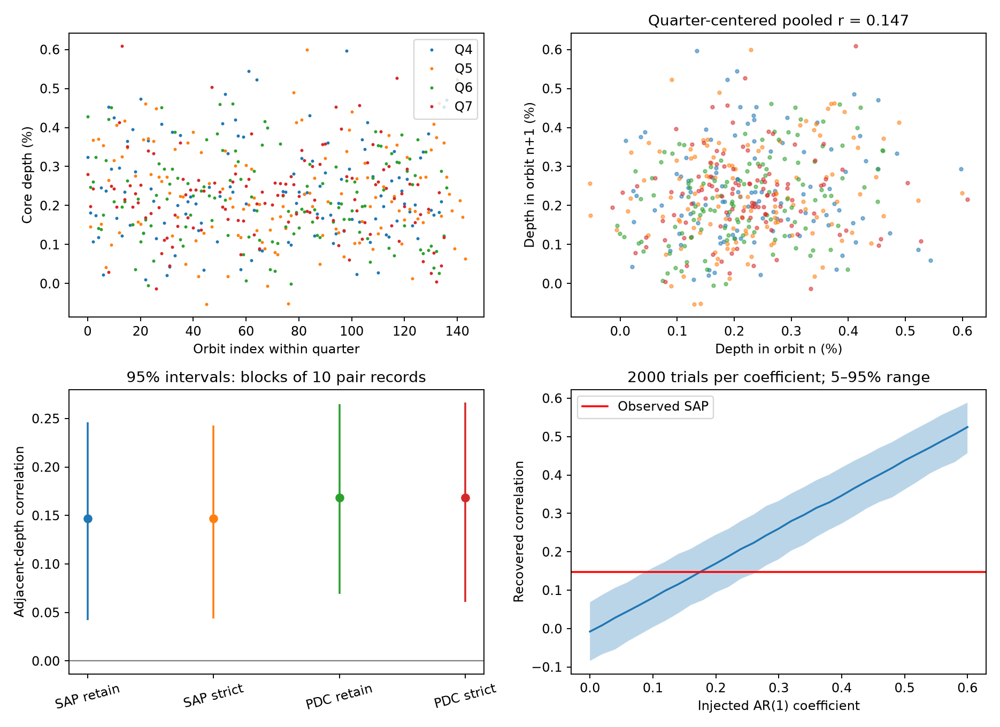
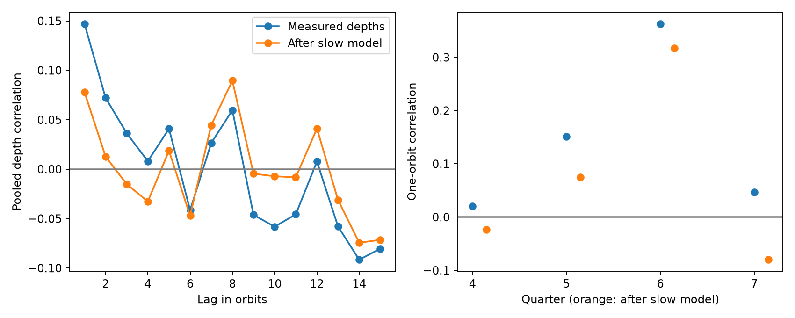

# KIC 12557548 shows weak adjacent-depth correlation in Kepler quarters 4 to 7, with most support in quarter 6

## Result

We measured the mean transit core depth of the known disintegrating planet system KIC 12557548. The data are public Kepler release 25 long-cadence files for quarters 4 to 7. There are 503 accepted events and 469 pairs of events in consecutive orbits. The pooled raw-flux correlation is 0.147. Its 95% interval from blocks of 10 pair records is 0.042 to 0.246. This interval applies to this estimator and sample. It is not a discovery significance for a search across stars or quarters.

Most support comes from quarter 6. Without that quarter, the pooled correlation is 0.078, with an interval of -0.045 to 0.197. A slow model fitted to the event depths reduces the full-sample correlation to 0.078, with a conditional interval of -0.009 to 0.165. Thus, these data do not establish a stable memory from one orbit to the next. They also do not establish that all consecutive depths are independent.



## Question and prior work

Can a short set of public light curves support a stable correlation between consecutive transit depths, after simple checks for instrument effects and slow changes?

This question matters because a dust cloud that remains in the line of sight for more than one orbit could make consecutive depths similar. A changing dust source could also do this. These are different physical causes.

Van Werkhoven et al. studied 15 quarters and reported no significant overall correlation between consecutive depths, apart from some special intervals. They also warned that quality flag 2048 can remove deep transits. Their data reduction and transit measures differ from ours. Our four-quarter result does not overturn their larger study. It tests the dependence on a short time interval and on a simple, fully recorded estimator.

Van Lieshout et al. explained how correlations can constrain dust survival, but also noted the need to model variable mass loss. Kawahara et al. reported a depth signal near the stellar rotation period. Croll et al. tested several causes for that relation, including starspots. Those results motivate our slow-model check. We do not claim that we discovered this relation.

We ran `sci search "astronomy" --in ./campaign --json` and `sci search "12557548" --in ./campaign --json` before this study. The second search returned no publication. We did not read private worker files.

## Data and selection

The target is KIC 12557548, also called Kepler-1520 and KOI-3794.01. We selected four consecutive full quarters, 4 to 7, before measuring correlations. This limits the work to a small, feasible test. We did not select the quarters for a strong correlation. Quarter 6 became a focus only after the first result. All later checks are exploratory.

| Quarter | Detector channel | Accepted events | Consecutive pairs | Raw-flux correlation | Median core depth (ppm) |
| --- | --- | --- | --- | --- | --- |
| 4 | 4 | 120 | 109 | 0.020 | 2171 |
| 5 | 56 | 133 | 125 | 0.151 | 2129 |
| 6 | 84 | 130 | 125 | 0.363 | 2157 |
| 7 | 32 | 120 | 110 | 0.046 | 2250 |

We used the frozen NASA Exoplanet Archive table `q1_q17_dr25_koi` for the period, 0.65355361 days, and epoch, BKJD 132.058957. BKJD is BJD minus 2454833. The exact row is in `files/catalog_row.json`. It is sufficient to reproduce this analysis without the full catalog.

The shared catalog path is `/mnt/dell-data/shared_datasets/nasa-kepler-dr25-koi-ephemeris-20261107/koi.csv`. Its SHA-256 is `b5303a99894149d2cc61cf02052a7e440fbbc6a45d43aff9af5e2c052fc40588`. We read and hashed this one file. We did not change it. `files/provenance.json` gives the resolved object path, original query URL, source metadata, all four light-curve URLs, byte counts, and SHA-256 hashes. The new light curves were downloaded to local work space. They are included in the bundle and were not added to the shared store.

The Kepler files come from the STScI public AWS mirror. Their FITS headers state data release 25. These are four observing intervals on different channels of one telescope. They are not independent telescope confirmation. NASA funded the Kepler mission. We acknowledge NASA, the Kepler team, STScI, and MAST for these public data.

## Method

For each predicted orbit, we fit a line to flux in two local time windows. Their distance from the predicted transit is 0.16 to 0.28 days. We require at least three valid samples on each side. We then average `1 - flux / fitted_baseline` from -0.04 to +0.06 days. We require at least three core samples. This is a window mean, not a fitted maximum transit depth or a dust mass. Long exposures and variable transit shape affect it.

We accept finite flux and positive finite flux errors. The main quality mask accepts flag values 0 and 2048 only. The strict check accepts flag 0 only. We repeat this for simple aperture photometry (SAP) and corrected photometry (PDCSAP). SAP and PDCSAP use the same photons and are not independent observations.

We propagate the archive flux errors and the fitted baseline covariance to estimate depth errors. These errors do not include unknown instrument or stellar noise. The primary depth standard deviation is 1162 ppm. The formal noise root mean square is 368 ppm.

We retain an explicit orbit grid, including missing events. Only pairs separated by exactly one catalog period enter the main statistic. We subtract each quarter's mean before pooling the pair records. We use the Pearson correlation of those records. We do not join pairs across gaps or quarter boundaries.

We draw 2000 circular block samples within each quarter for interval estimates. Each block contains 10 adjacent-pair records, including their gap pattern. We resample records rather than concatenate depth blocks, so artificial pairs at block joins cannot enter the result. Percentile limits are the 2.5 and 97.5 percentiles. Block lengths of 5 and 20 give intervals of 0.052 to 0.239 and 0.051 to 0.240. These intervals assume that local blocks represent the variation within each quarter. They cannot capture all changes between quarters or correct selection after inspection.

## Instrument and analysis checks

Corrected flux gives a pooled correlation of 0.168, with a block interval of 0.069 to 0.265. Its quarter 6 value is 0.361. The close SAP and PDCSAP values argue against an effect introduced only by the correction pipeline. They do not exclude common instrument errors.

No accepted core sample has flag 2048 in these four files. The strict and retained-flag selections give identical depth estimates. Their bootstrap limits differ slightly because separate random draws were used. This is a null quality-selection test, not evidence that this flag is harmless in all releases or quarters.

A narrow core window, -0.03 to +0.05 days, gives raw-flux correlation 0.115. A wider window, -0.05 to +0.08 days, gives 0.134. Their intervals remain above zero before the slow-model check. Changing baseline windows to distances of 0.12 to 0.24 or 0.18 to 0.30 days gives pooled correlations of 0.149 and 0.132. Quarter 6 remains near 0.35 to 0.36. These are sensitivity checks, not independent tests.

We apply the same local time windows to the reported aperture background. We divide its deficit by the local SAP flux. Its root mean square is 143 ppm and its correlation with the measured core depth is 0.012. Its adjacent-orbit correlation is -0.066. This check does not show a matching background signal. It does not test pixel position, pointing errors, rolling-band noise, or light from other stars.

A noiseless synthetic box transit on a sloped baseline verifies the extraction calculation to an absolute depth error below 2e-16. The test and the baseline checks are in `files/validate.py` and `files/validation.json`. `files/phase_check.png` shows the raw phase folds. Those folds retain stellar variation and must not be used to estimate absolute transit depth.

## Slow changes and physical models

After the first result, we fit a slow model separately to the measured depths in each quarter. It has an intercept, a linear time term, and sine and cosine terms with periods 22.9 and 11.45 days. These periods come from prior work on stellar rotation. We did not search periods for the largest reduction in correlation. This fit uses event depths, not an independent stellar activity measure.



The slow model reduces the pooled one-orbit correlation from 0.147 to 0.078. Its residual block interval includes zero. Quarter 6 still gives residual correlation 0.318, with a conditional interval of 0.155 to 0.439. The fit explains about 6.7% of the depth variance in that quarter. These intervals condition on the fitted slow model; the bootstrap does not refit its coefficients. Fitting a smooth model to stochastic data can itself change the correlation. Thus, the residual result is a diagnostic, not proof that rotation causes the original result. No multiple-test correction was made for the quarter checks.

We also test an ideal statistical model. The centered true depth follows `z[n] = alpha*z[n-1] + innovation[n]`. The innovations are independent Gaussian values. The total true variance in each quarter is set to the measured variance minus the mean formal error variance. Independent Gaussian measurement noise uses each event's formal error. The observed gaps are retained. Each trial has a 200-orbit initial run that is discarded. We run 2000 trials for each coefficient from 0 to 0.60 in steps of 0.02. This simulation operates on event depths. It does not inject transits into pixels or run the photometry pipeline.

The primary observed value is near the simulated median for alpha 0.18. The one-sided fraction at or below the observed value is 0.059 at alpha 0.26 and falls below 0.05 at alpha 0.28. This is a model sensitivity benchmark with 0.02 grid spacing and Monte Carlo error. It is not a general physical upper limit. It assumes stationary Gaussian forcing and correct formal noise. The observed changes between quarters already warn against those assumptions.

In a linear cloud model with constant geometry, independent new material, and exponential loss, alpha could equal `exp(-P/tau)`. Here tau would be a loss time. The same positive correlation can instead come from a correlated rate of new dust production, stellar surface structure, or instrument noise. A transit core does not measure the full cloud. We therefore do not convert this statistical coefficient into a measured dust lifetime. Full cloud simulations and independent time-resolved observations are needed for that step.

## Scope and limits

This package provides a new, bounded measurement and a reusable test of adjacent-depth correlation in a known unusual system. It establishes no new object, planet candidate, or unique physical cause. The apparent pooled signal does not replicate strongly in all four observing intervals. The result depends on time selection and on the treatment of slow depth changes. We used no pixel localization, comparison star, short-cadence data, or independent telescope observations. Prior work uses more quarters and more detailed models. Our result must not be read as a revision to the system's catalog status or as a discovery claim.

## Reproduce

The raw files, catalog row, source code, derived event table, result JSON files, and figures are all in `files/`. No network access or shared dataset is required once the bundle is extracted. Python 3.12.16 was used. Exact package versions are in `files/requirements.txt`.

From the extracted publication directory:

```sh
uv venv .venv
uv pip install --python .venv/bin/python -r files/requirements.txt
OPENBLAS_NUM_THREADS=1 OMP_NUM_THREADS=1 campaign-compute -- .venv/bin/python files/analyze.py
OPENBLAS_NUM_THREADS=1 OMP_NUM_THREADS=1 campaign-compute -- .venv/bin/python files/diagnostics.py
OPENBLAS_NUM_THREADS=1 OMP_NUM_THREADS=1 campaign-compute -- .venv/bin/python files/validate.py
```

Use an extracted working copy to avoid changing signed files. The code fixes all random seeds. Floating-point and plotting-library changes can change final bytes. These runs are small and were completed under the host compute limiter with library threads set to one. On a host without `campaign-compute`, an equivalent local resource limit is needed. `files/retrieve.py` can restore missing raw files from the recorded public URLs and checks their hashes. It leaves existing files intact and verifies them. The full shared catalog is not needed because its selected row is preserved.

## References

- Van Werkhoven et al. (2014), Analysis and interpretation of 15 quarters of Kepler data of the disintegrating planet KIC 12557548 b. DOI: [10.1051/0004-6361/201322398](https://doi.org/10.1051/0004-6361/201322398).
- Van Lieshout et al. (2016), Dusty tails of evaporating exoplanets II. DOI: [10.1051/0004-6361/201629250](https://doi.org/10.1051/0004-6361/201629250).
- Kawahara et al. (2013), Starspots-transit depth relation. DOI: [10.1088/2041-8205/776/1/L6](https://doi.org/10.1088/2041-8205/776/1/L6).
- Croll et al. (2015), The relation between the transit depths of KIC 12557548b and the stellar rotation period. [arXiv:1410.4289](https://arxiv.org/abs/1410.4289).
- [NASA Exoplanet Archive DR25 column definitions](https://exoplanetarchive.ipac.caltech.edu/docs/API_kepcandidate_columns.html).
- [Kepler public AWS data](https://registry.opendata.aws/mast-kepler/). Exact retrieval URLs are in the provenance file.

## Campaign record

Campaign: 11_07_2026. Job: sci-1107-dell-astronomy-6f8e5a61c974. Topic: astronomy. Machine: dell. Account: codex-andrii. Model: gpt-6.1-sol, high reasoning effort, through T3 Code and the Codex harness. Analysis date: 2026-11-08 UTC. One worker performed this study. The campaign-machine signature records bundle integrity. It is not a claim of personal authorship. No private key is included.
