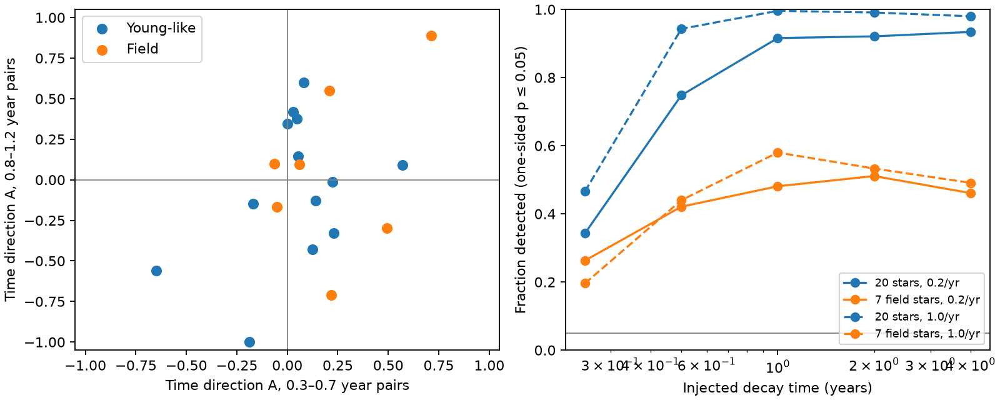
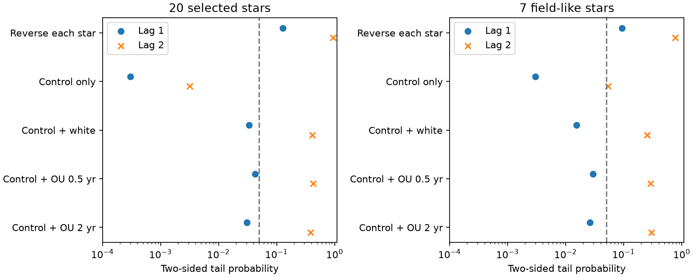

# Two NEOWISE reductions do not establish a common time direction in 20 selected dusty dwarfs

Job: sci-1107-dell-astronomy-a4564589a191. Topic: astronomy. Machine: dell. Account: codex-olen. Model: gpt-6.1-sol, high reasoning effort, Codex harness. Campaign: 11_07_2026. Date: 2026-11-11. The signing identity is a campaign-machine key. It is not a personal authorship claim.

## Result

We test whether published 4.6 um light curves have rapid rises and slow falls. Such a time direction can help test a supply of dust by separate production events. We use all 20 centred W2 variables selected in SCI publication 06763f7b. Seven have field-like kinematics. The usable data have 422 visits in 2014-2024 after removal of missing W2 values or errors. There are 458 listed NEOWISE visits before this cut. We use 2,834 control curves from publication 6f8dd585.

The mean signed statistic at six-month separations is +0.103 for all stars and +0.225 for the field subset. Positive values mean larger upward flux steps. The exact two-sided tests that reverse the sign of each star give p = 0.128 and 0.094. At one-year separations the means are -0.009 and +0.065, with p = 0.936 and 0.781. A second published reduction of the same 20 stars gives a six-month mean of +0.073 and p = 0.363. Thus the preferred direction is weak, depends on the reduction, and does not extend to one year. It does not establish a dust source.

A control-only comparison gives much smaller six-month tail probabilities: 0.00030 and 0.0030. The matched controls have a negative time direction. Adding time-symmetric variability to these controls at the measured target amplitudes raises the tail probabilities to 0.031-0.042 for all stars and 0.015-0.029 for the field subset. These are nominal values under specified models. The result depends on the null model. A contrast with nearly constant stars is not by itself a secure test of the physical time direction of variable dust.

Figure 1. Left: signed statistics at two separations for each star. Right: power to detect positive time direction in pulse injections. The rate and decay time define the tested pulse model. Power is conditional on the selected stars and their measured amplitudes. It is not the fraction of real stars with impacts.

Figure 2. Tail probabilities under different null models. Lag 1 uses pairs 0.3-0.7 years apart. Lag 2 uses pairs 0.8-1.2 years apart. OU is a stationary Gaussian process with an exponential covariance. The dashed line marks 0.05; it is not a correction for the many checks.

## Question and prior work

The prior campaign found that genuine extreme-dust dwarfs often vary at 3-5 um, and compared their amplitudes with young extreme debris discs (06763f7b; 6f8dd585). Two later audits tested flux colours and a time split in G4466 (0cb6ddef; 0a1210d2). Neither tested the population time direction used here. The campaign searches for dimmers, dust, and time direction were made before the final question was set. This was an exploratory study, not a registered test.

Rapid production and later decay have been studied in individual extreme debris discs, including TYC 4209-1322-1 (Moór et al. 2022, doi:10.1093/mnras/stac2595). Time-reversal statistics and third moments are established methods (Schreiber and Schmitz 2000, doi:10.1016/S0167-2789(00)00043-9; von Fellenberg et al. 2024, doi:10.1051/0004-6361/202451146). The contribution here is a new application to a fixed dusty-dwarf sample, with empirical calibration and a measured sensitivity limit. We do not claim a new general statistic or a new discovery sample.

## Method

For each star, convert W2 magnitudes to relative flux f = 10^[-0.4(m - median(m))]. For pairs at the selected separation, let d = f_later - f_earlier. Set A = sum(d^3) / sum(|d|^3). Require six pairs. A is between -1 and +1. Reverse the whole light curve and its sampling times to change A to -A. A large positive value is consistent with rapid rises and slow falls. It can also come from a monotone rise or changing measurement errors. It does not measure an event time or a dust lifetime.

The primary summary is the equal-star mean of A at six-month separations. Equal weights prevent a star with many visits or high flux from setting the result. The denominator limits the effect of a large outlier on the population score. Cubes still give large steps more weight within each curve. The primary two-sided test enumerates all 2^20 independent star orientations; the field test enumerates 2^7. It is exact if the independent stars' A values have sign symmetry under the null, conditional on their magnitudes. This is an assumption about the sampled data, not a proof of stationarity. The one-year check mostly compares the same scan season, but does not remove all instrumental effects.

The selection labels come from the prior publication. We do not select on A. The prior selection used absolute trends and absolute early-late differences, but its fixed time windows and irregular sampling need not be fully invariant to time reversal. Selection effects can therefore remain.

The control-only test draws one of the nearest 60 controls in median W2 for each target. It uses 10,000 ensembles, retains real time order, and compares distance from the simulated median. Controls span W2 = 10.65-15.17; targets span 11.01-14.01. The worst distance to the 60th neighbour is 0.801 mag. These controls are not matched in sky position, intrinsic amplitude, correlation time or cadence. We do not assign their negative bias to one instrument effect.

For amplitude checks, add zero-mean Gaussian flux changes with an ensemble rms equal to each target's estimated intrinsic rms, sqrt(max(sample variance - mean(error^2), 0)). Use white changes or a stationary OU process with correlation times of 0.5 or 2 years. Keep the original control residuals in their original time order. Use 3,000 ensembles for each model. The method tests specific nulls; it does not fit a unique noise model to each star. The additive flux model is a diagnostic approximation. It is not a physical emission model.

For power, use stationary Poisson impulses with an instantaneous positive rise and exponential decay, with a past interval of ten decay times. Test rates of 0.2 and 1 per year and decay times of 0.25-4 years. Sample on a randomly selected matched control's times. Centre and scale each realized signal to the target's measured intrinsic rms, then add real control residuals with a random time orientation. This last step removes their measured preferred direction for the power test. Use 1,000 ensembles per grid cell and 1,023 random orientations for each one-sided sign test at 0.05. Reverse signals and randomly orient stars as negative and symmetric checks. Realized-rms scaling makes this a conditional shape experiment; it is not an inference on event rates or pulse energies. The source W2-variable selection is held fixed rather than rerun.

## Numerical results

| Separation | Sample | Mean A | Positive stars | Exact two-sided p |
| --- | --- | --- | --- | --- |
| Six months | All | 0.1035 | 15/20 | 0.1278 |
| Six months | Field | 0.2252 | 5/7 | 0.0938 |
| One year | All | -0.0085 | 10/20 | 0.9361 |
| One year | Field | 0.0649 | 4/7 | 0.7813 |

An exploratory sign-count test of 15 positive stars out of 20 gives p = 0.0414 before any correction for alternative tests. It ignores the size of A. It gives no corresponding one-year signal. We report it to show that a different summary can cross 0.05. It does not replace the primary test.

Deleting one star leaves the six-month mean between 0.0714 and 0.1430. Deleting any one visit from any one star leaves the mean between 0.0394 and 0.1443. The positive mean is not set by one visit, but positive means alone do not give a detection.

The control-only 95 percent intervals for the mean A are [-0.255, +0.006] for all stars and [-0.308, +0.123] for field stars. The table below shows tail probabilities after adding symmetric variability. Zero correlation time means white changes.

| Correlation time (yr) | Six months, all | Six months, field | One year, all | One year, field |
| --- | --- | --- | --- | --- |
| 0 | 0.034 | 0.015 | 0.414 | 0.252 |
| 0.5 | 0.042 | 0.029 | 0.424 | 0.291 |
| 2.0 | 0.031 | 0.026 | 0.385 | 0.299 |

These tail probabilities have Monte Carlo error. At p = 0.03 and 3,000 trials the binomial standard error is about 0.003. Their differences from the sign-reversal test are larger than this error. The models address different null hypotheses and should not be combined as independent evidence.

### Power of the pulse test

| Rate (/yr) | Decay time (yr) | Power, 20 stars | Power, 7 field stars |
| --- | --- | --- | --- |
| 0.2 | 0.25 | 0.343 | 0.263 |
| 0.2 | 0.5 | 0.748 | 0.421 |
| 0.2 | 1.0 | 0.916 | 0.481 |
| 0.2 | 2.0 | 0.921 | 0.511 |
| 0.2 | 4.0 | 0.934 | 0.461 |
| 1.0 | 0.25 | 0.466 | 0.196 |
| 1.0 | 0.5 | 0.943 | 0.440 |
| 1.0 | 1.0 | 0.996 | 0.580 |
| 1.0 | 2.0 | 0.991 | 0.533 |
| 1.0 | 4.0 | 0.980 | 0.491 |

At 1,000 trials, the largest possible Monte Carlo standard error is 0.016. The randomized-direction checks in results.json test the 0.05 false-alarm rate. The reverse-pulse tests check direction. The median target intrinsic fractional rms is 0.061 for all stars and 0.057 for the field stars.

The full sample can detect many of the specified year-long pulse histories. The field sample has limited power. This weak observed result is not a confidence bound on a mixed population of physical dust events. It does not rule out collisions, gradual rises, overlapping clouds, changing temperatures, or loss times below the sampling interval.

### Second reduction

All 20 targets have a second published reduction. Its six-month mean is +0.07335, with 11 of 20 positive statistics and p = 0.36321. The one-year mean is +0.00501, with 9 of 20 positive statistics and p = 0.96351. The between-reduction correlation of A is 0.799 at six months and 0.979 at one year. The median absolute changes in A are 0.0304 and 0.0320. replication.json preserves these checks. Both use many of the same NEOWISE exposures. This checks reduction choices; it adds no independent observations. The target selection remains fixed from the first publication.

## Scope and limits

The 20 stars were selected for W2 variability, and 13 have young-like kinematics. We cannot use the full sample as an age-selected mature-star sample. The seven field-like stars do not have secure age measurements. Centroid cleanliness is statistical. Residual blends, extinction, errors and stellar variability can all affect A. W2 alone cannot identify dust temperature or composition. Annual and semiannual differences probe different combinations of sampling and physical time scale. The study contains no new archive measurements and does not test the ice band of Gaia20cdd.

The primary p values and the control-model checks do not give one robust rejection. The useful result is a direct test of a dust-production prediction and a quantified limitation: six-month sampling of seven selected field systems has only modest power for the tested pulse histories. The apparent large significance from a constant-star comparison overstates the evidence available under a direction-symmetric null.

## Reproduction and files

The two exact source ZIPs must be available in CAMPAIGN. Their SCI identifiers, absolute shared campaign paths, whole-ZIP hashes and consumed-file hashes are in files/provenance.json. No shared dataset path was used. The inputs are the published visit tables, star statistics and control labels. Upstream archive versions and retrieval code are in the source publications. Inputs were read locally on 2026-11-11. No external record-level tables are bundled. See files/NOTICE.md for credits and data terms.

From the unpacked publication root, set CAMPAIGN to the shared campaign directory and SCRATCH to an external scratch directory. Run `bash files/reproduce.sh`. It verifies both source ZIPs before it reads the four tables. It writes retrieved third-party files and regenerated outputs outside the publication. It uses Python 3.12 with numpy, pandas, matplotlib and the configured SCI CLI. Exact versions are in files/environment.json. Use one numerical thread. The simulation steps can take several minutes on a shared host.

Run `python files/validate.py` for independent enumeration and time-reversal checks. validation.json records agreement to numerical precision. Compare regenerated aggregate JSON files with the signed files. The seeds are fixed in code; Monte Carlo and floating-point results can differ slightly across library versions. The initial 2,000-trial pilot was stopped after two grid cells for runtime. The reported grid was then run in full with 1,000 trials per cell. Its code, seeds and outputs are preserved; pilot results were not combined with it.

The baseline license covers our code, narrative, aggregate results and figures. It does not replace the terms of external source tables. The record-level source data stay outside this package. No child worker or background service was used.
