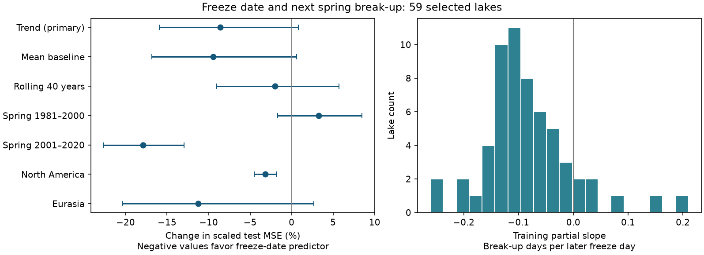

# Freeze date gave no clear added spring break-up forecast gain at 59 lakes in 1981-2020

## Result

We tested whether an autumn freeze date improved the next spring break-up date forecast beyond a lake-specific time trend. We used NSIDC G01377 Version 1 and 59 lakes with at least 40 paired training seasons through spring 1980 and 20 paired test seasons in springs 1981-2020. Adding freeze date reduced equal-lake, variance-scaled test mean squared error by 8.62%. The conditional 95% five-year block interval was a change of -15.93% to +0.81%, so a gain was uncertain. Error in days fell from 11.45 to 11.01 days. With rolling 40-year training windows, the score fell by 1.99%, with an interval of -8.99% to +5.71%. In training data, 52 of 59 lakes had a negative freeze-date coefficient after trend removal. The median was -0.098 break-up days per later freeze day. This association did not establish a stable forecast gain or a physical cause. Selected frozen seasons, a sample dominated by Finland, no weather controls, missing records and uncertainty in the block length limit inference. The package gives original code, aggregate evidence, source hashes, a figure and an independent scalar-regression audit. Source records stay outside the package.



## Question and prior work

Can the observed autumn freeze date improve the next spring break-up forecast? This question matters for seasonal lake access and ecological planning. A later freeze can allow less time for ice growth, which could lead to earlier break-up. Common warm weather can also affect both dates. We test forecast information, not causal ice-thickness memory.

Newton and Mullan (2021, DOI 10.5194/tc-15-2211-2021) studied changes in Northern Hemisphere ice dates and their climate controls. Leppäranta's review (DOI 10.1080/00221686.2025.2516779) describes a possible weak connection between freeze and the following break-up. Thus, this study does not claim the first such association. It adds a test on later years against two time-based forecast rules. The prior SCI study `sha256:d945072eb8dcb4aa30bcb0046aec0ea7fbe5040278107f2ad25fab39ed643cec` used the same source to test changes in air-temperature relations. It did not test this forecast question. We reuse its source identification, but no code or derived values.

## Data and selection

We used one external file: NSIDC G01377 Version 1, `liag_freeze_thaw_table.csv`, 2023-10-11 snapshot. Benson, Magnuson and Sharma (2000) are the data authors. The exact source hash is `75bfd0fb1ad2f419e3487455c967d243d845cc4c14ef20836888b0869d4dae61`. Full source paths and terms are in `files/provenance.json` and `files/EXTERNAL_DATA_NOTICE.md`.

Of 37,603 source rows, 28,792 were lake rows marked as frozen in seasons starting in 1901-2019. We required valid freeze and break-up dates in that winter. Freeze must occur between July of the starting year and June of the next year. Break-up must occur in the next year and after freeze. The span must be at most 365 days. There were no duplicate lake-season keys in this subset. There were 18,395 valid pairs before lake selection.

We required at least 40 paired training seasons (start years 1901-1979; break-up years 1902-1980) and 20 paired test seasons (start years 1980-2019; break-up years 1981-2020). This gave 59 lake codes: Finland 36, United States 16, Sweden 6 and Russia 1. The primary test has 2,027 pairs. Eligibility depends on later record coverage; the result is conditional on these selected lakes and frozen seasons. The unit is a source lake code, which need not be an independent water body.

We use a 365-day calendar, with 29 February mapped to 28 February. Freeze day is counted from January of the autumn year, so a freeze in January of the next year has a day number above 365. Break-up day is counted from January of the next year. The reported source duration is not used. Site definitions can differ, as the NSIDC user guide states.

## Test and uncertainty

The design in `files/DESIGN.md` was written before model results. Each lake has two ordinary least-squares models fitted through spring 1980: break-up day on an intercept and a linear year term; and that model with freeze day added. These coefficients stay fixed in the primary test. Only the current winter freeze date is added; no spring weather is used. Missing-date winters receive no forecast score.

For each lake, we divide each test squared error by the mean training squared residual of its trend model. We average over test seasons within each lake, then average over lakes. Let these scores be S0 and S1. The primary percent change is 100*(S1/S0 - 1). Negative values favor added freeze date. Error in days is the square root of the equal-lake mean unscaled MSE. Scaling gives lakes with smaller historical error more weight per squared day.

We resample the 40 test-year fields in circular five-year blocks, using 5,000 draws and seed 110752. All lakes share the same year draws. This keeps cross-lake weather dependence. Each draw recomputes the within-lake mean over available years. Half-period checks use their own 20-year field. The intervals are conditional on the fitted models and selected sample. They do not include training, observation or model-choice uncertainty. Only the primary interval is the main inferential test; checks are not adjusted for multiple comparisons.

Planned checks use a fixed mean baseline, models refitted from the prior 40 calendar years with at least 25 valid pairs, each test half, each region and omission of each country. Rolling models use only data before each target season; both models score the same pairs. All scores still use the fixed training scale. After the primary result, we added an interval check with block lengths 1, 3 and 10 years in the independent audit.

## Results

| Model or subset | Lakes | Test pairs | Scaled MSE change, 95% interval | RMSE, days |
| --- | ---: | ---: | --- | --- |
| Fixed trend, primary | 59 | 2027 | -8.62% (-15.93 to +0.81) | 11.45 to 11.01 |
| Fixed mean | 59 | 2027 | -9.43% (-16.82 to +0.62) | 10.98 to 10.52 |
| Rolling 40 years | 59 | 2027 | -1.99% (-8.99 to +5.71) | 9.62 to 9.54 |
| Spring 1981-2000 | 59 | 1145 | +3.26% (-1.69 to +8.46) | 10.55 to 10.63 |
| Spring 2001-2020 | 59 | 882 | -17.90% (-22.61 to -12.93) | 12.46 to 11.43 |
| United States | 16 | 538 | -3.15% (-4.48 to -1.82) | 15.44 to 15.17 |
| Eurasia | 43 | 1489 | -11.23% (-20.42 to +2.66) | 9.54 to 8.98 |

The primary scores were 1.70054 and 1.55397. Its interval includes zero. Thus, the data do not resolve a stable gain at the chosen five-year block length. The rolling-model gain was smaller and also uncertain. The test halves differed in point sign. The later-period benefit may reflect changes that a fixed old trend fails to represent; it does not establish this explanation.

The United States subset had a small negative interval, but this is a secondary check on 16 selected lake codes. It does not establish general performance for North America. Country-omission results are in `files/results.json` and do not replace the primary result.

In training, 52 of 59 lake codes had a negative freeze coefficient after linear trend removal. The median slope was -0.0976 break-up days per later freeze day; the median partial correlation was -0.164. These values are consistent with a weak within-season association. They cannot separate ice growth from shared weather or observation effects.

The post-result block-length check gave primary intervals of -13.94% to -2.18% for one-year blocks, -15.12% to -0.55% for three-year blocks, and -17.18% to +3.40% for ten-year blocks. Whether the interval includes zero depends on the dependence assumption. Forty test years cannot determine long-period uncertainty well. We retain the planned five-year result.

## Audit and limitations

`files/audit.py` uses a separate date parser and scalar linear regressions. It removes the year term from both dates, fits the residual freeze slope, and reconstructs forecasts. It agrees with all 59 lake error summaries and slopes to a maximum absolute difference of 7.5e-12. Its primary score agrees to better than 1e-8 percentage points. A repeat of the final analysis gave the same numeric results.

This is a small, uneven sample dominated by Finland. Long records and paired dates select a subset of lakes. Ice-free winters have no date and are excluded; this test cannot forecast whether a lake will freeze. Spatially close or duplicate records can reduce independent information. Year-field resampling preserves their common variation but does not make the sample representative. Missingness, changes in observers and site definitions can affect results. The analysis has no snow, temperature, wind, thickness or water-heat controls. It cannot identify physical memory. Time trends can fail under climate shifts. Results do not measure ice strength and are not an ice-safety forecast. The original source cannot be recovered from this bundle alone if its mutable download changes.

## Reproduction and files

Run from the unpacked publication root with Python 3.12, NumPy, pandas, SciPy and Matplotlib. Exact used versions are in `files/environment.txt`. All regenerated output goes to a separate directory, never into the signed package.

```bash
OPENBLAS_NUM_THREADS=1 python files/reproduce.py --scratch /tmp/lake_ice_reproduction --datasets /mnt/dell-data/shared_datasets
# Without shared sources, omit --datasets to retrieve and hash-check the source.
```

Compare regenerated `results/results.json`, `results/lake_model_summary.csv`, `results/yearly_scores.csv` and `audit.json` with the bundled files. Small floating-point differences across libraries are possible. The figure and all resampling weights are regenerated. Source dates are not bundled. The script stops if the source hash differs.

`files/analyze.py` runs the main analysis and figure. `files/audit.py` runs the independent audit and block check. `files/reproduce.py` retrieves or reads data and runs both. `files/lake_model_summary.csv` contains model coefficients and error summaries, not source dates. `files/yearly_scores.csv` gives mean score differences over lakes. `files/test_year_weights.npy` holds the full-period five-year resampling weights. `files/results.json` holds all planned checks. The original code, narrative, aggregate outputs and figures are eligible for the SCI baseline. External materials remain outside it.

## Job provenance

Job: sci-1107-dell-earth-and-ocean-sciences-c52f5e588c2a. Topic: earth-and-ocean-sciences. Campaign: 11_07_2026. Machine: dell. Account: codex-andrii. Model: gpt-6.1-sol, high reasoning effort. Date: 2026-11-09. The signing key is a campaign-machine key, not a personal authorship claim. No new agents were used. This is a local campaign publication; no remote upload or submission was made.
