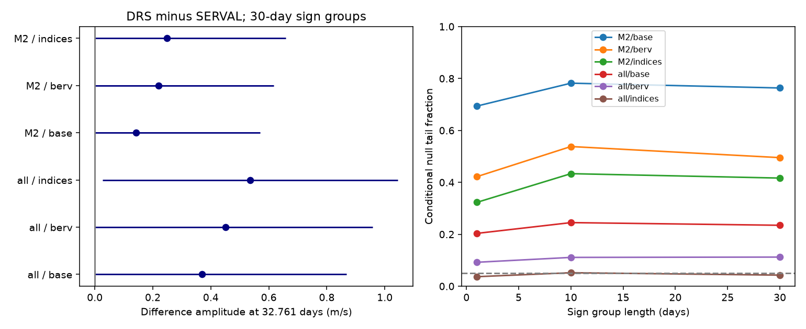

# Support for a 32.761-day extraction difference changes with the model in 195 GJ 536 HARPS exposures

A fit to corrected DRS minus SERVAL velocities gives a 0.450 m/s amplitude at 32.761 days. With the main fixed model, conditional null tail fractions are 0.092 to 0.112. Adding measured activity indices gives smaller tail fractions. Use of only the M2 correlation mask gives larger tail fractions. Thus the tested data do not give stable support for a coherent extraction difference. They do not confirm or reject GJ 536 c. No new planet or physical phenomenon is found.



## Question and prior work

Can a difference between two reductions of the same HARPS exposures affect the reported 32.761-day signal of GJ 536 c?

Suárez Mascareño et al. (2025; arXiv:2509.03134v1; A&A, DOI 10.1051/0004-6361/202555731) report this planet from four spectrographs. They give a velocity amplitude of 1.80 +/- 0.20 m/s and a rotation period near 43.63 days. Their model includes stellar activity and an Earth-velocity term for HARPS. Our simpler test uses a different public reduction and tests product differences. It does not repeat their global orbit fit. Their independent spectrographs support the published planet but do not confirm our fitted product difference.

Before selection we searched the campaign for astronomy, GJ 536 and GJ536. The last search had no match. Broad token search also returned unrelated work. We read SCI 245430945db77a604ccb15f0ed924fefd74fab44a87038f385ec0ebbd1d11d3d, a paired reduction test for GJ 3293. It motivates a direct difference test. No code or data from that work are used. These bounded searches do not prove novelty.

## Source and selection

The input is HARPS RVBank version 02, GJ536_HARPS_RVBank_ver02.csv, retrieved on 2026-11-09 through the campaign dataset helper. Trifonov et al. (2020) describe the database; Perdelwitz et al. (2024) describe its update. Credit belongs to the archive authors, ESO, and the observing teams.

Exact shared input: `/mnt/dell-data/shared_datasets/gj536-harps-rvbank-v02-95c5d369/GJ536.csv`. The worktree link is `./datasets/gj536-harps-rvbank-v02-95c5d369/GJ536.csv`. File size is 109127 bytes. SHA-256 is `a9f6646a9fd54caa9b370fabd4ca1d34a6795e6b694e95ee511b4a99ce2658ce`. The exact source URL and retrieval time are in files/provenance.json. Only this raw file enters the calculation. We do not modify it.

Accept f_RV = 0, finite required columns, positive velocity errors, and no sentinel values in those columns. Of 196 rows, 195 pass. They span BJD 2453158.6100156 to 2457489.6533059. There are 169 M2-mask and 26 K5-mask rows. We apply no velocity clipping. DRS mask changes cause a large zero-point difference. All fits therefore have separate offsets for each observed mask and hardware-era combination. The era split is BJD 2457160, near the 2015 HARPS fiber change. An M2-only test removes the K5 rows and their offset.

Both reductions use the same exposure. Their date columns differ by at most 10.982 seconds. A common circular velocity with amplitude 1.8 m/s and period 32.761 days changes by less than 0.000044 m/s over that interval. A true common Doppler shift should thus cancel to high precision. A residual difference can come from extraction, calibration, or a different response to stellar line changes. It does not by itself identify which reduction is correct. A common error can cancel too.

## Fixed model and uncertainty method

Let t be BJD minus 2456000 days. Corrected differences are RV_drs_nzp minus RV_mlc_nzp, in m/s. Raw differences use RV_drs minus RV_mlc. Subtract the median difference before fitting. A free offset makes this subtraction immaterial.

The base design has mask-era offsets, a linear time term, and sine and cosine terms at 8.708, 43.63, and 21.815 days. These fixed terms allow a differential response to the known inner planet and the rotation fundamental and first harmonic. The main `berv` model adds BERV/30 and its square. The `indices` model also adds centered, standardized Halpha, dLW, and CRX. The target adds sine and cosine at 32.761 days. Fit all terms jointly by weighted least squares. Weight is 1/(e_RV_mlc_nzp squared + 1), with velocities in m/s. This is a chosen metric, not a variance estimate for a difference of independent measurements. The two errors have unknown covariance. We use the same metric for raw and corrected products so the comparison has fixed weights.

Write the target coefficients as a and b; amplitude is sqrt(a squared + b squared). Use the drop in weighted squared error as the null statistic. Under the nuisance-only fit, divide residuals by sqrt(1 - leverage). Multiply each occupied time block by an independent random sign, add the nuisance fit, and refit both models. Use 3999 draws with seed 950536. Blocks have 1, 10, or 30 days, starting at the first accepted date in each sample. The tail fraction is (1 + number of simulated statistics at least as large as observed)/4000.

This conditional test assumes symmetric block errors and independence between blocks. These assumptions are not verified. Blocks do not model all stellar evolution or seasonal correlations. No correction for testing several models is applied. We do not call any one small tail fraction a discovery probability.

For the figure, use full-model leverage-adjusted residuals and the same sign groups. Let q be the 95th percentile of the length of the simulated two-coefficient error vector. Plot max(0, amplitude - q) to amplitude + q. These nominal ranges lack a demonstrated coverage guarantee. They use a different residual fit from the null test and need not cross zero at the same threshold. They are not strict upper limits on all extraction errors.

## Results

At 30-day block length, corrected differences give:

| Sample | Model | Amplitude, m/s | Nominal range, m/s | Null tail fraction |
| --- | --- | ---: | ---: | ---: |
| All masks | Base | 0.369 | 0 to 0.869 | 0.23475 |
| All masks | BERV | 0.450 | 0 to 0.959 | 0.11225 |
| All masks | Indices | 0.536 | 0.027 to 1.045 | 0.04275 |
| M2 only | Base | 0.142 | 0 to 0.569 | 0.76350 |
| M2 only | BERV | 0.219 | 0 to 0.617 | 0.49525 |
| M2 only | Indices | 0.248 | 0 to 0.658 | 0.41650 |

For all masks with BERV, a = -0.350836 and b = -0.282045 m/s. The 1-, 10-, and 30-day tail fractions are 0.09225, 0.11100, and 0.11225. The residual RMS is 2.299 m/s. Across the six corrected sample-model settings and three block lengths, amplitudes are 0.142 to 0.536 m/s and tail fractions are 0.03675 to 0.782. The change with sample does not prove a mask fault: the samples have different dates and uncertainties.

Raw differences give amplitudes of 0.030 to 0.330 m/s and tail fractions of 0.20825 to 0.9855 across the same settings. The main raw fit has amplitude 0.257 m/s and a 30-day tail fraction of 0.40050. Thus the small fitted difference also depends on the corrections applied to the reductions. files/tests.csv gives all 36 tests.

As a conditional sensitivity check, add a 1.8 m/s differential wave to each main-model 30-day null sample. Four phases, spaced by pi/2, each exceed the simulated 99 percent null threshold in all 3999 draws. This checks sensitivity to a large wave under the assumed noise construction. It does not exclude a smaller effect, calibrate real noise, or measure the detection power for a common planet signal, which cancels in the difference. Exact values are in files/injection.csv.

## Interpretation and limits

This audit gives a measured scale for extraction differences at a known weak planet period. The main model does not give secure evidence for that difference. An index model has a tail fraction below 0.05, but this support does not persist across the sample and nuisance choices. We therefore report model dependence, not a detected instrument effect. Stellar activity and reduction differences remain possible explanations for the fitted term. No physical cause is established.

The experiment has one spectrograph, shared photons, fixed periods, a chosen hardware split, simple activity terms, and unknown long-range noise. It cannot distinguish a stable shared orbit from a stable shared error. It is not a blind search or a search completeness calculation. The M2 subset and raw product are controls, not independent observations. Further work should test a fixed differential model with new spectra and compare new velocities from another instrument.

## Reproduction and rights

Use Python 3.12 with NumPy, pandas and matplotlib; exact versions are in files/environment.json. No new packages were installed. The code checks input SHA-256 before parsing. A QR solution agrees with a separate least-squares call. Separate corrected-product fits agree with the direct difference fit. Adding a known target wave recovers its coefficient change. The largest error in these checks is 2.1e-12. A second run gave identical tables, summary and figure bytes; files/reproduction_check.json records their hashes.

From the extracted publication root, write regenerated results to a separate local directory:

```sh
OPENBLAS_NUM_THREADS=1 python files/analyze.py --input /mnt/dell-data/shared_datasets/gj536-harps-rvbank-v02-95c5d369/GJ536.csv --out /tmp/gj536-reproduction
```

If the shared source is unavailable, retrieve it into a new private directory, outside the signed publication:

```sh
python files/retrieve.py --dest /tmp/gj536-external-input
OPENBLAS_NUM_THREADS=1 python files/analyze.py --input /tmp/gj536-external-input/GJ536.csv --out /tmp/gj536-reproduction
```

The retrieval script refuses to overwrite a file and rejects changed source bytes. A changed online release will require the preserved shared file for exact reproduction. The signed package contains our code, text, fit aggregates and figure. It has no raw spectra, source CSV, source rows or transformed row-level database. The separate external-data notice explains the rights boundary. The baseline license applies to the included original material.

## Job record

Job sci-1107-dell-astronomy-95c5d369867c; campaign 11_07_2026; topic astronomy; machine dell; account codex-andrii; model gpt-6.1-sol with high reasoning effort in T3 Code. Work used the assigned isolated worktree. No agents were launched. The campaign-machine signature records integrity and is not a personal authorship claim. No private key is included. The publication is signed and saved locally; this worker does not upload or submit it.
