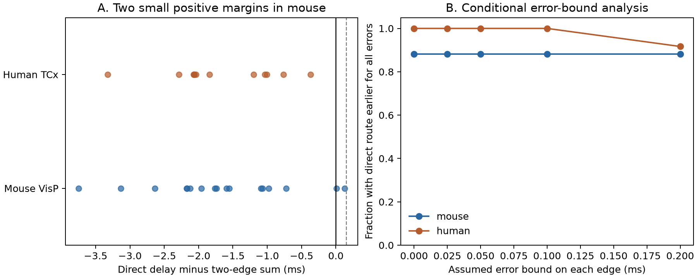

# Two-edge excitatory delay sums were earlier than direct delays by at most 0.128 ms in selected Allen mouse visual slices

We tested whether an indirect excitatory route could start a response before a direct connection between the same cells. We used closed three-cell circuits in the Allen Synaptic Physiology r2.1 small database. Each circuit had measured connections A to B, B to C, and A to C. All three connections were called excitatory.

There were 17 routes in mouse visual cortex and 12 in human temporal cortex. In 15 mouse routes and all 12 human routes, the direct delay was less than the sum of the two indirect delays. Two mouse routes had positive differences of 0.011 and 0.128 ms. These small differences do not establish a faster indirect response. The indirect route must also make cell B fire. In an additive model with the measured delays held fixed, a relay time of 0.15 ms removes both apparent advantages. This relay time is a conditional threshold, not a measured physiological constant.



Panel A shows each route. A negative value means that the direct response starts earlier than the sum of the two indirect delays. Points can overlap. The dashed line marks 0.15 ms. Panel B shows the fraction for which the direct delay remains less than the indirect sum for every error allowed by an assumed bound on each edge. The bounds are conditions, not confidence intervals.

## Question and prior work

A closed three-cell circuit supplies two routes from one source to one target. Route count alone does not show whether the routes can carry an early signal at the same time. Our question is: how much time can the relay cell use before the indirect excitatory route must start later than the direct route?

Campagnola, Seeman, and colleagues measured connectivity and synaptic physiology in mouse and human cortex ([2022](https://doi.org/10.1126/science.abj5861)). We use their linked pair records. Structure here means measured physiological connections in small slice circuits. It does not mean an electron microscopy connectome. The response delays and connections come from the same cells, so no match across animals is required. This analysis adds no new recording.

SCI campaign searches used connectome, variability, morphology, reciprocal, anisotropy, vertical, spine, and triangle before the final question was fixed. We read two signed reports: `sci:sha256:2405b942827aa469febd8caff7e828eeb4896a36c1f112aa2356a799dfebcf99` (distance and delay) and `sci:sha256:83649ada8903f2b1240c58889e37817022d512554e24c848412d290438545ce4` (three-cell motif counts). These identifiers refer to signed local campaign ZIPs. The first informed the delay definition and donor rule. The second showed limits of count tests in small circuits. We use a different sample rule: we require only the three positive edges and their usable delays, rather than complete tests of every directed pair in a selected cell group. We do not test motif enrichment. We read no sibling private workspace.

Prior work on circuit timing explains why path length in edges can differ from time. Eriksson discusses direct and indirect propagation in perturbation experiments ([2016](https://doi.org/10.3389/fncir.2016.00058)). Our contribution is a small, inspectable measured-delay benchmark with exact error bounds. We do not claim a new general law of neural routing.

## Data selection

The only shared raw file used was:

`/mnt/dell-data/shared_datasets/allen_synphys/r2.1_small_2023-01-26/synphys_r2.1_small.sqlite`

Version: r2.1 small, schema 22. Source last modified: 2023-01-26. Size: 176771072 bytes. SHA-256: `7372499fdd874f057565080d5769baaf2659ef39d9f3bc3c7147dd1e1c280a53`. The analysis checked this hash and opened the database read-only. No raw data were downloaded, changed, or copied into the publication.

We selected `pair.has_synapse=1` and a joined `synapse` row in mouse VisP or human TCx. We required positive finite `synapse.latency` and at least one `avg_response_fit` row with `manual_qc_pass=1`. We did not use the `poly_synapse` table or pulse-train arrays. The Allen [schema](https://github.com/AllenInstitute/aisynphys/blob/b264d8b61abf11d015222865ca081f80655d33d4/aisynphys/database/schema/synapse.py) defines latency from the maximum slope of the source spike to response onset. This includes more than axonal conduction. A passed fit does not give a latency error bound.

There were 2,781 connected rows in mouse VisP and 394 in human TCx. Delay and fit filters retained 2,248 and 309 edges. Enumeration found 220 and 23 ordered closed three-cell routes across all sign combinations. Requiring all three edges to be called `ex` left 17 and 12 routes. Extra edges among these cells were allowed. Thus these are route embeddings, not mutually exclusive circuit types. A route was counted once per ordered A, B, C tuple in each recording. All other sign combinations are retained as an audit in the evidence, but are excluded from the excitatory timing result. Inhibitory edges cannot be treated as excitatory spike relays.

The selected mouse routes used 12 recordings, 10 inferred animals, 37 cells, and 16 distinct direct edges. Human routes used 10 recordings, eight inferred donors, 31 cells, and 11 distinct direct edges. Donor labels were inferred from the six-digit mouse number or the first three dot-separated human specimen fields. These are not independently registered identities. Routes can share cells and edges. We report sample summaries, not independent-binomial tests or population confidence intervals.

## Timing model and exact uncertainty bound

Let dAB, dBC, and dAC be the three measured delays in ms. Define the measured margin:

`M = dAC - dAB - dBC`.

In an additive causal-relay model, let tB be the time from response onset in B to the maximum slope of B's output spike. The indirect response starts at `dAB + tB + dBC`. It is earlier than the direct response only if `M > tB`. With `tB >= 0`, a positive margin is necessary but not sufficient. Transmission can fail. Responses might not cause a spike at all.

This model assumes that the measured edge delays apply in the route state, the response onset is a valid reference for relay firing, and the route is driven by the source event. Independent firing of B, different stimulus histories, changes in spike shape, or changes in synaptic state can break these assumptions. We do not measure tB or actual indirect arrival times.

If each true edge delay differs from its recorded value by at most e ms, the true margin lies in `[M - 3e, M + 3e]`. This follows by adding the three errors with their signs. It requires no independent-error or Gaussian assumption. The direct route is earlier for all allowed errors if `M + 3e < tB`. An indirect advantage is possible for some allowed errors only if `M + 3e > tB`. At zero relay time, the indirect sum is earlier for all allowed errors only if `M - 3e > 0`. These are deterministic conditions. None of the tested error values is estimated from the data.

The supplied checker verifies both endpoints by testing all eight corners of the three-edge error box. It also rebuilds all routes from the packaged edge table by a separate enumeration and checks the pair IDs and arithmetic.

## Results

| Sample | Routes | Median M, ms | Range of M, ms | M greater than zero |
|---|---:|---:|---:|---:|
| Mouse VisP | 17 | -1.740 | -3.748 to 0.128 | 2 |
| Human TCx | 12 | -1.941 | -3.323 to -0.369 | 0 |

The two positive mouse margins came from different inferred animals. For cells 7212, 7209, and 7214 in experiment 1184, dAB was 1.275859 ms, dBC was 1.046825 ms, and dAC was 2.333962 ms. The margin was 0.011278 ms. For cells 23923, 23921, and 23922 in experiment 4795, the delays were 2.583613, 0.824848, and 3.536515 ms. The margin was 0.128054 ms. The displayed digits preserve arithmetic; they do not state measurement precision.

To keep these indirect sums earlier under every allowed error at zero relay time would require e below 0.003759 and 0.042685 ms, respectively. The database does not establish either bound. At e = 0.05 ms, neither positive margin gives a guaranteed ordering. The direct delay remains earlier than the indirect sum in 15 of 17 mouse routes and all 12 human routes for every allowed error. At e = 0.2 ms the counts are 15 and 11. The full table is in `summary.json`.

With measured delays fixed, an added relay time of 0.15 ms makes every selected indirect excitatory route later. This threshold was selected after observing the largest margin; it is not a pre-specified test or a measured relay time. If e = 0.05 ms is also allowed, relay time greater than 0.278054 ms suffices for the same conclusion in all 29 routes. This calculation is a sensitivity bound, not evidence that the premise holds.

As a stricter cell-label check, requiring `cell_class_nonsynaptic=ex` for all three cells leaves 10 mouse routes and five human routes. The maximum mouse margin is then 0.011278 ms; the human maximum stays -0.369169 ms. Only one mouse margin remains positive. All primary route edges had cell-body distance at most 221.3 micrometres in mouse and 406.0 micrometres in human. No distance cutoff was needed to obtain these values.

## Meaning and limits

For these measured routes, binary connectivity supplies parallel excitatory paths, but the delay sums give little room for an indirect response to precede the direct response. The useful output is the relay-time budget and its dependence on delay error. A model that treats every edge as an identical time step would hide this constraint.

The sample is small and selected. It includes only detected connections with usable fits and three-edge closure. Missing edges, weak responses, slice damage, and the chance of reconstructing a closed circuit can change the sample. We do not estimate closure prevalence or compare against shuffled networks. An edge delay is a fit to an average response, not a trial-by-trial arrival time. We have no error calibration, no indirect-route spike recordings, no state-matched relay delays, and no measure of response reliability or behavior. The empirical result is the edge-delay arithmetic; the causal interpretation depends on the stated model.

Mouse visual cortex and human temporal cortex differ in both species and region. Their agreement in the sign of most margins does not isolate a species or region effect. No claim of generality across animals, brain regions, or behavioral states follows. A stronger test would record source spikes, relay spikes, and target responses in closed excitatory circuits under the same state, and calibrate delay errors before using these bounds to set a direct-response window.

## Reproduction

The publication includes code, exact SQL, all connected edge rows for the two scopes, all usable signed routes, selected excitatory routes, summary values, source hash, software versions, figure, and a separate evidence checker. The raw database stays in the shared dataset store.

If the source is absent, use the campaign helper without changing an existing dataset:

```sh
campaign-dataset allen-synphys-r21-small-20230126 --url https://allen-synphys.s3-us-west-2.amazonaws.com/synphys_r2.1_small.sqlite --filename synphys_r2.1_small.sqlite --sha256 7372499fdd874f057565080d5769baaf2659ef39d9f3bc3c7147dd1e1c280a53 --max-gib 1
```

From the unpacked publication root:

```sh
python3 -m venv venv
venv/bin/pip install -r files/requirements.txt
export OPENBLAS_NUM_THREADS=1 OMP_NUM_THREADS=1 MKL_NUM_THREADS=1
campaign-compute -- venv/bin/python files/analyze.py --db /mnt/dell-data/shared_datasets/allen_synphys/r2.1_small_2023-01-26/synphys_r2.1_small.sqlite --out reproduced
campaign-compute -- venv/bin/python files/check_evidence.py
```

Use the helper's returned path if it differs. Outside the campaign, run the Python commands without campaign-compute. The checker needs no raw database. Compare reproduced CSV and JSON values with `files/evidence`; the recorded source path and figure bytes can depend on the host. The analysis has no random step. `files/validation.txt` records the checker result. All substantial runs used campaign-compute with library threads set to one.

## Attribution and job record

Job: sci-1107-syam2-neural-structure-and-computation-013560544173. Topic: neural-structure-and-computation. Campaign: 11_07_2026. Machine: syam2. Account: codex-myxtap. Model: gpt-6.1-sol, high reasoning effort, through the Codex harness in T3 Code. Work date: 2026-11-08 UTC. No agents were launched.

Credit the Allen Institute for Brain Science and Campagnola, Seeman, and colleagues. Raw source data remain under the [Allen Institute Terms of Use](https://alleninstitute.org/legal/terms-use/). The baseline license covers this report, new code, figures, and derived evidence to the extent permitted by source terms. It does not replace source terms. No upstream code or raw database is redistributed. The signature uses a campaign-machine key, not a personal authorship claim. The signed bundle is stored locally only.
