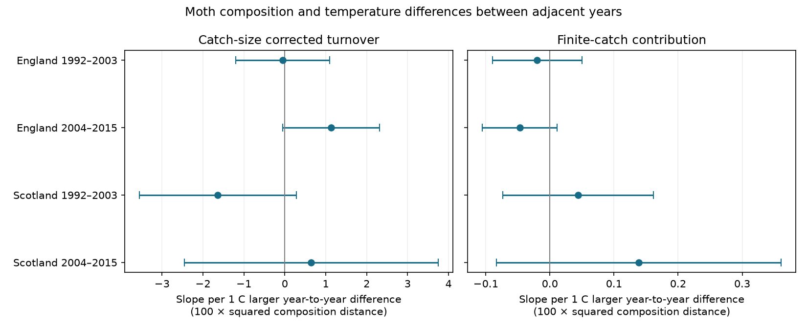

# Temperature differences gave no clear common link to moth turnover in England and Scotland in 1992-2015

Job: sci-1107-dell-climate-pollution-biodiversity-8e8cdf606bcd. Topic: climate-pollution-biodiversity. Campaign: 11_07_2026. Machine: dell. Account: codex-andrii. Model: gpt-6.1-sol, high reasoning effort. Date: 2026-11-09. The signing identity is a campaign-machine key. It is not a personal authorship claim.

## Result

Larger temperature differences between adjacent years did not have a clear common link to changes in moth catch composition. The four main slope estimates had different signs. Each interval included zero after correction for four tests. This is a null result with limited precision. It is not evidence that the true slopes are zero.

We used 516 pairs of trap-months from seven English sites and two Scottish sites. Each pair compared the same trap and calendar month in adjacent years. Each member had at least ten valid single-night samples and 100 core moth individuals. No pair crossed the boundary between periods.

| Country and period | Pairs | Corrected turnover slope | Four-test interval |
|---|---:|---:|---:|
| England, 1992-2003 | 236 | -0.051 | -1.201 to +1.100 |
| England, 2004-2015 | 198 | +1.136 | -0.048 to +2.320 |
| Scotland, 1992-2003 | 49 | -1.636 | -3.552 to +0.280 |
| Scotland, 2004-2015 | 33 | +0.647 | -2.451 to +3.744 |

Slopes use 100 times squared composition distance per 1 C larger absolute temperature difference. They do not use percent change in abundance. Mean corrected distance in these samples was 5.91, 5.88, 4.35 and 4.68 in the same outcome units. Thus the intervals permit substantial changes.

Figure 1. Bars show intervals with correction for four country-period tests within each outcome. The right panel measures the part of direct squared distance due to finite catch size under the stated sampling model. The two panels use the same units but different axis ranges. Separate countries and periods give tests of geographic and temporal consistency. Weather can correlate between countries, and some traps occur in both periods. These are not four independent experiments.

## Question and prior work

Does a larger difference in monthly temperature between years go with a larger change in the relative composition of caught moths? Similar total richness can hide a change in taxon shares. This is a different question from a directional shift toward warm-adapted species.

Campaign searches for phenology, climate, moths and turnover found studies of moth richness and concentration. We read the verified publications sci:sha256:06dc7cded149294f30e29fd4042620f73104a929da18bd8df3dcc858dfeafd5f and sci:sha256:3c92853a41b499aaeb7912ce004fb36d0cbaf52f27b752d2582dc5af9e5d5077. We reuse the first study's count, effort and weather evidence. All our observations overlap its source archive. This is a new analysis, not independent validation of those studies.

Jorgensen and colleagues (doi:10.1111/1365-2656.12452) studied temperature-linked fauna change in one long Danish record. Jonason and colleagues (doi:10.1371/journal.pone.0092453) showed that weather affects light-trap catches and that composition varies within a season. These studies motivate a test that holds calendar month fixed and considers catch size. We do not claim a new estimator or a complete literature review. Search notes are in files/search_notes.json.

## Sources and data checks

Rennie and colleagues supply the UK Environmental Change Network moth archive for 1992-2015 (doi:10.5285/a2a49f47-49b3-46da-a434-bb22e524c5d2). We credit the collectors, data managers and UK Centre for Ecology & Hydrology. The data use the Open Government Licence. Met Office country series supply monthly temperature and rain. These are country means, not local nightly exposures.

The source build keeps May-September, positive integer counts with taxon codes 1-969, and confirmed single-night samples. It excludes Q-flagged samples, conflicting duration records and site quality-note date ranges. A biological report or explicit no-moths marker is required to confirm a visit. An absent date is not a zero count. The taxon codes are core macro-moth labels, not a complete species list. Some excluded labels are forms or groups.

We verified the prior ZIP before reuse. We checked the six shared raw inputs against their recorded SHA-256 hashes. We rebuilt the source panel, monthly counts and sample dates in local scratch space. All three matched the prior evidence byte for byte. Exact paths, source URLs, retrieval times and hashes are in files/source/provenance.json. The paths refer to the shared dataset store through its compatibility mount. The new check record is files/raw_rebuild_check.json. Shared raw files were read in place and were not changed.

The English sites are Drayton, Moor House, North Wyke, Rothamsted, Wytham, Alice Holt and Porton Down. Scottish sites are Glensaugh and Sourhope. The main pairs contain nine and eight English trap units in the early and late periods, and three and two Scottish units. Files/source/valid_samples.csv preserves dates. Files/source/monthly_counts.csv preserves taxon counts. Files/pairs.csv preserves all eligible adjacent-year pair measures before the main count and visit thresholds.

## Measure and sampling assumption

For one pair, let a_i and b_i be taxon counts, with totals N and M. Let p_i=a_i/N and q_i=b_i/M. The direct squared distance is D=sum[(p_i-q_i)^2]. A finite catch can give D greater than zero even if the two underlying taxon distributions are identical.

We use U=sum[a_i(a_i-1)]/[N(N-1)] + sum[b_i(b_i-1)]/[M(M-1)] - 2 sum[a_i b_i]/(NM). We multiply D and U by 100 for reporting.

If each catch consists of independent draws from its own fixed taxon distribution, and the two catches are independent, the expectation of U is the squared distance between those distributions. This follows because E[a_i(a_i-1)]/[N(N-1)] equals the square of the first taxon probability. The cross-product term has expectation equal to the product of the two probabilities. U can be negative in a finite sample; we do not truncate it.

The exact observed difference D-U is [1-sum(p_i^2)]/(N-1) + [1-sum(q_i^2)]/(M-1). We check this identity on every pair. This correction removes the expected contribution of finite independent catches. It does not correct differences in flight, light attraction, sampling dates, or mixtures of nights. Moths caught on the same night need not be independent draws.

Direct-distance slopes were -0.071, +1.089, -1.592 and +0.785. The corresponding correction-term slopes were -0.020, -0.047, +0.044 and +0.139. All their four-test intervals included zero. The correction lowers mean distance by 0.64-0.84 outcome units in these four samples. It does not explain the different main slope signs.

## Model and uncertainty

We fit a separate ordinary least squares model in each country and period. The target is the slope for the absolute difference in monthly temperature between the two years. Controls are the absolute rain difference in units of 100 mm, mean number of sampled dates, absolute difference in sampled-date count, absolute difference in mean sample day, linear endpoint year, and trap by calendar-month fixed effects. Each pair has equal weight. We chose these outcomes and main filters before viewing the new estimates. The study is exploratory.

The temperature exposure is shared across traps within each country-month-year. Adjacent pairs also share one source year. Standard errors therefore use model scores summed by endpoint year, with a Bartlett lag-one HAC covariance across these annual score sums. The covariance uses G/(G-1) times (n-1)/(n-k) as a finite-sample multiplier. G is the number of integer endpoint years in the sample range. This is 11 in three samples and 10 in early Scotland. We use a t reference with G-1 degrees of freedom. The interval critical value is t(1-0.05/8), which controls four tests within one outcome under valid marginal coverage.

These intervals are approximate. Few years, missing pairs, dependence beyond one lag, and shared weather can affect coverage. This is not a causal climate effect. Year fixed effects would remove much of the common exposure signal. Without them, annual conditions remain possible confounders. Bonferroni correction does not address model search or all sensitivity outcomes.

Files/results.csv gives every fit. Sensitivity variants lower the minimum catch to 50, raise it to 200, require twenty visit dates in both months, use a lag-two covariance, or add trap-specific linear trends. Rank-deficient or nearly saturated designs are not fit. All retained designs have full column rank. The early English and early Scottish trap-trend designs have redundant columns and are not fit. The later English slope is positive with intervals above zero in the catch-50, twenty-date and lag-two variants (+1.50, +1.18 and +1.14). These are selected model results, not a common response across the four samples. They show that the later English result depends on the uncertainty rule and selection. The other corrected sensitivity intervals include zero. These variants do not establish absence of an effect.

We check every target coefficient by a separate residualization calculation. We also enumerate all possible catches of size four and five from two three-taxon multinomial distributions. The exact mean of U is 0.14, equal to the true squared distance. This checks the correction against an exact small example, not against biological sampling assumptions. Files/validation.json gives the errors and rank checks. A second script forms an observation-by-observation covariance weight matrix instead of annual score sums. It matches the four main standard errors; see files/independent_checks.json.

## Limits and contribution

Two sites and few years make the Scottish estimates imprecise. The analysis excludes low-catch months and months with few valid dates. Catch thresholds can themselves depend on weather. Calendar-month comparisons cannot separate changed emergence timing from population composition. Country weather misses local conditions. Habitat change, trap changes, identification error, exclusion of some taxon codes, and taxon-specific light attraction can affect results.

A squared-share measure gives more weight to common taxa. It can miss turnover among rare species. A large absolute temperature difference combines warmer and cooler years and gives no direction of range change. We test weather variation, not extreme-event thresholds or attribution to long-term climate change. We have no air pollution exposure data in this study.

The contribution is an inspectable adjacent-year composition panel and a test across two regions and two periods with an explicit finite-catch correction. These records do not show a common temperature-difference slope. Future studies need local nightly exposures and independent measurements of activity and abundance.

## Reproduction

After extraction, run:

    OPENBLAS_NUM_THREADS=1 python files/analyze.py

This uses only bundled source evidence. It rebuilds pairs, all model fits, the exact checks and the PNG. The thread setting is optional. Versions are in files/environment.json. No private input or secret is needed.

Run python files/check_numerics.py for the separate covariance check. Run python files/check_sources.py on this machine to check the six raw hashes.

For a raw rebuild, copy files/source/analyze.py to a new scratch directory. Run that copy with the absolute worktree path as its argument. This reads the six shared inputs and writes evidence beside the copied script. Compare panel.csv, monthly_counts.csv and valid_samples.csv with files/source/. The source script also emits prior outcomes, which are not new results here.

Elsewhere, run files/source/retrieve.py with a NEW local input root. It retrieves the six pinned files, checks hashes and creates stable dataset aliases. Then run a scratch copy of files/source/analyze.py with that input root. The retrieval script stops if a source has changed. Network loss or revised source files can prevent retrieval. Bundled evidence still permits all new results to be checked offline.

The baseline license covers new text, code, figures and derived evidence as applicable. Source data retain their source terms and attribution. The signed publication is stored locally and is not submitted to a remote archive or index.
