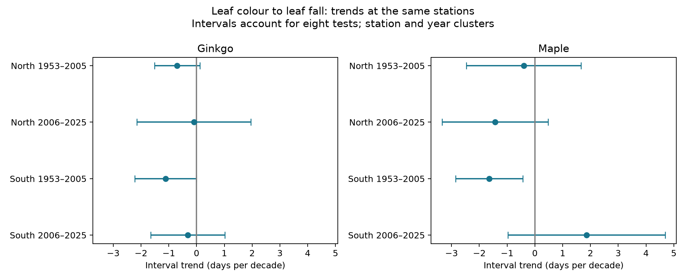

# Trends in autumn tree intervals did not show common shortening in four Japan samples in 2006-2025

We tested whether the time from leaf colour to leaf fall continued to shorten after 2005 at the same Japan stations. We used 5,233 paired records from 1953 to 2025: ginkgo at 47 stations and maple at 41 stations. Four separate species and region estimates for 2006-2025 ranged from -1.43 to +1.86 days per decade. All four intervals for uncertainty included zero after an eight-test correction across both periods. Earlier southern estimates were negative for both tree types. Observation-category controls and autumn temperature adjustment did not establish common recent shortening. The result does not show stable intervals or a causal climate effect. Selected long records, missing visit logs, specimen changes, short recent coverage and approximate cluster uncertainty limit inference. Code, paired data, source hashes, numerical checks and figures are included.

## Question and prior evidence

A later autumn colour date does not require a longer time before leaf fall. We ask whether earlier interval shortening continued after 2005 at the same monitored stations. Doi and Takahashi (2008; doi:10.1111/j.1466-8238.2008.00398.x) studied these events in Japan through 2005. Their models gave negative year slopes for the interval in both tree types. We use 2006-2025 as a separate recent period. Our station selection and model differ from theirs, so the earlier-period test is a replication in scope, not an exact reproduction.

We searched the campaign with `sci search "phenology" --in ./campaign` and `sci search "ginkgo" --in ./campaign`. We read publications a760f4dbf8854d509208c7a8cf9893d7e3f64848ea08a03cee2804c1eaa6678d and d59fde6e0c843a2c2e75a136205153ac98ac013995d48c5c9857ef5121ad53ed. These test weather links to autumn intervals. The present analysis tests trend persistence across the 2005 boundary. The source records overlap those publications. This is an exploratory follow-up, not an independent biological dataset or a registered test.

## Data and selection

We used JMA archive tables 013 to 016, decoded as CP932. They give ginkgo colour and fall dates and maple colour and fall dates. We used regular species codes 8 and 9 only. Codes 6 and 7 indicate substitute species. Code 8 marks the observatory grounds; code 9 marks a nearby site. The source remarks do not identify each specimen tree. JMA records colour when most leaves have changed colour and little green remains. It records leaf fall when about 80% have fallen. The interval is the difference between these two threshold dates. It is not the full time of senescence or a measure of carbon uptake.

We retained complete pairs from 1953 to 2025. We did not use future columns or incomplete 2026. A month-day value of zero is missing. An autumn date in January-May belongs to the next calendar year. We retained a station and tree type only if it had at least 15 complete pairs in each of 1953-2005 and 2006-2025. Thus the station set is common to both periods within each tree type. The cohort has 2,824 ginkgo pairs at 47 stations and 2,409 maple pairs at 41 stations. No selected interval is negative. Two are zero; the largest is 72 days. No interval-size filter was applied.

We matched the international station number to the NOAA ISD station history by adding 47000 to the three-digit JMA code. Where ISD has more than one entry, we use the entry with the latest end date, then latest start date. All stations with a regular-species pair had coordinates. These are approximate station coordinates, not dated specimen positions. North means latitude at or above 36 N; South means below 36 N. The groups have separate stations. Weather can remain correlated across the boundary. Stations recur across periods.

For temperature checks, we use NOAA PSL GHCN-CAMS monthly air temperature version 3.01. Data were provided by NOAA PSL, Boulder, Colorado, USA. We take the nearest 0.5-degree grid cell and form equal-month September-November (SON) and October-December (OND) means in degrees C. These fixed windows can extend beyond an event, especially at northern stations. They describe seasonal associations and cannot establish exposure before onset.

Exact shared paths, source URLs, byte counts, metadata and SHA-256 hashes are in files/provenance.json. The three shared sources are:

- /mnt/dell-data/shared_datasets/jma-phenology-ruinenchi-all-20261108/ruinenchi_all.zip
- /mnt/dell-data/shared_datasets/noaa-isd-history-20261108/isd-history.csv
- /mnt/dell-data/shared_datasets/noaa-psl-ghcncams-air-mon-mean-20261105/air.mon.mean.nc

No shared dataset was changed. Source material retains its source terms. The baseline license covers our code, text, figures and derived evidence, subject to those terms.

## Models and uncertainty

The eight primary fits are separate tree type, region and period models:

`interval = station intercept + trend * (year - 1989) / 10 + error`.

Each complete pair has equal weight. Fixed station intercepts remove constant differences among stations. They do not remove changes in specimens or reporting. We fit colour and fall separately to check which phase contributes to each interval slope. A separate within-station calculation checks each main slope. We also check the exact identity: fall trend minus colour trend equals interval trend.

We use the largest of three estimated variances: station clustering, year clustering, and two-way station and year clustering. The two-way estimate is station plus year minus their intersection. All use the statsmodels finite-sample correction with the explicit model parameter count. This variance envelope avoids an artificially small two-way result. It does not guarantee coverage under arbitrary spatial dependence. The reference is a t distribution with the smaller cluster count minus one degrees of freedom. We use Bonferroni intervals for eight primary tests: each has nominal 99.375% coverage. The nominal family coverage is 95% only under the cluster approximation. There are just 12 northern maple stations and 20 recent years.

Sensitivity fits replace the station intercept with station by colour-code by fall-code intercepts, then add SON temperature. Weather fits use station intercepts and station-specific linear trends. OND is an alternative window. Year effects and adjacent-year differences are further weather checks. These fits are diagnostic, not additional primary tests. Four secondary interaction fits compare recent with earlier slopes using separate station intercepts in each period. Their ordinary 95% intervals are exploratory and are not part of the eight-test family. A slope difference alone cannot establish an ecological cause.

## Results

| Tree | Region | Period | Pairs | Stations | Days per decade | Adjusted interval |
| --- | --- | --- | ---: | ---: | ---: | --- |
| Ginkgo | North | 1953-2005 | 774 | 18 | -0.698 | -1.518 to +0.123 |
| Ginkgo | North | 2006-2025 | 348 | 18 | -0.097 | -2.145 to +1.951 |
| Ginkgo | South | 1953-2005 | 1135 | 29 | -1.116 | -2.227 to -0.006 |
| Ginkgo | South | 2006-2025 | 567 | 29 | -0.319 | -1.650 to +1.013 |
| Maple | North | 1953-2005 | 490 | 12 | -0.400 | -2.465 to +1.665 |
| Maple | North | 2006-2025 | 238 | 12 | -1.430 | -3.335 to +0.475 |
| Maple | South | 1953-2005 | 1125 | 29 | -1.644 | -2.851 to -0.438 |
| Maple | South | 2006-2025 | 556 | 29 | +1.857 | -0.972 to +4.687 |

All four adjusted recent intervals include zero. Earlier southern estimates are negative for both tree types. The recent southern maple estimate is positive, while the recent northern maple estimate is negative. These estimates do not establish common continued shortening across the four recent samples. Wide intervals also allow meaningful shortening in each recent sample. They do not prove stable intervals, and signs alone do not prove a period difference.

With station and observation-code intercepts, recent slopes are +0.132 and -0.349 days per decade for northern and southern ginkgo, and -1.200 and +2.088 for maple. Adding SON temperature gives -0.080, -0.300, -1.372 and +1.090, respectively. All these recent diagnostic 95% intervals include zero. The controls do not establish a common recent shortening. These checks do not eliminate reporting bias or identify a temperature-mediated trend.

In the secondary period contrasts, the southern maple slope increased by 3.502 days per decade (ordinary 95% interval +1.647 to +5.357). The other three ordinary contrast intervals include zero. This points to a local change in the fitted calendar trend, not a common response or a demonstrated cause. These contrast intervals have no correction for multiple secondary tests.

The full model table, including colour and fall trends, weather fits and period contrasts, is in files/models.csv. The date-anomaly figure in files/results.png shows five-year means after station centring. It is descriptive; missing station-years still affect each annual mean. files/coverage.csv shows annual counts. files/primary_trends.csv contains the primary estimates and adjusted intervals.

## Limits and interpretation

The record describes selected monitored trees, including planted trees near weather stations. It is not a random sample of forests or community diversity. The long-record rule reduces changes in station coverage but selects surviving records. We do not model why a pair is missing. A station code can conceal tree replacement, relocation, tree age, pruning, irrigation, observer changes or changed visit frequency. Code intercepts only control recorded categories. No visit logs or dated specimen histories were available in this analysis.

Two periods have different lengths. A 20-year recent period has less information about a trend than the 53-year earlier period. A linear model can miss nonlinear changes. Weather cells are coarse, current coordinate matches can be wrong for historical trees, and climate products may share underlying station observations. The regional samples are separate, but not statistically independent in weather. The uncertainty approximation and multiple-test rule do not repair selection or measurement bias.

The tested explanation is persistence of an earlier calendar trend, with recorded category changes and seasonal warmth as limited diagnostic explanations. We do not identify air pollution effects, short weather extremes, causal climate-change effects, species distributions, or changes in biodiversity. A stronger test needs dated tree histories, visit schedules, daily weather and pollution, and an independent observation network.

## Reproduction and worker record

Read files/REPRODUCE.md. The package preserves source code, parsed events, paired records, the selected cohort, source hashes, station matches, all model estimates, numerical checks and figures. Raw data can be rebuilt from the shared snapshots. The compact panel supports offline model reproduction without the shared store. Run `python files/validate.py` after the model run and `python files/plot_trends.py` to rebuild the primary figure.

Campaign: 11_07_2026. Job: sci-1107-syam2-climate-pollution-biodiversity-3de91c99e816. Topic: climate-pollution-biodiversity. Machine: syam2. Account: codex-myxtap. Model: gpt-6.1-sol, high reasoning effort, through T3 Code and the Codex harness. Analysis date: 2026-11-08 UTC. The campaign-machine signature is not a personal authorship claim. Private keys are outside this package. The bundle is saved locally only.
