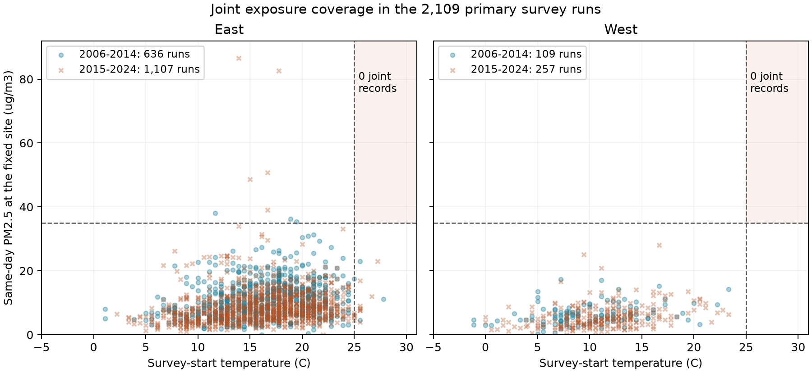
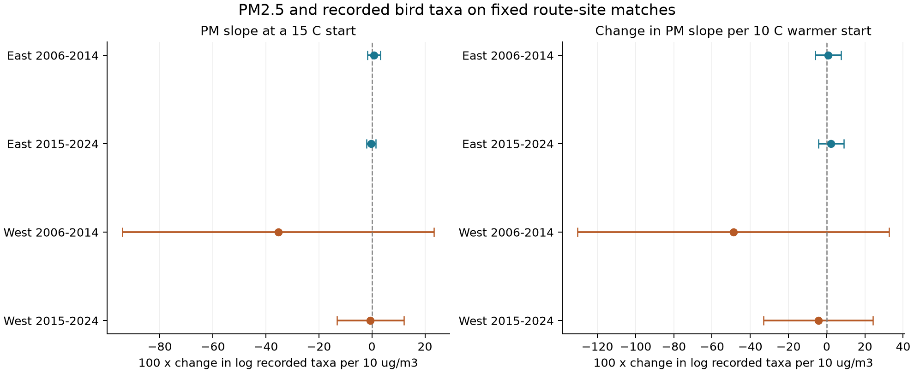
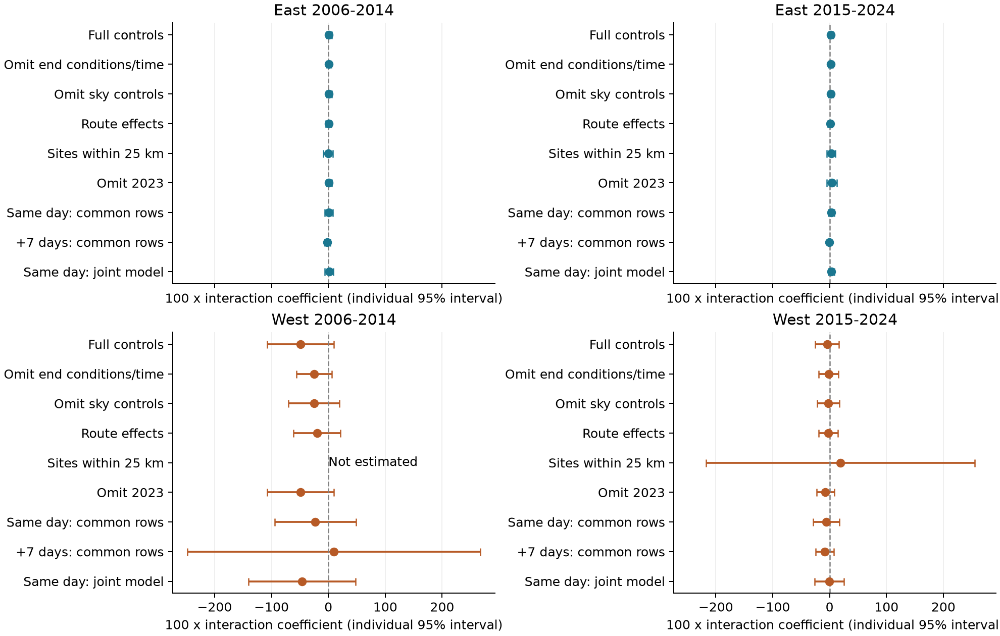

# No matched US bird survey had both a start at 25 C or more and PM2.5 above 35 ug/m3 in 2006-2024

A fixed-site match between US bird surveys and particulate pollution data gave 2,715 survey runs on 241 routes in 2006-2024. No run had both a start temperature of at least 25 C and same-day PM2.5 above 35 ug/m3. The four main models also gave no clear warmth-pollution interaction. The western models had low precision. These results show a data coverage limit. They do not show that joint extremes have no effect on birds.

We asked whether survey-start warmth changes the link between PM2.5 and the number of taxa recorded on a bird survey. Climate and pollution studies need to distinguish population change from changes in activity and observation. [Sanderfoot and Gardner (2021)](https://doi.org/10.1093/ornithapp/duab028) studied smoke and bird detection in Washington. [Robbins (1981)](https://pubs.usgs.gov/publication/5210258) described weather links to census results. These studies motivate the question. Our survey method, season, pollutant summary, and outcome differ from the Washington study.

We first searched local SCI campaign results. Lilac stage intervals had many prior tests, so we did not repeat that question. A campaign search for PM2.5 returned no publication among 676 verified or cached bundles at that time. Its output is in files/campaign_search_pm25.json. We read SCI 2603c41c, which tested seasonal ozone in related bird observations, and SCI 1342177d, which tested survey temperature and elapsed time. We use the same fixed BBS release, but new code and a new pollution match. This is not an independent survey-program replication. We copied only a verified source dictionary from SCI 1342177d. The full signed source ID and file check are in files/dictionary_retrieval.json. The plan was written before fitting and was not registered. The threshold coverage summary is descriptive.

The raw biological data are Weather.csv and Routes.csv from the [2025 BBS release, 1966-2024](https://doi.org/10.5066/P14SNUV4). We use the source TotalSpp field. The dictionary defines it as the number of recorded taxa, including some subspecific forms, hybrids, and groups. It is not a direct estimate of true species richness. We did not use species count files. The source metadata are preserved in files/bbs_dictionary.xml. The pollution data are EPA AQS parameter 88101 daily files for 2006-2024, from the shared snapshots stored on 2026-11-08. No new raw data were downloaded or added to the shared store.

Weather.csv has 141,266 records. US records in 2006-2024 give 46,693. Accepted standard first runs, with RPID 101, QualityCurrentID 1, and RunType 1, give 41,121. A contiguous-US coordinate box gives 40,067. We require dates from May 20 to July 10, a known observer, valid start and end temperatures, wind and sky codes, assistant status, and recorded taxa. We also require a start from 02:00 to 09:00 and elapsed time from 180 to 420 minutes. Temperatures must be -10 to 45 C, wind codes 0-5, sky codes 0-8, assistant status 0 or 1, and TotalSpp 1-200. This leaves 28,823 runs on 3,274 routes. There is no 2020 survey. files/selection.json and files/build_panel.py give all rules. Elapsed time includes travel and recording; it is not the time spent counting at each stop.

For each AQS physical site and local day, we retain nonnegative PM2.5 values up to 500 ug/m3 with at least 75% observation coverage. We retain event-inclusive data and reject event-excluded records. Repeated standards have no extra weight. Within an instrument and day, we prefer a block 24-hour average, then a 24-hour sample, then a daily summary of hourly samples. We take the median of unique values at that priority and then the median across instruments at a site. The source [file guide](https://aqs.epa.gov/aqsweb/airdata/FileFormats.html) explains the repeated standards and duration fields. Our median and priority rules are analysis choices, not an EPA exposure product. files/site_days.csv.gz preserves every cleaned May-July value at the selected sites. An audit rebuilt 36 site-days from three original annual files and found agreement to less than 1e-13 ug/m3.

Each route uses one fixed site. We choose the nearest eligible site within 50 km of the route start. An eligible site must have survey-day values in at least eight distinct years, with at least three in each period. Site choice uses coordinates, dates, and availability; it does not use bird counts or pollution magnitudes. We do not replace a site when a daily reading is missing. This gives 241 routes, or 7.4% of the otherwise eligible routes. These routes have 3,393 eligible runs, of which 2,715 have survey-day PM2.5. The selected site coordinates do not change in the retained daily data. This check cannot establish that all field conditions or instrument methods were stable.

We split routes at longitude -100: East is at or east of that line, and West is to its west. Periods are 2006-2014 and 2015-2024, with nine observed years in each. Primary fits require at least four records per route-observer group within the sample. They use 2,109 runs on 232 distinct routes and 146 distinct pollution sites. The table gives primary coverage. A warm-only run starts at 25 C or more with PM2.5 at most 35 ug/m3. A high-PM-only run exceeds 35 ug/m3 and starts below 25 C. These are coverage benchmarks, not biological or regulatory risk thresholds.

| Sample | Runs | Routes | Sites | Warm only | High PM only | Both |
| --- | ---: | ---: | ---: | ---: | ---: | ---: |
| East 2006-2014 | 636 | 120 | 79 | 4 | 3 | 0 |
| East 2015-2024 | 1,107 | 169 | 106 | 14 | 5 | 0 |
| West 2006-2014 | 109 | 24 | 18 | 0 | 0 | 0 |
| West 2015-2024 | 257 | 38 | 29 | 0 | 0 | 0 |

The wider matched sample also has no joint record. It has 26 warm-only runs and 12 high-PM-only runs, all in the East. Thus, the absence of joint records is not caused solely by the four-record model rule. It remains conditional on all earlier survey and site-selection rules. We did not fit a binary joint-extreme effect, because its exposure category is empty. A linear interaction among the observed lower exposures is a different quantity.

Each region-period model fits log(TotalSpp) by least squares. It removes route-observer effects and state-year effects. These terms account for stable differences within a route-observer pair and conditions shared within a state and year. Pollution is scaled as p = PM2.5/10, and start temperature as t = (C - 15)/10. The target interaction is the coefficient of p times t. It is the change in the PM slope per 10 C warmer start. The PM coefficient is the slope at 15 C. Both are conditional associations. The fitted controls are start temperature squared, date and its square, start clock time and its square, end temperature and its square, elapsed time and its square, separate start and end wind and sky categories, and assistant status.

We remove fixed effects by repeated mean subtraction. For sparse samples, a QR basis keeps the full nuisance control space when some columns are redundant. It does not remove controls to identify a target. A direct sparse indicator regression agrees with all four primary fits to less than 4e-11 in coefficient units. Remaining effect means are below 1.1e-11 across completed fits. These are numerical checks, not checks of causal validity.

The variance calculation uses pollution-site and year score sums and subtracts their site-year intersection, following the multiway form of [Cameron, Gelbach, and Miller (2011)](https://doi.org/10.1198/jbes.2010.07136). For each reported coefficient, we use the largest of the site-only, year-only, and two-way variance estimates. Each has cluster-count and residual-degrees-of-freedom corrections. The fixed-effect rank comes from connected components of the effect graph. The t reference uses the smaller cluster count minus one degrees of freedom. Four-test intervals use a Bonferroni adjustment for the four primary interactions. They have nominal 95% family coverage only if the approximate marginal intervals are valid. Few years, sparse data, and spatial or serial dependence can impair that coverage. Secondary intervals do not adjust for all analysis choices.

The table reports 100 times a log-outcome coefficient. The PM column is per 10 ug/m3 at a 15 C start. The interaction column is the change in that PM slope per 10 C warmer start. These values are log points, not exact percentage changes.

| Sample | PM slope at 15 C (95% interval) | Interaction (four-test interval) |
| --- | --- | --- |
| East 2006-2014 | +0.70 (-1.75, +3.15) | +0.75 (-6.02, +7.51) |
| East 2015-2024 | -0.23 (-1.98, +1.53) | +2.22 (-4.43, +8.86) |
| West 2006-2014 | -35.35 (-94.07, +23.38) | -48.85 (-130.33, +32.62) |
| West 2015-2024 | -0.57 (-13.20, +12.07) | -4.36 (-33.01, +24.28) |

All four individual 95% interaction intervals also include zero. Positive eastern estimates and negative western estimates do not establish a regional difference; we did not test that contrast. The early West model has 109 runs, 70 fixed-effect dimensions, 27 regressors, and only 12 residual degrees of freedom. Its large coefficient is not a stable effect estimate. The other primary models have 302, 677, and 119 residual degrees of freedom for early East, late East, and late West. Median site distances are about 29 km in the East and 31-36 km in the West. Western start-temperature middle 90% ranges are about 3-19 C, and no western primary run starts at 25 C. The primary sample therefore provides little evidence about hot mornings with severe pollution.

We checked removal of end conditions and elapsed time, removal of both sky controls, route effects in place of route-observer effects, a 25 km site limit, omission of 2023, and a log(1 + PM2.5) scale. We also compared same-day exposure with exposure seven days later on common complete rows, and fit both together. All estimated interaction 95% intervals include zero. The early West 25 km target is not identified under the full nuisance control space; files/fit_status.csv records it. We did not weaken the control space to obtain that estimate. There are 39 completed fits out of 40 planned variants. The early-period omission of 2023 leaves that sample unchanged and gives no new check there.

The future-exposure models do not establish absence of confounding. Their interactions are also uncertain. Future pollution can track persistent weather and seasonal conditions. A future measurement cannot cause an earlier bird record, but a null future coefficient does not prove that the same-day coefficient is causal. End conditions and elapsed time can be consequences of survey conditions or recording tasks. Sky code 4 combines fog and smoke. The omitted-control checks address these choices only in part. The complete estimates, sample support, and diagnostics are in files/results.csv, files/support.csv, and files/checks.json.

The study has important limits. Site availability and accepted-run rules select a small share of routes and can remove conditions relevant to smoke or heat. Missing or cancelled surveys are not modeled. A point monitor near a route start may poorly represent a long route. PM2.5 is total particulate mass, not a smoke-only measure. A daily mean includes hours after the early-morning survey, so it does not measure the exact exposure during the count. The models do not control for all annual habitat changes, traffic noise, observer hearing or skill changes, or other pollutants. They do not identify detection probability. Movement, calling behavior, and observation error can change recorded taxa without population loss. Joint-extreme absence in this selected panel cannot be generalized to all US surveys, all seasons, or all climate conditions.

The regions have different routes and the periods have different years, but they share methods and weather systems. They are not independent experiments. This study does not estimate human-caused climate change, mortality, or distribution change. Its useful result is a checked dataset and a direct warning about exposure support: a linear interaction fit can exist even when a proposed joint-extreme category has no observations. Hourly exposure, event-specific smoke data, more complete survey coverage, and repeated detection measurements would be needed for a stronger biological test.

The raw files were read through private copies with hashes checked against shared provenance. No shared data were changed. The exact shared BBS paths are /mnt/dell-data/shared_datasets/usgs-bbs-2025-weather/Weather.csv and /mnt/dell-data/shared_datasets/usgs-bbs-2025-routes/Routes.csv. The Weather.csv SHA-256 is bd8ceccc2045089762aacf32c4e160cdf75feb9bb387621949fb349b97b8d8b7. All 21 exact paths, source URLs, versions by snapshot, file sizes, and computed SHA-256 values are in files/provenance.json. The shared raw data are not duplicated here. The signed panel and daily site data are sufficient to inspect the reported results. files/REPRODUCE.md gives offline fit, full rebuild, raw audit, and public retrieval commands. The second offline run gave byte-identical tables, checks, and figures in the recorded environment; files/reproduction_check.json gives the hashes.

Campaign: 11_07_2026. Job: sci-1107-hp-climate-pollution-biodiversity-1f3f652738bb. Topic: climate-pollution-biodiversity. Machine: hp. Account: codex-myxtap. Model: gpt-6.1-sol with high reasoning effort, through T3 Code and the Codex harness. Analysis date: 2026-11-08 UTC. No other agents were launched. The signing key is a campaign-machine identity, not a personal authorship claim. The publication is saved in the local campaign folder and is not submitted to a remote archive or index.
