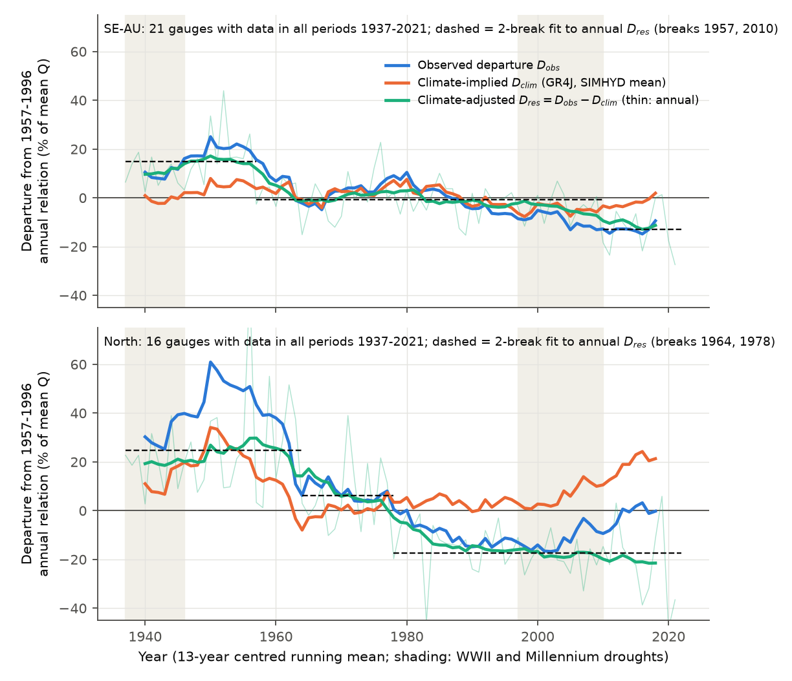
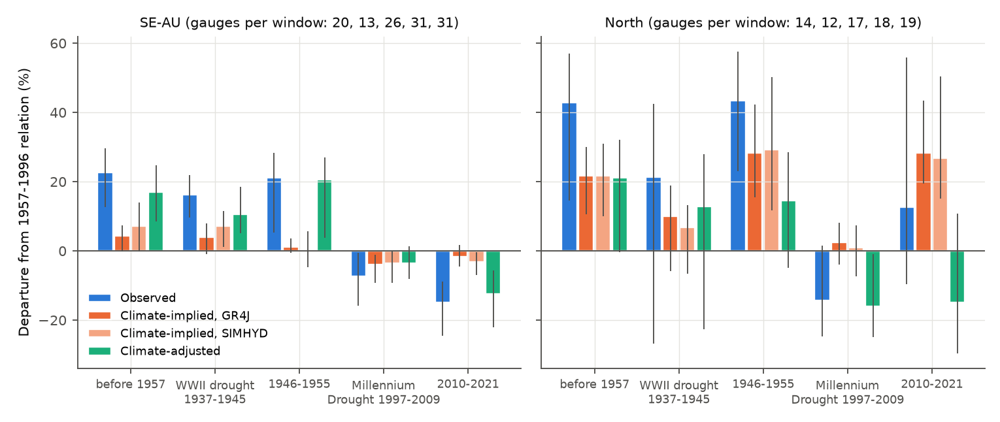
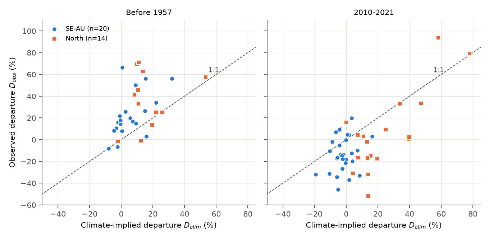

# Daily climate explained at most about one third of multi-decadal runoff-efficiency changes at south-east Australian gauges (1889-2021); adjusted efficiency fell in two steps, near 1957 and 2010

Job `sci-1107-dell-earth-and-ocean-sciences-1621e6ee2ab2`, campaign 11_07_2026, topic
earth-and-ocean-sciences, machine dell, account claude-myxtap. Model: Claude Opus 5.5
(`claude-opus-5-5`) in Claude Code (T3 Code). The signing key is a campaign-machine key. It is
not a personal authorship claim.

## Summary

**Question.** Bundle 4e9ae7e7 found that runoff at equal annual rain in south-east Australia
(SE-AU) changes at multi-decadal scale: it was about 19% above the 1957-1996 rainfall-runoff
relation before 1957 and during the WWII drought, and 9-14% below it after 1997. That analysis
used only annual rain and previous-year rain. Its open question was whether the change is a
multi-decadal change in runoff efficiency with a **climatic cause**, or something else. Annual
rain does not show the seasonal timing of rain, daily rain intensity, wet-day frequency,
multi-year rain sequences or evaporative demand. These can change runoff at equal annual rain.
We asked: **how much of the multi-decadal departure does daily climate explain?**

**Method.** We drove two daily rainfall-runoff models with fixed parameters (GR4J and SIMHYD)
with daily catchment rain and potential evaporation from 1889 to 2021. A model with fixed
parameters has a stationary catchment. Thus, if it makes the same departures from the annual
relation as the observations, the departures come from climate. For each gauge we fitted the
annual relation Q = a + bP + cP(t-1) on 1957-1996 to the observed flow (departure D_obs) and,
on the same years, to the simulated flow (climate-implied departure D_clim). The difference
D_res = D_obs - D_clim is the **climate-adjusted departure**: the part of the efficiency change
that a stationary catchment driven by the observed daily climate does not make. We used 50 of
the 58 long-record gauges of bundle 4e9ae7e7 (flow from Bureau of Meteorology Water Data Online,
1885-2025; climate from CAMELS-AUS v2.03 daily SILO series). The plan
(`files/ANALYSIS_PLAN.md`) was written before any model run.

**Main results** (SE-AU, gauge means, 95% intervals from a 2-degree cell bootstrap):

| Period | Rain anomaly | D_obs | D_clim GR4J | D_clim SIMHYD | D_res |
| --- | --- | --- | --- | --- | --- |
| Before 1957 (20 gauges) | -1.7% | +22.6 (12.6 to 29.6) | +4.3 | +7.1 | +16.9 (8.6 to 24.8) |
| WWII drought 1937-1945 (13) | -17.8% | +16.2 (9.7 to 21.8) | +3.9 | +7.2 | +10.6 (5.2 to 18.6) |
| 1946-1955 (26) | +8.8% | +21.2 (5.3 to 28.2) | +1.1 | +0.1 | +20.6 (3.8 to 27.0) |
| Millennium Drought 1997-2009 (31) | -17.9% | -7.4 (-15.8 to -0.6) | -3.9 | -3.6 | -3.6 (-8.1 to 1.3) |
| 2010-2021 (31) | -2.6% | -15.0 (-24.5 to -9.0) | -1.7 | -3.2 | -12.5 (-22.2 to -5.7) |

1. **Daily climate does not explain the long-term level change.** The models reproduced 19%
   (GR4J) and 31% (SIMHYD) of the excess before 1957, and 11% and 21% of the 2010-2021 deficit.
   The post-drought contrast (2010-2021 minus 1946-1955, 26 paired gauges, 24 lower) was -36.9
   points observed, but only -2.4 points from climate; the climate-adjusted contrast was -34.5
   (-42.8 to -20.1). Before 1957 the rain structure was the same as in 1957-1996 (cool-season
   share -0.2 points, share of rain on very wet days -0.3 points, wet days +1%, Tmax -0.2 C), so
   there is no climate signal that could make a 23% excess. Gauge medians agree: before 1957
   D_obs +17.3% and D_clim +1.7%; in 2010-2021 D_obs -14.8% and D_clim -2.6%.
2. **Daily climate does explain part of the shorter wiggles and of the drought contrast.** In
   the SE-AU group series of 13-year windows before 1997, D_clim removed 46% of the variance of
   D_obs (pooled over gauge-windows: 18%). It explained about 40-50% of the difference between
   the two droughts (Millennium minus WWII: -20.8 observed; -6.8 GR4J, -10.3 SIMHYD), because
   the Millennium Drought had 15% fewer wet days and the WWII drought only 8% fewer. But the
   two post-drought decades differ by 35 points that the climate does not explain.
3. **The climate-adjusted efficiency fell in two steps (post hoc).** For 21 SE-AU gauges with
   data in every period from 1937 to 2021, the annual group D_res is best described by three
   levels: +14.8% before 1957, -0.9% in 1957-2009 and -12.9% in 2010-2021 (2-break fit; BIC
   380.6, against 390.5 for one break and 425.7 for none). In a gauge bootstrap the single
   largest break was in 1957 in 70% of draws (else 2010). The Millennium Drought decade itself
   had only a small climate-adjusted deficit (-3.6%, -7.8 to 1.8): most of the observed
   1997-2009 deficit (-5.7%) came from the drought's daily rain structure, and the
   non-climatic loss appeared after the drought broke.
4. **The northern control also had a non-climatic decline, and its "recovery" after 2009 was
   climatic.** In 16 northern gauges, D_res fell from +26% (1937-1956) to +13% (1957-1976),
   -13% (1977-1996), -19% (1997-2009) and -21% (2010-2021); breaks near 1964 and 1978. The
   apparent recovery after 2009 in bundle 4e9ae7e7 (D_obs +3% to +13%) came from wet years with
   intense rain, which the models expect to give +24% to +28% more runoff than the annual
   relation; at equal daily climate, northern runoff stayed low.
5. **No link to the Interdecadal Pacific Oscillation.** The SE-AU 13-year group D_obs and D_res
   series did not correlate with the IPO Tripole Index (r = -0.01 and +0.16; effective sample
   size about 5) or the PDO (r = 0.06 and 0.21). D_clim did correlate with the TPI (r = -0.32):
   La Nina-type decades bring rain that the models convert to runoff more efficiently, but the
   observed efficiency changes are not of that kind.

**Conclusion.** The multi-decadal change in SE-AU runoff efficiency is mostly not climatic in
the sense tested here. Daily rain structure, seasonality, multi-year rain sequences and
evaporative demand explain the shorter decadal wiggles and half of the WWII/Millennium drought
contrast, but only 14-33% of the high efficiency before 1957 and 4-34% of the low efficiency
after 2010 (range over models, rain products, PET treatment, calibration periods and gauge
sets; 19-31% and 11-22% in the main analysis). After this adjustment, efficiency did not oscillate: it fell
twice, near 1957 and near 2010, with a stable level between. The northern control had a
similar non-climatic fall that came later (1964-1978) and did not recover. The post-1997 deficit
is therefore not a return of an earlier climate state, and it is not unique either: it is the
second of two downward steps in a stationary-climate-adjusted record. Our data do not identify
the cause of either step. Changes in the catchments (farm dams, pasture improvement and
vegetation, groundwater use, forest regrowth) or in flow measurement are candidates; the
climate variables we tested are not.

**By the planned decision rule** (stated before results): with all 21 pre-1957 gauges (planned
set), both models reproduced less than one quarter of D_obs in both periods (14% and 23% before
1957; 12% and 23% in 2010-2021), which the plan calls "not climatic". When we remove gauge
410033 (diversion of its headwaters to Tantangara Reservoir after 1960; its pre-1957 excess is
+170%), SIMHYD reproduces 31% of the pre-1957 excess, so the rule gives "partly climatic" by a
small margin. Our main tables use the set without 410033, as bundle 4e9ae7e7 did for its window
analysis.

## Data

- **Flow.** Daily mean discharge (`DMQaQc.Merged.DailyMean.09HR`) for the 58 gauges of bundle
  4e9ae7e7, from Bureau of Meteorology Water Data Online (KiWIS), retrieved 2026-11-11. Daily
  runoff in mm from CAMELS-AUS catchment areas. A lag test confirmed that the value stamped 09:00
  on day D aligns with SILO rain on day D (both are the 24 h to 09:00), so we did not shift it.
  A year is valid with 300 or more valid days.
- **Climate.** CAMELS-AUS v2.03 daily catchment series: SILO rain (1889 to May 2022), SILO
  Morton wet-environment areal potential evaporation, SILO Tmax; AGCD rain (1911-2022) for a
  rain-product check. We used full years 1889-2021; 1889-1891 is model warm-up.
- **Regions.** SE-AU: outlet south of 33.5 S and east of 140 E (34 gauges, 33 without 410033);
  North: the other 24 gauges (Hunter, northern NSW, Queensland). 51 gauges (32 SE-AU, 19 North)
  had 30 or more valid calibration years in 1957-1996 and enter the analysis (50 without
  410033); 20 SE-AU gauges (21 with 410033) had 10 or more valid years before 1957.
- **Indices.** IPO Tripole Index computed from HadISST1 (Henley et al. 2015 regions,
  1971-2000 base); ERSSTv5 PDO index (NOAA NCEI).

## Method

- **Models.** GR4J (4 parameters, Perrin et al. 2003) and SIMHYD (7 parameters, Chiew et al.
  2002), implemented in `code/models.py`. Calibration on daily flow 1957-1996 (3-year warm-up)
  with the objective NSE(sqrt Q) - 5|ln(1+B)|^2.5 (Viney et al. 2009), differential evolution
  (fixed seed); a restart test with other seeds and a 2.5 times larger search gave the same
  optimum. Then one continuous simulation from 1889 to 2021. Median daily NSE in calibration:
  0.73 (GR4J, IQR 0.63-0.78) and 0.53 (SIMHYD, IQR 0.43-0.64); median calibration bias -3% and
  -4%. Model bias does not enter D_clim, which compares the model only with itself.
- **Departures.** Per gauge, Q = a + bP + cP(t-1) fitted on valid 1957-1996 years; residuals in
  % of the mean calibration flow (observed for D_obs, simulated for D_clim); window means over
  valid years (10 or more years before 1957, 5 or more in the other windows). D_clim is the mean
  of the two models unless stated. We also report the direct model residual
  R = (Q_obs - Q_sim) / mean Q_obs, centred on 1957-1996; it agrees (before 1957 +17% GR4J,
  +13% SIMHYD; 2010-2021 -15% and -14%).
- **Intervals.** 2,000 cluster-bootstrap draws over 2 x 2 degree cells (9-10 SE-AU cells).
- **Planned sensitivity variants (Q4).** (a) potential evaporation replaced by its 1957-1996
  day-of-year climatology (only rain varies); (b) AGCD rain instead of SILO (1911-2021); (c)
  calibration of the models and of the annual relation on all pre-1997 years; (d) without the
  five regulated or diverted gauges.

## Robustness (SE-AU, D_obs / D_clim GR4J / D_clim SIMHYD / D_res, %)

| Variant | Before 1957 | 2010-2021 | Group 13-yr variance removed before 1997 |
| --- | --- | --- | --- |
| Main (SILO, 1957-1996, without 410033) | 22.6 / 4.3 / 7.1 / 16.9 | -15.0 / -1.7 / -3.2 / -12.5 | 46% |
| All gauges (planned set) | 29.7 / 4.1 / 6.9 / 24.2 | -15.1 / -1.8 / -3.4 / -12.5 | 0% |
| (a) Climatological PET | 22.6 / 4.8 / 6.6 / 16.9 | -15.0 / -2.3 / -5.0 / -11.3 | 42% |
| (b) AGCD rain | 19.5 / 4.3 / 6.4 / 14.1 | -26.0 / -1.1 / -2.9 / -24.1 | 45% |
| (c) Calibration on all pre-1997 years (21 gauges before 1957) | 14.0 / 2.4 / 4.1 / 10.7 | -19.7 / -2.3 / -3.6 / -16.7 | 40% |
| (d) Without 5 regulated gauges | 23.5 / 4.5 / 7.1 / 17.7 | -14.5 / -1.2 / -2.7 / -12.5 | 43% |

With AGCD rain, post-2010 rain was 1.7% above the 1957-1996 mean (SILO: -2.6%), so the
observed and climate-adjusted deficits were larger (-26% and -24%). The 2-break fit gave the
same break years with AGCD (1957, 2010) and 1957 and 1988 with climatological PET.
In the North, the 2010-2021 climate-adjusted deficit was -18.7% with AGCD rain and -8.5%
(-24.4 to 18.9) with climatological PET; the 1997-2009 deficit was -16% to -22% in all variants.
In variant (c) the reference level is the mean of all pre-1997 years, so all departures move
down by 5-8 points, but the shares are the same (climate: 17-29% of the pre-1957 excess, 12-18%
of the 2010-2021 deficit). The 2-break fit to the fixed-composition series gave the same break
years, 1957 and 2010 (levels +8.6%, -5.7%, -16.9%; 1957 was the largest break in 70% of
bootstrap draws). **The 1957 step is therefore not an artefact of the start of the 1957-1996
calibration period.** For the North, variant (c) gave breaks in 1964 and 1978 again.

**Flow-quality check (post hoc).** Of the 20 SE-AU gauges with pre-1957 data, the 10 whose
pre-1957 days are mostly coded "good" (code 10) had a pre-1957 D_res of +19.1%, the other 10
had +14.8% (Spearman correlation of D_res with the good share 0.21, p = 0.38). The SE-AU excess
before 1957 is thus not limited to poorly coded records. In the North, the excess is in the NSW
Hunter gauges (+31%), whose records are coded "unknown" in all periods, and not in the five
Queensland gauges coded "good" (+3%). We cannot separate a regional effect from a measurement
effect there.

**Land cover (post hoc).** Split at the median CAMELS-AUS forest share (0.77), forested and
cleared SE-AU catchments had the same pre-1957 D_res (+17.1% and +16.8%). After 2010 cleared
catchments had a larger climate-adjusted deficit (-15.0%, -22.1 to -5.0) than forested ones
(-9.9%, -23.8 to -3.1); the intervals overlap. Present-day land cover therefore does not
explain the first step; land-use history (for example farm-dam construction after 1950) is not
in our data.

**Trend forecast (post hoc).** A linear trend of each gauge's annual D_res fitted on years before
1997 (-2.6 points per decade, -4.2 to -0.8; 20 SE-AU gauges) forecast -8.2% for 2010-2021; the
observed D_res was -10.4% (difference -2.2, -17.6 to 11.1). A continued slow decline is thus
consistent with the post-1997 level, but the annual series is better described by steps than by
a line, so we do not use this as evidence of a trend.

## Rain structure in the windows (S1; SE-AU gauge means, anomalies from 1957-1996)

| Window | Rain | Cool-season share (points) | Rain on days > 99th pct (points) | Wet days | Tmax (C) | PET |
| --- | --- | --- | --- | --- | --- | --- |
| Before 1957 | -1.7% | -0.2 | -0.3 | +1.0% | -0.21 | -0.1% |
| WWII drought 1937-1945 | -17.8% | -0.5 | -2.0 | -7.6% | +0.19 | +3.1% |
| 1946-1955 | +8.8% | -0.6 | +1.0 | +6.0% | -0.49 | -3.3% |
| Millennium Drought 1997-2009 | -17.9% | -0.4 | -1.5 | -15.1% | +0.75 | +4.5% |
| 2010-2021 | -2.6% | -4.7 | +1.7 | -7.2% | +0.89 | 0.0% |

After 2010 the cool-season share fell by 4.7 points and wet days by 7%, the main climate
changes. The models translate them into only -2% to -3% of runoff at equal annual rain.

## Interpretation

- **What the result rules out.** If the multi-decadal efficiency changes were caused by how rain
  falls (season, intensity, frequency, sequence) or by evaporative demand, a stationary daily
  model would reproduce them. It reproduces the short wiggles and about half of the drought
  contrast, but not the long-term levels. This is true in both models, with two rain products,
  with and without varying PET, and without regulated gauges. The IPO does not track the
  observed efficiency.
- **What the result shows.** After the climate adjustment, SE-AU efficiency has two levels
  shifts down and no recovery, not an oscillation. The 1997-2009 drought decade is close to the
  1957-1996 level once its rain structure is considered; the non-climatic deficit is in
  2010-2021. The same type of non-climatic fall happened in the North 1964-1978. This
  reframes the question of 4e9ae7e7: the low 13-year windows before 1997 (1959-1971,
  1983-1995) are lows of the climate wiggle around the post-1957 level, while the post-2010 low
  is a new level.
- **Limits of the inference.** Conceptual models can miss real climate mechanisms (for
  example a slow groundwater response to multi-year rain deficits, which is the mechanism
  that the campaign's water-table bundles found to be incomplete). Thus "not explained by the
  daily climate through GR4J and SIMHYD" is the exact statement. It is possible that a model
  with a slower store could put more of the post-2010 deficit into climate; it cannot easily
  put the pre-1957 excess into climate, because the climate before 1957 was not different
  from 1957-1996.

## Limitations

- Few early gauges: 20 SE-AU and 14 North gauges before 1957, 13 in the WWII drought, in 9-10
  and 8 cells. Early flow ratings and gauge changes are not known; quality codes are a weak proxy.
- SILO and AGCD both depend on the Bureau rain-gauge network, which was sparser before 1957.
  Bundle 4e9ae7e7 found SILO annual rain within 1-2% of a fixed station network in all periods,
  but daily intensity in early decades can be smoothed by sparse stations. The pre-1957 heavy
  rain share and wet-day count were close to the 1957-1996 values, so such smoothing was small
  at catchment scale, but we did not test it directly.
- SILO temperature and PET before 1957 come from few stations; variant (a) removes PET
  variation and gives the same result.
- Two conceptual models only; daily, lumped, no snow. Annual relation with one year of memory.
- The step analysis, land-cover split, quality-code check and trend forecast are post hoc. The
  first break year (1957) coincides with the start of the main calibration period; variant (c)
  calibrates on all pre-1997 years and gives the same break years.
- The gauges are the long-record subset of CAMELS-AUS; regulated or diverted reaches are
  included in the main set except 410033 (variant (d) removes four more).

## Figures



**Figure 1.** Fixed-composition gauges (data in every period 1937-2021). 13-year running means
of the observed departure from the 1957-1996 annual relation (blue), the climate-implied
departure of the two daily models (orange) and the climate-adjusted departure (green; thin:
annual). Dashed: three-level fit to the annual climate-adjusted series. Shading: WWII and
Millennium droughts.



**Figure 2.** Planned windows: observed departure, climate-implied departures of GR4J and
SIMHYD, and climate-adjusted departure, with 95% cell-bootstrap intervals.



**Figure 3.** Per gauge: observed against climate-implied departure before 1957 and in
2010-2021. Points on the dashed line would be fully explained by climate.


**Figure 4.** SE-AU group 13-year observed and climate-adjusted departures (all gauges, years
with 5 or more gauges) and the 13-year mean IPO Tripole Index.

## Files

- `files/ANALYSIS_PLAN.md`: plan, written before any model run.
- `files/code/`: all code. `reproduce.sh` runs the full pipeline in a separate scratch folder.
  `fetch_bom_flow.py` (from bundle 4e9ae7e7, https endpoint), `build_daily_flow.py`,
  `extract_camels_climate.py`, `tpi_hadisst.py`, `rain_structure.py`, `models.py`,
  `calibrate.py`, `departures.py`, `structure_windows.py`, `teleconnection.py`, `posthoc.py`,
  `qc_check.py`, `collect_results.py`, `figures.py`.
- `files/results/variant_table.csv`: all window results for all variants and gauge sets.
- `files/results/departures_<set>/`: `summary.json` (planned statistics), per-gauge window
  means (`window_*.csv`), per-gauge and group 13-year windows (`rolling13*.csv`), per-gauge annual
  departures in % (`annual_departures.csv`; no flow or rain amounts). Sets: `main` (without
  410033), `main_all`, `main_dropreg`, `climpet`, `agcd`, `calpre97` and their `_all` versions.
- `files/results/posthoc_<variant>/`: fixed-composition series, break fits with bootstrap,
  trend forecast, land-cover split, quality-code check (`main` only).
- `files/results/secondary/`: rain-structure windows and IPO/PDO correlations.
- `files/results/calibration_scores.csv`: per gauge, model and variant: objective, daily NSE,
  bias and parameters.
- `files/provenance/`: BoM request URLs, byte counts and SHA-256 of each response; SHA-256 and
  source URLs of the shared dataset files used; the gauge list.
- `files/DATA_NOTICE.md`: third-party data sources, terms and credit lines.

## Reproduce

```
mkdir /tmp/scratch && cd /tmp/scratch
bash /path/to/files/code/reproduce.sh /path/to/files /path/to/shared/datasets
```

Needs Python 3.12 with numpy, pandas, scipy, xarray, netCDF4, pyarrow, matplotlib and numba.
Downloads about 70 MB from Water Data Online; uses the shared CAMELS-AUS v2.03 (Zenodo
14289037), HadISST1 and ERSSTv5 PDO files listed in `files/provenance/shared_dataset_sha256.tsv`.
Calibration takes about 45 s per gauge, model pair and variant on one core (about 3 h on 2
cores). Water Data Online values can be revised by the agencies, so a new download can differ
slightly from ours (our response hashes are in the fetch log).
