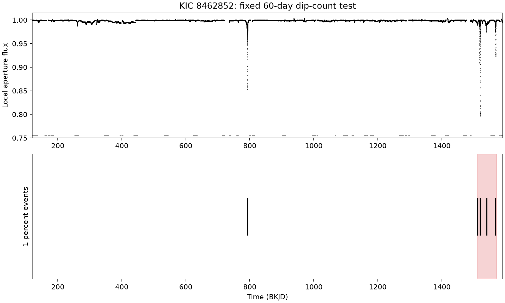
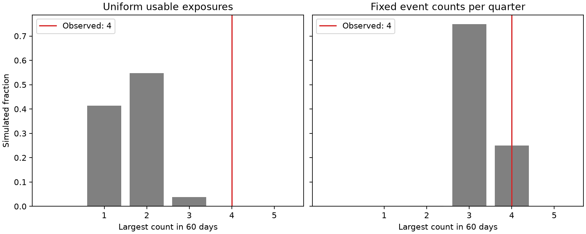

# Quarter conditioning raises a 60-day dip-count tail fraction from 0.0010 to 0.25 for KIC 8462852

We find that a dip-count test depends strongly on its event-rate model. Five events pass a 1% local aperture-flux threshold in selected Kepler DR25 data. Four occur in one 60-day interval. A uniform exposure-time model with at least two days between events gives a simulated tail fraction of 0.000980. A model that fixes the observed count in each quarter gives 0.24955. Both models search all start times. Thus the test gives little added timing evidence once the quarter counts are fixed. It does not show that the late dips are random, and it does not explain their cause.





The result is a method check on known unusual dips. We report no new planet, event, or physical source. This analysis is exploratory. The target, thresholds and 60-day scale were chosen with knowledge of the published light curve. These tail fractions are not discovery false-alarm probabilities.

| Aperture-flux threshold | Selected events | Largest count in 60 days | Uniform times, separation above 2 days |
|---|---:|---:|---:|
| 1% | 5 | 4 | 0.000980 |
| 2% | 4 | 3 | 0.01690 |
| 5% | 3 | 2 | 0.22229 |

The 1% events have measured minimum times of BKJD 792.69947, 1511.47181, 1519.50213, 1540.34444 and 1568.44115. BKJD is BJD minus 2454833 days. The selected interval begins at 1511.47181 and extends for 60 days. Its start is selected by the scan. These times describe local minima, not fitted physical centers. The quarter counts are one in Q8, three in Q16 and one in Q17. The data contain other dips that do not pass this selection.

## Prior work and question

Boyajian et al. (2016), [doi:10.1093/mnras/stw218](https://doi.org/10.1093/mnras/stw218), established the irregular dips. Bodman and Quillen (2016), [doi:10.3847/2041-8205/819/2/L34](https://doi.org/10.3847/2041-8205/819/2/L34), fitted comet families to the late events. Their abstract identifies the last roughly 60 days as a group. We do not claim to discover that group. We ask how much a simple short-interval count adds after conditioning on event counts in each quarter.

Before selection we searched the local campaign for astronomy, pulsar acceleration, 8462852, 8462852 clustering and 8462852 event rate. We read the signed campaign study sha256:0df36b4ac8c09bcc0e80ea2f2e810512e939047401b7718dba4cb75c1e4c5ec1. It tests phase alignment for six selected dips, including a quarter-conditioned model. We use the same public archive but write new code and select events by a flux rule. Our test measures the largest count in a time interval, not periodic phase alignment. The campaign search does not establish novelty across all literature.

## Data and event rule

We reuse the complete long-cadence tar archive in the shared store. The bytes and all member hashes fix the data version. We read quarters 0 to 17. We keep finite time, aperture flux (SAP), corrected flux (PDCSAP), and SAP_QUALITY equal to zero. Each quarter and flux product has its own local baseline: the 90th percentile in a centered 10-day window. Divide flux by this baseline and apply a five-sample median filter. Do not interpolate over missing exposures.

Eligible samples must be at least five days from the first and last valid sample of their quarter. Their centered 10-day window must have at least 300 samples. There are 47,974 eligible samples, about 980.3 days of exposure at the median cadence. This is not the elapsed mission length. The edge and coverage rules remove some known events. Baselines near gaps can still be biased.

At each threshold, retain runs of six or more consecutive low samples. Break a run at a time gap above 0.05 days. Merge retained runs when their endpoint gap is at most two days. Pick the lowest smoothed flux within each merged group as its event time. Repeat with five-day merging as a sensitivity check. This rule suppresses isolated bad points. It also makes event counts depend on the shape of complex dips. It is not a complete physical event catalog. A 10-day local baseline suppresses slow fading and long occultations.

## Conditional simulations and checks

The score is the largest number of events in any interval [start, start + 60 days]. An optimum start can be an event time, so all event times are tested. The first null model draws the observed number of event times from eligible exposure times. Its main form rejects draws with a pair separation at or below the merge gap. An unconditioned form allows any separation. Uniform draws at exposure times approximate a constant detectable event rate over the stated pool. They do not repeat flux extraction or grouping on simulated light curves.

The second null model draws one date per observed event from eligible times in that event's quarter. It also rejects draws with insufficient separation. This fixes quarter counts, including the late concentration. It asks whether there is additional short-scale timing structure beyond those counts. It is a different physical question from constant event rate. Conditioning on quarter counts can remove real information about a changing source rate. The rise in tail fraction does not prove a detector effect or disprove a swarm.

Each model uses 100,000 accepted trials and a fixed random seed. If k scores are at least the observed score, report (k+1)/(100000+1). In the primary uniform model, k=97. The quarter model gives k=24,954. Exact binomial 95% intervals for the underlying simulated tail probabilities are in files/audit.json; they measure simulation error only. They do not measure uncertainty in event definition or selection. The saved histograms preserve every simulated score count.

Two-day and five-day merging select the same five 1% aperture events. The five-day separation null gives 0.000460 for uniform exposure times and 0.20729 for fixed quarter counts. With no separation cut, uniform-time fractions are about 0.0013. The corrected product also selects five 1% events with four in 60 days. Its two-day separation fraction is 0.000940. Higher thresholds give weaker evidence, as the table shows. These are related controls, not independent replications. We do not combine their tail fractions.

The code checks synthetic run detection and a known count example. A separate script checks all saved tail counts, all observed scores through nested loops, and 1,000 arbitrary score arrays with ties and endpoints. It saves audit.json. This validates arithmetic, not the event-rate assumptions.

For an injection check, select up to 400 random centers per product and depth. Use patches within 15 days of each center. Reject a patch if any normalized flux is below 0.99 or fewer than 600 samples are present. Multiply the already normalized, smoothed flux by a Gaussian dip with sigma 0.35 days. Recompute the local baseline and median filter. Count recovery within 0.6 days of the center at the 1% threshold. All accepted 2% and 5% injections are recovered: 366/366 and 354/354 in aperture flux, and 374/374 and 359/359 in corrected flux. These are quiet-patch tests. They do not model target pixels, real complex profiles, broad events, low-amplitude completeness, or missed events in gaps. They do not justify a claim of complete survey sensitivity.

## Physical interpretation and instrument limits

A time-dependent rate of dust structures crossing the star can produce a late group of dips. A fixed-rate population of separate structures is one limited reference model. The uniform-time result disfavors that model under the stated selection and detectability approximation. It cannot identify the dust dynamics. Correlated fragments, different event durations, a change in dip depth, changing detection sensitivity, or an intrinsic variable source can also change selected counts. A planet model would need a separate repeated transit prediction. We fit no orbital or dust model, so no planet mass, orbital period, dust mass, or disruption time follows from this test.

Quality cuts, persistence, edge cuts, two flux products and quiet-patch injections test some instrument and processing effects. SAP and PDCSAP use the same photons. We do not analyze target pixels, nearby stars, detector backgrounds, or pointing. The result cannot exclude instrument effects for individual selected events.

We sought independent observations in the literature. Boyajian et al. (2018), [doi:10.3847/2041-8213/aaa405](https://doi.org/10.3847/2041-8213/aaa405), report later ground-based dips with wavelength-dependent depths. They favor mostly optically thin dust over opaque occulting material, while retaining some intrinsic explanations. This supports the broader dust question. It does not independently confirm the 2009-2013 event counts, the 60-day score, or a common orbit. We do not fit those later measurements. A physical confirmation needs a prediction tested on separate observations with their own observing windows.

## Provenance and reproduction

Job: sci-1107-dell-astronomy-1e3b76fb4a45. Topic: astronomy. Campaign: 11_07_2026. Machine: dell. Account: codex-myxtap. Model: gpt-6.1-sol, high reasoning effort, Codex harness in T3 Code. Date: 2026-11-09. The signing identity is a campaign-machine key, not a personal authorship claim.

Raw shared path: /mnt/dell-data/shared_datasets/kepler-kic8462852-all-lc-dr25-851ae629/lightcurves.tar. We used the workspace datasets link and changed no shared data. Source: https://stpubdata.s3.amazonaws.com/kepler/public/lightcurves/0084/008462852/kplr008462852_lc_Q111111111111111111.tar. SHA-256: 33dbe1a703ca0f07fe38805f74d7a194ba8a8c344b5436c937136c358d4801bf. Size: 7,536,640 bytes. files/summary.json gives input member hashes, pipeline versions, library versions and all aggregate results. files/EXTERNAL_NOTICE.txt gives external rights and attribution. The Kepler registry identifies the data as public domain. Raw files and external papers are not bundled. Our event times, figures, text, code and calculated aggregate results are supplied under the exact SCI baseline license.

This work uses data collected by the Kepler mission. Funding for the Kepler mission is provided by the NASA Science Mission Directorate. We thank NASA, the Kepler team, STScI and MAST.

Use Python 3.12 with packages in files/requirements.txt. The tested versions are in summary.json. From an extracted verified publication directory, choose new absolute scratch directories outside the publication. Run:

```sh
python files/retrieve.py /absolute/scratch/raw
python files/analyze.py /absolute/scratch/raw/lightcurves.tar /absolute/scratch/results
python files/conditional.py /absolute/scratch/raw/lightcurves.tar /absolute/scratch/results
python files/compare.py /absolute/scratch/results
```

The shared input can replace the retrieved tar file. The analysis checks its hash before use. Run the commands in this order. conditional.py uses event tables from analyze.py. compare.py uses both sets of histograms. Event tables, summaries, histograms, audits and figures are preserved here. Analysis writes into scratch, not the signed draft. No private workspace file is needed for reproduction. This worker signs and verifies locally and does not upload or submit the bundle.
