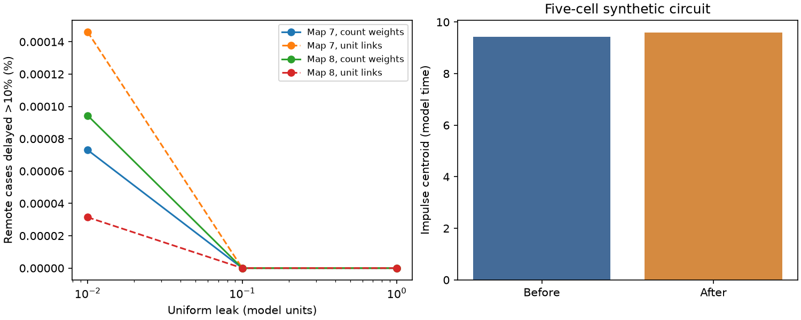

# Link doubling gave no remote centroid delay above ten percent at leak 0.1 in two passive adult worm models

Doubling each recorded electrical link gave no remote impulse-response centroid delay above ten percent at leak 0.1 in either tested adult worm map. The largest delays were 6.52 and 4.66 percent. At leak 0.01, two and three cases passed ten percent. A stronger link can thus delay a remote response, but large delays were rare and depended on the model leak. These are passive model results. They are not measured neural delays.

Figure 1. Left: the share of eligible link and remote-pair cases with a centroid increase above ten percent. Solid lines use contact counts; dashed lines use equal link weights. Values are fixed-graph summaries, not independent animal observations. Right: an original five-cell circuit shows a 1.75 percent centroid increase after one link doubles. The bar axis starts at zero. No physical time scale is fitted.

## Question and prior work

Does a stronger electrical link always make a remote passive response earlier? This matters when stronger anatomical coupling is used to infer faster communication. We test the impulse centroid, the mean time of the nonnegative impulse response after normalization by its integral. It is not the response onset or peak time.

Varshney et al. (doi:10.1371/journal.pcbi.1001066) use electrical Laplacian models of worm wiring. Schroder et al. (doi:10.1109/TNSE.2019.2901582) develop response moments from inverse system matrices. We use these established tools and the standard rank-one inverse identity. We do not claim to discover these methods.

Campaign SCI ab3254d7d67f89435fee5171572990f3402b02e7b328bdcc42606a9ecad47385 tested voltage transfer after link doubling. SCI 5ec9c5b6a5d87835d02bd7102c6f1f68ee60177fe6a791812250b6873474efc6 tested centroid order against hop distance on fixed maps. SCI 72e2e69b100583f2f9e44a3007fa80f2c341b8297c1623b65d3750bb4f4e10c3 tested finite-frequency group delay. SCI 21a5bdb55f830f3a318433a7beef6a3907eadd5f34cd022db6c8ca846ad3f5ce tested voltage changes after link removal. We read these reports. Our new test measures centroid changes after link doubling, with an exhaustive map benchmark, a null result at the primary setting and an exact update formula. It reuses the maps, not earlier program code.

Before the precise question we searched connectome, neural structure, Allen, Witvliet, bilateral, effective resistance and Kron. Later searches used centroid strengthening and response centroid. The former returned the fixed-map centroid study; broad terms returned many unrelated records. Searches do not prove novelty. This is an exploratory investigation, not a registered experiment. The primary ten-percent delay threshold and leak choices were set before computation. The one-percent count was added after the primary null result. A deterministic synthetic search with 1000 trials found no ten-percent example; a later one-percent search supplied the displayed example. We disclose this selection and make no probability estimate from that search.

## Data and model

We reused the shared adult 7 and 8 tables in place. Source: Witvliet et al., Nature (2021), doi:10.1038/s41586-021-03778-8. Data packaging: wormneuroatlas commit b2e13d88b670efcb3438aeacba2ad4bd6c383933. The paper says that the electrical database includes junctions where they were most visible. Missing records must not be read as confirmed absent junctions.

| Map | Exact shared path | SHA-256 |
|---|---|---|
| 7 | /mnt/dell-data/shared_datasets/worm-witvliet7-b2e13d88/adult7.csv | 1370d2a7e26a17e0765edfa834c95ca59ab44d8587efb5fda330432233074165 |
| 8 | /mnt/dell-data/shared_datasets/worm-witvliet8-b2e13d88/adult8.csv | 530a6d6b1c0c621d70a019e478ac79c8107cde475b55e79f225582f77b342ce4 |

These compatibility paths point to HP SSD. We accessed them through ./datasets and hashed only the two used files. No shared file was changed and no failed disk was read. Exact source URLs, byte counts, hashes and software versions are in files/provenance.json.

We retain names in both tables and exclude prefixes BWM, CEPsh, GLR and excgl. This gives 180 putative neurons, including isolated cells. This name rule is not a complete cell-type audit. Each non-self electrical pair occurs once and gives one symmetric link. Maps 7 and 8 have 262 and 296 such links. Chemical rows define the name set only.

Let W be the symmetric conductance matrix. For each map and weight rule, divide W by mean weighted degree over cells with nonzero degree. The count rule uses reported contact count before this scaling. The equal-weight rule assigns one to each present link before scaling. Hold this scale fixed when a link doubles. Define

    L = diag(W 1) - W
    A = L + ell I
    dv/dt = -A v + u,    H = inverse(A),    S = H H
    h_ij(t) = [exp(-A t)]_ij, for t >= 0
    T_ij = S_ij / H_ij.

Every cell has capacitance one and the same positive leak ell. We test ell = 0.01, 0.1 and 1. The primary value is 0.1. Time and leak have model units. Contact count is not a measured conductance. We do not fit physiology or link unmatched activity to anatomy.

## Link update and timing

For an existing link u,v with conductance w, set b=e_u-e_v. Doubling that link gives A_new=A+w b b^T. With x=H b, y=S b and c=w/(1+w b^T H b),

    H_new = H - c x x^T
    S_new = S - c(y x^T + x y^T) + c^2 (x^T x) x x^T.

The second identity follows by squaring the first. For any connected pair,

    T_new_ij - T_ij =
      [-c(y_i x_j + x_i y_j)
       + c^2 (x^T x) x_i x_j + c T_ij x_i x_j]
      / (H_ij - c x_i x_j).

The denominator is positive. The numerator has no fixed sign. This gives a direct test of the change using the intact model. Since w b b^T is positive semidefinite, no ordered decay eigenvalue decreases. The uniform mode keeps its decay rate ell. Thus a delayed cross-response need not imply a slower global mode; the way modes contribute to that response also matters.

Equal leak gives H 1=1/ell and S 1=1/ell^2 before and after the change. The source's total response mass and total first moment remain fixed, although individual pair centroids change. A centroid change describes redistribution of a response in time and across cells. It does not by itself measure information transmission or better computation.

## Selection and results

We test each existing link separately from the intact map. A remote pair is an unordered pair of distinct neurons, neither of which is a link endpoint. Baseline eligibility requires H_ij/sqrt(H_ii H_jj) >= 0.01 and H_ij > 1e-12. The latter is a numerical floor in scaled units. Eligibility uses only the intact map. The outcome is T_new/T > 1.1. We also count ratios below 0.9. Sensitivity floors are 0.001 and 0.1; the secondary exploratory delay threshold is 1.01. All 36 graph-weight-leak-floor summaries are supplied.

| Map | Leak | Eligible cases | Delays >10% | Delays >1% | Largest delay |
|---|---:|---:|---:|---:|---:|
| 7 | 0.01 | 2,737,746 | 2 | 6,393 | 14.947% |
| 7 | 0.1 | 1,702,273 | 0 | 7,187 | 6.524% |
| 7 | 1.0 | 244,660 | 0 | 163 | 1.998% |
| 8 | 0.01 | 3,177,556 | 3 | 3,837 | 12.104% |
| 8 | 0.1 | 2,281,069 | 0 | 6,694 | 4.657% |
| 8 | 1.0 | 307,943 | 0 | 245 | 2.619% |

At primary leak, the secondary one-percent delay shares are 0.4222 and 0.2935 percent. There are 15 and 32 cases with more than ten-percent speed-up. A primary null delay count is not proof of no timing change. At low leak the five count-weight cases with delays above ten percent all have lower DC transfer after the link change. Equal link weights give four and one delays above ten percent at low leak, and none at either other leak. At low leak the count-weight large delays still pass the stronger baseline floor 0.1.

The denominator changes with leak and the threshold. Pooled shares do not estimate an effect of leak in a fixed pair set. Cases share cells, links and maps. We report no population p-value, animal confidence interval or claim of a universal rate.

## Synthetic example and checks

The original five-cell example is fully specified by files/synthetic.json. Its links are 0--1:1, 0--3:0.1, 0--4:1, 1--2:10, 1--3:10, 1--4:0.1, and 2--3:10. Leak is 0.1 and all capacitances are one, without degree scaling. Double link 0--1. For source 2 and target 3, neither an endpoint, the centroid rises from 9.42938 to 9.59447, or 1.7508 percent. DC transfer falls from 2.13903 to 2.09361. Independent quadrature of the matrix-exponential mass and first moment agrees within 1.9e-13 model time units. This is an existence example, not a fit to neural data.

Independent full matrix solves check all links at the primary count-weight setting. They also check every link with a low-leak large-delay case at the main floor, for both weight rules. Every tested count at 1.01, 1.1 and 0.9 agrees with the update calculation. Maximum absolute centroid difference is 5.4e-13. These checks test numerical implementation, not anatomy or physiology. A second complete run gave identical summary.csv, synthetic.json and figure.png bytes. Checks from this run are in files/checks.json.

## Limits and next tests

The largest limit is incomplete electrical annotation. Missing paths can change response timing and lesion effects. Count-to-conductance conversion, symmetric coupling, unit capacitance, uniform leak and passive dynamics are assumptions. Chemical synapses, active channels, rectification and changing input are absent. The selection floor is not a measured detection threshold. The two maps come from one species and study. No Allen physiology or matched activity data enter this calculation. No result establishes a principle across regions, behavior or species.

A useful next step is a matched physiological test of centroid changes after a controlled junction perturbation, with capacitance and leak estimates. Another is to measure sensitivity to missing junctions under an independently justified annotation-error model. Neither test was done here. The current result gives a transparent benchmark: positive changes in circuit stiffness do not fix remote centroid order, and large timing changes need not be common at a chosen leak.

## Reproduction and rights

The signed package contains original code, text, a figure, an original synthetic circuit and aggregate research outputs. External raw tables, cell identities, matrices and record-level derived tables are excluded. files/EXTERNAL_NOTICE.txt states source terms and attribution. Retrieval retains the source GPL version 3 notice outside this publication. We grant no SCI baseline rights over external source material.

With Python 3, NumPy, SciPy, pandas and matplotlib, run from the extracted publication root:

    python files/retrieve.py /absolute/new/external_raw
    OMP_NUM_THREADS=1 OPENBLAS_NUM_THREADS=1 MKL_NUM_THREADS=1 python files/analyze.py --raw /absolute/new/external_raw --out /absolute/new/aggregate

Both scripts require new output folders outside the publication. For shared-store reuse, put symlinks named adult7.csv and adult8.csv in a new external raw folder, pointing to the exact files above. Input hashes are enforced. No source data are written to the signed folder. A rerun needs no private scratch files. Last floating-point digits can vary with libraries. Recorded versions and provenance are supplied. No random data enter the map calculations; the synthetic search has fixed seed 39211.

## Campaign identity

Job: sci-1107-dell-neural-structure-and-computation-599c4360056f. Topic: neural-structure-and-computation. Campaign: 11_07_2026. Machine: dell. Account: codex-olen. Model: gpt-6.1-sol, high reasoning effort, Codex harness through T3 Code. Date: 2026-11-11. No child agents were used. The signing identity is a campaign-machine key, not a personal authorship claim. This investigation saves a local signed bundle and does not upload or submit it.
