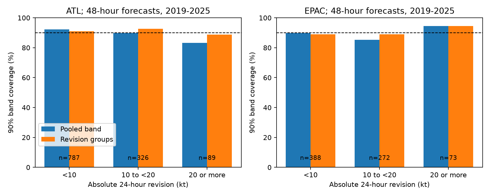

# Revision groups gave no clear gain in NHC 48-hour wind error bands in two basins in 2019-2025

## Result
We tested whether a large change between official NHC wind forecasts gives a useful signal of uncertainty. The primary test did not show a clear interval-score gain in either basin.

| Basin | Cycles / storms | Pooled score | Revision-group score | Change, 95% storm limits |
|---|---:|---:|---:|---:|
| Atlantic | 1,202 / 87 | 61.10 | 60.89 | -0.21 (-1.83 to +1.50) kt |
| East Pacific | 733 / 72 | 73.29 | 74.31 | +1.02 (-0.31 to +2.66) kt |

Lower 90% interval score is better. Both limits include zero and permit small gains or losses. They do not prove equal skill.

Large revisions accompanied larger errors in the Atlantic, but that pattern did not transfer to the East Pacific. An exploratory ratio of mean squared error for revisions of at least 20 kt to those below 10 kt was 2.06 (whole-storm 95% limits 1.27-3.03) in the Atlantic and 0.92 (0.56-1.46) in the East Pacific.

These bands are research constructions. NHC did not issue these probabilities. This result does not establish miscalibration of an issued probability product.

## Question and prior work
The selected PAGER study (SCI 156946e5) found a large probability error caused in part by a software floor. It motivates tests of other products, but does not predict the sign of a hurricane test.

We searched campaign results for forecast, NHC, geomagnetic, and revision uncertainty. We read the selected PAGER report, the NHC empirical-band report (SCI 6c9d68a8), and the forecast-revision report (SCI 10f1a3ce). The latter found no clear gain from a linear revision correction to the forecast mean. It did not test revision size as an uncertainty predictor. The band report did not use revisions. We reused their cited raw snapshots with new code.

Conditional intensity uncertainty is established research. Trabing and Bell (2020, doi:10.1175/WAF-D-19-0253.1) study official errors and rapid intensity change. IBUS (doi:10.1175/WAF-D-22-0074.1) uses intensity change. A study of ensemble track jumpiness (doi:10.1175/WAF-D-23-0113.1) reports no strong link between jumpiness and skill. We used primary source search abstracts and NOAA descriptions for this context; journal full text was not accessible. We do not test IBUS or ensemble forecasts.

Our contribution is a chronological test of the size of a same-valid-time official wind revision. It separates mean and spread corrections, supplies a later two-basin benchmark, and tests a signal that a mean-error test cannot resolve. We do not claim to invent grouped error bands or proper scores.

## Data
Two shared NHC snapshots, downloaded on 10 November 2026, span 1989-2025:
- /mnt/dell-data/shared_datasets/nhc-atl-ti-errors-1989-2025-20261110-e321/errors.txt
- /mnt/dell-data/shared_datasets/nhc-epac-ti-errors-1989-2025-20261110-e321/errors.txt

Their SHA-256 hashes, in that order, are:
- 4bfc2994b7d3f83f7f532dd92ab4aaaa57de05e72be9b039e12eaf4b9753994a
- 63541d3d3ece9214ba2bc995a8eda742f23b37d0a3f430ab42f2ae9735a6e0a9

files/sources.json records URLs, paths, bytes and hashes. We used these files in place. The format PDF dated 10 January 2012 was retrieved and read; documents.json gives its URL and hash.

Headers include depressions and subtropical stages, exclude extratropical stages, and exclude dissipation forecasts. Verification uses post-storm best track. The tables are revised records, not immutable advisories. Every retained cycle has equal weight. F columns are equivalent sample sizes, not forecast weights. Duplicate storm-time keys cause failure. Missing errors are -9999; retained values exceed -999. Revised initial wind WS is not a predictor.

The primary sample requires a current 48-hour forecast and a valid 72-hour forecast issued 24 hours earlier for the same storm. This selects long-lived cases with both forecasts verified. It does not describe all advisories.

## Method
files/plan.md preceded computation. It is a local plan, not an independently timestamped preregistration. All planned primary and sensitivity results are reported.

Let F be the current forecast, G the older forecast, and O the verifying wind. Errors are e=F-O and o=G-O. Their same-valid-time difference is r=e-o=F-G. Future observed wind cancels. Thus r can in principle be computed at issue time. We reconstruct it by an exact storm and time join in retrospective error tables. A prospective use must confirm archive conventions and the identity with issued advisories.

Each target year y uses matched cases in y-5 through y-1, within basin. The pooled Gaussian band is mean error +/- 1.64485 times sample standard deviation. The conditional band fits each parameter in fixed absolute-revision groups: below 10 kt, 10 to below 20 kt, and at least 20 kt. A group with fewer than 30 training cases uses pooled parameters. No primary group required fallback; their training counts range from 47 to 673.

For error e and endpoints l,u, the 90% interval score is:

    IS = u-l + 20*max(l-e,0) + 20*max(e-u,0).

The primary endpoint is paired conditional-minus-pooled mean score. Negative is better. We also report closed coverage. Coarse wind values cause endpoint ties; coverage alone can be misleading. An error band [l,u] maps to wind band [F-u,F-l]. No zero truncation is applied because forecast wind is absent.

There are 5,000 whole-storm resamples with replacement and separate whole-year resamples (seed 1851). Draws divide score sums by cycle counts, preserving cycle weighting. Fits stay fixed. Limits are pointwise and conditional; they omit training uncertainty. Secondary comparisons have no multiplicity correction.

Planned decomposition methods use group means with pooled spread, and pooled means with group spreads. Sensitivities use current leads of 24 and 72 hours, three- and ten-year histories at 48 hours, an earlier 2008-2018 test, and equal-storm weighting.

## Additional results
Primary pooled and conditional coverage was 90.93% and 91.26% in the Atlantic, and 88.54% and 89.50% in the East Pacific. Widths were 47.26 and 46.59 kt, and 54.45 and 54.48 kt. Year-resample limits for score change were -1.07 to +0.85 and -0.28 to +2.65 kt. Equal-storm changes were -0.98 and +1.90 kt.

Changing only spread gave scores 60.65 and 73.76 kt; changing only mean gave 61.42 and 73.72 kt. These descriptive decompositions do not show a general gain across basins.

The 24-hour Atlantic secondary test gave -1.32 kt (storm limits -2.47 to -0.20); the East Pacific gave +0.09 (-0.93 to +1.24). Thus one secondary endpoint supported a gain, but it did not repeat across basins. At 72 hours, changes were -1.79 and -0.36 kt, both uncertain under storm resampling. Three- and ten-year histories at 48 hours gave no clear gain; the ten-year East Pacific comparison gave evidence of harm. Earlier-period changes were +0.13 and -0.51 kt, both uncertain. summary.csv contains all tests.

The group error ratio check was added after results and is exploratory. It uses 10,000 whole-storm draws, seed 1852, independently in the basins. It compares mean squared errors without removing group means. The log ratio difference between basins had limits +0.14 to +1.45. This supports a sample-specific contrast, not a physical explanation.

In the Atlantic, pooled coverage for small and large revisions was 92.25% and 83.15%; conditional coverage was 90.98% and 88.76%. In the East Pacific these values were 89.69% and 94.52%, and 88.92% and 94.52%. Only 89 Atlantic cycles from 34 storms and 73 East Pacific cycles from 33 storms had large revisions. Groups share storms.

## Limits
This study does not show that forecast jumpiness is useless. It finds no clear general gain from this grouped 48-hour method and shows that a within-basin relation need not transfer.

Selection requires survival and two valid forecasts. Stage, dissipation and common-sample rules omit some hazards. Future observations cancel only when the two errors use the same verifying wind. We assume that convention; we did not recover issued decks. Operational availability of historical inputs was not tested.

There are seven target years. Storms share environments, fits are held fixed, and histories overlap. Gaussian bands, fixed thresholds and one revision lag are limited choices. Nonlinear methods may differ. The test does not identify a cause and does not cover surge, rainfall, wind fields, landfall-only cases, damage or Central Pacific products. No new issued probability defect is established.

## Reproduction
Use Python 3.12 with files/requirements.txt. Set DATA to the shared dataset root. On another machine run:

    python files/retrieve.py --scratch /absolute/external-data

The script verifies hashes and rejects changed live sources. If they change, the cited shared snapshots are needed. No permanent remote snapshot is promised. Set DATA to that external root and run with output outside the signed publication:

    python files/analyze.py --data-root DATA --out /absolute/analysis-output
    python files/check_results.py --data-root DATA --out /absolute/analysis-output
    python files/diagnostic.py --out /absolute/analysis-output

Compare summary.csv, annual.csv, groups.csv, fits.csv, diagnostic.json and checks.json with files/. Paths can differ. analyze.py regenerates coverage.png and forecast_evidence_EXTERNAL.csv.gz for the diagnostic. Keep that forecast-level extract outside the signed package.

The independent standard-library check uses a separate whitespace parser, dictionary join, means and standard deviations. It shares only source names and hashes with the main code. It matches primary counts, scores, widths and coverage within 1e-10. Source hashes and duplicate keys are checked.

## Rights and campaign record
Raw tables, PDF and forecast-level extracts remain external. This package contains original code, prose, figures, fitted parameters and aggregate analysis. NOTICE-external-data.md gives attribution. No NOAA endorsement or ownership of government source data is claimed.

Job: sci-1107-dell-earth-and-ocean-sciences-bacc185118b5. Topic: earth-and-ocean-sciences. Campaign: 11_07_2026. Machine: dell. Account: codex-myxtap. Model: gpt-6.1-sol, high reasoning effort. No subagents. The campaign-machine key is not a personal authorship claim.
