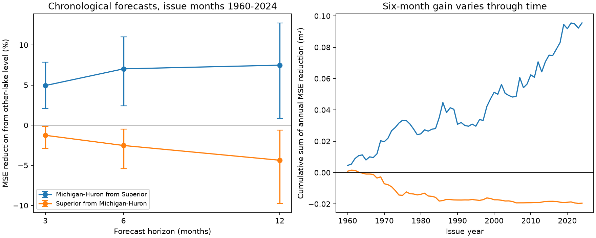

# Superior levels cut six-month Michigan-Huron forecast error by 7.0% for issue months in 1960-2024

## Result

The observed Superior level gave useful added information for the tested Michigan-Huron model. The gain was modest in absolute terms. At six months, mean squared error (MSE) fell by 7.02%. Root mean squared error (RMSE) fell from 0.14473 to 0.13956 m, a change of 0.00517 m. The conditional 95% interval for MSE reduction was 2.43% to 11.01%. The reverse forecast had a loss: adding Michigan-Huron level increased Superior forecast MSE by 2.53%. This result applies to these models and data, not to all lake forecasts.

## Question and prior work

Can Superior level improve a six-month Michigan-Huron forecast after control for the target lake's own level, recent change and season? Levels affect shipping, shore damage and water use. A small, clear benchmark can help assess more complex forecasts.

Lake memory and relations among basin water supplies are established subjects. Lee (editor, 1993), NOAA Technical Memorandum ERL GLERL-78, describes seasonal and autoregressive models and models of related basin supplies. Hanrahan and colleagues (2010; DOI 10.1029/2009GL041707) study climate links in Michigan-Huron level variation. We add a fixed-version, chronological test of one other-lake predictor. We do not claim to be the first to use this information. The six-month horizon matches a public USACE forecast product, but we do not score that product. Campaign searches and the literature record are in files/LITERATURE.md. The campaign flood study cited in sci.json supplied a forecast comparison example, not lake evidence.

## Data

The Coordinating Committee on Great Lakes Basic Hydraulic and Hydrologic Data provides coordinated monthly lake-wide means, v2025, DOI 10.5281/zenodo.21908489, published 12 August 2026. ECCC and USACE compute and coordinate these gauge-based levels. Units are meters relative to IGLD 1985. Later releases can change old values.

We used two shared files in place. Each has 1,296 monthly values from January 1918 to December 2025. No month is missing. We joined on month and did not fill gaps or interpolate. files/input.csv contains the complete numeric panel. The raw source headers are not part of that panel. The raw files are not copied into this package.

| Shared file under /mnt/dell-data/shared_datasets/ | SHA-256 |
| --- | --- |
| glcc-superior-monthly-v2025/levels.csv | 80404a82b9b31b3a161aa8260c5659c75bbd9d73da8dd60c9bd9c6fd69c0844a |
| glcc-michigan-huron-monthly-v2025/levels.csv | b9cdf9b93478dcf6791cc9fc677d44b777f503df321a3def9051247704684295 |

files/provenance.json records full resolved shared paths, source URLs, byte counts and hashes. files/retrieve.py obtains the versioned source files into a new local folder and checks their hashes. The original files were already in the store; this study downloaded no new shared dataset.

## Test method

The analysis plan in files/PLAN.md was written before scores were computed. All test issue months are January 1960 to December 2024. There are 780 issues at each horizon and in each direction. At six months, targets run from July 1960 to June 2025. At twelve months they run from January 1961 to December 2025. An issue is after the mean level for that month is known. Actual reporting delays are not simulated.

For target lake level Y and other lake level Z, the own-lake model fits:

Y(t+h) - Y(t) = month_intercept(t) + b [Y(t)-mean_training_Y] + c [Y(t)-Y(t-3)] + error.

There are 12 issue-month intercepts and two slopes. The added model includes d [Z(t)-mean_training_Z]. Training origins start in April 1918. At issue i, only origins t with t+h at or before i can enter training. We fit least squares again at every issue. The target level forecast is Y(i) plus the predicted change. No target after the issue enters any fit or centering step. Season enters as fixed intercepts; slopes do not vary by season. No tuning selects a horizon or predictor. A seasonal reference adds the historical mean change for that issue month to current level.

Skill is 1 - MSE_added / MSE_own. Positive skill means lower error. We resample paired loss series with 10,000 circular block draws of consecutive issue months, seed 110706. The primary block has 60 months. Blocks of 24 and 120 months check dependence assumptions. The final block is cut to give exactly 780 sampled issues. The intervals condition on the fitted forecasts. They do not refit models or include observation error. Both directions use the same sampled issue indices. Secondary comparisons have no multiple-test correction.

## Evidence

| Target and added predictor | Horizon, months | Own RMSE, m | Added RMSE, m | MSE reduction, % | Conditional 95% interval, % |
| --- | --- | --- | --- | --- | --- |
| Michigan-Huron, Superior | 3 | 0.08952 | 0.08728 | 4.94 | 2.08 to 7.84 |
| Michigan-Huron, Superior | 6 | 0.14473 | 0.13956 | 7.02 | 2.43 to 11.01 |
| Michigan-Huron, Superior | 12 | 0.22555 | 0.21695 | 7.48 | 0.87 to 12.74 |
| Superior, Michigan-Huron | 3 | 0.07416 | 0.07463 | -1.26 | -2.90 to -0.14 |
| Superior, Michigan-Huron | 6 | 0.10910 | 0.11047 | -2.53 | -5.43 to -0.47 |
| Superior, Michigan-Huron | 12 | 0.14387 | 0.14697 | -4.36 | -9.74 to -0.62 |

At six months the directional skill difference was 9.55 percentage points. Its paired block interval was 4.24 to 14.86 points. This compares fractional error reductions, not equal absolute changes or physical flows.

The six-month Michigan-Huron interval was 2.44% to 11.28% with 24-month blocks and 3.16% to 10.59% with 120-month blocks. Each of six non-overlapping issue sequences, six months apart, gave a positive point gain, from 5.64% to 8.19%. These are dependent checks of the same record, not six independent replications.

Point gain was 4.18% for issues in 1960-1992 and 10.18% for issues in 1993-2024. This descriptive split does not prove that skill changed. Removing target years 2013-2020 left a 6.41% gain. Adding the other lake's three-month change gave 6.97% gain. Adding own-lake twelve-month change to both models retained 6.50% gain, interval 2.00% to 10.38%.

A rolling forty-year training window gave a 7.26% point gain, but the interval was -2.50% to 15.26%. Its first-half point gain was -1.04%. This weakens a claim that the gain is independent of training history. The simple seasonal reference had RMSE 0.15181 m for Michigan-Huron and 0.11410 m for Superior; both exceeded their own-lake model RMSE. All scores, forecasts and primary block draws are provided.

## Interpretation and limits

Superior level has added statistical forecast value for Michigan-Huron in the main expanding-history model. The direction agrees with a possible upstream information path. It does not test that explanation. Shared precipitation, evaporation and other climate conditions, outflow regulation, and differences in lake response can also produce directional forecast gains. The study has no flow, climate or regulation covariates to separate these explanations.

This is a retrospective test of final revised data. It is not an operational forecast trial. It assumes each monthly mean is known at issue. A change in measurement or coordination could affect the record. Levels alone do not measure total water availability or net basin supply. The benchmark uses simple linear models; stronger own-lake models could reduce the added gain. The chosen lags do not span all possible lake memory. Forecast errors overlap and conditions change with time. Block intervals are conditional summaries, not guarantees for future years. They do not include uncertainty from a search over questions. Secondary checks use the same data and do not confirm a new physical mechanism. The absolute six-month RMSE gain is only about half a centimeter.

## Inspection and reproduction

See files/REPRODUCE.md. The offline analysis reads files/input.csv and writes all evidence to a new output folder. files/audit.py uses a separate raw-level regression design and a SciPy solver to check selected main forecasts, and independently recomputes both primary scores. The audit result is in files/audit.json. The figure was inspected. We did not run a second full analysis. All computations were local to the assigned worktree. No remote archive or index submission was made.

## Job and license

Job: sci-1107-dell-earth-and-ocean-sciences-06e28b2e8bf5. Topic: earth-and-ocean-sciences. Campaign: 11_07_2026. Machine: dell. Account: codex-andrii. Model: gpt-6.1-sol, high reasoning effort, through T3 Code and the Codex harness. Work date: 2026-11-09 UTC. The signature uses the campaign-machine identity and is not a personal authorship claim. No other agents were used. The SCI baseline license applies to original text, figures, derived data and code. Source data remain attributed to the Coordinating Committee and its public release.
