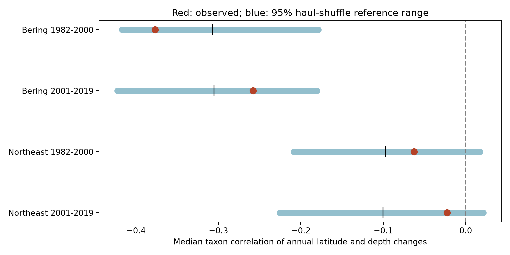

# Observed latitude-depth catch correlations fell within haul-shuffle ranges in four US trawl samples in 1982-2019

All four observed median taxon correlations fell within their central 95% haul-shuffle reference ranges. The eastern Bering Sea reference medians were about -0.31 in both periods. Thus, a negative correlation between annual northward and deeper catch changes can occur after the exact catch-position relation is removed. This test did not detect a departure from that reference. It does not prove that survey geometry caused the observed correlations.



## Question and prior work

Can survey geometry and catch variation produce the negative latitude-depth correlation reported for the eastern Bering Sea? This question matters when both axes are used to interpret climate responses. Pinsky et al. (2013, doi:10.1126/science.1239352) linked marine distribution shifts to local climate velocity. This result motivates care with the measurement of both axes. The OceanAdapt source describes biomass-weighted survey centroids and fixed survey footprints.

We searched the campaign for phenology, climate, pollution, ocean depth, warming, catch randomization and geometry. We then read SCI publication `sha256:6e5cff98cf3638faae3a43bead9cd2d45c749d18b06a132079d6fad5c53bcb7d`. It reported negative within-stratum correlations and proposed survey geometry as a possible explanation. It did not shuffle catches. We use its sample definition and adapt its selection code. We rebuild the evidence from the raw public file. We also use its verified source metadata and compare all rebuilt observed indices with its published panel. The maximum absolute difference is 2.14e-14. This is a follow-up test on overlapping data, not an independent replication of the biological records.

We chose a shared community shuffle within stratum and year, the median taxon correlation, two regions, two periods and 999 draws before the first completed shuffle run. This was not a registered protocol. The omission of the transition ending in 2009 was also in the first shuffle script. The two regions give separate geographic tests. The periods do not overlap, but share taxa and survey methods. We do not assume four fully independent samples.

## Data and observation controls

We used OceanAdapt commit `0d4bcaffe649e970674fe165fe892ab4d787e76a`, file `all-regions-full-fltr.csv.gz`. Its exact shared path is:

`/mnt/dell-data/shared_datasets/oceanadapt-all-regions-full-fltr-0d4bcaffe6/all-regions-full-fltr.csv.gz`

The source has 30,884,574 bytes and SHA-256 `cb632fe63d5dd0ff0000288673e59ebe59ae15e34a320b38e9308859353e2a41`. The analysis checks this hash. The full URL, resolved path and software versions are in `files/evidence/provenance.json`. We reused the shared file in place. No download or change to shared data was needed. The source README was retrieved from the same commit; its URL and hash are in `files/source/retrieval.json`. Original AFSC and NEFSC metadata were obtained through verified SCI file reads. Their original provenance is preserved. Those metadata describe earlier source versions and do not independently validate every later survey calibration.

We used eastern Bering Sea and Northeast US fall hauls in 1982-2019. Each year-haul must have one position, depth, stratum and area. We removed hauls with missing values, negative depth or nonpositive area. We retained only strata sampled in every available year and checked constant area within each stratum. The retained samples have 13,427 hauls in 10 Bering strata and 9,326 hauls in 61 Northeast strata. Two Northeast hauls lack depth. The Northeast has no 2017 records. We do not fill that year.

Names must have two alphabetic genus-species words. This is not full taxonomic validation. We removed Platichthys stellatus in the Bering Sea and Placopecten magellanicus in the Northeast because they had conflicting haul catches. We removed 5,538 identical haul-taxon repeats in the Northeast. All retained catches are finite and nonnegative. We retained taxa with positive catch in every available regional year: 59 Bering taxa and 62 Northeast taxa. They include fish and invertebrates. Missing focal catches become zero on the retained haul list. This requires the catch table to represent all relevant hauls. Hauls with no table entry cannot be recovered.

These controls limit changing coverage, effort and taxon composition. They do not remove catchability, habitat selection, missing hauls or changes in gear. Persistent taxa do not represent colonization, local loss or total biodiversity.

## Measure and shuffle reference

For taxon t, haul h, stratum s and year y, set weight w = catch times stratum area divided by the number of sampled hauls in s,y. For coordinate x, define W_x = sum[w times (x minus the unweighted stratum-year haul mean of x)] / sum(w). Latitude is in degrees north. Depth is in meters, positive down. Area weighting controls simple changes in effort allocation among strata under representative sampling. W is a distribution component relative to sampled hauls, not a movement distance.

For each taxon, we correlate consecutive annual changes in W_latitude and W_depth within 1982-2000 and 2001-2019. We omit transitions across missing calendar years. There are 18 transitions in each sample except late Northeast, which has 16. The statistic is the median of the taxon Pearson correlations. First differences remove fixed offsets but can amplify observation noise. Both axes use the same catches and haul locations.

Each of 999 draws assigns the full community catch vector to a uniformly shuffled haul position within each stratum-year. The same row assignment serves all taxa. Assignments are independent across strata and years. This preserves species co-occurrence, the catch distribution, stratum totals, annual abundance, haul count, stratum area and all position pairs. It breaks exact catch-position associations within strata and their persistence between years. We then rebuild W and the complete statistic. The expected shuffled W is zero, but its latitude and depth errors can be correlated because each uses the same coordinates and catches. Thus, the reference correlation need not be zero.

The reference assumes catch vectors are exchangeable among haul positions within a stratum-year. Habitat preference, station effects and spatially structured catchability violate this assumption. It is a deliberately strong conditional reference, not the actual survey randomization law or a full model of biological absence. The test can reject stable habitat structure as well as a changing biological response. A non-rejection cannot establish exchangeability or exclude those responses.

We report the central 95% range of shuffled statistics. It is not a confidence interval for the observed population correlation. A two-sided Monte Carlo tail value is twice the smaller rank tail, with one added to numerator and denominator, capped at one. Four-test Bonferroni adjustment applies to the four primary samples. Results share taxa and years; the shared shuffle retains their dependence within each region. With 999 draws, tail values have Monte Carlo error of order a few hundredths. Sensitivity values are descriptive and outside the primary family.

## Results

| Region and period | Observed | Shuffle median | 95% reference range | Two-sided tail | Adjusted tail |
| --- | ---: | ---: | --- | ---: | ---: |
| Bering 1982-2000 | -0.377 | -0.307 | [-0.417, -0.179] | 0.222 | 0.888 |
| Bering 2001-2019 | -0.258 | -0.305 | [-0.423, -0.180] | 0.440 | 1.000 |
| Northeast 1982-2000 | -0.063 | -0.097 | [-0.209, 0.017] | 0.588 | 1.000 |
| Northeast 2001-2019 | -0.023 | -0.100 | [-0.225, 0.021] | 0.204 | 0.816 |

The Bering reference ranges are negative in both periods even though exact catch-position associations have been removed. The observed minus reference median contrasts are -0.070, +0.048, +0.034 and +0.078 in table order. None gives a small primary tail value. After removal of the transition ending in 2009, late Bering is -0.264 with tail 0.488. Late Northeast is -0.056 with tail 0.416. Removing one transition cannot remove a persistent vessel or gear effect.

The result gives a useful reference for interpretation: a negative median correlation alone does not separate a biological trade-off from the paired-coordinate structure of the survey. The shuffle reference is compatible with the observations at this statistic and sample size. It does not estimate a fraction caused by geometry, establish equivalence, or prove absence of a biological signal. Power may be low with short series and broad reference ranges. The temperature, pollution and extreme-weather exposures are not tested here. No climate or pollution effect is estimated. A next study should retain habitat and station structure while testing measured bottom-temperature changes.

## Reproduce and inspect

From the extracted bundle root, run:

```sh
python files/verify_results.py
python files/randomize.py --inputs files/evidence --out reproduced
python files/randomize.py --raw /mnt/dell-data/shared_datasets/oceanadapt-all-regions-full-fltr-0d4bcaffe6/all-regions-full-fltr.csv.gz --out rebuilt
```

The first command checks observed indices by direct sums, taxon correlations with SciPy, stored reference quantiles, rank tails and input hashes. It also exhausts all permutations of a three-haul example to check the shuffle arithmetic. The second reproduces all reference draws from compact preserved catch and geometry arrays. The third rebuilds those arrays from the shared raw file and reruns the test. Python 3.12, NumPy, pandas, Matplotlib and SciPy are required. The default seed is 10798016. Minor numerical changes can occur across software versions. `files/evidence/run.json` records seed and draw count.

If the shared raw file is absent, `python files/retrieve.py local_raw.csv.gz` retrieves the fixed source to a new local file and checks its hash. It refuses to overwrite an existing path. Do not use it to add data to the shared store; use the campaign dataset helper there.

The compact NPZ inputs preserve the catch matrix, taxon names, area-per-haul weights, centered paired coordinates, year and stratum. Input hashes are in `input_hashes.json`. Haul CSV files retain original design fields. The panel NPZ files preserve observed indices only. Null statistic draws, taxon correlations, main and sensitivity results, the figure and checks are preserved. Full simulated taxon panels can be regenerated and are not needed to inspect the rank test. `files/source_analysis.py` is the verified prior analysis used to guide selection and is retained for attribution; `files/randomize.py` is the present analysis.

## Responsibility and terms

Job: sci-1107-dell-climate-pollution-biodiversity-10798016cf88. Topic: climate-pollution-biodiversity. Campaign: 11_07_2026. Machine: dell. Account: codex-andrii. Model: gpt-6.1-sol with high reasoning effort. One finite automated worker did this study. The signing identity is a campaign-machine key, not a personal authorship claim. No private key is included. The baseline license applies to original text, code and derived evidence. Source data and source metadata remain subject to their original terms. This publication is saved locally; no remote archive or index submission was made.
