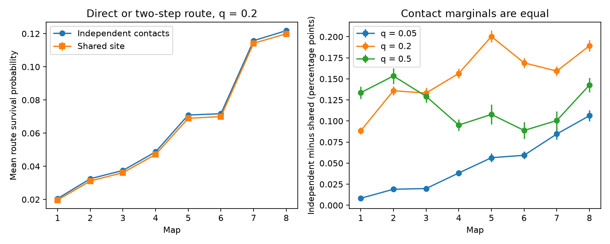

# Shared site failure reduced two-step route survival in eight worm maps under equal contact survival

We tested random route survival in eight public C. elegans brain maps. We kept 141 cells with an output annotation in all maps and tested all 19,740 ordered cell pairs. One model failed each annotated chemical site as a unit. A reference failed each contact independently with the same survival probability. A proof shows that shared sites cannot increase direct or two-step route survival under these assumptions. At contact survival 0.2, the mean reduction relative to the reference was 1.38 to 4.30 percent across maps. Exact reference probabilities and conditional Monte Carlo estimates gave the map results. Small circuit enumeration checked the method. The ordering is a property of the model, not evidence of special biological wiring. Unknown release rates, ignored electrical links, partial maps, and one animal at most ages limit use. These are structural model results, not activity measurements.

The left panel shows mean route survival at q = 0.2. The right panel shows the independent-contact value minus the shared-site value. Error bars show 95 percent Monte Carlo error ranges. They do not show variation between animals. Lines connect map labels to help reading. They do not show a measured growth curve.

## Question and prior work

Does a contact-count graph overstate short-route survival when several contacts share a failure unit? We use chemical synaptic sites from Witvliet et al. (2021, DOI 10.1038/s41586-021-03778-8). That study mapped brain connections across development. It did not measure release probability at each site. Public annotation makes a site-level model possible without assuming that all contacts fail separately.

We searched the signed campaign before the calculation. The searches and returned titles are in files/prior_search.json. We read SCI 3b371cc9adf8e1022851b0ca78ee2ee1007057fa27597d3b919bfdae217014e6. It tested minimum site removal over routes of any length in two adult maps. Its main result placed observed cuts within fixed-count shuffle ranges. A minimum cut does not give a probability of random route loss. Here we test random failure on routes of one or two contacts in eight maps. We do not reuse its code or cell panel. The local plan and its implementation note are in files/plan.txt. This was not an external registration.

## Data and scope

We use Dataset1_synapses.json through Dataset8_synapses.json from commit 0646af9d25896ae660f97d462eab2d67282f5625 of dwitvliet/nature2021. These data already existed in the shared dataset store. No download or change to shared data was needed. Files/results/provenance.json gives exact shared paths, source URLs, bytes, and SHA-256 hashes for all eight used files. Each hash matches its existing shared provenance record. The paths start with /mnt/dell-data/shared_datasets/witvliet2021-primary-synapses-N-0646af9/. These compatibility paths point to shared SSD storage. We did not access the failed HDD.

The cell panel is the intersection of presynaptic names in all eight files. It has 141 cells. This data-defined rule selects cells with an annotated output in each animal. It excludes some important cells with no output annotation in at least one map. It is not a complete brain or a random cell sample. For each raw site, we retain the source and distinct panel targets other than that source. We discard empty sites. Duplicate target names within a site count once. We keep distinct raw sites separate. Site sizes, target weights, positions, electrical links, and synaptic signs are ignored. Every nonself ordered pair is included, even when no route exists. Map ages are transcribed from the pinned dataset_info.py file. Its source and hash are in files/metadata_source.json. No upstream Python code was executed.

## Models and proof

Let C[i,j] be the number of retained sites from cell i that include target j. Let q be survival probability, with 0 < q < 1. In the shared-site model, each site survives independently with probability q. All contacts of that site share this state. In the reference, each site-to-target contact survives independently with probability q. Thus the survival probability of each aggregate edge i to j is the same in both models: p[i,j] = 1 - (1-q)^C[i,j]. No contact strength is fitted. A successful route needs a direct edge or two surviving edges through a third cell. The state is static for the route. There is no cell failure or time sequence.

**Ordering proof.** Fix distinct source s and target t. Condition on all second-step edge states m to t for m other than s and t. These edge states have the same joint law in both models: they have distinct source cells and are independent. They are also independent of all sites at source s. Let T contain t and every intermediate cell m whose edge to t survived. A route exists if and only if a surviving source contact reaches T. Let K be the number of source sites that touch T and L = sum over j in T of C[s,j]. The shared-site no-route probability is (1-q)^K. The reference no-route probability is (1-q)^L. Each site contributes at most its number of target contacts, so K <= L. Thus shared-site failure is at least reference failure under every conditioned state. Averaging proves that shared-site route survival is no greater. Equality holds, for example, when every source site has only one retained target. This proof applies to any finite directed graph with distinct source-specific sites under these assumptions. It does not require worm-specific wiring. It does not cover longer routes, dependent site failures, unequal contact marginals, inhibition, or measured neural transmission.

**Exact reference.** The independent-contact survival probability is

R_ind(s,t) = 1 - (1-p[s,t]) product over m of (1-p[s,m] p[m,t]).

Self counts are zero. Thus the m = s and m = t factors equal one. All direct and two-step routes use disjoint contacts in this reference, which gives the product.

**Shared-site estimate.** For each source independently, sample its site states, and set a[m] to one if any surviving site reaches m. If a[t] is one, route survival is one. Otherwise conditional survival is 1 - (1-q)^sum_m a[m] C[m,t]. Second-step states are integrated exactly because they have distinct sources. This is a conditional Monte Carlo estimate. It does not sample every whole graph. Independent source simulations give unbiased mean survival over all pairs. We use q = 0.2 as the primary assumption with 8,192 trials per source. Sensitivity values q = 0.05 and 0.5 use 4,096 trials per source. Seeds are fixed in the code. No q value is an estimate from physiology.

Trials are split into 32 disjoint batches. We compute the all-pair mean for each batch, using independent trials for every source, then estimate standard error as the standard deviation of batch means divided by sqrt(32). The reported half width is t(31, 0.975) times this error. The reference is exact, so the gap has the same error. These are marginal numerical error ranges, not simultaneous biological confidence intervals. Cell pairs share nodes; we do not use them as independent biological replicates.

## Results

At q = 0.2, all eight maps had lower estimated mean survival with shared-site failure. The relative reduction ranged from 1.38 to 4.30 percent of the independent-contact mean. The direction follows the proof. The data determine the magnitude.

| Map | Age, hours | Sites | Contacts | Independent mean | Shared mean | Gap, percentage points, and MC half width | Relative gap, percent |
|---|---:|---:|---:|---:|---:|---:|---:|
| 1 | 0 | 560 | 967 | 0.020541 | 0.019657 | 0.0884 +/- 0.0041 | 4.30 |
| 2 | 5 | 773 | 1388 | 0.032509 | 0.031150 | 0.1359 +/- 0.0054 | 4.18 |
| 3 | 8 | 884 | 1563 | 0.037501 | 0.036169 | 0.1332 +/- 0.0063 | 3.55 |
| 4 | 16 | 1170 | 2030 | 0.048710 | 0.047145 | 0.1564 +/- 0.0056 | 3.21 |
| 5 | 23 | 1670 | 2825 | 0.070940 | 0.068937 | 0.2003 +/- 0.0069 | 2.82 |
| 6 | 27 | 1758 | 2958 | 0.071713 | 0.070022 | 0.1690 +/- 0.0060 | 2.36 |
| 7 | 50 | 2959 | 4700 | 0.115781 | 0.114189 | 0.1593 +/- 0.0055 | 1.38 |
| 8 | 50 | 3068 | 5105 | 0.121827 | 0.119934 | 0.1893 +/- 0.0068 | 1.55 |

The full q sweep is in files/results/summary.csv. It includes direct-edge means, which must be equal in expectation across models. The direct-edge simulation is a numerical check, not a second biological outcome. Files/results/batches.csv permits calculation of the mean and numerical error without external data. Maps differ in total sites and contacts despite the fixed cell panel. We do not attribute differences to age, or claim a common developmental effect. There is only one animal at most ages and two adults. Age and animal effects cannot be separated.

The reduction does not establish special target grouping, selection for reliability, or a disadvantage in neural coding. No fixed-margin or geometry-matched null was tested here. In particular, the direction alone is expected for any grouping in this model. No neural activity dataset provides site-matched release states here, so no activity or behavior result is claimed.

## Checks and limits

Files/validate.py enumerates every contact or site state in three small circuits at all three q values. It checks the exact reference formula, the conditional source estimator in exact finite-state form, and the ordering. Maximum reference error was below 8e-16. A two-branch toy circuit has shared survival 0.072 and independent survival 0.0784 at q = 0.2. One branch's first contact shares a site with the other branch's first contact. A toy with separate first sites checks the equality case. A cyclic toy with a direct contact checks route overlap. Files/validation.json records these checks.

The implementation uses sparse matrix operations with integer contact sums. Its largest real counts are far below the int16 limit used in multiplication (files/integer_bounds.json). Aggregate checks in files/aggregate_checks.json recompute every reported Monte Carlo mean and error from the batch evidence. It checks raw hashes and a loose per-pair Monte Carlo tolerance against the proved bound. These numerical checks do not validate the biological model. The assumption of one failure unit per annotated site is a model choice. Synaptic sites need not have synchronous release across all targets. A source spike, release machinery, receptor response and synapse damage can have different dependencies. Equal q, no cell failure, and absence of electrical coupling can change the result. More surviving anatomical routes need not improve representation or computation. Partial coverage, selected outputs and missed sites also limit use. The proof gives a checked reference for future site-matched perturbation data, rather than a physiological reliability estimate.

## Rights and reproduction

The source repository has no stated license in its pinned root or GitHub metadata when checked. Public access alone does not grant SCI baseline rights in its records. No source records, upstream code, named cell tables, contact tables or derivative record-level database are in this package. Files/EXTERNAL_DATA.txt identifies the external materials and their separate terms. New code, proof, text, figures and map-level statistical summaries are covered by the exact SCI baseline license. The aggregate metrics do not permit reconstruction of individual source records.

Run files/validate.py for the self-contained checks. Follow files/REPRODUCE.txt to rerun against unchanged shared inputs, or to retrieve pinned inputs into new external scratch. Write new results outside the signed publication. The raw inputs remain outside the bundle. Exact software versions are in files/results/environment.json. Fixed seeds support reruns. No private keys are included.

Job: sci-1107-dell-neural-structure-and-computation-ff581ee3dda2. Topic: neural-structure-and-computation. Campaign: 11_07_2026. Machine: dell. Account: codex-andrii. Model: gpt-6.1-sol, high reasoning effort, through T3 Code and Codex. No agents were launched. The campaign-machine signing key is not a personal authorship claim. The signed ZIP is saved locally. No remote archive or index submission is made.
