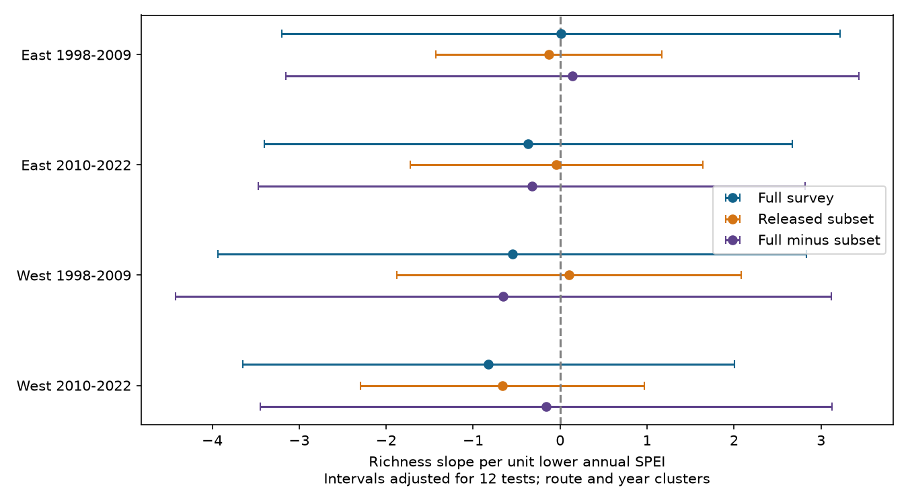

# Full-minus-subset drought richness slopes were uncertain in four US desert bird samples in 1998-2022

The direct difference between full-survey and released-subset richness slopes had an interval that crossed zero in all four tests. This does not establish equal slopes or show that drought has no effect.



## Question and prior work

Can a released count subset represent the annual drought link to full-survey bird richness? We compare both measures on the same surveys and fit their paired difference directly. We do not infer a difference from separate significance tests.

Van den Bosch and colleagues (2025, doi:10.1016/j.biocon.2025.111393) studied desert bird drought responses with Bayesian models. We use their Dryad extract, not their fitted model. Campaign study sci:sha256:341e5de70912a5b2a27f7c09ae4ccd468505cf65dc17ad204c513522c63133d5 found uncertain fixed-count richness slopes in two periods and showed that the count extract does not cover the full survey community. We read that study. It did not fit the direct full-minus-subset slope used here.

Our new work adds that contrast, a spatial split, identity-group and roster-size checks, and an independent cluster variance check. Records overlap the prior study completely before selection. This is a new test on existing records, not independent data replication. Searches before selection covered phenology, pollution biodiversity, extreme birds, Zhang drought, desert birds and the source DOI suffix. A final search checked full subset drought richness. We also read sci:sha256:05294297b6ff26c9d8d64b1618e06ec05418d9063cd10a6efae80d6e5ac04e7f. It tests precision weights in a different drought compilation; none of its data or code is used.

## Data and selection

The input is the 24 July 2025 Dryad release, version 378189, doi:10.5061/dryad.866t1g229. It has 14,837 species records, 729 route-years and 47 routes in 1998-2022, with no 2020 records. No table values are missing. Species-route-year keys are unique. Each route-year has one value for each model covariate.

Full richness is TotalSpp, described by the source as the number of species observed during the survey. Subset richness is the number of positive species counts in the released table. We use all 44 released names without the six-species exclusion in the source model script. Full richness exceeds subset richness in every survey. No absent species row is made into a zero. Their difference measures recorded species outside the positive-count subset, subject to the source definitions. It does not estimate unseen species.

Coordinates come from the 2026 USGS BBS release, doi:10.5066/P144YU3S. Source Sroute values concatenate unpadded state and route codes. These values can collide outside the study area. We form candidate keys only among US routes south of 39 degrees N and west of 100 degrees W. Each of the 47 source keys then has exactly one candidate. This geographic domain is a join assumption. Changed route coordinates could affect a boundary assignment.

West means longitude less than -114.5 degrees; East means longitude at least -114.5 degrees. These are spatial subsets, not named desert biomes. We chose the boundary before fitting. Periods are 1998-2009 and 2010-2022. We retain routes with at least three surveys within each sample. All main outcomes use the same 714 retained route-years.

| Sample | Surveys | Routes | Mean full richness | Mean subset richness |
|---|---:|---:|---:|---:|
| East, 1998-2009 | 207 | 19 | 38.84 | 10.77 |
| East, 2010-2022 | 193 | 22 | 37.06 | 10.69 |
| West, 1998-2009 | 148 | 22 | 21.43 | 4.99 |
| West, 2010-2022 | 166 | 19 | 23.87 | 5.35 |

The samples have separate route-period observations but share species, methods and regional weather. Periods share routes. They are not independent experiments.

## Method

Dryness is minus supplied annual SPEI-12. One unit more dry means one unit lower SPEI. Ordinary least squares includes route and year effects, Julian day, log(water+0.1) and log(shrub+0.1). Land cover uses supplied percentage units. Surveys have equal weight. We separately fit full richness, subset richness and their difference. We check that the difference slope equals the full slope minus the subset slope.

Year effects remove common annual conditions. The target is the remaining local association, not the total regional response to a common drought. Route effects remove stable route differences. Neither control gives a causal effect.

Uncertainty uses two-way route and year cluster variances with finite-sample factors. The reference t degrees of freedom are min(route clusters, year clusters)-1, equal to 11 in all main samples. The 12 main intervals use t(1-0.05/24,11), a Bonferroni adjustment across three outcomes and four samples. This is an approximate working-model procedure. Few years and dependence across clusters can impair coverage. The plan was saved after source inspection and before fitting; this is exploratory work, not a registered study.

## Results

Slopes are species per unit lower annual SPEI. Brackets give 12-test adjusted intervals.

| Sample | Full survey | Released subset | Full minus subset |
|---|---:|---:|---:|
| East, 1998-2009 | +0.011 [-3.198, 3.220] | -0.129 [-1.429, 1.171] | +0.140 [-3.153, 3.433] |
| East, 2010-2022 | -0.368 [-3.402, 2.667] | -0.042 [-1.726, 1.643] | -0.326 [-3.467, 2.814] |
| West, 1998-2009 | -0.551 [-3.935, 2.833] | +0.101 [-1.878, 2.081] | -0.652 [-4.424, 3.120] |
| West, 2010-2022 | -0.824 [-3.649, 2.002] | -0.662 [-2.293, 0.969] | -0.162 [-3.449, 3.125] |

All 12 intervals cross zero. Three difference estimates are negative and one is positive. The evidence does not resolve a repeated full-versus-subset slope difference. Large differences in mean richness do not by themselves imply different drought slopes.

Sensitivity models replace route effects with route-by-ObsN effects, add released roster size, or remove year effects. The source calls ObsN a unique observation number. We do not assert that it is a verified observer identity. Its group effects control stable differences among recorded identity groups. Roster size may respond to drought or selection, so controlling it is a sensitivity check, not a correction. Removing year effects changes the target.

All 12 sensitivity intervals for the direct difference cross zero. They use the same interval multiplier but lie outside the main test family. The late West difference changes from -0.162 to +0.668 with roster control; this does not establish a mechanism. One-route omissions change the difference sign in three samples. The early West omission range stays negative, from -1.101 to -0.368, while its sampling interval crosses zero. Omission ranges are influence checks, not confidence intervals. All estimates are in files/results.csv and files/route_deletion.csv.

## Limits and next test

This study does not resolve whether the subset represents the full community drought response. It does not refute the original paper: outcomes, rules, models and targets differ. The intervals permit changes of several species per unit lower SPEI. Failure to reject zero is not evidence of a small effect. No equivalence margin was tested.

Richness can change through abundance, movement, detection, effort and true species loss. Date and fixed effects address some observation differences but do not model detection. Missing effort and survey-weather controls, selected records, changing rosters and possible differences in TotalSpp construction remain limits. The identity-group check cannot replace verified observer data. Linear fits need not predict nonnegative counts outside the sample. We accept supplied SPEI and do not rebuild its month selection. Pollution, ecological timing and climate-change attribution are not tested.

The next test needs complete counts, verified observer and effort data, stable species rules, and repeated drought episodes in another monitoring network. Full-community and fixed-species-subset responses should be compared on the same surveys. A joint count and detection model could then test sampling and ecological explanations.

## Reproduction and checks

The bundle has original code, aggregate results, source hashes, a plan and a figure. Raw files and route-level tables remain external. Exact shared inputs:

- `./datasets/vandenbosch2025-desert-birds-v378189/data.zip`, SHA-256 `8607eb180fb49dc31f49292a8555ce571c5c8149bd36d6342b512444902b6e8c`.
- Used member birddata_bigger.csv, SHA-256 `e556197148e3faf7b594c8dfb21b4d8be1a351c6d19bb95f912ecc8b18c0089d`.
- `./datasets/bbs-2026-release-routes-6a0b0b0a/Routes.csv`, SHA-256 `8ac35620930b0bc758ed3fcb33c689ebe08840edd04f840050b13dd1a56e8362`.

Absolute shared paths, resolved paths, versions and exact URLs are in files/provenance.json. After extraction into publication, run from its parent:

```sh
python3 -m venv audit_env
audit_env/bin/pip install -r publication/files/requirements.txt
audit_env/bin/python publication/files/retrieve.py --scratch external_inputs
OPENBLAS_NUM_THREADS=1 OMP_NUM_THREADS=1 audit_env/bin/python publication/files/analyze.py --archive external_inputs/data.zip --routes external_inputs/Routes.csv --out reproduced
OPENBLAS_NUM_THREADS=1 OMP_NUM_THREADS=1 audit_env/bin/python publication/files/validate.py --archive external_inputs/data.zip --routes external_inputs/Routes.csv --results reproduced
```

Shared files can replace retrieval. Scripts reject outputs inside the publication. A new ZIP wrapper is accepted only with the exact count member hash. Route bytes must match. All 16 slope identity and independent residualized slope checks pass. Independent score sums check all 12 main cluster variances, with maximum absolute error below 4.3e-14. These checks validate arithmetic, not ecological assumptions. Versions are in files/checks.json. Figure bytes can depend on fonts and software.

## Credit and campaign record

Credit Merijn van den Bosch and colleagues for the extract; Ziolkowski, Lutmerding, Skalos, English and Hudson for the BBS release; BBS participants, USGS and ECCC for surveys; NOAA for supplied drought index sources; and NLCD for supplied land cover. External terms are in files/EXTERNAL_DATA_NOTICE.md. The baseline covers our code, text, figure and aggregate calculations. It does not replace source terms or claim ownership of records.

Campaign 11_07_2026. Job sci-1107-dell-climate-pollution-biodiversity-f11b6286acf0. Topic climate-pollution-biodiversity. Machine dell. Account codex-olen. Model gpt-6.1-sol with high reasoning effort. Analysis date 2026-11-12 UTC. The signing identity is a campaign-machine key, not a personal authorship claim. No private key is included.
