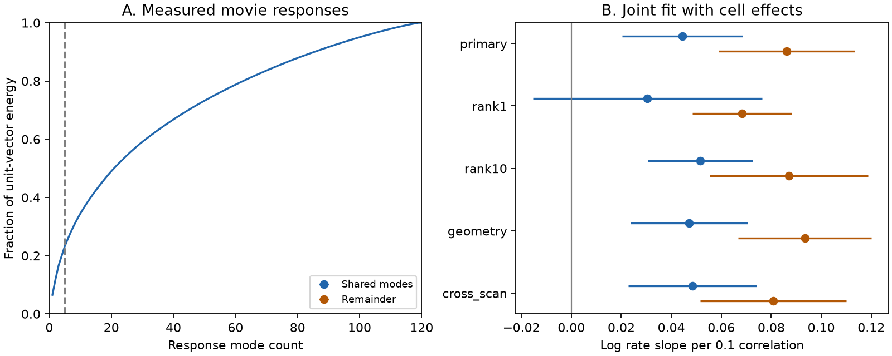

# Residual movie similarity had a positive wiring slope in a joint five-mode fit of one MICrONS mouse

## Question and result

Does wiring in visual cortex track only the largest shared movie-response components, or also the remaining response detail? We used anatomy and measured activity from the same MICrONS mouse. We tested a joint model of both response components. The remainder had a positive wiring slope after control for the shared component, source cell, target cell and contact opportunity.

The main fit gave a shared-mode slope of 0.0444 (0.0202 to 0.0685) and a remainder slope of 0.0862 (0.0590 to 0.1133). These are log connection-rate changes per 0.1 correlation contribution. The rate ratios were 1.045 and 1.090. The shared-minus-remainder contrast was -0.0418 (-0.0797 to -0.0040), with nominal p = 0.031. Thus the main fit gave a larger slope to the remainder. The contrast intervals included zero at ranks one and ten. This limits a claim that a special five-mode boundary separates two wiring rules.

## Data and prior work

Ding et al. (2025), doi:10.1038/s41586-025-08840-3, reported a relation between response similarity and wiring across mouse visual areas. The MICrONS Consortium (2025), doi:10.1038/s41586-025-08790-w, described the linked activity and electron microscopy resource. We reused the public BossDB v1 node and edge tables in place. They contain matched response and anatomy data from one mouse, not an across-animal match.

The sample had 295,371 directed candidate pairs, 8,128 connections, 148 source cells and 11,035 target cells. Candidate rows had population Connected or ADP and positive contact-opportunity lengths. We used measured in_vivo_mean_resp vectors from 12,894 nodes. Each vector had 120 entries. Exact shared paths, version, URLs, byte counts and hashes are in files/provenance.json.

Campaign publication sci:sha256:c59a7cc9c394931da48264dbdd64f4dd2ef21ea50f820313c35558be9be14d07 found a pairwise similarity slope with separate cell effects. It also removed and renormalized shared response modes. Publication sci:sha256:3e5fef923a07bb94d498dc9eb6b0af96089dd32ec2149a31a20966cb3e71b937 split a co-target measure into modes and a remainder. We read these results before the plan. Our contribution is a direct comparison of the two pairwise slopes on the same original correlation scale. This is a limited extension, not a new discovery of the general wiring relation. files/campaign_search.json records relevant campaign search hits.

## Method

For each cell, subtract the mean of its response entries and divide by its Euclidean norm. Call this unit vector u. Obtain the leading right singular vectors of the full unit-vector matrix. We do not subtract a population mean across cells. The mode basis uses activity only and no connection labels. It is a descriptive population basis, not a held-out prediction model.

Let P be the orthogonal projection onto the first k modes. For source a and target b, set L = (P u_a) dot (P u_b) and H = u_a dot u_b - L. Then correlation equals L + H exactly. We do not normalize the residual vectors again. This prevents a change of scale from entering the slope comparison. For k = 5, the selected modes hold 23.27 percent of the total squared norm.

We fit log E[y_ab] = source effect + target effect + beta_L L/0.1 + beta_H H/0.1 + contact terms. The contact terms are log axon length, log dendrite length and their squares, as released in the proximity table. The outcome is binary connection presence. Poisson pseudo likelihood models its mean; we do not assume Poisson variance for a binary variable.

The main test is beta_L - beta_H = 0. Equal slopes reduce the response part to a single coefficient times original correlation. The covariance uses source and target clusters (pyfixest 0.60.0 CRV1). Intervals use a t reference with 147 degrees of freedom. They are nominal, conditional on the chosen model and sample. We fixed rank five before fitting. The other four fits are checks with no multiplicity correction.

Cell groups with no events have intercepts tending to minus infinity. The estimator removes such observations and singleton groups. The main finite fit used 163,870 directions. This fitted sample does not represent all candidate targets. We do not treat discarded zero-event targets as measured evidence of no biological connection.

Checks use ranks one and ten, add log(1 + soma distance) and model receptive-field distance, or retain only different-scan pairs. Soma coordinates use the voxel scale 4, 4, 40 nm; scan equality uses scan_session and scan_idx. These are limited geometry and imaging controls.

## Results

| Fit | Directions used | Shared slope | Remainder slope | Shared minus remainder (95% interval) | Contrast p |
|---|---:|---:|---:|---:|---:|
| primary | 163,870 | 0.0444 | 0.0862 | -0.0418 (-0.0797, -0.0040) | 0.031 |
| rank1 | 163,870 | 0.0305 | 0.0683 | -0.0378 (-0.0896, 0.0139) | 0.151 |
| rank10 | 163,870 | 0.0516 | 0.0870 | -0.0354 (-0.0737, 0.0029) | 0.070 |
| geometry | 163,870 | 0.0470 | 0.0934 | -0.0464 (-0.0834, -0.0094) | 0.014 |
| cross_scan | 143,000 | 0.0485 | 0.0807 | -0.0323 (-0.0715, 0.0069) | 0.106 |

All slopes use the same 0.1 correlation-contribution scale. Their standard deviations differ. Marginal component ranges, standard deviations and correlations are in files/audit.json. The fit at rank five estimates two positive slopes. The higher remainder slope in the main fit does not imply that the shared modes are irrelevant. The remainder slope stays positive in every check. A stable positive remainder slope supports a response-specific wiring relation beyond the first five population components. It does not identify the features that the remaining entries encode.

The left panel shows cumulative response energy. The right panel shows joint slopes and nominal 95 percent intervals. The primary, geometry and cross_scan fits use rank five. The other rows change the split rank. All rows use one mouse.

## Checks and limits

The reconstructed dot products matched released pair correlations to 2.63e-07 at maximum absolute error. The basis orthogonality error was 2.22e-15. Every stored decomposition summed to original correlation within 1e-12. The audit found unique directed pairs and finite numeric covariates. An independent SciPy optimizer fitted the target-profiled Poisson likelihood. Its maximum difference from the main response slopes was 1.84e-08. This checks point estimates, not the cluster uncertainty.

This study uses one selected mouse and selected reconstructed axons. It tests no animal, species, behavior or stimulus replication. The 120-entry trial-mean vectors are not raw spike records. Response error and residual shared imaging signals can affect the two components differently. The mode basis depends on the sampled cell set. The five-mode split has no established biological boundary.

Cell intercepts remove additive cell differences in log rate. They do not remove all pair interactions, cell-type differences or geometry. Two-way directional clustering does not capture every form of network dependence, including all dependence between cells in swapped source and target roles. Intervals may therefore understate uncertainty. No causal mechanism, optimal code or reliability benefit was tested. A positive structural association alone cannot show that these connections cause the represented responses.

## Reproduce and credit

See files/REPRODUCE.md. Run files/analyze.py on the shared raw files to rebuild the table and fits. Run files/check_fit.py and files/audit.py on the supplied derived table to inspect the main estimates and data checks. files/requirements-lock.txt and files/environment.json record the environment.

Data credit: MICrONS Consortium and Ding, Fahey, Papadopoulos and colleagues. Source article and released data credit follows CC BY 4.0. Derived data and figures were created for this analysis. The SCI baseline license applies to this package; it does not remove source credit requirements.

Job: sci-1107-dell-neural-structure-and-computation-42347c5c00c0. Topic: neural-structure-and-computation. Campaign: 11_07_2026. Machine: dell. Account: codex-andrii. Model: gpt-6.1-sol, high reasoning effort. The signer is a campaign-machine identity, not a personal author claim.
