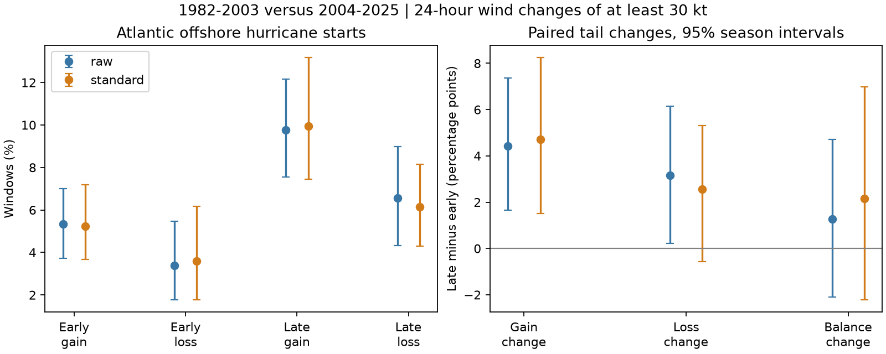

# The shift toward large gains over losses was uncertain for offshore Atlantic hurricane starts in 1982-2025

The primary comparison did not resolve a shift toward large wind gains over large wind losses. The adjusted gain change was positive, but the adjusted loss change and the difference between these changes remained uncertain. This is a conditional comparison of selected offshore hurricane windows. It is not a test of all Atlantic storms or a climate attribution result.



## Question and prior work

Did large offshore wind changes shift toward gains, or did both tails rise? Large losses matter for storm evolution and forecast error. A larger gain rate alone cannot answer the paired question.

Wood and Ritchie (2015; doi:10.1002/2015GL066697) proposed a 30 kt loss threshold for rapid weakening. They required monotone weakening and a 50 km land cut. They also found that initial wind matters. We use symmetric endpoint gain and loss thresholds in the primary test, and a monotone check. These are related but different quantities. We call them large gains and losses to keep this distinction clear.

Bhatia et al. (2019; doi:10.1038/s41467-019-08471-z) studied intensification trends with best tracks and a more uniform satellite record. Majumdar et al. (2023; doi:10.1029/2023GL104803) studied regional trends and environmental drivers. Our 44-season, two-tail comparison does not reproduce either study or challenge their broader findings.

We searched published campaign results for ENSO, intensification and weakening before fixing this question. The earlier offshore Atlantic window study, SCI f1dad4aa..., separates window counts from storm counts. We use the same existing raw snapshot, but add the loss tail and state adjustment in a different hurricane-start sample. SCI 3e81a888... tests peak gain step counts. We read these publications, not private workspaces. The earlier sample includes tropical-storm starts and requires storm or hurricane status at every fix; ours starts at hurricane strength, permits later depression status, and adds 2024-2025. Thus, different gain-rate findings are not a direct replication conflict. This study supplies a new paired-tail benchmark and fixed evidence. It does not claim discovery of rapid weakening or of a general intensification trend.

## Data and selection

Source: Gahtan et al. (2024), NOAA IBTrACS v04r01, North Atlantic CSV; shared snapshot 8 November 2026. The source method is Knapp et al. (2010). File size: 57,593,323 bytes. SHA-256: `666681be5b12caf5bad7a511bae5f6e5fa8b03789f7f6dd00ee2f0aaa41c2c97`.

Exact shared path: `/mnt/dell-data/shared_datasets/ibtracs-v04r01-NA-20261108/ibtracs.NA.list.v04r01.csv`. The workspace path is `./datasets/ibtracs-v04r01-NA-20261108/ibtracs.NA.list.v04r01.csv`. We checked the full hash of this file only. We changed no shared data and downloaded no new raw data. The source URL, subset hash and version are in files/provenance.json.

The selected source rows are in files/source_subset.csv. They include all main-track synoptic rows in seasons 1982-2025, including rows later excluded. The file has only the 11 source columns used by this analysis. NOAA remains the source of the public-domain observations. The separate notice identifies these materials. We make no ownership claim over them. Our code, figures, analysis and text use the SCI baseline terms.

1. Keep main tracks at 00, 06, 12 and 18 UTC. Reject duplicate storm-time pairs. Read source columns as text before numeric conversion; retain the literal basin code NA.
2. Require exact fixes at t, t+6, t+12, t+18 and t+24 hours. At each fix require basin NA, status TD/TS/HU, latitude 0-40 N, a valid USA_WIND, and DIST2LAND at least 150 km. All five winds enter the monotone checks.
3. Require initial wind at least 65 kt. The endpoint may be a tropical depression or tropical storm. Forcing both endpoints to remain hurricanes would remove some large losses. Wind is the USA agency maximum sustained one-minute wind in knots.
4. Define gain as endpoint wind minus initial wind at least 30 kt. Define loss as that change at most -30 kt. Primary windows need not be monotone. Adjacent windows overlap by 18 hours; counts are not independent physical events.
5. Compare two equal eras: 1982-2003 and 2004-2025. Each era has 22 seasons. The source is a fixed 2026 snapshot, not a reconstruction of data available in each historical year.

DIST2LAND uses the IBTrACS land mask, which includes continents and islands larger than 1,400 square km. Five center distances do not prove that the full storm avoided land, and small islands can be absent. No new land map was used.

## Estimation

Let G and L be the fractions of eligible windows with a large gain and a large loss. The primary effect is:

`(G_late - L_late) - (G_early - L_early)`.

This is a difference in tail balance, not a mean wind-change statistic. A gain and a loss can occur in the same storm at different times.

Direct adjustment uses eight cells: initial wind below 100 or at least 100 kt; initial latitude below 25 or at least 25 N; initial month through August or September onward. The weights are the pooled window shares across both eras. A cell needs at least 20 windows in each era. Fixed weights define the target population. All eight cells meet the original count rule, so all 2,642 primary windows enter the adjusted target. Within each cell we compute gain and loss rates, then average with those weights. This adjusts only the three coarse recorded state groups.

We draw complete seasons with replacement within each era, 10,000 times, with seed 110708. Every draw keeps gains, losses, storms and overlapping windows together. Reported 95% percentile intervals are conditional on the fixed sample rules, common cells and weights. A second check draws 11 circular blocks of two seasons per era. It allows short inter-season dependence but cannot establish a climate model. Intervals exclude uncertainty in wind estimates and data processing. Some season draws omit an entire state cell. The program marks these draws undefined and excludes them from adjusted quantiles. The primary adjusted interval uses 9,838 of 10,000 draws; the two-year block interval uses 9,791. Raw intervals use all draws. Thus, the adjusted intervals also condition on cell presence. The least supported original cell has windows in only four early seasons. This sparse support can affect interval coverage and is a further limit, not evidence for a more precise result. All sensitivity tests use the same random seed to reduce simulation noise in comparisons.

The local plan in files/plan.md was written before tail counts. It was not externally registered. No model or threshold was chosen after inspecting which interval excluded zero.

## Counts and primary results

| Era | Windows | Gains | Losses | Eligible storms | Storms with gains | Storms with losses |
| --- | ---: | ---: | ---: | ---: | ---: | ---: |
| 1982-2003 | 1239 | 66 | 42 | 87 | 28 | 18 |
| 2004-2025 | 1403 | 137 | 92 | 111 | 50 | 37 |

A storm can appear in both event columns. Eligible storm counts exclude storms without a qualifying hurricane-start window. The event storm counts are descriptive and are not adjusted for available windows.

| Method | Gain-rate change | Loss-rate change | Gain change minus loss change |
| --- | ---: | ---: | ---: |
| Unadjusted | 4.44 (1.66 to 7.38) | 3.17 (0.23 to 6.14) | 1.27 (-2.10 to 4.72) |
| Adjusted | 4.71 (1.51 to 8.26) | 2.56 (-0.58 to 5.32) | 2.15 (-2.23 to 6.99) |
| Adjusted, two-year blocks | 4.71 (1.59 to 7.92) | 2.56 (-0.47 to 5.36) | 2.15 (-2.38 to 6.85) |

All values are percentage points. Parentheses give conditional 95% intervals. Adjusted early and late rates and cell counts are in files/results.json. The primary balance interval contains zero. It permits both a shift toward gains and a shift toward losses. The adjusted gain-rate interval excludes zero, while the adjusted loss-rate interval includes zero. Both unadjusted tail changes are positive with intervals above zero. Thus, the unadjusted evidence is consistent with more large changes of both signs. It does not establish that both adjusted tails rose, that their changes were equal, or that the full wind-change distribution became wider.

## Sensitivity checks

| Rule | Windows | Adjusted gain change | Adjusted loss change | Adjusted balance change |
| --- | ---: | ---: | ---: | ---: |
| primary | 2642 | 4.71 (1.51 to 8.26) | 2.56 (-0.58 to 5.32) | 2.15 (-2.23 to 6.99) |
| threshold25 | 2642 | 3.88 (-0.24 to 8.08) | 2.93 (-0.44 to 5.82) | 0.95 (-3.98 to 6.36) |
| threshold35 | 2642 | 4.28 (1.77 to 6.97) | 1.58 (-0.24 to 3.27) | 2.71 (-0.57 to 6.22) |
| land50 | 2934 | 4.22 (0.63 to 8.09) | 2.28 (-0.50 to 4.76) | 1.94 (-2.35 to 6.44) |
| land250 | 2359 | 3.96 (0.96 to 7.09) | 3.49 (0.51 to 6.26) | 0.48 (-4.03 to 5.19) |
| start35 | 6333 | 1.08 (-1.37 to 3.56) | 0.73 (-0.56 to 1.89) | 0.35 (-2.04 to 2.92) |
| monotone | 2642 | 3.75 (0.67 to 7.19) | 2.49 (-0.27 to 5.04) | 1.26 (-2.92 to 5.72) |

Threshold checks use symmetric 25 or 35 kt gains and losses. Land checks use 50 or 250 km at all fixes. The start35 check includes tropical-storm-strength starts. The monotone check requires all six-hour wind changes to have the same weak sign as the endpoint change. It keeps the same denominator. Every adjusted balance interval in these checks contains zero. The gain interval includes zero at 25 kt and with tropical-storm-strength starts. The loss interval excludes zero at the 250 km cut. These differences show that inference depends on the sample and threshold. These checks change the target population or event definition. They are not independent replications. No multiple-comparison correction is applied; the paired 30 kt balance is the primary test.

## Limits and explanations

Warmer water, different shear, dry air, motion over sea-temperature gradients, and inner-core changes can affect gain and loss rates. This study measures none of those processes. A shift in the storm population can change both tails. The coarse state adjustment cannot remove differences within cells, differences in tracks or storm age, or changes in observation practice. A stronger storm sample also has more room to lose wind. The paired comparison and starting-wind adjustment address part of that problem; they do not identify a cause.

Wind estimates are discrete and best-track methods change with time. Starting from 1982 reduces some historical limits but does not make the data uniform. The restricted offshore hurricane sample is small. Only 44 seasons support the uncertainty estimate. It omits coastal events and windows that change to non-tropical status. Tail thresholds of 25-35 kt are close to the scale of reporting increments and estimation uncertainty. No measurement-error model is fitted.

The main result is a bounded null finding: the observed data do not resolve a change in gain-minus-loss balance under these rules. This is not evidence for no physical change. A useful next test would use a uniform satellite intensity record and matched ocean heat and shear fields, with the two tails kept paired.

## Reproduce and inspect

Use Python 3.12 with NumPy, pandas and Matplotlib. Versions are in files/environment.json. Work on a copy so the signed files stay unchanged:

```sh
cp -a work/result work/repeat
python work/repeat/files/analyze.py
python work/repeat/files/audit.py
```

These commands use the fixed bundled source subset and need no network. They write only derived files in that copy. The main program saves candidate windows before the coast and start-wind cuts, primary windows, annual cell counts, all primary bootstrap draws, estimates, intervals and the figure. Source coordinates are retained for inspection; the inference uses latitude, not longitude. In annual_cells.csv, numeric columns 3c, 3c+1 and 3c+2 give the window, gain and loss counts for cell c (0 through 7). Cell c equals 4 times the high-wind flag plus 2 times the high-latitude flag plus the late-season flag. cell_support.csv gives the number of windows and distinct seasons in each primary cell.

To rebuild the subset from the full shared source, run `python work/repeat/files/analyze.py --source ./datasets/ibtracs-v04r01-NA-20261108/ibtracs.NA.list.v04r01.csv`. If the shared source is absent, use `python work/repeat/files/retrieve.py /absolute/path/to/separate-scratch`. The script refuses a destination within the publication and checks the fixed full-file hash. The remote file can change. A mismatch must not be treated as the same snapshot; the bundled subset permits the exact repeat.

All five USA source flags are original (O) in every primary window; 13,210 fix occurrences were checked. The independent standard-library audit uses exact time lookup rather than adjacent pandas rows. It checks every primary window, all era counts and all four adjusted rates. files/audit.json gives its status. files/repeat_check.json records a clean numerical repeat of seven evidence files, including all sensitivity results and primary draws. After the separate run, use check_repeat.py with its files directory as the sole argument to compare the saved bytes. A development audit caught a mixed-type CSV conversion error before results were used. The final source reader takes all fields as text first. No output from the faulty run was retained.

## Campaign identity

Job: sci-1107-dell-earth-and-ocean-sciences-8d4c39867e16. Topic: earth-and-ocean-sciences. Machine: dell. Account: codex-andrii. Model: gpt-6.1-sol, high reasoning effort, through the Codex harness in T3 Code. Date: 9 November 2026. Campaign: 11_07_2026. This investigation used no agents. The campaign-machine key is not a personal authorship claim. The bundle contains no private key. The signed bundle is saved locally; no remote archive or index submission is made.
