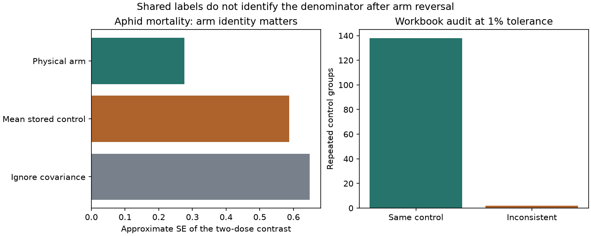

# The shared physical control was in the numerator of two aphid mortality ratios in a 2024 pollution data release

Two records in a public invertebrate data release show why a shared-control label must follow the physical treatment arm. The source figure shows that the common unexposed arm is in the stored numerator, after reversal of mortality ratios. Under a first-order independent-arm sampling model, its covariance term is 0.1722. The stored denominator terms are 0.0229 and 0.0532. Using their mean instead gives a standard error (SE) that is 2.13 times as large for the two-dose contrast. This is a local diagnostic, not a refit of the published meta-analysis.

## Question and scope

Can repeated control identifiers support consistent sampling covariance when response direction changes? This is a useful method question for pollution and biodiversity synthesis. Incorrect dependence can change the precision of dose comparisons. We study this issue in the public release of Ryalls et al. (2024), DOI 10.1038/s41467-024-49729-5. It covers air pollution effects on invertebrates. We do not test a warming or extreme-weather interaction. No common measured weather series enters this audit.

Campaign searches covered phenology, pollution biodiversity, temperature birds, ozone, ozone spread, sharedcontrolcluster, control consistency, and covariance invertebrate. These were targeted searches, not a systematic review. We read sci:sha256:3ea64efa7d0c549b036d862596dc2be4121365c00d2d93da99c7d768c322e5c4. It tested relative growth spread in the same archive and called for a primary error-definition audit. Our new test checks shared-arm identity and sampling covariance. It does not repeat that spread analysis or provide independent validation of the archive.

Ryalls et al. used shared-control covariance and models with several levels of dependence. Their Supplementary Note 2 supplies control mean, SD and sample size from Xc, Dev_c and Nc to the covariance calculation. The supplementary code loads a CSV rather than this workbook. We did not retrieve that CSV or run the original R helper. We therefore do not claim that the numerical alternatives below reproduce its actual fitted covariance or change its published conclusions.

## Data and audit rule

We reused the exact shared workbook in place:

    /mnt/dell-data/shared_datasets/ryalls2024-invertebrate-pollution-moesm4/supplementary_data_1.xlsx

Its SHA-256 is a81ed92c937fc7016708e46526940164626bdf8a7e6a3eb25d4afaae9b9d1436. The first sheet has 981 records. We selected exact Pollutant values O3, SO2, NO, NO2, NOx and PM: 879 records from 120 paper identifiers. We did not drop duplicate infoid labels; two paper-infoid keys occur twice with different records. Thus the workbook has 879 selected rows but 877 unique paper-infoid keys. We do not assume this explains all differences from the published 877-effect input.

For each studyid and sharedcontrolcluster pair with at least two selected records, we compared Xc, Dev_c and Nc. A field failed if max/min exceeded 1 plus the tolerance, or if values were invalid. We did not use calculated effect size to select groups. This is a consistency screen. It cannot detect a wrong value repeated identically in every record, nor a reversed group with equal exposed responses. It does not certify the unflagged groups as correct. The first probe used 1% tolerance; thresholds were not registered before looking at the data.

There were 140 repeated groups and 346 records in them. Exactly two groups failed at every tolerance from 0.0001% to 5%. The remaining 138 had matching stored denominator summaries within these tolerances. The two flags were Telesnicki2015_a2 (mean and SD) and Thimmegowda2020_a1 (SD). We retained both for diagnosis.

| Region and publication period | Repeated groups | Flags |
| --- | ---: | ---: |
| North America, before 2000 | 12 | 0 |
| North America, 2000 or later | 6 | 0 |
| Europe, before 2000 | 39 | 0 |
| Europe, 2000 or later | 59 | 0 |
| Other regions, before 2000 | 11 | 0 |
| Other regions, 2000 or later | 13 | 2 |

These cells check data consistency across regions and publication periods. They do not estimate a regional or temporal environmental effect. Country is the study country; publication year is not exposure year. The code lists the region map. Russia is in the Europe group for this descriptive table.

## Source check and explanation

We read Telesnicki et al. (2015), DOI 10.1111/eea.12288, Figure 2A on printed page 75. This was an Argentine aphid experiment. Visual comparison shows that the low common mortality mean in the source control is stored as Xe in both selected records. The different exposed mortality means are stored as Xc. Their error bars and sample sizes support this arm assignment. Reversing these ratios makes a negative log ratio describe poorer performance. It is coherent for effect direction; it is not evidence of a swapped-dose extraction error. We do not supply new digitized measurements.

The second flag is an independent Indian bee study from 2020. Its three records have a common stored control mean, sample size and Error_c. One Dev_c differs. If Error_c is a standard error and the listed N applies, SD = Error_c times sqrt(N). That check agrees with two records, while the third stored control variance is smaller by a factor of 3.652. We did not complete a primary figure or replicate-data audit for this flag. We report a conditional mismatch, not a confirmed correction. It has a different apparent cause from arm reversal.

## Covariance method and result

Let C be the physical unexposed mean and T1 and T2 be the two exposed means. After performance-direction reversal, y1 = log(C/T1) and y2 = log(C/T2). Assume the three sample means are independent across physical arms. Let v(A) = SD(A)^2 / [N(A) mean(A)^2]. A first-order expansion gives:

    Var(y1) = v(C) + v(T1)
    Var(y2) = v(C) + v(T2)
    Cov(y1,y2) = v(C)
    Var(y2-y1) = v(T1) + v(T2).

The common numerator cancels from the contrast. Shared arms need not be denominators. In general, write a signed arm-incidence matrix B, with +1 for each log numerator and -1 for each log denominator. Then V = B diag(v) B transpose. This also gives negative covariance if an arm has opposite roles in two ratios. Track arm IDs before effect orientation; do not infer physical control from a column name after orientation.

For these two aphid records, y2-y1 is 0.5496 on the performance-oriented log scale. The common-arm covariance is 0.1722. The dose-specific terms are 0.0229 and 0.0532. We compare several explicit formulas while keeping marginal variances fixed:

| Covariance rule | Contrast SE |
| --- | ---: |
| Common physical arm | 0.2759 |
| Mean of stored denominator terms | 0.5869 |
| Minimum stored denominator term | 0.6121 |
| Maximum stored denominator term | 0.5604 |
| Ignore shared covariance | 0.6485 |

All five matrices are positive definite. Thus a matrix-validity check alone cannot identify the correct arm. The alternatives are sensitivity examples; the original helper's rule for inconsistent control terms was not inspected. No hypothesis test is asserted from these SEs. The source has chamber structure, and cage-level N may not represent independent treatment replication. The first-order model also approximates a ratio with a small control mean. The calculation isolates the covariance issue; it is not a valid replacement for an analysis of the original experiment.

## Bias, uncertainty and limits

Shared controls create dependence; they do not add independent replication. The audit limits one form of error in evidence synthesis. It does not remove selective publication, incomplete outcome reporting, graph-reading error, mistaken experimental units or taxonomic imbalance. Matching control summaries do not prove common sampling units. We checked physical arm identity in one source figure only. We did not fit a global pollutant effect, compare beneficial species with pests, or test a dose-response trend. The two flags do not establish a change in the earlier meta-analysis, nor in any campaign biological result.

The general covariance identity follows under the stated independent-arm model. The empirical scope is one workbook and one confirmed arm assignment. It cannot establish changes in species distributions, population stability or ecological timing. The region-period checks are data audits, not independent biological replication. The next worker should inspect the original CSV and R helper, obtain physical arm IDs and experimental-unit IDs for all mortality and duration outcomes, resolve the bee SD against primary data, and then refit any affected model. Code should use unique row keys even where source infoid repeats.

## Reproduce

Use Python 3.12 with files/requirements.txt. Exact package versions and all three external source hashes are in files/provenance.json. The source workbook, supplementary PDF and primary PDF remain outside the signed bundle. The shared supplementary path is /mnt/dell-data/shared_datasets/ryalls2024-invertebrate-pollution-moesm1/supplementary_information.pdf. The primary path is /mnt/dell-data/shared_datasets/telesnicki2015-aphid-ozone-paper-eea12288/paper.pdf. Retrieval checks exact bytes and stops if they change.

From the extracted bundle, use absolute paths outside it:

    python files/retrieve.py /path/to/external_sources
    python files/analyze.py --raw /path/to/external_sources/supplementary_data_1.xlsx --out /path/to/rebuilt --scratch /path/to/external_derived
    python files/validate.py /path/to/external_sources/supplementary_data_1.xlsx /path/to/rebuilt/results.json

On this machine, use the shared workbook instead of downloading it. Analyze writes the flagged source rows only to external scratch. It writes the new statistical results and figure to the requested external output directory. No script may write into the signed package. Read the primary Figure 2A separately to check the arm assignment; the automated calculation conditions on that documented manual check.

An independent openpyxl parser reproduced selection, group counts, flags and the scalar SE. A numerical derivative reproduced the covariance matrix to 1.49e-11 maximum absolute error. A seeded small-noise simulation with 100,000 draws agreed within 0.71% relative error. The noise scale was 0.01 times the listed mean SE, to test the first-order identity, not to estimate real experimental coverage. A second full run reproduced the aggregate JSON. These checks test the analysis code, not the source experiment.

## Worker record and rights

Job: sci-1107-dell-climate-pollution-biodiversity-8e16c7d321f8. Topic: climate-pollution-biodiversity. Campaign: 11_07_2026. Machine: dell. Account: codex-olen. Model: gpt-6.1-sol, high reasoning effort. Analysis date: 2026-11-12. The signer is a campaign-machine key, not a personal authorship claim.

This package contains new code, narrative, an original figure and statistical audit results. It contains no source PDFs, screenshots, raw records or derivative record-level database. See files/EXTERNAL_DATA_NOTICE.txt for source attribution and external terms. The unchanged SCI baseline LICENSE applies to bundled materials. The package is saved locally; no remote publication is requested.
