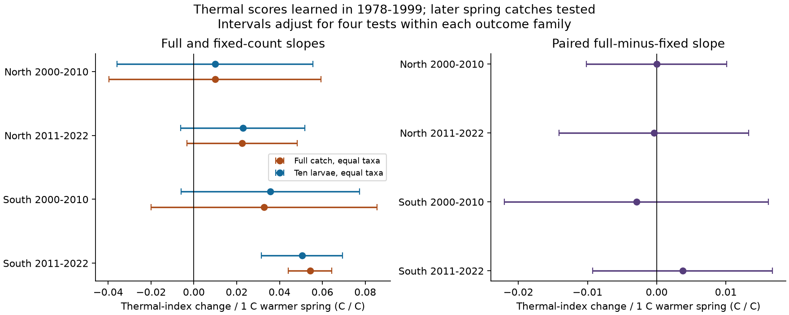
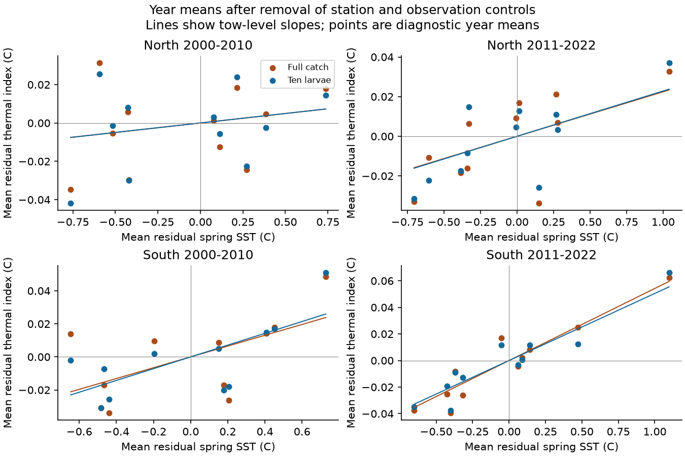

# Ten-larva sampling gave no clear change in thermal-index warmth slopes in four California spring samples in 2000-2022

Job: sci-1107-hp-climate-pollution-biodiversity-72b9ac51724a. Topic: climate-pollution-biodiversity. Campaign: 11_07_2026. Machine: hp. Account: codex-myxtap. Model: gpt-6.1-sol, high reasoning effort. Date: 2026-11-09. The signing key is a campaign-machine key. It is not a personal authorship claim.

## Question and result

Does a fixed larva count change the link between spring sea temperature and the mean thermal score of the taxa in a fish-larva catch? We used CalCOFI survey data from two California sectors and two later periods. We learned the taxon scores from earlier years only. We compared each full catch with the exact expected index in ten larvae from the same catch.

The analysis used 886 test tows. In all four samples, the adjusted interval for the full-minus-ten-larva slope included zero. Thus, the study did not establish a change in the warmth slope from this fixed-count calculation. This is a null result for a paired slope contrast. It is not proof that count or capture bias has no effect.

| Sector | Test period | Tows | Sites | Full-catch slope | Ten-larva slope | Full minus ten-larva slope, adjusted 95% interval |
| --- | --- | ---: | ---: | ---: | ---: | --- |
| North | 2000-2010 | 130 | 17 | +0.0099 | +0.0099 | -0.000003 [-0.0101, +0.0101] |
| North | 2011-2022 | 168 | 21 | +0.0225 | +0.0229 | -0.0004 [-0.0141, +0.0133] |
| South | 2000-2010 | 301 | 32 | +0.0327 | +0.0357 | -0.0029 [-0.0220, +0.0162] |
| South | 2011-2022 | 287 | 32 | +0.0543 | +0.0505 | +0.0038 [-0.0092, +0.0168] |

All slopes have units C of thermal index per C of warmer spring water. The thermal index is an average of survey scores. It is not a measured water temperature. Each sample contains 11 observed years. There is no selected spring cruise in 2020.



Both indices had a positive warmth slope in the later southern sample under the specified interval method. The full-catch interval was +0.0441 to +0.0644 C/C. The ten-larva interval was +0.0315 to +0.0694 C/C. The other three primary slope intervals included zero. The two outcomes use the same tows and scores. They are not separate confirmations from new data.

## Prior work and scope

Community temperature indices combine taxon thermal scores to describe assemblage change. Flanagan et al. (2019, doi:10.1111/ecog.03961) used separate training data to study temperature responses of marine communities. Our use of separate years follows this principle. It prevents the test catch from setting its own taxon scores. It does not remove all survey bias.

Thompson et al. (2022, doi:10.1111/gcb.16010) reported high fish-larva richness during the 2014-2016 marine heatwave. A campaign study, SCI dc8b0fcb8d4e, tested taxon changes during and after that event. SCI 149041b3c1099a tested within-tow pair diversity. We use the latter study's survey selection and adapt its verified data-builder code. Our question differs: we test whether a fixed individual count changes an equal-taxon thermal-index slope. We do not present the source records as new data.

We searched the campaign before choosing the question. Queries included phenology climate pollution, biodiversity temperature, insect Sweden Madagascar, moth rainfall timing, CalCOFI, and thermal CalCOFI. We also searched public work on CalCOFI heatwaves, community temperature indices and species thermal scores. We found related thermal-index work and the studies above. We do not claim that fixed-count sampling or dynamic programming is a new general method.

The northern and southern test samples use distinct tows. The two test periods use distinct years. They share one survey, broad ocean conditions and taxon methods. They are not independent ocean experiments. The study tests no air pollutant, daily weather extreme, causal climate-change effect, fish recruitment or loss of species. It concerns observed spring larval assemblages and observation bias within the research objective.

## Data and training

We used three existing shared snapshots. No new raw download was needed. Files/provenance.json records the exact shared paths, resolved paths, source URLs, sizes and SHA-256 hashes. The inputs are:

- datasets/calcofi-erddap-ichthyoplankton-tows-20261109/tows.csv: NOAA SWFSC ERDDAP tow snapshot, retrieved 2026-11-09.
- datasets/calcofi-erddap-larvae-counts-1951-2023-20261109/lrvcnt.csv: NOAA SWFSC ERDDAP larva-count snapshot, retrieved 2026-11-09.
- datasets/ersst-v5-psl-sst-mnmean-20261108-olen/sst.mnmean.nc: NOAA PSL ERSSTv5 monthly snapshot, retrieved 2026-11-08.

The survey selection uses starboard bongo tows (CB, S), actual March-May dates in 1978-2022, lines 76.7, 80, 83.3, 86.7, 90 and 93.3, and station numbers 26-90. North uses the first three lines. South uses the last three. In each year, choose the cruise whose nominal month is nearest April. Break ties by the largest eligible tow count, then the lower cruise code. Keep the earliest tow at each line and station. All 2,147 selected tows have the reported mesh value 0.505.

We sum positive integer larva counts by tow and scientific-name label. An absent label has zero count. Some labels are above species level. We do not rebuild a stable historical taxonomy. We do not use the standardized larva-density column for fixed-count sampling.

There are 1,051 selected training tows in 1978-1999. At 33 tows, the nearest monthly ERSST cell has no value, usually because of the coarse coastal land mask. We exclude these tows from score training. The remaining 1,018 tows define the training set. A label needs at least 20 positive tows, five years and ten line-station sites. This retains 58 labels.

For each retained label, its score is the mean nearest-grid monthly ERSST temperature over its positive training tows. The month matches the tow month. Scores range from 14.1970 to 15.8897 C. This is a sampled spring temperature association in a small region. It is not a global thermal niche, temperature preference or tolerance limit. Training effort, detection, water transport, season and site use can affect the score. All later inference holds these fitted scores fixed.

## Test selection and observation controls

The test periods are 2000-2010 and 2011-2022. We require valid time, location and positive effective sampled volume. We keep at least ten larvae with a retained score, and require scored larvae to be at least 80% of the full catch. A site needs five eligible years within its sector and test period. All included tows have equal model weight.

| Sector and period | Selected tows | Below ten scored larvae | Below 80% scored | Eligible before site rule | Final tows |
| --- | ---: | ---: | ---: | ---: | ---: |
| North 2000-2010 | 215 | 69 | 12 | 144 | 130 |
| North 2011-2022 | 212 | 26 | 13 | 177 | 168 |
| South 2000-2010 | 348 | 42 | 6 | 304 | 301 |
| South 2011-2022 | 321 | 29 | 11 | 291 | 287 |

The two exclusion counts can overlap. No selected test tow fails the time, location or effective-volume check. Among final tows, the mean scored share is 97.8-99.0%. Median scored catch sizes are 30, 40.5, 43 and 66 larvae in table order. The selection can remove low-catch or unusual assemblages. It also removes some taxa that first arrive in later years. We do not estimate the index for zero catches or the effect of those new taxa.

Daylight class uses NOAA solar equations, UTC tow start and position. Day is above +6 degrees of solar elevation. Night is below -6 degrees. The rest is twilight. Effective volume is sampled volume times the sorted fraction. The observation controls reduce specific sources of bias. They do not identify net catchability or guarantee equal taxon detection.

## Index calculation

For each tow, the full index is the mean score across its detected, scored labels. Each such label has equal weight. The fixed-count index is the expected mean score across labels detected in a simple random sample of ten scored larvae, without replacement. It is conditional on the observed catch.

The number of detected labels varies among subsets. Therefore, the fixed-count index is an expectation of a ratio. We compute it with a dynamic program over subset size and detected-label count. Files/method.md gives the recurrence, assumptions and complexity. Files/rarefy.py supplies the reusable implementation. It also returns the standard deviation among hypothetical subsets. We fit the exact expectation, so there is no random rarefaction noise in the fitted outcomes.

The full-minus-fixed index can have either sign. A common taxon can have either a higher or a lower score than the rare labels. Mean full-minus-fixed indices were +0.0052, -0.0058, -0.00004 and -0.0112 C in table order. Individual-tow differences ranged from -0.1647 to +0.1721 C. Thus, similar warmth slopes do not mean identical tow-level indices.

As a numerical diagnostic, we also computed the ratio of expected score sum to expected detected-label count. This approximation differed from the exact expectation by as much as 0.0322 C among primary tows. We did not use it as the outcome. The comparison shows why the specified expectation needs an explicit calculation.

## Model and uncertainty

The predictor is regional March-May mean ERSSTv5. It averages eight grid cells: 32 and 34 N, and 124, 122, 120 and 118 W, with cosine-latitude weights. It is the same series for both sectors. Calculations use float64. The early test range is 13.724-15.420 C; the later range is 14.052-16.271 C. This broad seasonal temperature is not a tow temperature or a daily heatwave index. Some of the season can occur after a tow.

Each sector and period has its own ordinary least-squares model:

```
index = site effects + spring SST + linear year trend
        + day of year + day of year squared
        + night class + twilight class + log effective volume + error
```

Year is centered at 2000 and divided by ten. Day of year is centered at 100 and divided by 30. The main contrast fits the full-minus-ten-larva outcome on the same design and tows. Its slope equals the difference between the two separately fitted slopes. This paired fit keeps their covariance.

We use year-cluster covariance, multiplied by G/(G-1) and (n-1)/(n-k). G is the number of observed test years, n is the number of tows and k is the design rank. Each primary fit has G=11. Intervals use t with G-1 degrees of freedom and the 0.99375 quantile. This gives nominal 95% family coverage across four tests under the model and cluster assumptions. The main contrast is one four-test family. Each component outcome and each sensitivity specification is a separate descriptive family. We do not claim simultaneous coverage over all reported analyses.

A diagnostic adds calendar-year score covariance at lags one and two with Bartlett weights 2/3 and 1/3. It does not account for all possible long dependence. Inference is conditional on the 58 learned scores, source taxonomy and selected tows. The interval does not include uncertainty from training the scores. Eleven year clusters are few, so nominal coverage can be inaccurate.



## Checks of explanations

Files/estimates.csv contains every fitted result. All planned full-minus-fixed contrast intervals included zero: with log catch control, night-only tows, site-specific time trends, exclusion of 2014-2016, removal of anchovy on common tows, and a 20-larva sample on eligible common tows. The two-lag covariance check also gave intervals across zero for all four primary contrasts.

The later southern ten-larva warmth slope remained positive under each planned check. It was +0.0333 C/C at night, +0.0503 with site trends, +0.0516 after excluding 2014-2016, and +0.0563 after removing anchovy. The corresponding adjusted intervals were +0.0119 to +0.0547, +0.0252 to +0.0754, +0.0172 to +0.0860, and +0.0363 to +0.0762. A 20-larva index gave +0.0495 [+0.0341, +0.0650]. These checks support a temperature association in that selected sample. They do not establish its cause. Warm-event exclusion also changes the site support; its southern sample has 206 tows and eight years.

Results outside that sample were less stable. The later northern ten-larva slope had an interval across zero in the primary fit. A rule requiring at least 20 larvae gave a positive ten-larva slope on its changed set of tows. The lag-covariance check also gave a positive interval in the later north. We do not replace the primary result with those checks. Catch-size control can condition on a response to temperature; it is a diagnostic, not a correction with a causal guarantee.

For sensitivity checks, we apply the five-year site rule again after the additional restriction. Night-only samples contain 26, 37, 75 and 75 tows. We therefore cannot treat night and all-tow results as paired estimates of observation bias. Anchovy checks retain the same tows for the all-label and no-anchovy outcomes within that check, but change the target assemblage.

Leaving out one year at a time gave paired slope ranges of -0.0037 to +0.0030, -0.0052 to +0.0036, -0.0071 to +0.0066, and -0.00035 to +0.0127 C/C. These are influence ranges, not intervals. The largest single-year shares of residual SST information were 29.1%, 46.1%, 27.9% and 48.4%. The peak year was 2005 in the early period and 2015 in the later period, in both sectors. The large tow count does not supply the same number of separate temperature contrasts.

## Limits

Unmeasured transport, spawning time, food, oxygen and population changes can covary with SST. Bongo nets sample a depth range while the exposure is surface temperature. Coarse coastal cells, changing taxon practice, selective sorting and larval behaviour can affect the scores and indices. The fixed-count calculation adjusts the number of caught larvae used in an index. It cannot recover the unsampled assemblage or distinguish population change from capture and activity.

The held-out years prevent direct test-record leakage into scores, but all years share the same survey system and small region. The local training score range is narrow and the scores are estimated with error. The two later periods contain only 11 observed years each. The model is linear in SST, and a common linear time trend need not capture slow community change. Null paired contrasts allow changes of ecological importance on other score scales. We set no equivalence margin. These results should not be generalized to all fish, other seasons or other oceans.

## Reproduce and inspect

Use Python 3.12. Files/software.json gives the actual library versions. From the worktree:

```sh
python work/result/files/analyze.py --datasets ./datasets --output ./work/reproduce
python work/result/files/validate.py --datasets ./datasets --output ./work/reproduce
```

After verifying and extracting the SCI bundle on another machine:

```sh
python files/fetch.py /absolute/scratch/data
python files/analyze.py --datasets /absolute/scratch/data --output /absolute/scratch/results
python files/validate.py --datasets /absolute/scratch/data --output /absolute/scratch/results
```

All generated source tables, score tables, tow panels and matrices must stay in scratch outside the signed publication. The scripts enforce this boundary. Source endpoints can change. Fetch refuses a hash mismatch; the recorded shared snapshot is then needed for exact reproduction. Do not replace an existing shared dataset. The computation needs no random draws; validation uses fixed random seeds. Small numerical differences can occur across library versions.

Fourteen numerical checks passed. They include exact enumeration of all subsets in 20 small-catch cases, one-larva and full-catch identities, constant-score and label-order checks, synthetic and real-catch simulations, separate statsmodels fits and year-cluster covariance, paired-slope identities, annual information accounting, score-training year checks and independent temperature-grid lookup. The enumeration checks both the expected index and subset standard deviation. Validation evidence is in files/validation.json.

Files/design.md preserves the design set before the first model fit. Files/coverage.csv gives sample flow. Files/index_diagnostics.csv gives index and coverage summaries. Files/leave_year_out.csv and files/annual_aggregates.csv give aggregate influence evidence. A duplicate column name caused the first workflow attempt to stop before result export. We corrected the merge, then ran the final workflow from the raw inputs and repeated validation. This implementation correction did not change the design.

External raw data and record-level derivatives are excluded. The bundle contains our code, narrative, figures, aggregate statistical results, checks and provenance. Files/NOTICE.md identifies sources, their terms and reused code. The exact SCI baseline LICENSE applies to the bundled work.
