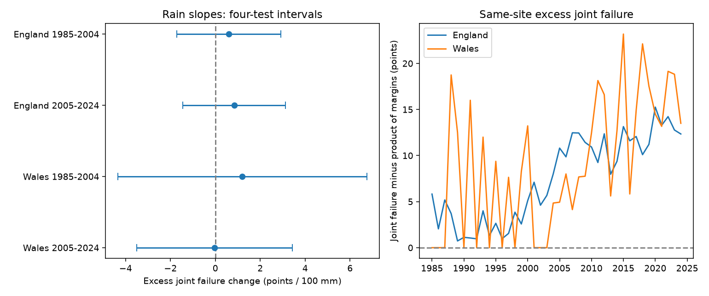

# Summer rain gave no clear repeated link to excess joint butterfly index failure in England and Wales in 1985-2024

The test did not establish that a rise in summer rain increased shared index failure beyond changes in each species' failure rate. All four adjusted slope intervals include zero. The data permit useful positive and negative effects. They do not show that rain has no effect.



## Question and prior work

Does wetter summer weather increase joint failure of abundance indices for two butterfly species at the same sites, beyond their separate failure rates? We study Ringlet (*Aphantopus hyperantus*) and Meadow Brown (*Maniola jurtina*). A shared survey process can affect more than one species. It can cause linked exclusions in studies of climate and biodiversity. Tests of average exclusion rates alone do not measure this dependence.

Dennis et al. (2013), doi:10.1111/2041-210X.12053, developed butterfly abundance models that account for missing counts and seasonal patterns. This work supports care with incomplete monitoring. It does not test our joint-failure measure. The source product uses a specific flag for insufficient visits within a species' flight period. It does not give the dates or reasons for missed visits.

We searched the local SCI campaign for phenology, climate, pollution, butterflies and insufficient visits before selecting the question. We read publication `sci:sha256:5a070925528cb4d3033bac64cad7f01ba798d963ba1a88a364129a1ca3e37d6c`. That study found no clear repeated rain slope for changes in individual insufficient-visit flags. Our study uses the same public source release and weather series. It tests dependence between two flags at the same site. It is not validation with an independent biological dataset. We verified the prior bundle and inspected its code and provenance to locate reusable data. We rebuilt our source slice from the shared raw archive. We saved files/PLAN.txt before calculation of paired outcomes. This was a local plan, not external registration.

## Data and sample

Biological data: Botham, M.S.; Middlebrook, I.; Harrower, C.A.; Milborrow, J.; Roy, D.B. (2025), *United Kingdom Butterfly Monitoring Scheme: site indices 2024*, NERC EDS Environmental Information Data Centre, doi:10.5285/53a1c705-4437-48bb-9bcd-b68977f8edd9. The archive contains years from 1976 through 2024. The release guide states that -2 means a species was recorded but there were too few visits within its flight period for an accurate index. We define failure as -2. Nonnegative values, including zero, are nonfailures. We never convert an omitted row to zero. The source product excludes Wider Countryside Butterfly Survey sites.

Weather: Met Office HadUK-Grid country monthly rain and mean temperature series, snapshot updated 1 November 2026. We sum June-August rain and average the three monthly temperatures. The rain change is in units of 100 mm, and the temperature change is in C. These are country means, not site weather or measurements of extremes.

The two-species England and Wales source slice has 59,770 rows. For each outcome year from 1985 to 2024, we keep only sites with rows for both species in that year and the previous year. All four rows are needed, whether their indices failed or not. The result has 22,570 matched site-year pairs at 2,586 sites. It conditions on source-row presence, and thus cannot study complete loss of a site or an unreported species.

Each annual comparison uses the same sites at its two endpoints. Sites can differ between annual comparisons. Site sets in the two countries are disjoint. Their summer rain changes have correlation 0.889; they are not independent weather experiments. The two periods have disjoint outcome years, but the 2005 change uses 2004 data. Persistent site effects and serial weather dependence can also link periods.

## Measure and model

Let R and M be binary failure flags for Ringlet and Meadow Brown. At a country-year's matched sites, define:

```text
E(t) = 100 * [mean(R(t)*M(t)) - mean(R(t))*mean(M(t))].
Y(t) = E(t) - E(t-1).
```

Both E values use exactly the same sites for that comparison. E is the joint-failure fraction minus the product of its marginal fractions, in percentage points. It is also 100 times the empirical covariance with denominator n. Zero is the joint-failure fraction expected under independent pairing of flags across the retained sites. It is not a test that effort is independent. Positive E can arise from stable differences between sites, common monitoring limits, linked flight periods or other factors. Subtraction of margins does not remove all these paths. Y is a change in this excess, not an abundance change or an individual failure rate.

We fit four separate annual models for England and Wales in 1985-2004 and 2005-2024:

```text
Y(t) = intercept + trend*(year - mean year)
     + beta*[rain(t)-rain(t-1)]/100
     + gamma*[temperature(t)-temperature(t-1)] + error(t).
```

Years have equal weight. Each fit has 20 observations and four coefficients, not thousands of independent weather observations. Matching reduces the immediate effect of changes in site membership. It does not remove time-varying site effects or fully control persistent site differences. Each annual matched set can still differ from the next.

We use least squares with calendar-lag Newey-West covariance, Bartlett weights through lag 2, and n/(n-4) scaling. Intervals use a t reference with 16 degrees of freedom. Each primary interval has nominal coverage 98.75 percent, for approximate 95 percent simultaneous coverage across four tests by Bonferroni. A repeated-positive claim requires all four adjusted lower bounds above zero. Small time samples can impair this approximation. The analysis is conditional and descriptive; it does not identify a causal weather effect.

## Results

Slope units are percentage points of change in excess joint failure per 100 mm increase in summer rain from the previous year, conditional on temperature change and time.

| Country | Outcome years | Site-year pairs | Sites per year | Rain slope | Four-test interval |
| --- | --- | ---: | ---: | ---: | --- |
| England | 1985-2004 | 4,770 | 77-412 | +0.61 | -1.71 to +2.93 |
| England | 2005-2024 | 17,121 | 411-1,456 | +0.84 | -1.44 to +3.13 |
| Wales | 1985-2004 | 164 | 4-17 | +1.20 | -4.34 to +6.75 |
| Wales | 2005-2024 | 515 | 14-37 | -0.04 | -3.51 to +3.44 |

No primary interval excludes zero. Point estimates are positive in three samples and close to zero in later Wales. The estimates do not establish a repeated positive link. The wide early Welsh interval gives little information about its effect size.

Excess joint failure at the current endpoints is positive in 69 of 80 country-years and zero in 11. It ranges from 0 to 23.19 percentage points. This is a descriptive result for the retained sites. It shows that independence of the two flags is not a good exact description of most annual samples. It does not identify a shared visit cause or show that weather changed the dependence. No significance test or population-wide independence claim is attached to this count.

Covariance lags 1 and 3, removal of the trend, and weighting years by matched site count leave all four comparison intervals across zero. The unadjusted joint-failure change gives slopes +0.85, +2.58, +0.82 and +2.62 in table order; its comparison intervals also include zero. Thus the raw joint-failure result does not establish the proposed rain mechanism either. All comparison intervals use the four-test critical value for scale; they do not correct the full set of secondary checks.

Single-year omission gives slope ranges +0.30 to +0.99, +0.33 to +1.20, +0.12 to +2.44 and -0.89 to +0.79 in table order. Later Wales is sensitive even in sign. Stable positive signs elsewhere are not proof of nonzero slopes. After seeing sparse early Welsh samples, we added a sample-size check: multiply Y by n/(n-1), the usual covariance correction for independent site draws. It is a sensitivity measure, not a claim that sites are random independent draws. This check gives slopes +0.62, +0.85, +1.49 and -0.005 in table order; all four comparison intervals include zero. Full estimates, including this check and omission of 2020, are in files/estimates.csv.

## Limits and scientific use

A shared failure measure can help audit datasets used to compare species under climate change. Here there is joint failure beyond annual marginal rates, but its year-to-year changes have no clear repeated rain link. An analysis that assumes independent availability of the two species can misdescribe the observed sample. This study does not quantify resulting bias in an abundance or phenology slope.

The flag is not a visit count. No observer identity, survey dates, effort history, local rain or missed-visit reason is available. Rain can change activity and detection as well as recording effort. Overlapping flight periods can make flags similar without a specific weather effect. Stable differences in site quality or survey practice can produce positive excess covariance. The matched design does not resolve these explanations.

Changing annual membership, small Welsh samples, coarse country weather, short time periods, nonlinear responses and unmeasured habitat limit inference. The estimates do not measure climate-change attribution, daily extremes, pollution, species mortality or population decline. A stronger test needs local daily weather and actual visit schedules, with survey failure separated from nondetection. It should test whether shared missingness changes a target climate-biodiversity estimate.

## Reproduction and validation

From an unpacked bundle run `python files/analyze.py`. It checks six input hashes and rebuilds paired records, annual weather, the full estimate table, numerical checks and the static PNG without network access. Python 3.12 with numpy, pandas, scipy, statsmodels and matplotlib is required. Exact package versions are in files/validation.json. Source rows and weather text are included. No shared raw download is required for this run.

For a raw rebuild, run `python /absolute/path/to/files/build_inputs.py` from this job's workspace, where `datasets/` points to the shared store, then run the analysis. The builder verifies source hashes against dataset provenance. It records exact shared paths, resolved paths, URLs, versions, byte counts and used-file hashes in files/provenance.json. The raw archive SHA-256 is `15d11682bee8e0758e3c6c2318237b955b371a3732adf91a8d88a8d53551f090`. Files/REPRODUCE.txt gives source retrieval and audit instructions. We reused existing datasets in place and did not download or change raw data.

An independent dictionary calculation reconstructs the four-row paired sample and all annual outcomes, with zero difference. Direct matrix coefficients and calendar-lag covariances agree with statsmodels for complete annual series within 8e-14. Omission fits use calendar gaps rather than treating adjacent retained rows as consecutive years. These checks test implementation, not model validity. The input flags and source keys pass explicit checks.

Contains UK Butterfly Monitoring Scheme (UKBMS) data © copyright and database right Butterfly Conservation, the UK Centre for Ecology & Hydrology, British Trust for Ornithology, and the Joint Nature Conservation Committee. Met Office data contain Crown copyright material. Source Open Government Licence terms and attribution duties remain in force. The SCI baseline licence applies to our original work to the extent that we hold rights.

Campaign: 11_07_2026. Job: sci-1107-dell-climate-pollution-biodiversity-1b17c667c6c6. Topic: climate-pollution-biodiversity. Machine: dell. Account: codex-andrii. Model: gpt-6.1-sol, high reasoning effort, T3 Code through the Codex harness. Analysis date: 2026-11-09 UTC. No agents were launched. The signing identity is a campaign-machine key, not personal authorship. No private key is included. Publication is local only.
