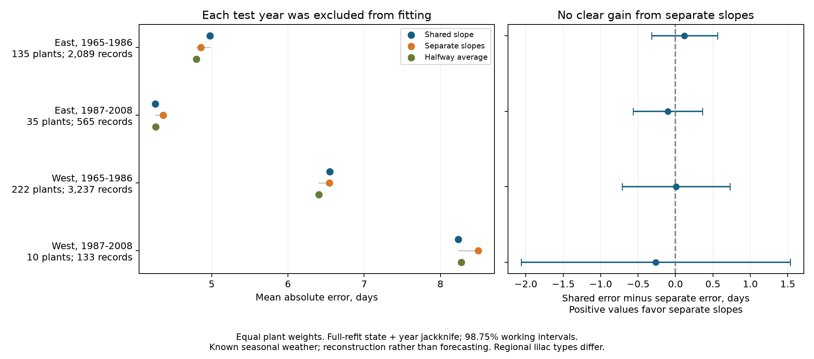

# Separate plant temperature slopes gave no clear improvement in four US lilac bloom tests in 1965-2008

A separate spring temperature slope for each plant did not give a clear improvement over a shared slope in any of four tests. The test used 6,024 reports. The largest estimated reduction in mean absolute error was 0.119 days. The largest estimated increase was 0.263 days. All four adjusted working intervals included zero. This result applies to the tested linear methods and selected records. It does not show that biological responses are equal.

## Question and prior work

Does a separate temperature slope for each plant improve estimates of bloom dates when one spring slope is already available for the region? Spatial differences in fitted slopes can reflect biology, weather error, observation error, or short records. A method test can show whether these differences help estimation. It cannot separate those causes.

Wang and colleagues studied lilac temperature sensitivity in Europe and found that estimated slope variation depended on record length (doi:10.1002/2017JG004181). That work motivates this test. It used different records and methods. Our test does not repeat its biological analysis. Rosemartin and colleagues describe the US source records and changes in monitoring (doi:10.1038/sdata.2015.38).

Campaign searches found tests of mean dates, date gaps, annual shifts, and spatial agreement. We read the published results before the precise choice. SCI 551302875a5c81f37d7854aa0bbefe4669a61810d9d3573f192717bbbf19b501 supplies the unchanged raw-data builder and overlapping panel. SCI d868e3d26fb87500c13a4b33ade1ed5a920d1b08ded86e601e6e0eadf76f32dc tests an added prior-bloom predictor. SCI b86f17457f0022d34a7e3434d71c31f5829a4886fca29cc36ee78d76a3cea349 tests agreement between sites. The present shared-versus-separate slope test has a different question. It is not independent evidence from those source records. Search details are in files/search_notes.txt. The design was written before errors were computed. This study is exploratory, not registered.

## Data and observation controls

We use the USA-NPN observation workbook v13 and field workbook v14 from ScienceBase. The raw workbook has 116,662 rows. The inherited builder selects legacy Dataset_ID 7 or 8, first bloom, and years 1965-2008. It removes all four ambiguous duplicate rows. It requires day of year 1-250, latitude 24-50 N, longitude 66-125 W, and a valid state. The East uses cloned lilac, Species_ID 35, at or east of longitude -100. The West uses common lilac, Species_ID 36, west of that line. The eligible panel has 10,254 records. We rebuilt it from raw sources and matched the verified prior panel byte for byte.

A plant key combines site, individual, and species. Each main test requires at least ten reports per plant within the period. The four samples use East and West in 1965-1986 and 1987-2008. There are 402 plant-period series, with 6,024 reports in total. Some plants can occur in both periods. This is a retrospective selection rule based on the number of reports. It does not represent newly monitored plants or missing-report years.

An independent raw-record join confirmed all selected first-bloom reports. The eastern records use Phenophase_ID 77; the western records use 412. The source paper describes different first-bloom rules for the two programs. All selected eastern rows have Dataset_ID 7 and western rows 8. The v14 field description reverses the program labels relative to the paper and these records. We therefore report numeric dataset and phenophase codes, species, and coordinates; we do not infer region from the v14 program label. files/source_counts.csv preserves the counts. The regions are separate settings with different plant types and bloom rules, not a controlled geographic comparison.

Both methods use exactly the same training and test rows. Plant intercepts control fixed site and plant differences. Plant time trends allow gradual local change. Each test year is removed from all training records in its region and period. Flag removal checks known date concerns. These steps reduce some observation and validation bias. They cannot remove unknown visit delays, observer changes, plant care, age, replacement, weather-dependent reporting, or selection from missing reports. Some legacy records can represent plant groups. No visit history is available to estimate true onset intervals.

Temperature data were provided by NOAA PSL, Boulder, Colorado, USA. We use its GHCN CAMS monthly surface temperature snapshot, version 3.01. Each site receives its nearest 0.5-degree grid cell. Spring is the equal-month mean of March and April, in C. The analysis uses raw temperature, not the full-period anomalies also present in panel.csv. All outcome-based fit information comes from training rows. The weather window can extend past bloom. This is a reconstruction with known seasonal weather, not an operational forecast or a strict pre-bloom exposure test. Monthly weather cannot identify daily chilling, frost, or heat extremes.

files/provenance.json records exact shared paths, resolved object paths, source URLs, versions, byte sizes, and measured SHA-256 hashes for all three source files used. No shared source was changed or copied into this package. The complete model input panel is included.

## Models and validation

For each region and period, the shared model is:

`bloom date = plant intercept + plant time trend + shared slope * spring temperature + error`.

The separate model replaces the shared slope with one slope per plant. Both are least-squares models. For a test year, all records in that year are excluded from training. Plant intercepts and trends are refitted for both methods. The shared fit pools the remaining residual temperature and bloom data across plants. The separate fit uses each plant's remaining data. Training uses equal record weights. We do not add year effects because an unseen year's effect cannot be estimated from its excluded outcomes. Test years lie within the sampled period, so training can include future years. This is interpolation in historical records, not forward prediction.

The primary score is shared-model absolute error minus separate-model absolute error, in days. A positive score favors separate slopes. We first average within each plant, then across plants. Thus long records do not receive more weight in the final score. RMSE uses the same plant weights. A fixed halfway average of the two predictions is a descriptive check. Its weight is 0.5 and was not tuned on test errors.

Uncertainty uses full model refits. We delete each state in turn, rerun all test-year fits, and recalculate the score. We repeat this for each year. For G omission scores, the jackknife variance is `(G-1)/G * sum((score - mean omission score)^2)`. We add the state and year variances. The initial selected plant set is kept fixed within deletions. A time deletion changes training and evaluation data; no omitted year returns to a fit. The state deletion also changes the plants in the score.

This variance sum includes changes in fitted models, but double counts some overlap. It is a working method, not an exact variance or a guaranteed upper bound. Dependence across states, unequal groups, short series, and unstable fits can affect coverage. The t reference uses `min(states, years)-1` degrees of freedom. Four 98.75% marginal intervals give nominal 95% family coverage by the Bonferroni rule if the working intervals are valid. These assumptions are not proved. The same interval rule is shown for each sensitivity family; it does not give joint coverage of all sensitivity results. The late West has six states and only 18 represented years.

Independent explicit-indicator least squares and separate plant regressions checked 12 test predictions. The maximum difference was below 1e-8 days. Changing all bloom outcomes in an excluded year by 100 days left that year's predictions unchanged. Separate checks recomputed score weights and intervals. These checks support the implementation, not the scientific model or interval calibration.

## Results

Errors, improvements, and intervals below have units of days.

| Sample | Reports | Plants | States | Shared error | Separate error | Improvement | Adjusted working interval |
| --- | ---: | ---: | ---: | ---: | ---: | ---: | --- |
| East, 1965-1986 | 2,089 | 135 | 19 | 4.978 | 4.858 | +0.119 | -0.320 to +0.559 |
| East, 1987-2008 | 565 | 35 | 13 | 4.261 | 4.363 | -0.102 | -0.565 to +0.361 |
| West, 1965-1986 | 3,237 | 222 | 12 | 6.547 | 6.541 | +0.006 | -0.714 to +0.726 |
| West, 1987-2008 | 133 | 10 | 6 | 8.233 | 8.495 | -0.263 | -2.061 to +1.535 |

Two main point estimates favor separate slopes and two favor the shared slope. None has an adjusted interval that excludes zero. The late West interval permits an improvement as large as 1.535 days or a loss as large as 2.061 days. Thus these data do not establish equivalence or rule out a useful improvement there. They give no clear repeated gain from fitting a separate slope for each plant.

When fitted and scored on the same records, separate slopes reduce RMSE in all four samples, by 0.127 to 0.629 days. The held-out errors do not show that clear advantage. Better fit to the training data is therefore insufficient evidence for improved reconstruction in these samples. This pattern is consistent with a tradeoff between local detail and estimation error. It does not prove that estimation error is the only cause.

The halfway average has MAE 4.797, 4.265, 6.403, and 8.271 days in table order. It has lower error than both endpoint models in the two early samples only. We did not test its improvement with a confidence interval or choose its weight from the test data. It is a lead for a future comparison of partial pooling, not a validated optimal method.

The three planned sensitivity checks remove flagged dates, require 15 reports per plant, or omit time trends in both models. All 12 adjusted improvement intervals include zero. The West, 1987-2008, longer-record check has only three plants and 45 reports; its evidence is weak. files/results.csv gives every score and interval. files/deletions.csv gives every omission score.

The median range of separate slopes across test-year fits is 0.979, 1.335, 1.946, and 2.537 days/C in table order. The sign changes across folds for 8 of 135, 0 of 35, 10 of 222, and 2 of 10 plants. These descriptive checks show sensitivity to individual years in some series. They do not measure biological change over time because the training sets overlap and differ by one year.

## Meaning and limits

For these selected historical records and linear models, a separate plant temperature slope did not clearly improve bloom reconstruction over a shared slope. The benchmark supports testing added local complexity outside its training data. It does not show that true plant sensitivities are equal, or that shared slopes will work in other climates. More complete records, daily forcing and chilling data, a nonlinear response, or partial pooling could change the result.

The four samples are not independent experiments. Some plants occur in both periods, and weather is correlated across regions. The two regions use different lilac types and first-bloom definitions. The sample has planted indicator shrubs, not whole ecological communities. Unknown observation intervals and missingness remain serious limits. The late western sample is especially small. Coarse weather and measurement error can hide useful local responses.

This investigation addresses ecological timing and a useful estimation method within the broader research objective. It does not measure air pollution, species distributions, biodiversity loss, ecological mismatch, or damage from weather extremes. It does not estimate a human-caused warming effect or predict a future climate response.

## Reproduction and worker record

files/REPRODUCE.md gives offline commands, a raw-data build, source retrieval, and version checks. The package contains code, the full eligible panel, selected inputs, paired estimates, fit coefficients, all results, uncertainty refits, source metadata and hashes, design, checks, and a figure. Large raw sources stay in the shared store. The NOAA source URL is mutable; a raw rebuild requires the recorded bytes. The included panel supports offline reproduction even if the live source changes.

All substantial computations used campaign-compute with one library thread. No agents were launched. The baseline license covers our text, figures, code, and derived evidence; source material retains its original terms.

Campaign: 11_07_2026. Job: sci-1107-hp-climate-pollution-biodiversity-02d6af69c895. Topic: climate-pollution-biodiversity. Machine: hp. Account: codex-myxtap. Model: gpt-6.1-sol with high reasoning effort, in T3 Code through the Codex harness. Python: 3.14.4. Analysis date: 2026-11-08 UTC. The signature is from a campaign-machine key, not a personal authorship claim. The signed bundle stays in the local campaign folder. It is not uploaded or submitted to a remote archive or index.
