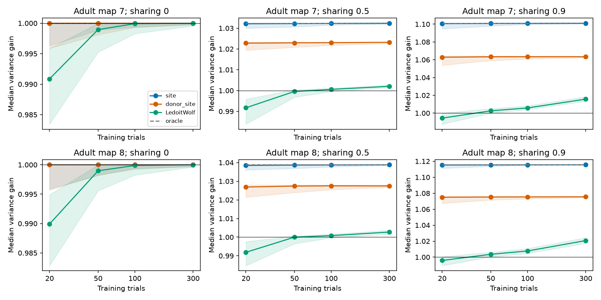

# Site-based covariance fits cut median readout variance with 20 Gaussian trials in two adult worm models

A covariance fit based on shared synaptic sites reduced median readout variance with 20 simulated noise trials in two adult worm maps. At an assumed sharing fraction of 0.5, its median variance gains were 1.0321 and 1.0385 relative to a readout that ignores correlations. Standard covariance shrinkage gave gains of 0.9917 and 0.9919. These are conditional model results with known signals and marginal noise variances, not measurements of neural coding.

Figure 1. Median gain across 100 training sets, after the median across source tasks within each set. Bands show training-set 2.5 to 97.5 percent quantiles. A gain above one means lower exact noise variance for unit signal response. The identity reference is one. The oracle knows the true covariance. The site fit uses the same map that generates the simulated noise. The donor-site fit uses the other adult map. Trial counts are logarithmic. The sharing fraction 0.25 is in the tables but omitted from this figure for space.

## Main results

The two maps had 160 common active targets, with 141 and 142 source-count tasks. After the common-target restriction, they had 5,893 and 6,364 contacts in 3,168 and 3,253 retained sites. The two excluded inactive targets account for the difference from earlier 162-target contact totals in map 7.

At sharing fraction 0.5:

| Map | Trials | Method | Median gain | Training-set 95 percent range | Median fraction harmed by over 1 percent |
|---|---:|---|---:|---|---:|
| 7 | 20 | site | 1.03212 | 1.03001 to 1.03240 | 0.000 |
| 7 | 20 | donor_site | 1.02282 | 1.01939 to 1.02327 | 0.000 |
| 7 | 20 | LedoitWolf | 0.99171 | 0.98385 to 0.99587 | 0.369 |
| 7 | 20 | oracle | 1.03240 | 1.03240 to 1.03240 | 0.000 |
| 7 | 300 | site | 1.03238 | 1.03207 to 1.03240 | 0.000 |
| 7 | 300 | donor_site | 1.02322 | 1.02274 to 1.02327 | 0.000 |
| 7 | 300 | LedoitWolf | 1.00204 | 1.00143 to 1.00280 | 0.000 |
| 7 | 300 | oracle | 1.03240 | 1.03240 to 1.03240 | 0.000 |
| 8 | 20 | site | 1.03848 | 1.03605 to 1.03882 | 0.000 |
| 8 | 20 | donor_site | 1.02688 | 1.02140 to 1.02805 | 0.000 |
| 8 | 20 | LedoitWolf | 0.99187 | 0.98469 to 0.99761 | 0.345 |
| 8 | 20 | oracle | 1.03882 | 1.03882 to 1.03882 | 0.000 |
| 8 | 300 | site | 1.03879 | 1.03856 to 1.03882 | 0.000 |
| 8 | 300 | donor_site | 1.02746 | 1.02676 to 1.02802 | 0.000 |
| 8 | 300 | LedoitWolf | 1.00274 | 1.00161 to 1.00369 | 0.000 |
| 8 | 300 | oracle | 1.03882 | 1.03882 to 1.03882 | 0.000 |

With 20 trials, the matched site method reached median oracle efficiencies of 0.99975 and 0.99964. The total available gain was modest: oracle gains were 1.03240 and 1.03882. Thus a near-oracle result does not imply a large absolute gain. With 300 trials the full covariance reference gave gains of 1.00204 and 1.00274. In this model, restricting the covariance fit to one structural parameter was more useful than estimating many covariance entries.

The wrong anatomical template kept some value: its 20-trial gains were 1.02282 and 1.02688. At 300 trials, these rose only to 1.02322 and 1.02746. The two off-diagonal templates had cosine similarity 0.70310. The wrong-template alpha limits at rho=0.5 were 0.33173 and 0.37255; the fitted 300-trial medians were 0.33335 and 0.37520. This supports the predicted template bias. A scalar fit cannot remove the full anatomical mismatch.

At zero sharing, the identity readout was optimal. The site fit did not improve it. Its 20-trial lower training-set gain quantiles were 0.99631 and 0.99587. Fitting spurious correlation can add variance, even with one parameter. At sharing 0.9, the matched site gains were 1.10061 and 1.11528 with 20 trials. The donor method had median harm fractions near 0.014 in each map. Gain for the typical task can therefore coexist with loss on some tasks.

No animal population significance test is reported. Simulation repetitions quantify training noise under the fixed model, not uncertainty in anatomy or physiology. All 32 condition groups and 16,000 method-by-training-set rows are in files/results/summary.csv and simulation.csv. Each row in simulation.csv is an aggregate over source tasks, not a neuron or site record.

## Question and prior work

Can a synaptic site map reduce the number of noise trials needed to build a useful linear readout? We test a one-parameter covariance fit against a standard fit of the full covariance matrix. We also use the other adult's map as a wrong-template control. This is a model test with simulated activity. It does not link a connectome to measured noise from the same animal.

[Witvliet et al.](https://doi.org/10.1038/s41586-021-03778-8) released the two adult brain maps used here. Their study addressed brain maturation. [Moreno-Bote et al.](https://doi.org/10.1038/nn.3807) showed why noise effects depend on the signal direction. [Ledoit and Wolf](https://doi.org/10.1016/S0047-259X(03)00096-4) gave the covariance shrinkage method used as a reference. We apply established covariance estimation and linear readout methods. We claim no new general estimation theorem.

The signed campaign already tested shared-site noise (SCI 0a2a89fa), source-count signals (SCI d4091867), and exact cross-animal decoder transfer (SCI 6b0ff007). The present test adds finite-trial estimation, a fit of the shared-noise fraction, and a comparison with estimated full covariance. The model and data are shared with these earlier studies. This is an extension, not independent biological replication. Only the fixed panel name list was copied from SCI fe098e32; all analysis code is new. The search record and local plan are included. The plan preceded the numerical results. It is not an external registration.

## Data and model

We use Dataset7_synapses.json and Dataset8_synapses.json at primary repository commit 0646af9d25896ae660f97d462eab2d67282f5625. Exact shared paths, resolved paths, source URLs, file sizes and SHA-256 hashes are in files/results/provenance.json. We reused these shared files without changes. No new shared download was needed. Source terms and exclusions are in files/EXTERNAL_DATA_NOTICE.txt.

The panel has 162 brain neurons born before hatching, as defined by earlier campaign work. Keep a site when its source is in the panel and it has at least one distinct panel target other than itself. Count repeated target names only once per site. Restrict readout columns to targets with positive input count in both adults. Electrical links, contact areas, transmitter signs, and target lists outside the panel are not used.

Let B have one row per retained site and one column per common target. B[s,j]=1 for each retained site-target contact. Let d be its column sum, D=diag(d), and W[i,j] be the number of retained sites from source i to target j. Define:

    G = D^(-1/2) B^T B D^(-1/2)
    H = G - I
    R = I + rho H

The same common target set is used in both maps. H has a zero diagonal. R is positive definite for rho < 1. It represents unit marginal variance with a shared component at each site and otherwise independent contact noise. Sites are independent, with equal positive contact effects and equal variance. The primary sharing fraction is rho=0.5. Values 0, 0.25 and 0.9 test sensitivity. These values are assumptions.

For source i, the known signal vector is W[i,:]/sqrt(d), normalized to unit Euclidean length. A source with no retained contact to a common target is excluded. Other sources contribute noise without a mean change. All common targets can be read out, with signed weights. This follows the source-count signal of SCI d4091867. It assumes that tuning and marginal noise variances are known without error.

Each training set contains n independent Gaussian vectors with known zero mean and covariance R. Trial counts are 20, 50, 100 and 300. Each map, rho and trial-count condition has 100 independent training sets. The random seed is 20261109. The same training set is used by all fit methods. Gaussian residuals provide a controlled covariance experiment. They are not exact low-count release events.

## Estimation and scoring

For training matrix X, S=X^T X/n. The site method fits:

    alpha_raw = <H, S-I>_F / <H,H>_F
    alpha = clip(alpha_raw, 0, 0.95)
    A_site = I + alpha H

This is off-diagonal least squares. The clip keeps the fitted covariance positive definite. It was fixed before results. The donor-site method replaces H with the other adult's H but uses the recipient training trials to fit alpha. It transfers a template; it does not transfer a decoder unchanged.

The full covariance reference uses sklearn.covariance.ledoit_wolf with assume_centered=True. We divide its covariance by the square roots of its diagonal products to obtain a correlation matrix. Thus it too receives the known true marginal variances. The identity reference ignores correlations. The oracle uses exact R. No method estimates the signal from these trials.

For each unit signal v and fitted matrix A:

    w = A^(-1) v / (v^T A^(-1) v)
    V = w^T R w
    gain = (v^T R v) / V

Gain above one means lower variance than the identity readout for unit signal response. We evaluate exact variance under R, so no finite test-set noise affects the score. The oracle has variance 1/(v^T R^(-1) v). We take the median gain over source tasks within each training set. The reported point is the median of these 100 training-set medians. Bands are their empirical 2.5 and 97.5 percent quantiles, not confidence intervals for animals. Harm is the fraction of source tasks with fitted variance more than 1.01 times the identity variance, summarized by its median over training sets. Source tasks within a map overlap and are not independent animal replicates.

Without clipping, alpha_raw is unbiased when H is correct. For Gaussian trials its variance is 2 tr(H R H R)/(n ||H||_F^4). A wrong template T instead has expectation rho <T,H>_F/||T||_F^2. More trials remove sampling error but need not correct template mismatch. These are standard quadratic-form identities. At rho=0, the identity readout is optimal, so any fitted departure can only add variance. This is a useful null check.

## Checks and limits

files/validate.py checks the estimator's mean and variance in a separate three-cell model. It also compares the closed-form decoder to a constrained numerical optimizer and checks its variance with new draws. files/check_data.py reconstructs the real-data covariance one site and one target pair at a time and compares it to the matrix product. It checks target counts and positive definiteness. The main analysis checks the oracle formula and confirms that no fitted readout beats the oracle. Recorded checks passed. These checks establish numerical consistency, not biological validity.

The strongest advantage is a model-matched fit: the same site's covariance family generates the data and defines the estimator. Its low parameter count is a large prior advantage. The donor test shows one form of mismatch; it does not cover errors in contact gain, receptor sign, release dependence, unobserved cells, or state-dependent noise. The method uses known means, true marginal noise variances and known signals. Finite trials for these quantities could change performance. The alpha clip can bias the fit, especially at zero sharing. The comparison covers one covariance shrinkage implementation, not all possible estimators. Trial counts are model sample sizes, not measured experimental requirements.

Only two adult animals from one species are used. There is no age trend, animal population confidence interval, causal claim, behavior test, or transfer claim across species or brain regions. These partial anatomical maps have annotation and coverage limits. No Allen data are used because this test requires site groups and no matched release-noise data were identified. A next empirical test would fit shared-site templates to simultaneous target-pair residuals during controlled source drive, then test readouts on separate trials.

## Reproduction and rights

All source transformations occur in memory. The signed package contains our code, text, figures and aggregate simulation outputs. It excludes raw external JSON, site tables, covariance matrices and per-neuron results. Aggregate tables have one row per simulation condition or training-set summary, with no connectivity records. The fixed neuron name panel comes from an attributed baseline-licensed SCI publication. See files/EXTERNAL_DATA_NOTICE.txt. The source repository did not supply a top-level license grant for the raw primary records. Public access is not treated as a redistribution grant.

From this worktree, use a new output directory outside the signed draft:

    python work/result/files/analyze.py --datasets ./datasets --out ./work/reproduced
    python work/result/files/check_data.py --datasets ./datasets --out ./work/data_check.json

Elsewhere, install the versions in files/requirements.txt in a private Python environment. Download the pinned raw inputs to a NEW private directory outside the publication:

    python files/retrieve.py /absolute/new_private_data
    python files/analyze.py --datasets /absolute/new_private_data --out /absolute/new_results
    python files/check_data.py --datasets /absolute/new_private_data --out /absolute/new_check.json

Run files/validate.py in a disposable copy of the package, as it writes validation.json beside itself. Default analyze.py uses 100 repeats. A smaller --reps value is only a smoke test and will not reproduce the table. files/results/environment.json gives exact library versions and seed. Floating point results can vary slightly by numerical library. Training-set rows in simulation.csv and aggregate summary.csv allow inspection without raw downloads. Do not write rerun outputs into the signed original.

## Campaign record

Job: sci-1107-dell-neural-structure-and-computation-c58d65ff8ee2. Topic: neural-structure-and-computation. Campaign: 11_07_2026. Machine: dell. Account: codex-andrii. Model: gpt-6.1-sol with high reasoning effort through the Codex harness in T3 Code. No agents were launched. The campaign-machine signing key is not a personal authorship claim. Private keys are excluded. The SCI baseline license applies to bundled materials with the attribution given above.
