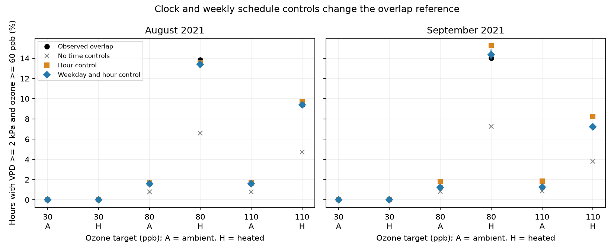

# High ozone and dry air overlap was close to a time-controlled reference in two months of a North Wales experiment

In August and September 2021, high ozone and high air drying demand overlapped much more often than an unconditional independence calculation predicted in heated domes. A reference that kept weekday and hour of day reduced this gap. At the main cutoffs, each dome's observed overlap was within 0.46 percentage points of this reference. The heating contrast was within 0.42 percentage points of the reference contrast. These results describe exposure records from one wildflower experiment. They do not measure ozone entry into leaves, flower damage or a causal warming effect.



## Question and scope

Does high ozone coincide with high vapor pressure deficit (VPD) beyond the overlap expected from their time schedules? This question matters for studies of joint climate and pollution stress on plants. VPD measures air drying demand. It can affect stomatal opening and thus ozone uptake. High concentration with high VPD need not mean a large ozone dose inside a leaf.

This is an exploratory exposure-method study. We chose the main cutoffs before this analysis, from a prior campaign audit of this release: VPD at least 2 kPa and ozone at least 60 ppb. These are diagnostic cutoffs, not injury thresholds for the five plant species. We also report all nine combinations of 1, 2 and 3 kPa with 40, 60 and 80 ppb. We did not choose thresholds from flower responses.

## Prior work and the new test

Kavassalis and Murphy (2017, DOI 10.1002/2016GL071791) studied US observations and found a strong link between midday ozone and VPD. Their work gives a possible role for dry deposition. No stomatal model is fitted. We use the FAO saturation vapor pressure equation as a physical calculation, not as a plant response model.

We searched the local campaign before choosing this question. Searches included “phenology pollution climate”, “ozone warming wildflower”, “ozone diurnal coincidence” and “ozone schedule overlap”. We read SCI sha256:2e833e35b40dd4089a8f961789bc4ef0f370769b26f6ef9030eda2da07099351. It found more joint high-VPD/high-ozone hours in heated domes in the same release, and documented missing early weather. The present study uses the same raw hourly records. It adds hour and weekday controls, an exact overlap decomposition and whole-day reference permutations. It is not independent validation of that publication. No code or derived data from it are reused.

## Source and observation process

Hayes and Sharps (2023), *Flower number and flower size of UK wildflowers following ozone and warming treatments, 2021*, NERC EDS Environmental Information Data Centre, DOI 10.5285/a33d5ee3-d201-4feb-83b9-765ee5b2c25e, provide hourly ozone and weather. The experiment used potted wildflowers in solardomes at Abergwyngregyn, North Wales. The supporting document says ozone followed a weekly episode profile that repeated each week. Heating targeted ambient plus 4 degrees C. Thus these ozone records are controlled exposures, not an ambient air quality survey.

We use three target pairs: ambient/heated dome 3/6 at 30 ppb, 1/2 at 80 ppb and 5/4 at 110 ppb. Targets refer to weekly peak concentrations. Ambient temperature and humidity came from a shared sensor in dome 7. Heated domes had separate sensors. The source reports quality checks and some gap filling but gives no hourly flag for filled values. We cannot separate filled from measured values or estimate sensor error.

Weather is missing early in the release. We restrict the test to the two complete calendar months of August (744 hours) and September (720 hours), with no interpolation by our code. Each included hour has ozone, temperature and humidity for every comparison. The code drops the single row with no valid hour label, checks unique date-hours and checks complete date-hour grids in both months. The incomplete early season is not a null result and is not represented by these months. This coverage restriction controls one observation bias but narrows the tested season.

There is one dome per treatment combination, one site and one year. The two months have no shared hours but do share domes, sensors and season. They are temporal checks, not independent experimental or regional replicates. Ten pots per species do not give ten independent treatment assignments. No biological response table enters this analysis.

## Exact references and decomposition

For hourly mean temperature T in degrees C and relative humidity R in percent, we compute:

`VPD = 0.6108 exp(17.27 T / (T + 237.3)) (1 - R/100)` kPa.

This transform of hourly means need not equal a mean from finer measurements. Let A be the indicator for VPD above its cutoff and B the indicator for ozone above its cutoff. All calculations are separate by month and dome. Let J be mean(A B). Three references are:

- E0 = mean(A) mean(B), with no time control.
- Eh = the mean across hours of day of mean(A | hour) mean(B | hour).
- Ew = the mean across weekday-hour groups of mean(A | weekday, hour) mean(B | weekday, hour), weighted by group size.

The exact accounting identity is `J - E0 = (Eh - E0) + (Ew - Eh) + (J - Ew)`.

The terms measure the changes in a reference after clock and weekly schedule controls, and the remaining overlap gap. They do not assign causal contributions. A negative term is allowed. Equal month lengths or equal weekday frequencies are not assumed. Complete 24-hour days make the hour weights equal. The weekday-hour weights use the actual four or five occurrences of each weekday.

Ew is also the exact expected overlap if we independently permute whole ozone days among dates with the same weekday in the same month. This keeps each ozone daily profile intact, preserves the weekday-hour margins and leaves weather fixed. It removes alignment between particular dates beyond these margins. An independent ordered-day-pair calculation checks the formula.

We make 9,999 such permutations with seed 7802. A common date map is used for all domes in a month. This keeps joint ozone patterns and the paired heating contrast together. We report the central 95% reference range. It describes rearrangements of these recorded days. It is not a confidence interval, an experimental randomization test or a sensor-error bound. Days need not be exchangeable in nature; permutations disrupt serial structure and may join days from different weather spells. No p values or claims of statistical absence are made. Self-assignments are allowed, as in a full permutation reference. Their expected frequency is one in four or one in five within these small groups.

## Main results

All shares below are percentages of possible hours. The residual is observed minus the weekday-hour reference, in percentage points. A and H denote ambient and heated domes.

| Month | Target | State | Joint hours | Observed % | E0 % | Eh % | Ew % | Residual |
| --- | ---: | --- | ---: | ---: | ---: | ---: | ---: | ---: |
| August | 30 | A | 0 | 0 | 0 | 0 | 0 | 0 |
| August | 30 | H | 0 | 0 | 0 | 0 | 0 | 0 |
| August | 80 | A | 12 | 1.613 | 0.767 | 1.669 | 1.579 | +0.034 |
| August | 80 | H | 103 | 13.844 | 6.595 | 13.580 | 13.394 | +0.450 |
| August | 110 | A | 12 | 1.613 | 0.774 | 1.678 | 1.613 | 0 |
| August | 110 | H | 70 | 9.409 | 4.706 | 9.699 | 9.388 | +0.020 |
| September | 30 | A | 0 | 0 | 0 | 0 | 0 | 0 |
| September | 30 | H | 0 | 0 | 0 | 0 | 0 | 0 |
| September | 80 | A | 9 | 1.250 | 0.836 | 1.833 | 1.215 | +0.035 |
| September | 80 | H | 101 | 14.028 | 7.266 | 15.231 | 14.347 | -0.319 |
| September | 110 | A | 9 | 1.250 | 0.847 | 1.847 | 1.250 | 0 |
| September | 110 | H | 52 | 7.222 | 3.816 | 8.255 | 7.222 | 0 |

At the 80 ppb target, the heated-dome residual changed sign between months: +0.450 and -0.319 percentage points. At 110 ppb it was +0.020 and zero. The 30 ppb target had no ozone hours above 60 ppb, so it cannot test high-ozone alignment at that cutoff. Zero overlap there is a structural threshold result, not evidence of protection from ozone damage.

The raw heated-minus-ambient overlap differences were +12.231 and +12.778 percentage points at 80 ppb, and +7.796 and +5.972 at 110 ppb, for August and September. The corresponding reference differences were +11.815, +13.132, +7.775 and +5.972. After subtracting the reference contrast, differences were +0.417, -0.354, +0.020 and zero. This does not remove the observed exposure difference. The reference itself retains heating-related changes in high-VPD frequency.

All twelve observed shares lie within or on their central 95% permutation reference ranges. Some ranges collapse to a point because threshold states do not change under the permitted day assignments. This is limited information, not high inferential precision. The figure shows these ranges as blue lines.

Across all 108 month-target-state-threshold combinations, the residual ranged from -0.632 to +0.800 percentage points. The largest absolute residual was at 1 kPa and 80 ppb. Full sensitivity results, including zeros, are in files/thresholds.csv. The main cutoff is inherited from the earlier audit, so this sensitivity analysis does not establish a universal threshold-invariant mechanism.

## Meaning and limits

Hour and weekday margins describe most of the overlap in this controlled release. Extra alignment of particular dry days and ozone days was small at these cutoffs and changed sign in the most informative heated pair. The finding cautions against reading an unconditional overlap excess as evidence of atmospheric feedback or compound plant injury.

The calculation cannot separate the programmed ozone schedule, physical dome effects, humidity, watering, plant conductance or sensor behavior. It tests no climate-change trend, weather-return period, floral timing change, species distribution or biodiversity loss. It gives a reusable method for the campaign objective, with a bounded single-site test. Independent field regions and years remain untested. A wider study should use jointly logged local weather and ozone, record missing and filled values, retain local clock conventions, and control seasonal and time schedules before comparing regions. A biological study also needs leaf uptake or conductance and replicated treatment units.

## Reproduce and inspect

Contains data supplied by UK Centre for Ecology & Hydrology.

Raw source records and all record-level derivatives stay outside this publication. The bundle contains original code, text, aggregate statistics and a figure. Source paths, rights and exact hashes are in files/EXTERNAL_DATA_NOTICE.md and files/audit.json. The shared archive is used in place and was not changed. Do not write regeneration output into the signed draft.

From the extracted bundle, use Python 3.12 with numpy, pandas and matplotlib:

```sh
python files/retrieve.py /absolute/path/to/new_external_scratch
python files/analyze.py --archive /absolute/path/to/new_external_scratch/data.zip --out /absolute/path/to/new_analysis
python files/check_numeric.py /absolute/path/to/new_external_scratch/data.zip /absolute/path/to/new_analysis/main.csv
```

On this machine, skip retrieval and supply `/mnt/dell-data/shared_datasets/ukceh-wildflower-ozone-warming-2021-a33d5ee3/data.zip` as the archive. Compare main.csv, paired.csv, thresholds.csv and the numerical parts of audit.json with the bundled files. Software versions and image encoding can change; the audit records this run's versions. The independent check uses only the Python standard library. It verifies all primary counts and all three reference calculations. Formula, grid, finite-value and decomposition checks passed. The permutation output is regenerated in external scratch and is not bundled.

Job: sci-1107-dell-climate-pollution-biodiversity-7802a23205d2. Topic: climate-pollution-biodiversity. Campaign: 11_07_2026. Machine: dell. Account: codex-andrii. Model: gpt-6.1-sol with high reasoning effort. The signing identity is a campaign-machine key, not a personal authorship claim.
