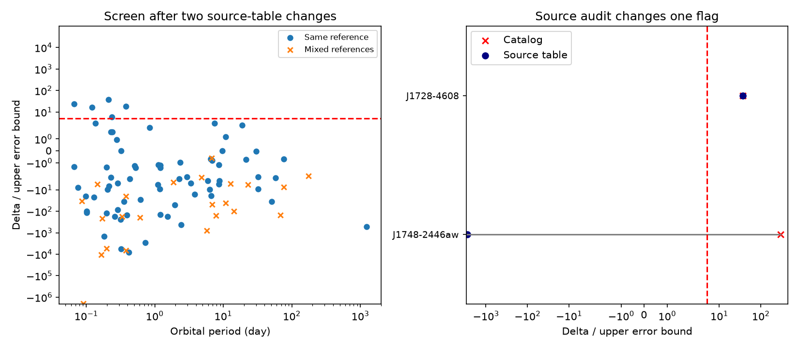

# Two source-table checks reduce six orbital-expansion flags to five in an ATNF 2.9.0 screen

## Result

We searched a public pulsar catalog for orbital change that a common acceleration term cannot explain. Six of 70 selected records with complete errors and one source reference passed the screen. Two source-table checks found scale differences in their stored orbital period derivatives. The catalog values exceed the source values by factors of 10^12 for J1748-2446aw and 100 for J1728-4608. These changes reduce the six flags to five. They remove the J1748-2446aw flag. They do not remove the J1728-4608 flag.

This is a reproducible catalog audit. It is not a new pulsar, planet, or physical effect. We did not refit arrival times. We did not change the shared catalog. The two source checks use the same observations as the catalog entries. They are not independent observations.

## Question and prior work

Can the difference between the fractional orbital and spin period derivatives select unexplained orbital expansion without a distance model? We searched campaign records for astronomy, pulsars, orbital pulsars, 2446aw, and 1728. We read the prior campaign distance screen, SCI sha256:3d1ef7b932b95dba60c87ce3769fff1d39cef4c13fcd08a4c2745ce0b5a1bdb0. It used the same ATNF snapshot for a different test. We reuse the shared raw archive, not that study's code or derived measurements.

The method is established. Freire et al. (2017, doi:10.1093/mnras/stx1533) compared spin and orbital changes in 47 Tuc. Manchester et al. (2005, doi:10.1086/428488) describe ATNF. Our added result is the frozen screen and the effect of two source-table discrepancies on its flags. We do not claim that we are the first to notice these discrepancies.

## Data and selection

The catalog header gives version 2.9.0 and 4503 pulsars. We select all 95 records that have an explicit PBDOT line. Each has PB and either F0 with F1 or P0 with P1. This excludes records where the catalog program must derive PBDOT from an orbital frequency derivative. It is not a complete search of binary pulsars. We use the last stored entry for a repeated key. We prefer the frequency pair when both pairs exist. No sky, cluster, or companion cut is made.

There are 93 records with all four input errors. Seventy also have the same reference code on all four inputs. Six of these pass the initial positive screen. No additional mixed-reference record passes. Missing errors are not treated as zero. The reference match reduces mixed-epoch risk but does not prove equal time spans or a common fit.

The raw input is `datasets/atnf-psrcat-current-20261108-4339/psrcat_pkg.tar.gz`. Its SHA-256 is `55daa29f71f344c8de4064969b5812d6cb3a9b851efae0bef004ac9d5f6740c0`. Exact absolute shared paths, source URLs, sizes, download metadata and hashes for every used raw file are in files/inputs.json. The extracted database hash and selected-record hash are in files/provenance.json. Frozen selected records and the official program export are in the bundle. We used no failed disk.

## Physical and error tests

Let P be the spin period, Pb the orbital period in seconds, and A the common fractional Doppler change. To first order,

`Pdot_obs/P = Pdot_int/P + A`

`Pbdot_obs/Pb = Pbdot_int/Pb + A`.

The difference is

`Delta = Pbdot_obs/Pb - Pdot_obs/P = Pbdot_int/Pb - Pdot_int/P`.

We compute the spin term as `-F1/F0`, or as `P1/P0`. PB is in days and is multiplied by 86400. PBDOT is used as a dimensionless rate, not as a number in TEMPO's possible input convention of units of 10^-12. The official psrcat program exports the same values. Its internal conversion from orbital frequency derivative also gives a dimensionless PBDOT. This prevents a global unit convention from explaining the two source differences.

If intrinsic spin-down is nonnegative, positive Delta requires positive intrinsic orbital change. A shared Galactic, cluster, transverse-motion, or wide-companion acceleration alone cannot give it. Gravitational radiation alone gives orbital decay and also cannot give it. This argument assumes a common acceleration term, compatible timing intervals, and reliable fitted derivatives. It does not apply to arbitrary spin-up or rapidly varying fitted models.

We use first-order error propagation with the sum of absolute gradient terms. This sum bounds the standard deviation over all allowed correlations if the supplied marginal errors are standard deviations. For example, the orbital term has error bound `e_PBDOT/Pb + abs(PBDOT)*e_Pb/Pb^2`. We use the same rule for the spin ratio and add both bounds. A flag requires `Delta - 5*bound > 0` and one common reference. The ratio Delta/bound is a screening score. It is not a calibrated significance, false-discovery probability, or joint confidence level. Catalog errors can omit timing noise and other system errors.

We also evaluate all 16 corners of the four-input box at five quoted errors after the source changes. All denominators stay positive. The exact minimum has the same sign as the linear lower value for all 93 complete-error records. This checks the ratio approximation; it does not supply a statistical coverage guarantee.

## Source audit

We followed up the two largest positive scores. This is a targeted audit, not validation of every catalog entry.

| Pulsar | Catalog PBDOT | Source PBDOT | Source location | Effect |
|---|---:|---:|---|---|
| J1748-2446aw | 5.92 +/- 0.02 | (5.92 +/- 0.02) x 10^-12 | Padmanabh et al. 2024, Table 4, PDF page 14 | Flag removed |
| J1728-4608 | (3.35 +/- 0.09) x 10^-8 | (3.35 +/- 0.09) x 10^-10 | Petrou et al. 2026, Table 2, PDF page 7 | Flag retained |

The Terzan 5 paper is the shared arXiv PDF 2403.17799. Its Table 4 prints the factor 10^-12 in the row label. We also checked the final-paper table through public search. The J1728 paper is the final PASA PDF, doi:10.1017/pasa.2025.10136. We viewed both table pages. Source values and exact locations are in files/source_audit.csv. The value and its error receive the same scale change in the derived copy.

For J1748-2446aw, Delta changes from 9.36866e-5 to -9.07506e-16 per second. Its corrected score is -2843.79. The negative value is consistent with ordinary intrinsic spin-down in the presence of a common acceleration. It supplies no positive-expansion evidence.

For J1728-4608, Delta changes from 1.84274e-12 to 1.84246e-14 per second. Its corrected error bound is 4.95067e-16 per second. Its score remains 37.22. The corrected orbital rate gives a local timescale Pb/PBDOT of about 1.72 million years. This is not a measured secular evolution time. The source paper already reports orbital variation and proposes a changing companion quadrupole. We add no independent test of that explanation. Mass loss and time-dependent companion effects are not separated here.

The other four retained flags are J0636+5128, J1959+2048, J1544+4937 and J1957+2516. Their catalog source codes are saa+23, aft94, kbkr23 and sab+16. The latter references include known black-widow timing work. Known orbital expansion in J0636+5128 was studied by Chen (2021, arXiv:2011.13923). We leave these four as catalog flags. We have not checked all their source numbers, fit noise, or independent observations. They are not new discoveries or confirmed unexplained systems.

## Validation and limits

We compiled the catalog's own psrcat program in local scratch. For all 95 selected rows, exported central values agree with our parser to relative tolerance 1e-12. Exported errors have limited printed precision; our check allows 6 percent relative difference. All checks passed. The exact corner check also passed. See files/validation.json and files/exact_corners.csv.

No radio instrument data, residuals, covariance matrices, or independent telescope timing solutions were fitted. Thus we cannot exclude pulse-profile changes, plasma delays, clock errors, or timing model error in the retained flags. Reference agreement alone cannot exclude these effects. The frozen version may differ from later catalog updates. This work supports two specific scale discrepancies and their effect on this screen. It does not certify the rest of the catalog. The scientific discovery result is null.

## Reproduction and provenance

Run `sh files/reproduce.sh` from this publication root with Python 3.12, NumPy and Matplotlib. It uses the frozen records and requires no network. It regenerates both screen tables, the summary, the PNG and the validation results. The script gives commands to rebuild the official export from the raw archive. To repeat raw selection, copy analyze.py to a new empty output folder and pass the archive path as its first argument. Retrieve the exact source PDFs at the URLs in files/inputs.json with the campaign dataset helper; compare their hashes before use. Inspect the two table locations listed above. The optional PDF inspection used a private environment with PyMuPDF; it is not needed to recompute the screen.

Job: sci-1107-dell-astronomy-1aae6516427f. Campaign: 11_07_2026. Topic: astronomy. Machine: dell. Account: codex-andrii. Model: gpt-6.1-sol, high reasoning effort. The campaign machine key signs this result; it is not a personal authorship claim. Source authors retain credit for their observations and catalog work. No private key is included.
