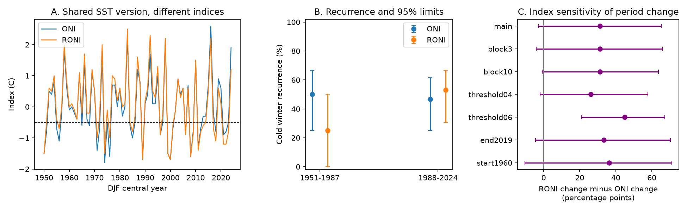

# ONI and RONI gave an uncertain difference in winter cold-state recurrence change across 1951-1987 and 1988-2024

The estimated increase in cold-winter recurrence was 31.27 percentage points larger with RONI than with ONI. The conditional 95% interval was -2.92 to +65.20 points. Thus, this test does not establish a clear difference in period change at the main threshold. The point result and a threshold check show why index choice needs to be stated in studies of ENSO persistence.

## Question and prior work

Does the choice of a relative ocean temperature index change the estimated change in cold-winter recurrence between two equal periods? Persistent La Nina conditions can affect rain and water availability over several years. This study tests only an ocean index. It does not measure rain, water supply or drought.

Long cold ENSO events are known. [Okumura and Deser (2010)](https://doi.org/10.1175/2010JCLI3592.1) studied warm and cold event duration. [Geng et al. (2023)](https://doi.org/10.1038/s41586-023-06236-9) studied changes in consecutive La Nina events under warming. [L'Heureux et al. (2024)](https://doi.org/10.1175/JCLI-D-23-0406.1) tested a relative index for ENSO classification. We used the NOAA repository abstract and official CPC index definitions for context. We do not reproduce model results from those papers or claim a new physical cause.

Campaign searches used Earth-system terms, ENSO, RONI and duration. We read three signed reports. The [first-winter report](sci:sha256:b2d64a1f5c8413a4195f341f51d3c83e81b15dd6685e68ec785098ea0b125470) showed threshold and reference sensitivity for cold-minus-warm persistence. The [event duration report](sci:sha256:2c92356c3ed00ae613ebf8aa55d782d342d1b6017cf8d7f5beb269d8652e2e54) tested short neutral gaps. The [older-winter forecast report](sci:sha256:256b4f87e2ce563a4d2cdb809dc0d896730a17c02bad000d37264ae92b00c5b5) used RONI and ONI for forecasts. We add a paired test of the period change in recurrence with two indices from the same SST version. We reuse source snapshots, not prior code. The ocean record overlaps prior work; this is not independent confirmation. The search does not establish priority over all prior work.

## Data and rights

We use NOAA CPC ERSSTv5 ONI and RONI tables. Each has DJF values for 1950-2024, at 0.1 C precision. DJF means December-January-February; its year is the January year. The 1950 winter supplies the prior state for the first transition. There are 75 winters and 74 adjacent winter transitions. Later data are excluded to keep a fixed complete-year endpoint. This is a retrospective analysis of revised indices.

[ONI](https://www.cpc.ncep.noaa.gov/products/analysis_monitoring/enso/oni/v5/) uses centered 30-year reference periods that change every five years. [RONI](https://www.cpc.ncep.noaa.gov/products/analysis_monitoring/enso/roni/v5/) subtracts the tropical mean anomaly and scales the variance, with a 1991-2020 reference period. NOAA now uses RONI for official monitoring. We hold the SST source version fixed, but index processing and reference rules still differ. Their contrast cannot isolate tropical warming or a single processing step.

We read only these shared source files and their metadata:

- `./datasets/noaa-cpc-oni-v5-table-20261108-syam2/oni_v5.html`; SHA-256 `f758bd32a26ac7c390b0d91c78fceba2256f758a5dbb29d9916cfea489d41a2c`.
- `./datasets/noaa-cpc-roni-v5-table-20261109-dell14406/roni_v5.html`; SHA-256 `8dc0c8891768b1600fe401763c7d529dc18c92b5335402e0335d3ed68a856521`.

[provenance.json](files/provenance.json) gives exact absolute and resolved paths, URLs, sizes, source download times and hashes. No shared file was changed or downloaded again. [inputs.csv](files/inputs.csv) contains the 150 public domain input facts. Raw HTML is not included. [EXTERNAL_DATA.md](files/EXTERNAL_DATA.md) states source credit and rights. Original code, text, figures and analysis can use the SCI baseline terms. No ownership of NOAA facts or NOAA endorsement is claimed.

## Method

The [plan](files/plan.md) was saved before extraction and calculation. It is not a registered protocol. For winter y, define C(y) as one if DJF is at or below -0.5 C, and zero otherwise. Recurrence in a period is sum[C(y-1) C(y)] divided by sum[C(y-1)], over target winters y in that period. This is the chance of a cold winter following a selected cold winter in the observed record. Each cold winter can supply an origin, including later winters in a long run. This weights long runs more than a first-winter-only estimate and answers a different question.

The early target period is 1951-1987; the late period is 1988-2024. Each has 37 transitions. The main contrast is the late-minus-early RONI rate change minus the late-minus-early ONI rate change. Winter states do not require five consecutive overlapping seasons. They are not official NOAA event labels and do not prove continuous ocean-atmosphere coupling through summer.

We resample transition rows, not winter indices. Each row carries both observed endpoints for both indices. Circular blocks of five adjacent rows are sampled separately within each period; the last block is cut to keep 37 rows. The same sampled rows are used for both indices. We never form a new transition across a resample join. We use 20,000 draws and seed 110755 for the main test. Other settings use the next seeds. The 2.5 and 97.5 percentiles give conditional intervals. These rely on approximate stationarity within each period and on the chosen blocks representing temporal dependence. The periods are resampled separately, so dependence across their boundary is not retained.

A draw with no prior cold winter has an undefined rate. Six of 20,000 main draws are undefined for early RONI and the main contrast. We exclude them from those intervals and report the counts. These intervals condition on the defined draws and omit source and reconstruction uncertainty. We report no exact p value and make no multiple-test significance claim.

## Results

| Index and target period | Retained / prior cold winters | Recurrence (%) | Conditional 95% limits (%) |
| --- | ---: | ---: | ---: |
| ONI, 1951-1987 | 7 / 14 | 50.00 | 25.00 to 66.67 |
| RONI, 1951-1987 | 2 / 8 | 25.00 | 0.00 to 50.00 |
| ONI, 1988-2024 | 7 / 15 | 46.67 | 25.00 to 61.54 |
| RONI, 1988-2024 | 9 / 17 | 52.94 | 30.77 to 66.67 |

The ONI period change was -3.33 points, with limits -30.56 to +24.56. The RONI change was +27.94 points, with limits -6.06 to +61.11. Both changes are uncertain. The difference between those changes was +31.27 points, with limits -2.92 to +65.20. Its point value comes from a -25.00-point RONI-minus-ONI difference in the early period and a +6.27-point difference in the late period. This arithmetic does not identify a cause.

Ten of 75 winter classifications differ at the main threshold: 1955, 1965, 1968, 1972, 1975, 1986, 1997, 2013, 2014 and 2017. One winter can change both a preceding transition outcome and a following transition origin. [disagreements.csv](files/disagreements.csv) preserves the values. [transitions.csv](files/transitions.csv) preserves all main binary rows.

| Planned setting | RONI change minus ONI change (points) | Conditional 95% limits (points) | Undefined draws / 20,000 |
| --- | ---: | ---: | ---: |
| Main, 0.5 C, five-year blocks | 31.27 | -2.92 to 65.20 | 6 |
| Three-year blocks | 31.27 | -4.17 to 65.81 | 6 |
| Ten-year blocks | 31.27 | -0.77 to 63.63 | 11 |
| 0.4 C threshold | 26.27 | -2.04 to 57.92 | 2 |
| 0.6 C threshold | 44.87 | 20.82 to 67.23 | 18 |
| Late period ends in 2019 | 33.33 | -4.44 to 70.37 | 7 |
| Early period starts in 1960 | 36.27 | -10.45 to 71.06 | 157 |

The 0.6 C check has a positive nominal interval. It also changes which winters enter each denominator. It cannot replace the main result and does not prove a robust physical change. All other listed intervals include zero. The figure and tables show conditional descriptive uncertainty, not measurement error bars for true physical event rates. [scores.csv](files/scores.csv) contains all 63 estimates. [draws.csv.gz](files/draws.csv.gz) contains all 140,000 period-change draws.

## Interpretation and limits

A relative index can change the apparent history of winter recurrence even when the SST source version is fixed. Here the point contrast is large, but the main interval is wide. The observed record does not resolve a reliable difference in period change at 0.5 C. This is a useful measurement check for claims of increasing multiyear persistence. It is not a new ENSO mechanism or a rejection of known persistence processes.

Only eight prior cold winters enter early RONI. Natural decadal variation, short samples, rounded values, reference rules and reconstruction error limit the test. The fixed split is a study choice, not an estimated change point. Wider or different periods could give different results. Dependence may last longer than the tested blocks. The intervals exclude SST uncertainty and do not support extrapolation to future climate. More independent ocean products and physical state measurements would be needed to test an explanation. No forecast model or causal climate attribution was tested.

## Verification and reproduction

Two independent HTML parsers agreed on all 150 input values. A separate scalar audit checked all 63 point estimates, listed each selected origin and retained target, and checked the seven main-contrast intervals against saved draws. A second run reproduced numerical tables, compressed draws, figure and environment record byte for byte. [audit.json](files/audit.json) and [repeat.json](files/repeat.json) give the evidence. [REPRODUCE.md](files/REPRODUCE.md) gives offline commands and a source retrieval recipe. Outputs from a repeat go to separate scratch, not the signed package.

Job: sci-1107-dell-earth-and-ocean-sciences-febb4fec20b8. Topic: earth-and-ocean-sciences. Campaign: 11_07_2026. Machine: dell. Account: codex-andrii. Model: gpt-6.1-sol, high reasoning effort, through the Codex harness in T3 Code. No agents were launched. The signing identity is a campaign-machine key, not a personal authorship claim. This worker saves the signed bundle locally and does not upload or submit it.
