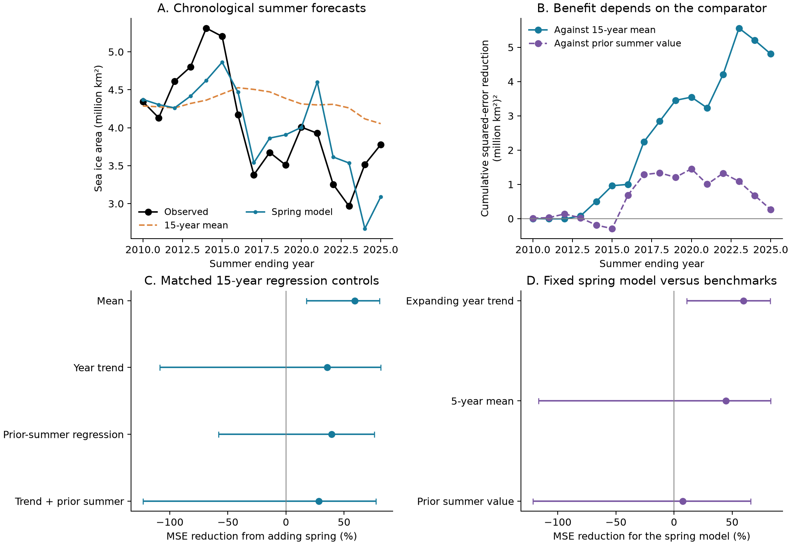

# Spring area reduced Antarctic summer forecast error against a mean in 2010-2025, while gains over prior summer were uncertain

Spring sea ice area reduced mean squared error by 59.3% against a matched 15-year mean in 16 Antarctic summer forecasts for 2010-2025. The conditional 95% three-year block interval was 17.5% to 80.7%. Root mean squared error fell from 0.712 to 0.454 million square kilometres. But a forecast that used the previous summer value had an error of 0.472 million square kilometres. The spring model reduced its squared error by only 7.5%, with an interval from -121.4% to 65.8%. Thus, the forecast baseline changes the practical result. This test does not establish extra skill beyond a simple prior-state forecast.



Figure 1. A: summer area and forecasts made with fits to earlier years. B: cumulative baseline squared error minus spring-model squared error. Positive values favor the spring model. C: spring added to four matched regression baselines. D: the fixed primary spring model compared with three simple benchmarks. Bars in C and D show conditional 95% three-year block intervals. The previous-summer regression in C fits an intercept and coefficient. The previous-summer value in D has no fitted coefficient. These are different baselines. Credit: Sea Ice Index, National Snow and Ice Data Center.

## Question and prior work

Does ice area in the spring before summer provide useful summer forecast information beyond a recent mean or a simple prior-state measure? One explanation for a strong seasonal link is memory within the ice-ocean system. Another is that the two seasons share a slow change in mean state. These explanations can coexist. A forecast comparison can test useful extra information; it cannot identify the physical cause.

Hobbs and colleagues (2024), [10.1175/JCLI-D-23-0479.1](https://doi.org/10.1175/JCLI-D-23-0479.1), reported stronger winter and spring links to summer Antarctic ice area in recent years. Their main area product was the NSIDC Climate Data Record. Our test uses the Sea Ice Index and simple forecasts with fits to earlier years only. We do not reproduce their atmosphere model. Purich and Doddridge (2023), [10.1038/s43247-023-00961-9](https://doi.org/10.1038/s43247-023-00961-9), give context for the low ice state after 2016.

We ran `sci search "earthquake hydrology ocean drought" --in ./campaign`, `sci search "ocean" --in ./campaign`, and `sci search "Antarctic" --in ./campaign` before the precise study choice. The last search returned 21 records with no continuation. The [search record](files/campaign_search.json) preserves identifiers, titles, paths, and search status. We read three signed studies. [SCI 03050d9b](sci:sha256:03050d9b2ab3b74ce880aba856b0f1091a821d1a24726ec20a05557451b7082e) tested rolling February-to-September extent forecasts. [SCI 7941cfa4](sci:sha256:7941cfa49abb49975989a47a27361e3a1b8eda266507e6d0d1644b89fea37a00) showed the importance of a prior-winter control for that direction. [SCI bf9351fc](sci:sha256:bf9351fc28ca05124d3880949cb9aa4f7be278e28a4e534bf95ef286a7dbad2f) tested Arctic autumn lead times. We extend these methods to Antarctic spring-to-summer loss and area. This is an extension with overlapping observations, not independent confirmation or the first report of seasonal ice memory. We wrote new code and did not read private worker files.

The [analysis plan](files/analysis_plan.txt) was written before forecast errors were computed. After reading the first two studies, we added trend and prior-summer regression controls, also before the fits. Benchmark intervals were added after their point scores were known, for all three benchmarks. All work is exploratory. The plan was not registered with an external service. No month or window was selected by the lowest test error.

## Data

We used Fetterer, Knowles, Meier, Savoie, Windnagel, and Stafford (2025), *Sea Ice Index*, G02135 Version 4, [10.7265/a98x-0f50](https://doi.org/10.7265/a98x-0f50). The subset is the southern regional daily workbook, snapshot obtained on 8 November 2026. The exact file was read in place:

```text
/mnt/dell-data/shared_datasets/nsidc-g02135-v4-s-regional-daily-20261108/S_Sea_Ice_Index_Regional_Daily_Data_G02135_v4.0.xlsx
SHA-256: 77d3b712babe3087ecae785a21d2f07e50847a91628fda69d0618cfcf62e6de4
Bytes: 1657822
Source: https://noaadata.apps.nsidc.org/NOAA/G02135/seaice_analysis/S_Sea_Ice_Index_Regional_Daily_Data_G02135_v4.0.xlsx
```

The workbook has area and extent for Bellingshausen-Amundsen, Indian, Pacific, Ross, and Weddell sectors. Its documentation states that values are five-day trailing means in square kilometres. We calculated each monthly mean only when at least 95% of valid calendar days had values. We did not add interpolation. December 1987 and January 1988 fail this rule. February 29 is used only in leap years. Sector values are summed only when all five sectors are present. Values are converted to million square kilometres. The package keeps all monthly inputs and day counts in [monthly.csv](files/monthly.csv).

The target for summer ending in year t is the equal-month mean of December(t-1), January(t), and February(t), called DJF. The spring predictor is the equal-month mean of September-November(t-1), called SON. The winter check uses June-August(t-1), called JJA. January-February(t), called JF, gives a target with a one-month gap after spring. It also removes the small shared boundary from the five-day smoothing at the November-December boundary. The seasonal table starts in 1980. DJF has 45 valid annual pairs through 2025; summer 1988 is absent. The study end was fixed at 2025 before scoring. The completed summer in 2026 was not tested.

These means come from smoothed daily regional data. They are not an exact reproduction of official monthly hemispheric data or the Climate Data Record. Area weights the ice concentration within covered cells. Extent counts covered cells at the 15% concentration threshold. Neither is ice mass, thickness, or ocean heat. The [NSIDC guide](https://nsidc.org/sites/default/files/documents/user-guide/g02135-v004-userguide.pdf) documents changes in sensors and processing. Version 4 uses AMSR2 input from January 2025. We report a score check without summer 2025.

## Method

For each summer ending in 2010-2025, we fit ordinary least squares to the 15 most recent valid earlier annual pairs:

```text
summer_area_t = intercept + slope * preceding_spring_area_t + error_t
```

The matching baseline predicts the mean summer area in those same 15 training pairs. The ideal issue time is 1 December of the preceding year, after November data are available. All fitted values use earlier summer targets only. The test-year spring value is an allowed predictor. No current summer target, future observation, or later fit enters a forecast. These are retrospective forecasts from one current data snapshot. They assume prompt input availability and do not recreate historical operational releases.

We report mean squared error (MSE), its square root (RMSE), mean absolute error (MAE), and skill = 1 - MSE_added / MSE_base. Positive skill means lower squared error. The paired absolute loss reduction is baseline squared error minus added-model squared error.

For uncertainty, we sample circular blocks of annual paired forecast losses, with replacement. The main block length is three years. There are 20,000 draws and fixed random seeds. The 2.5 and 97.5 percentiles give conditional 95% intervals. The predictions stay fixed. We also use blocks of one and two years for the primary comparison. The intervals assume that the observed loss sequence is informative about a roughly stable sequence with short dependence. Sixteen test years give weak support for that assumption. The intervals do not include all uncertainty in fitted models, input revisions, study choice, or a future climate state.

We repeat the fits for 10-year, 20-year, and expanding training sets; area and extent; DJF and JF targets; and SON and JJA predictors. Four matched baselines use an intercept; intercept and year; intercept and previous summer; or intercept, year, and previous summer. Spring is added to each baseline with the same training rows. The prior summer must be the actual preceding calendar year. It is not the preceding retained record across a gap. Short early training sets can have fewer than the named maximum window length; each needs at least ten pairs. All primary 15-year fits have exactly 15 pairs.

We score 1995-2009, 2010-2025, and 2017-2025. The full output has 128 settings and 384 score rows. These are related sensitivity checks. Their intervals are not corrected for multiple comparisons. We also compare the fixed primary spring model with a trailing five-summer mean, the previous summer value, and an expanding linear time trend. These benchmarks were planned; their loss intervals are a later diagnostic. They do not select a new primary model.

A leave-one-year check removes each test year from scoring only. It does not remove that year from later model training. The no-2025 check also changes scoring only. Retrospective correlations use the full records, separate linear trend removal, and separate means before and after 2017. These descriptions use future information and are not forecasts.

## Results

| Primary area forecast, 2010-2025 | Matched mean | Spring model |
|---|---:|---:|
| Test summers | 16 | 16 |
| RMSE, million km2 | 0.712 | 0.454 |
| MAE, million km2 | 0.613 | 0.384 |
| MSE, squared million km2 | 0.506 | 0.206 |

The spring model had lower absolute error in 12 of 16 summers. MSE reduction was 0.3005 in squared million square kilometres, with a three-year interval of 0.0482 to 0.5555. Relative reduction was 59.3%, with an interval of 17.5% to 80.7%. One-year and two-year block intervals were 17.2% to 79.9% and 12.7% to 80.4%. These nominal intervals support a gain against the selected mean under the stated loss-resampling assumptions.

The primary point gain ranged from 52.2% to 66.7% when one year was removed from scoring. Without 2023 it was 53.8%. Without 2025 it was 64.8%, with an interval of 37.4% to 82.3%. The main gain therefore does not depend on a single scored extreme or the first AMSR2 summer.

| Baseline for a matched 15-year fit | Baseline RMSE | RMSE with spring | MSE reduction | Conditional 95% interval |
|---|---:|---:|---:|---:|
| Mean | 0.712 | 0.454 | 59.3% | 17.5% to 80.7% |
| Year trend | 0.603 | 0.485 | 35.4% | -108.6% to 81.5% |
| Prior-summer regression | 0.557 | 0.434 | 39.3% | -57.9% to 76.0% |
| Trend and prior summer | 0.556 | 0.471 | 28.2% | -123.1% to 77.5% |

RMSE units are million square kilometres. Every extra-control interval includes zero. This does not show that spring has no extra information. It shows that this short test does not resolve the gain after those controls. Large negative lower bounds arise when a resample has a small baseline loss and several poor spring forecasts. Relative loss reduction has no finite lower bound.

| Benchmark compared with the fixed primary spring model | Benchmark RMSE | Spring MSE reduction | Conditional 95% interval |
|---|---:|---:|---:|
| Expanding year trend | 0.715 | 59.7% | 10.8% to 82.8% |
| Five-summer mean | 0.611 | 44.8% | -116.6% to 83.2% |
| Previous summer value | 0.472 | 7.5% | -121.4% to 65.8% |

The previous summer value already follows much of the changing level. Against that benchmark, the spring model had lower absolute error in eight of 16 years. The absolute MSE reduction was 0.0167, with an interval of -0.1628 to 0.2314 in squared million square kilometres. This comparison gives much less evidence of useful new information than the 15-year mean comparison.

| Check against its matched mean | MSE reduction | Conditional 95% interval |
|---|---:|---:|
| Area, SON to DJF, 10-year fit | 55.2% | 1.3% to 76.4% |
| Area, SON to DJF, 20-year fit | 57.0% | 21.6% to 79.0% |
| Area, SON to DJF, expanding fit | 60.9% | 40.7% to 76.3% |
| Area, SON to JF, 15-year fit | 54.3% | 24.4% to 73.7% |
| Area, JJA to DJF, 15-year fit | 8.1% | -29.9% to 34.2% |
| Extent, SON to DJF, 15-year fit | 29.4% | -35.3% to 64.8% |

All rows use 2010-2025. A one-month target gap retains the area point gain and an interval above zero. A longer lead from winter does not. The area result does not carry the same uncertainty conclusion for extent. The data do not establish why the two quantities differ.

For area with the primary spring model, skill against its mean was -3.8% in 1995-2009, with an interval of -28.0% to 11.7%. It was 62.2% in 2017-2025, with an interval of 31.0% to 84.6%. These small subperiods are descriptive. Their separate intervals are not a formal test of a change in skill.

The 2010-2025 area correlation between spring and summer was 0.828. It was 0.677 after separate linear trends were removed and 0.545 after separate means for 2010-2016 and 2017-2025 were removed. The raw correlation within 2017-2025 was 0.388, based on nine pairs. This agrees with a role for shared changes in level but does not identify their cause or exclude physical memory. [All associations](files/associations.csv), [forecasts](files/forecasts.csv), and [scores](files/scores.csv) are preserved.

The model still missed important events. For summer 2024 it forecast 2.671 against observed area of 3.517 million square kilometres. For 2025 it forecast 3.088 against 3.777. A lower overall error does not imply that individual extremes are well predicted.

## Meaning and limits

This benchmark puts a practical boundary on a seasonal-memory interpretation. Spring area can track summer area better than a long recent mean in this period. However, a simple previous-summer value is nearly as accurate, and extra gains after prior-state or trend controls are uncertain. This is consistent with part of the forecast gain coming from the changing ice level. It does not prove that a slow state caused the seasonal link, that physical memory is absent, or that the system crossed a tipping point.

There are only 16 main test summers and nine recent summers. Conditions changed during that record. Block intervals can have poor coverage in a changing system. Many sensitivity checks share the same events. Product revisions, concentration errors, five-day smoothing, the 1987-1988 gap, and sensor changes affect the inputs. Excluding 2025 does not remove earlier sensor issues. We did not fit an instrument correction. Current finalized or revised data may give more skill than a true operational test. A linear total-area model can miss regional information and nonlinear responses.

No wind, heat, salinity, thickness, or transport data enter this analysis. Ice area and extent alone cannot select a mechanism. The result covers these fixed seasonal means and years. It does not establish future operational skill or test recovery in ice mass. A useful next test would freeze the model and compare future summer forecasts with both spring and previous-summer benchmarks, using data available at the issue date.

## Reproduction

Use Python 3.12 with NumPy, pandas, SciPy, Matplotlib, and openpyxl. Exact versions and seeds are in [environment.json](files/environment.json). Work in an extracted copy so that signed files stay unchanged.

An offline repeat needs no shared data or network:

```bash
python files/analyze.py --monthly files/monthly.csv --out repeat
python files/plot_summary.py --dir repeat
cp files/monthly.csv repeat/monthly.csv
python files/audit.py --dir repeat
```

To rebuild monthly inputs from the exact shared snapshot, run from this worktree:

```bash
python work/result/files/extract.py --out work/raw_repeat
python work/result/files/analyze.py --monthly work/raw_repeat/monthly.csv --out work/raw_repeat
python work/result/files/plot_summary.py --dir work/raw_repeat
python work/result/files/audit.py --dir work/raw_repeat --raw datasets/nsidc-g02135-v4-s-regional-daily-20261108/S_Sea_Ice_Index_Regional_Daily_Data_G02135_v4.0.xlsx
```

Elsewhere, pass `--raw /path/to/the/workbook.xlsx` to `extract.py`. The [provenance record](files/provenance.json) gives the exact shared path, source URL, version, bytes, and hash. A fresh workbook can be retrieved from that URL to private scratch. The source can change. `extract.py` refuses a file with a different hash. The preserved monthly inputs permit an exact statistical repeat when the source snapshot is not available. No shared raw data were changed or downloaded for this study.

The [audit](files/audit.txt) independently reconstructs the seasonal table, checks all training-year lists, refits all forecast pairs with a QR solver, checks all score rows, and recreates the 20,000 primary three-year bootstrap draws. A separate workbook reader checks the raw hash, all monthly means, and day counts. The [repeat record](files/repeat.txt) records byte comparisons from a second offline run. These checks test the implementation, not the physical explanation or future validity.

## Campaign and license record

Campaign: 11_07_2026. Job: sci-1107-hp-earth-and-ocean-sciences-62582412debb. Topic: earth-and-ocean-sciences. Machine: hp. Account: codex-andrii. Model: gpt-6.1-sol with high reasoning effort. Work date: 8 November 2026. No agents were launched. The campaign-machine signing key records package integrity. It is not a personal authorship claim. Private keys remain outside the publication. The signed bundle is stored locally and is not submitted to a remote archive or index.

The SCI baseline license applies to original text, figures, code, and derived tables. Source data retain NSIDC attribution and source terms.
