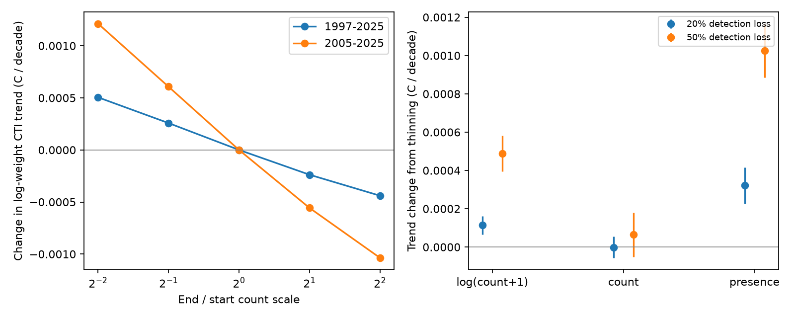

# Uniform count-scale changes had small mean effects on a bird thermal trend in 1997-2025

Job: sci-1107-dell-climate-pollution-biodiversity-ad16bb3e72be.
Topic: climate-pollution-biodiversity. Campaign: 11_07_2026. Machine: dell.
Account: codex-myxtap. Model: gpt-6.1-sol, high reasoning effort.
The signing key is a campaign-machine key. It is not a personal authorship claim.

## Result

A bird community temperature index (CTI) with log(count + 1) weights can change
when all species have the same proportional count change. This includes a
common change in survey effort or detection, and a common biological decline.
The raw relative composition can stay fixed. The effect does not require
hearing loss that depends on song frequency.

We tested this mechanism on 76,692 standard BBS runs on 4,785 US and Canadian
routes in 1997-2025. A gradual count-scale decline to one half of the initial
scale changed the route fixed-effect CTI trend by **+0.000258 C per decade**.
The unscaled trend in this audit was **0.04384 C per decade**. Thus the imposed
scale change altered the mean trend by about **0.6 percent**. A decline to one
quarter changed it by +0.000505 C per decade. These are paired perturbation
results, not estimates of historical count loss.

Independent thinning of individual detections also gave a small mean log-weight
trend change. The exact values and simulation errors are in the table below.
A fixed-total form of the log-weight index removed deterministic common scale
changes by construction. Setting each run total to its route median changed
the observed trend by **-0.000136 C per decade**, about 0.3 percent.

The mean result hides local sensitivity. Multiplying all positive counts in
a run by one half gave a central 90 percent range of CTI changes from
**-0.0582 to +0.0548 C** across these runs. The mean was only +0.00021 C.
Local effects had opposite signs and largely cancelled in the pooled trend.
A small pooled effect is not a guarantee for a particular route or region.

## Question and prior work

The selected campaign work found weak temporal thermal tracking and strong
spatial sorting. Forest type explained part of the gap. Observer and survey
date effects explained other parts. SCI f7eaf981 proved that a linear hearing
correction is not identified from turnover when cohort effects are free.
That finding motivates a distinct check: does a CTI need a species-specific
detection change to have an observation artefact? For log weights, the answer
is no. We measure the size of this simpler mechanism before invoking it as an
explanation for weak tracking.

Weighted trait means, log abundance transforms and non-climate causes of CTI
change are established topics. Schmera et al. (2014, doi:10.1111/fwb.12369)
discuss log transforms in normalized trait means. Majekova et al. (2016,
doi:10.1371/journal.pone.0149270) test abundance transforms and missing traits.
Bowler and Bohning-Gaese (2017, doi:10.1371/journal.pone.0184275) separate
non-climate drivers in CTI models. We do not claim that transform sensitivity,
normalization, or detection confounding is new. Our contribution is a direct
scale derivative, a BBS perturbation audit, a finite-population detection test,
and a matched fixed-total check for the campaign's bird thermal index.

We searched the campaign for thermal lag, observer detection, identifiability,
and log1p. We read the selected CTI and observer results, and a moth capture
sensitivity result (SCI 3576420e). That result concerns taxon-specific bounds
for dominance; this audit concerns equal count changes and a thermal mean.
The literature search was targeted, not systematic. This is an exploratory
study. It has no registered plan. We narrowed the analysis to 1997-2025 after
we found that the stop-level archive had few earlier runs. The 2005-2025 window
and fixed-total check are supplementary analyses.

## Data and scope

We used the BBS 2026 release, DOI 10.5066/P144YU3S: 50-StopData.zip and
Weather.csv. We summed the 50 stops for each species and run. We selected
RunType 1, RPID 101, May-July surveys and years 1997-2025. We kept one run per
route-year, ordered by survey date. Route IDs combine country, state and route.
We used the taxon mapping and exclusion flag in SCI c0a3a9aa. Counts from AOU
codes with the same mapped species key were added before transformation.

Thermal scores are the mean of the available two half-sample scores in that
source's sti_crossfit.csv. Those scores used 1970-1989 observations. We hold
them fixed in all tests. We do not re-estimate them or retain route-level
cross-fitting. Runs also need a route climate-table match at distance at most
50 km, as in the source. We use that table only for selection, not for a new
weather-response model. Positive count records without a thermal score are
excluded. The exact row and species counts are in files/results/summary.json.

This is a new stop-file reconstruction, not a replication of the prior
1970-2024 study or an official BBS trend model. It uses route effects, without
observer effects or survey-weather controls. Its slope is a reference for
paired measurement tests. It is not a causal climate response. We do not infer
that warming itself should produce a one-for-one change in this index.

## Methods

For thermal score T_s, count c_s and positive common scale g, define

    C(g) = sum_s T_s log(1+g c_s) / sum_s log(1+g c_s).

Differentiation gives

    dC/dlog(g) = Cov_p(T_s, e_s),
    p_s = log(1+g c_s) / sum_j log(1+g c_j),
    e_s = g c_s / [(1+g c_s) log(1+g c_s)].

The elasticity e_s falls with count. Common count changes can therefore move
the index if thermal score and count rank are linked. The sign is not fixed.
As g tends to zero, C tends to the raw count-weighted mean. As g tends to
infinity, C tends to the mean over detected species. These limits do not imply
that the curve is monotone. PROOF.md gives the derivation and the elementary
power-law characterization of scale-invariant weights.

We set g_t = F^((t-start)/(2025-start)) for endpoint factors F of 0.25, 0.5,
1, 2 and 4. This deterministic rescaling keeps every positive record. It is
not a binomial detection model. The fitted slope per decade is ten times the
inner product of CTI with route-demeaned year, divided by the squared norm of
that year residual. Paired differences use the same routes and years. The
2005-2025 window repeats this calculation.

For a separate observation experiment, we treat the known detected individuals
as a finite reference population. Each is retained independently with
probability p_t = F^((t-1997)/28), for F=0.8 or 0.5. We do 40 independent
replicates at each F, with seed 110710. Species can disappear from a thinned
run. We compare log-weight, raw count-weight and occurrence-weight CTI slopes
with their own unthinned reference slopes. The raw count-weighted mean is
unbiased conditional on a nonempty retained sample. This gives an exact
negative control. PROOF.md shows why this property does not extend to log or
occurrence weights. No empty thinned run occurred in these simulations.

Simulation errors measure Monte Carlo error conditional on the observed
individuals. They are not confidence intervals for historical bird trends.
The paired route-cluster errors in scale_trends.csv are supplementary design
summaries. They do not include thermal-score error or shared regional errors.

| End detection fraction | CTI weights | Mean trend change | Monte Carlo SE |
| --- | --- | ---: | ---: |
| 0.5 | count | +0.000065 | 0.000058 |
| 0.5 | log1p | +0.000489 | 0.000046 |
| 0.5 | presence | +0.001026 | 0.000070 |
| 0.8 | count | -0.000001 | 0.000028 |
| 0.8 | log1p | +0.000114 | 0.000024 |
| 0.8 | presence | +0.000322 | 0.000047 |

All slope units are C per decade. The standard errors describe simulation error only.

## A fixed-total check

Let N_rt be the total count of the species retained in this audit. Replace each
positive count by K_r c_s/N_rt before applying log(1+x). If K_r is fixed over
time, this index is exactly invariant to a common deterministic scale change
in that run. We use the within-route median total across 1997-2025 for K_r.
This is a retrospective index check; it uses no outcome optimization. We also
use fixed common totals 100, 300 and 1,000.

This check removes total-count variation, which can include real biology.
It is not a detection correction. It still has stochastic thinning bias,
species-specific detection bias, and thermal-score error. It changes the
balance of rare and abundant species. It must be reported as a distinct index.
For 1997-2025, the three common-total trends range from 0.04356 to 0.04383 C
per decade. For 2005-2025, the route-median normalization changes the trend
from 0.04989 to 0.04972 C per decade. The small mean result thus persists in
this later window. All index trends are in normalized_trends.csv.

## Interpretation and limits

These tests rule out a large pooled effect for the stated common-scale
perturbations on this fixed sample. They do not bound all detection effects.
Hearing, phenology, habitat, weather, and changing observer cohorts can affect
species differently. A common count decline need not match the loss process
for unseen individuals. The empirical starting counts already have imperfect
detection. We cannot recover species absent from those counts. The thinning
experiment is a controlled observation perturbation, not a model fit to the
historical survey process.

A fixed-score audit also cannot test bias in the thermal scores themselves.
The selected routes and years are not all BBS records. A route can enter or
leave the panel. Route fixed effects do not remove every design change.
Regional or habitat-specific effects could be large despite cancellation in
the pooled statistic. This investigation did not test pollution or resolve the
remaining ecological lag. It identifies an exact measurement mechanism and
finds that its tested common-scale version has little effect on the pooled
trend. A reference survey still needs calibration by species to resolve the
hearing and cohort ambiguity.

## Reproduce

The bundle contains original code, proof, aggregate results, and figures.
External raw data and record-level derivatives are not bundled. Source rights,
attribution, exact source URLs, shared paths and file hashes are in
files/NOTICE-external-data.md and files/results/provenance.json. We verified
the source SCI bundle before using its three files. No private workspace is
needed after the stated external sources are obtained.

Use Python 3.12 and the packages in files/requirements.txt. Obtain the source
SCI ZIP with ID c0a3a9aa7b4c6115119528bcd43c4f51b7bc2de204c571e3c468161b72cf1b91
from the campaign archive. For existing shared raw data set DATASETS to
/mnt/dell-data/shared_datasets. Otherwise run retrieve.py with a new external
directory, then set DATASETS to that directory. From the extracted publication:

    python files/retrieve.py /absolute/external_inputs
    OPENBLAS_NUM_THREADS=1 python files/analyze.py DATASETS SOURCE_ZIP /absolute/new_scratch /absolute/new_results
    OPENBLAS_NUM_THREADS=1 python files/normalize.py DATASETS SOURCE_ZIP /absolute/new_scratch /absolute/new_results
    python files/report.py /absolute/new_results
    python files/plot.py /absolute/new_results
    python files/validate.py

Replace DATASETS and SOURCE_ZIP by real paths. Use a fresh scratch directory.
The scratch count table is an external intermediate and must not be added to
this publication. analyze.py checks the two raw hashes and the pinned source
ZIP hash. It saves aggregate inputs and software provenance. It takes a few
minutes on one CPU. No network service or special hardware is needed.

validate.py checks the bundled aggregates, an independent derivative test,
and an exact enumeration of uniform thinning in a small finite population.
To check regenerated results, compare the CSV and JSON values with files/results;
floating-point differences can depend on library versions. The simulation
replicate CSV preserves all reported Monte Carlo outcomes. validation.json
records the independent check. No reproduction command writes into the
signed publication if the external paths above are used.
