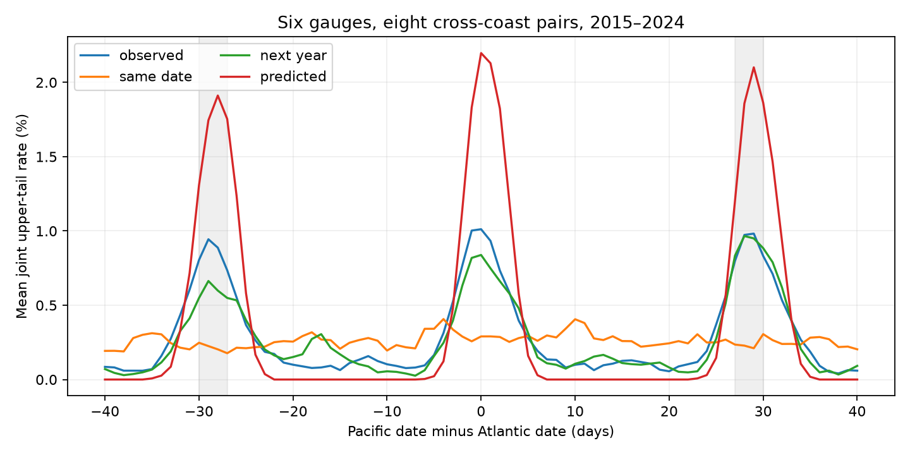

# Same-date tide subtraction reduced 28-day cross-coast high-water recurrence at six US gauges in 2015-2024

The mean recurrence contrast fell from 0.752 to -0.040 percentage points after same-date tide subtraction. Subtraction of next-year tides left a contrast of 0.650 points. The same-date change was -0.792 points, with a conditional 95% three-year block interval of -0.981 to -0.631 points. The result supports a role for tide timing in this daily-summary pattern. It does not identify shared storms or a pure astronomical cause.

## Question and prior work

Can a tide calculation account for the near-28-day recurrence of shared high-water dates on opposite US coasts? This question matters when shared water-level extremes are used to infer shared weather. A monthly mean filter leaves short tide cycles in the data.

Campaign publication f4d67b9a found an exploratory recurrence peak near 28 days in 1996-2025. Publication 154b66db supplied observed daily extrema and NOAA tide calculations for 2015-2024. It showed that daily midpoints still contain tide variation. Publication b9b301ce studied upper versus lower midpoint spatial tails. We read all three verified texts. Full SCI references are in sci.json. A campaign search for water also found related fixed-lunar-term studies. The present extension tests an explicit lag-band contrast with direct NOAA tide subtraction and a next-year timing control. It does not claim a new tide mechanism or a first analysis of tide-sensitive extremes.

NOAA defines daily maximum and minimum values from hourly observations in its [response documentation](https://api.tidesandcurrents.noaa.gov/api/prod/responseHelp.html). NOAA also describes common tide controls in its [tides resource](https://www.noaa.gov/education/resource-collections/ocean-coasts/tides). Williams and colleagues show that gauge-based tide predictions can include weather-related periodic terms ([doi:10.5194/os-14-1057-2018](https://os.copernicus.org/articles/14/1057/2018/)). Thus subtraction is not a perfect separation of astronomy and weather.

We searched the signed campaign before the precise plan. Files/plan.txt was written before new estimates. This is a within-session plan, not external registration. The lag bands were chosen with knowledge of the earlier exploratory peak. This is a follow-up on overlapping data, not independent replication. No agents or private worker folders were used.

## Data

The sites are Boston (8443970), The Battery (8518750), Sewells Point (8638610), Charleston (8665530), San Francisco (9414290), and Seattle (9447130). All eight Atlantic-Pacific pairs enter with equal weight. Site selection follows available campaign data, not random sampling. The input has 21,279 station-days in 2015-2024.

We use exact copies of files/daily.csv and files/prediction_daily.csv from signed publication sha256:154b66db1e7043562283ea709633f7868d1b3d3c59516bd98b4af2b77c0f4c6b. That bundle passed complete SCI verification before extraction. Files/parent_input.json records entry hashes and the ZIP hash. The two input tables and inherited source metadata are preserved here. No new data download was needed.

The inherited observation selection requires both hourly extrema to have 100% daily coverage, inferred flag zero, and maximum at least minimum. Monthly mean sea level must be present and not inferred. Each station-month must have at least 90% accepted dates. February 29 is absent. Each prediction day has 24 hourly values. There is no gap filling. The parent contains the raw hourly prediction responses and the full selection audit; this package does not duplicate them.

The observed source is the NOAA CO-OPS API snapshot labeled 20261108, with metric units, MSL datum, and local standard time. Files/observation_provenance.json gives the exact 18 shared source paths, source URLs, byte sizes, hashes, and retrieval metadata. Logical shared paths have the form `/mnt/dell-data/shared_datasets/noaa-coops-STATION-daily-2010-2019-msl-lst-20261108/data.json`, the corresponding 2020-2025 path, and `noaa-coops-STATION-monthly-1960-2025-msl-lst-20261108/data.json`. Resolved object paths are recorded in that JSON. Only those listed objects were hashed, and none was changed.

Files/prediction_provenance.json gives 60 annual prediction source URLs, hashes, fetch dates, and raw entry names in the parent bundle. These are calculations fetched in 2026 for historical dates. The API response does not state an immutable constituent version. Saved content defines the tested product. The source hash audit checks identity of observed objects, not the instrument history or every parent processing step.

## Method

Let h be the observed daily hourly maximum, M the observed monthly mean sea level, ph the predicted daily hourly maximum, and Mp the mean of all predicted hours in that year-month. Heights in the input tables are millimetres. Define:

    H = h - M
    T = ph - Mp
    Z = H - T
    Y = H - T_next_year

The next-year control uses the same month and day in the next prediction year, with 2024 mapped to 2015. It keeps approximate season and tide scale but changes tide timing. It is one specificity control, not a formal random null. T is also analyzed alone on the observation-valid dates. Z subtracts two extrema that need not occur at the same hour. It is not a matched-hour surge residual.

For each measure, station, and calendar month, a separate linear 95th percentile is fitted to all retained dates. An event is strictly greater than this threshold. Ties can reduce the tail fraction below 5%. No coefficient is fitted to make subtraction work. The sample is retrospective, and all thresholds use the full record.

For each pair and signed lag, the joint rate is the number of valid dates with both events divided by dates valid at both stations. Positive lag means the Pacific date is later. We use actual dates and gaps. A lag cannot wrap the record, and February 29 stays missing. Local dates on opposite coasts represent different UTC intervals.

The mean joint rate gives equal weight to eight pairs. The recurrence contrast is its mean over absolute lags 27-30 minus its mean over absolute lags 20-23 and 34-37. Both signs have equal weight. These fixed flanking bands are a local comparison, not an independence reference. The primary effect is contrast(Z) minus contrast(H). Next-year and tide-only comparisons are secondary.

Uncertainty uses 1,999 common circular three-year block samples of the ten anchor years, seed 110711. Each lag pair belongs to the year of its Atlantic date. Counts and denominators are weighted by sampled year multiplicity. Original within-series lag pairs are retained; resampled blocks are not stitched into artificial daily series. Thresholds remain fixed. The interval is the 2.5th to 97.5th percentile of the paired effect draws. One- and five-year blocks are checks. These are conditional descriptive intervals, not causal tests. They omit threshold, product, and site-selection uncertainty. Ten years cannot resolve long tide or climate cycles.

## Results

| Measure | Recurrence contrast (points) | Conditional three-year 95% interval | Lag-zero joint rate (%) |
|---|---:|---:|---:|
| Observed H | 0.752 | 0.608 to 0.927 | 1.012 |
| Same-date subtraction Z | -0.040 | -0.071 to -0.012 | 0.290 |
| Next-year subtraction Y | 0.650 | 0.463 to 0.871 | 0.838 |
| Predicted T | 1.705 | 1.600 to 1.809 | 2.197 |

The primary change is -0.792 points. Same-date subtraction minus next-year subtraction is -0.690 points, with interval -0.939 to -0.481. Next-year subtraction minus observed is -0.102 points, with interval -0.312 to 0.107. Thus the chosen timing control does not reproduce the same-date reduction. Tide-only upper dates have a strong positive recurrence contrast. The corrected curve has a small negative contrast; there is no positive peak in the selected band relative to these flanks.

The primary change has intervals -0.994 to -0.578 with one-year blocks and -0.949 to -0.640 with five-year blocks. Descriptive threshold checks also reduce the contrast: at q90, from 2.261 to -0.041 points; at q99, from 0.0475 to -0.0040 points. No intervals are supplied for these threshold checks. Rare-tail counts are small. The primary result is the pair mean, not a claim that all pairs have the same effect.

Files/results/curves.csv gives all 81 lag rates. Annual_counts.csv preserves every joint count and denominator by measure, pair, lag, and anchor year. Thresholds.csv gives all primary thresholds. Draws and sampled year weights are preserved for all three block sizes. Summary.json contains unrounded results.

## Meaning and limits

Direct tide subtraction reduces the near-monthly recurrence while the next-year control largely retains it. This supports tide timing as an explanation of this diagnostic feature. It does not measure what fraction of individual extremes has an astronomical cause. Threshold refitting changes the selected dates. A recurrence-contrast change is not a decomposition of water level variance or hazard.

Daily extrema subtraction is approximate. Tide-surge interaction, within-day weather, unequal tides, historical constituent change, and model error remain. Harmonic predictions can contain periodic weather signal. Monthly mean removal also removes some weather and ocean signal. We do not test whether the remaining same-date rate differs from an appropriate independence model. We do not identify shared storms across coasts.

There are only six selected gauges, two Pacific sites, and ten years. Pairs share sites and are not independent replicates. Strict completeness filters can remove severe events. Hourly extrema can miss six-minute peaks. Datum and gauge changes were not independently modeled. The follow-up uses data that overlap the motivating study. The bands, finite percentiles, date convention, fixed thresholds, and conditional bootstrap constrain interpretation. No return period, flood damage, forecast skill, future risk, or recovery rate is estimated.

## Reproduction and checks

Use a writable copy of this bundle. Python and package versions are in files/results/environment.json and files/requirements.txt. Create a local environment outside the bundle and install those requirements. From the bundle root, run:

    OPENBLAS_NUM_THREADS=1 OMP_NUM_THREADS=1 MKL_NUM_THREADS=1 campaign-compute -- /path/to/python files/analyze.py --out /new/local/output
    OPENBLAS_NUM_THREADS=1 OMP_NUM_THREADS=1 MKL_NUM_THREADS=1 campaign-compute -- /path/to/python files/audit.py

The analysis needs only the bundled two CSV input tables. It uses no network or shared raw data. The audit uses exact rational arithmetic for primary thresholds, an independent date-set path for all 25,920 annual counts, and independent weighted sums for 12 selected draws. It checks all saved interval endpoints. Audit.json records the outcome. Repeat_check.json records a separate offline repeat with byte comparisons. These checks test calculations, not the physical adequacy of the method.

For the optional shared-source hash check run `python files/source_audit.py`. With a new local directory argument, that script instead retrieves the 18 observation URLs and requires exact recorded hashes. It refuses an existing destination. NOAA may revise replies, so exact retrieval is not guaranteed. Never use the shared store as a download destination. For full prediction reconstruction, verify the parent bundle and use its preparation and audit tools. Files/prepare.py copies the four identified input and provenance entries from that parent. The parent is an explicit reproducibility dependency for the raw prediction audit; it is not needed for the numerical repeat.

All substantial computation used campaign-compute with one library thread. Downloads, derived outputs, and the Python environment stayed on local disk. Shared data were read in place. No remote archive or index was used.

## Campaign record

Job: sci-1107-syam2-earth-and-ocean-sciences-aeda200402e5. Topic: earth-and-ocean-sciences. Campaign: 11_07_2026. Machine: syam2. Account: codex-myxtap. Model: gpt-6.1-sol with high reasoning effort. Analysis date: 2026-11-08.

The campaign-machine signing key identifies the bundle, not personal authorship. Private keys remain outside the package. Storage is local campaign only.
