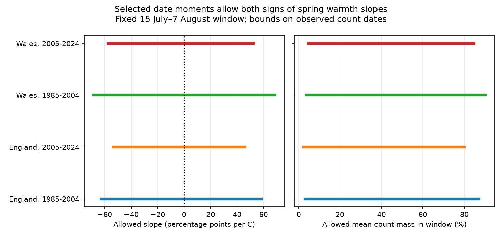

# Date moments allow both signs of temperature slopes for summer count shares of Meadow Brown in England and Wales in 1985-2024

## Question

Do the first date, last date, mean date and date standard deviation determine the sign of a spring-temperature slope for the share of observed butterfly counts inside a short summer window? We test this method question for Meadow Brown (Maniola jurtina). A change in seasonal timing can change a short survey count even if total abundance stays fixed.

Dennis et al., *Incorporating Phenology to Estimate Species’ Population Trends from Snapshot Citizen-Science Data* (doi:10.1007/s13253-024-00669-z), model this bias with full seasonal curves. Their study shows why flight timing matters for short surveys. Our work asks what selected summary fields can support without a curve model. It does not test their fitted curves or their correction method.

We searched the shared SCI campaign before choosing this test. Searches were `phenology temperature`, `butterfly duration abundance` and `butterfly moment bounds snapshot`. We read the published Orange-tip spread study (SCI 900f8204...) and the butterfly response-measure study (SCI e2f2fce4...). Both motivate an audit of the information in outcome measures. Our date-moment calculation uses overlapping source observations, not independent new monitoring data. No claim of a new general moment theorem is made.

## Sources and sample

We read the UKBMS phenology 2024 and site-location 2024 ZIPs in place. The two datasets are releases by Botham et al. (2025). We read the Met Office England and Wales monthly mean temperature and rainfall series updated on 1 November 2026. Weather is a country mean. It is not local site weather. Exact paths, source URLs, ZIP and used-member SHA-256 hashes are in files/provenance.json. No new raw dataset was downloaded.

The target years are 1985-2024. We use separate England and Wales samples in 1985-2004 and 2005-2024. The regions have no common sites. The periods have no common years, but can share sites. Regional weather is correlated. These are separate partitions, not independent experiments.

Each row must have peak count at least five, positive date SD, ordered first, mean and last dates, first date at least 1, last date at most 183, and range equal to last minus first. Each site must have at least eight usable years within its country and period. The initial sample has 19,339 rows. Exact equalities are infeasible for 117 rows: 6 in early England, 104 in later England, none in early Wales, and 7 in later Wales. We omit infeasible rows and repeat the eight-year rule for each calculation. This is a documented computational sample change, not a source-error finding. The high-count check uses a peak count of at least ten and repeats the eight-year filter. Dates use the source convention: April 1 is day 1. The fixed inclusive window is July 15 to August 7, or source days 106 to 129. It resembles a short summer survey but is not the actual changing Big Butterfly Count window in each year.

## Method and tested assumptions

For one site-year, let p(d) be a nonnegative normalized mass on each integer date from the reported first date to the reported last date. In the main calculation, its sum is one, its mean is the reported mean m, and its variance is the reported SD squared, s². We assume that the source SD can be read as the population SD of the count-weighted date distribution. If the source used another SD convention, the numerical bounds need to be rebuilt.

The target is q = sum of p(d) for days 106 through 129. Two linear programs minimize and maximize q with the three moment constraints. We scale dates as x=(d-m)/max(s,1) for numerical stability. A peak count supplies the sample filter and regression control. We do not impose a peak-date constraint, integer count constraints, an observed visit calendar, or a known total count. We allow zero mass at the support endpoints. Thus this is a class of real-valued distributions with selected date moments. It is a relaxation of the class of full raw count records. The bounds are exact within this defined class; they need not be exact for all source fields together. Both signs within this class do not prove that both signs occur among fully compatible raw records.

The rounding check permits a mean change of at most 0.01 day. It bounds E[(d-m)²] between max(s-0.01,0)² and (s+0.01)²+0.01². These are necessary linear constraints for means and SDs within 0.01 day of their reported values. This check is an outer relaxation, not an exact bound for that nonlinear rounding set. It covers ordinary rounding at two decimal places.

For each partition, the regression response is q. The predictor is equal-month March-May mean temperature. Controls are January-February mean temperature, mean March-May monthly rain, linear year, log peak count, and site intercepts. Each year has equal total weight; each row within a year has equal weight. We remove weighted site means, then remove the other controls from temperature. Let r be this residual, w the row weight, and a_i=w_i*r_i/sum(w*r²). The warmth slope is sum(a_i*q_i). Its lower bound uses each row's lower q bound when a_i is nonnegative and its upper bound otherwise. The upper slope bound reverses that choice. Since each row has its own feasible mass, the two extrema can be chosen separately for all rows. This proves the slope bound for the exact-moment class. Mean-mass bounds use the same year weights and nonnegative weights only.

These are fixed-record possibility bounds. They are not confidence intervals. They have no nominal coverage level and need no multiple-test confidence adjustment. Sampling uncertainty and source errors can enlarge uncertainty beyond these calculations. Country weather gives only 20 annual exposures per fit. Site intercepts and year balancing reduce stable site and network-composition effects but do not remove changing observer, habitat or detection effects. Log peak count is an imperfect proxy and can remove part of a biological response.

An exact example shows why moments can leave ambiguity. On days 90, 100, 110 and 120, masses (0.20, 0.40, 0.10, 0.30) and (0.30, 0.10, 0.40, 0.20) both have mean 105 and variance 125. Both have positive mass at the same first and last dates. Their shares in the fixed window are 0.40 and 0.60. These are synthetic distributions, not butterfly records.

## Results

The exact-moment models use 19,147 site-years after the feasibility and repeated-site filters. All four slope ranges permit both signs. Units below are percentage points of observed count mass per degree C.

| Country | Period | Rows | Sites | Lower slope | Upper slope | Mean mass range (%) |
|---|---|---:|---:|---:|---:|---|
| England | 1985-2004 | 3290 | 239 | -62.75 | 58.49 | 3.14 to 87.19 |
| England | 2005-2024 | 15197 | 1124 | -53.30 | 45.90 | 2.36 to 80.04 |
| Wales | 1985-2004 | 160 | 11 | -68.61 | 68.85 | 3.66 to 90.24 |
| Wales | 2005-2024 | 500 | 40 | -57.35 | 52.24 | 4.88 to 84.77 |

Median row-bound widths range from 82.10 to 89.85 percentage points. Thus the selected moments often permit very different window shares within a site-year. The higher-count check also permits both slope signs in all four samples.

The rounding relaxation is feasible for all 19,339 initial rows and permits both slope signs in every partition. Its four slope ranges are -62.67 to +58.43, -52.84 to +45.61, -68.66 to +68.91, and -56.91 to +51.26 percentage points per degree C, in table order. Because the exact-moment exclusion and repeated-site filter change the sample, these are not simple nested comparisons of the same regression. The rounding calculation is an outer bound, as specified above.

The largest reported linear-program duality gap is below 1.1e-11. Direct weighted least squares matches the slope-bound formula within 1.5e-14 in all twelve fits. Independent three-date vertex enumeration matches the four selected row bounds within 1.2e-14. These checks support the numerical calculation, not the biological assumptions. files/aggregate_results.csv gives all twelve fits.

The main result is an information limit for a specified summary class. A full flight curve, visit counts, or defensible shape constraints can narrow these bounds. It would be wrong to select a unique correction for short-window counts from these selected moments alone under this model. It would also be wrong to read a wide allowed range as evidence that climate has no effect.

## Limits

The mass describes dates of observed counts, not daily true abundance or a probability of detecting an individual. Weekly visits, weather rules, missing visits and unknown effort remain in the summaries. We cannot reconstruct daily flight activity or show that a snapshot count transfers between habitats or surveys. We did not model pollution, daily extremes, causal climate change, survival, or species distribution. This narrow method result serves the broader climate and biodiversity objective by testing an observation-bias limit. It does not estimate a climate-pollution interaction.

The main moment equalities treat rounded fields as exact. The stated relaxation checks sensitivity, but cannot fix an unknown source SD definition. The model permits irregular curves and unobserved daily support. Those choices are deliberate assumptions for this information audit, not claims that all extreme curves are biologically plausible. The test cannot reject a mechanistic model, a smooth curve method, or a corrected population trend based on richer data.

## Reproduce

Use Python 3.12 and the versions in files/environment.json. From the extracted bundle, with the shared datasets mounted:

    python files/analyze.py --shared-root /mnt/dell-data/shared_datasets --output /path/to/local_scratch/replay

This reads only the six named raw files, checks their hashes, and writes private row tables, aggregate results, a figure, provenance and numerical checks into scratch. Keep the output outside this signed bundle. It does not change shared data. The run compares coefficient endpoint formulas with direct weighted least squares. It checks linear-program duality and two synthetic support cases. Run `python files/validate_vertices.py /path/to/local_scratch/replay` to enumerate all three-date vertices for one nontrivial row in each partition. The stored vertex_validation.json records 19,075 tested triples across these four rows. It also checks the synthetic two-distribution example. An analytic variance check on the integer support agrees with all 19,339 exact-moment solver feasibility decisions. Its lower variance limit is frac(m)*(1-frac(m)); its upper limit is (m-first)*(last-m). files/validation.json and the aggregate table record the checks. No code is run by SCI verification.

If the shared sources are absent:

    python files/retrieve.py /path/to/new_local_raw
    python files/analyze.py --shared-root /path/to/new_local_raw --output /path/to/local_scratch/replay

The retrieval script downloads the six exact URLs and rejects a changed hash. Live weather files can change. If so, recover the exact dated shared source or document a new version and a new analysis; do not treat it as an exact replay. Raw ZIPs and record-level derived tables are outside the signed package. The package contains our method, code, narrative, aggregate statistics and figure. These support inspection and source-based regeneration, not an offline raw-data replay.

## Attribution and external terms

Full source citations, required UKBMS attribution, and external licence terms are in files/EXTERNAL_DATA_NOTICE.txt. They apply to external sources and scratch tables. They do not change the baseline licence for our bundled contributions.

## Job record

Campaign: 11_07_2026. Job: sci-1107-dell-climate-pollution-biodiversity-5f2b2187ab79. Topic: climate-pollution-biodiversity. Machine: dell. Account: codex-andrii. Model: gpt-6.1-sol, high reasoning effort. The campaign-machine signing key is not a personal authorship claim. No agent was launched. This publication is saved locally and is not submitted or uploaded by this worker.
## Version note

This version corrects the figure heading to specify selected date moments. It supersedes SCI sha256:379d3a924a4f8af5b7f279ca08f8a1a6fafe5f3674fc72fb07f320d67e4af75b. The analysis and numerical results are unchanged.
