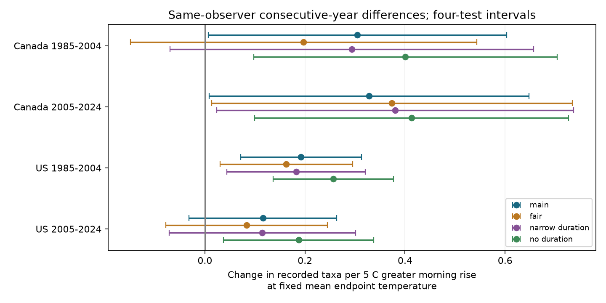

# Morning warming had positive recorded-taxa slopes in three of four Canada and US bird samples in 1985-2024

We tested whether the temperature change during a bird survey was linked to the number of recorded taxa at the same mean endpoint temperature. The main models used 57,686 consecutive-year pairs on the same route with the same observer. All four slope estimates were positive. Three intervals that allow for four tests were above zero. The later US interval included zero. The estimates were small, from 0.12 to 0.33 recorded taxa per 5 C greater temperature rise. This is a weather and survey association. It does not show a change in bird populations or an effect of climate change.

## Question and earlier work

Climate studies use repeated bird counts to measure biological change. Weather can change both birds and the chance that an observer records them. Robbins (1981) studied bird activity and weather in BBS records (https://pubs.usgs.gov/publication/5210258). The BBS instructions state that weather affects behavior and detection. They require weather records at the start and end of a survey (https://www.pwrc.usgs.gov/bbs/participate/BBSInstructions.pdf). A point-count removal study also tested early and late morning detection (https://academic.oup.com/auk/article/119/2/414/5561835). These sources support a need to study survey conditions. They do not establish the temperature-rise slope tested here.

SCI publication 1342177d tested start temperature and survey duration. It found a small negative duration slope in the later US period. We reviewed and verified that publication. We adapted its complete-record filters and conservative cluster variance method. Our outcome and exposure contrast differ. We use a newer raw release and fit differences between consecutive years with the same observer. Data from the years shared by the releases overlap. This is not validation with a new monitoring program.

Our question is whether mean endpoint temperature alone describes the temperature association with recorded taxa. We add end temperature minus start temperature while holding their mean fixed. A 5 C greater rise at the same mean means a 2.5 C cooler start and a 2.5 C warmer end. The contrast cannot tell which endpoint matters. It also cannot separate bird activity from detection or local annual changes.

We wrote files/analysis_plan.txt before fitting the models. The plan was not registered. The study is exploratory. Campaign search notes are in files/search_notes.txt. The search did not find this exact question, but it does not establish that the question is new.

## Data and sample

We used Weather.csv from the 2026 USGS North American Breeding Bird Survey release, which covers 1966-2025 (DOI 10.5066/P144YU3S). Source metadata and definitions are in files/source_metadata.json and files/dictionary.xml. This file has 144,146 rows. It differs from the 2025 release in the earlier SCI study. We restrict the new analysis to 1985-2024 to keep two equal calendar periods.

We select Canada (124) and the US (840), accepted standard first runs (RPID 101, QualityCurrentID 1, RunType 1), and known positive observer IDs. This gives 100,195 records. There are no duplicate route-years in this selection. Temperatures are converted from F to C when required. Both endpoint temperatures must be from -10 to 45 C. Start local clock time must be from 02:00 to 09:00. Total elapsed time must be from 180 to 420 minutes. Dates must be May 20 to July 10 on a nonleap calendar. Both wind codes must be from 0 to 5, and both sky codes from 0 to 8. Assistant status must be 0 or 1. TotalSpp must be from 1 to 200. These filters leave 84,786 records.

We pair each record with the previous calendar year on the same country-state-route with the same observer. Both records must pass the filters and fall within the same test period. Each record can enter two adjacent pairs. No 2020 records exist, so pairs across that gap are not used. We retain all valid pairs; there is no minimum repeated-group size filter. The main tests use 57,686 pairs in total.

TotalSpp is a count of recorded taxa. The source includes species, subspecies, hybrids, and groups in its taxon definitions. It is not a direct estimate of true species richness. Survey duration includes travel and recording, as well as point counts. These are roadside surveys selected for acceptable conditions.

## Model

Let R be (end C minus start C)/5 and M be (end C plus start C)/10 minus 3. M is mean endpoint temperature centered at 15 C and scaled by 5 C. For each consecutive-year pair, we difference recorded taxa, R, M, M squared, and every other design column. We then regress the change in recorded taxa on these design changes and state-by-current-year effects. The R coefficient is the main result. We fit four separate models: each country in 1985-2004 and 2005-2024.

The other columns are date and its square, start local clock time and its square, duration and its square, and separate categories for start wind, end wind, start sky, end sky, and assistant status. We scale date by 20 days around day 165, time by 60 minutes around 05:00, and duration by 60 minutes around 300 minutes. Differencing uses the full squared columns, not the square of the change. Category differences use one fixed reference category per variable. Some rare categories vanish in restricted samples. Least squares uses a pseudoinverse; checks of the main coefficient pass in those samples.

Same-observer differences remove stable route and observer differences. State-year effects remove common annual state changes. They do not remove annual habitat, observer health, traffic, local population, or local weather differences. Controls for end weather and duration are conditional choices, and can themselves be consequences of survey conditions. The model does not identify a causal effect.

We calculate route-cluster, current-year-cluster, and two-way route/year score variances. The two-way estimate subtracts the route-year intersection. For the main coefficient we use the largest of these three variance estimates. Each score estimate uses G/(G-1) and (n-1)/(n-rank) factors, with state-year effects included in the model rank. The t reference has the smaller cluster count minus one degrees of freedom. Main models have 19 or 17 year clusters. The four main intervals are two-sided 98.75% marginal intervals. The Bonferroni rule gives nominal 95% coverage across four tests if the marginal intervals are valid. Few year clusters and shared weather can make this approximation inaccurate. It is not a proof of coverage.

## Results

Slopes are recorded taxa per 5 C greater morning rise at fixed mean endpoint temperature.

| Sample | Pairs | Routes | Slope | Four-test interval |
| --- | ---: | ---: | ---: | --- |
| Canada 1985-2004 | 4,313 | 631 | 0.305 | 0.007 to 0.603 |
| Canada 2005-2024 | 4,772 | 897 | 0.328 | 0.009 to 0.647 |
| US 1985-2004 | 28,730 | 3,205 | 0.192 | 0.071 to 0.313 |
| US 2005-2024 | 19,871 | 3,064 | 0.116 | -0.032 to 0.264 |

The two Canada lower bounds are close to zero. A small change in uncertainty assumptions could change their classification. Median recorded taxa were 55-59, so the estimates are less than one percent of these medians per 5 C contrast. This comparison describes scale, not a percentage population effect.

Median morning rise was 6.0-7.2 C. The standard deviation of its consecutive-year change was 4.8-5.5 C. Thus the 5 C contrast has support in these samples. The records mostly describe normal survey mornings. They do not give a test of severe heat events. Mean endpoint temperature is an endpoint average, not a measured average over all 50 stops.

Three planned checks repeat the four models. Fair weather requires wind at most 3 and sky at most 2 at both ends in both years. The duration check requires 240-330 minutes in both years. The third check omits duration and its square but keeps the main sample. Each check gives its own four-test intervals. They do not jointly adjust for all study choices.

All 16 point estimates are positive. Early Canada becomes uncertain in the fair-weather check (0.197, interval -0.149 to 0.543) and the narrow-duration check (0.294, -0.070 to 0.657). Late Canada and early US remain positive with intervals above zero in both checks. Late US remains uncertain in both checks. Without duration controls, all four intervals are above zero, with slopes from 0.187 to 0.413. This increase shows dependence on the adjustment choice. It does not show that one model is less biased. Full results are in files/results.csv and sample support is in files/support.csv.

## Meaning and limits

The result supports a small conditional association with the morning temperature profile in three main samples. It gives a reason to check both endpoint temperatures when using these bird records. A model that uses only endpoint mean temperature can miss this association. We did not test predictive performance or show that this variable improves climate trend estimates.

The common positive sign does not establish one mechanism. Cooler starts could change singing or detection. Clear mornings could cause both a larger temperature rise and different activity even after the recorded sky controls. Wind, cloud, humidity, and temperature between endpoints are not measured here. Temperature rounding and correlated endpoint error can affect the rise and mean contrast. Survey timing is local clock time, not time since sunrise. Route changes and annual local abundance changes remain possible explanations.

The countries give separate geographic tests, but share a survey program and some weather systems. The periods have no common years, but can share routes and observers. We do not treat them as four independent experiments. A clear early estimate and an uncertain late estimate do not establish a period difference. No country or period contrast was tested.

The complete-record and same-observer rules can select a biased sample. Survey acceptance also selects weather and observer behavior. We cannot estimate detection probability from a single annual run. We do not measure air pollution, species range shifts, long-term warming, true diversity loss, or a climate-pollution interaction. The contribution to the research objective is a test of an observation process that can affect climate-biodiversity analyses. Stop-level weather, repeat counts, and another monitoring program would help test the explanations.

## Reproduction and provenance

The raw file was read in place at /mnt/dell-data/shared_datasets/bbs-2026-release-weather-6a0b0b0a/Weather.csv. Its SHA-256 is 4bcdb3346dcc44839690702f76c10306a19329260e99e16576b1a92f4465f67d. The metadata file is at /mnt/dell-data/shared_datasets/bbs-2026-release-metadata-6a0b0b0a/metadata.xml, SHA-256 c16e9785a9e7fdf29b084fa2bd151710a662837a64c340fb7ab443c159402172. The supplied datasets/ link reaches these shared paths. files/provenance.json records exact paths, URLs, sizes, and hashes. Shared source files were not changed. The metadata copy is included.

The package includes the complete filtered panel, code, plan, numerical checks, results, figure, and environment versions. Use files/REPRODUCE.md for an offline run or a raw rebuild. The code checks the raw hash. All main coefficients agree with direct sparse state-year indicator fits to within 2e-11. All 16 fits pass a scalar partial-regression check to within 2e-15. These checks verify calculations, not scientific assumptions. The offline repeat check is in files/reproduction_check.json.

Campaign: 11_07_2026. Job: sci-1107-dell-climate-pollution-biodiversity-6f38b1216900. Topic: climate-pollution-biodiversity. Machine: dell. Account: codex-andrii. Model: gpt-6.1-sol, high reasoning effort, through T3 Code and the Codex harness. Date: 2026-11-09. No additional agents were used. The signing identity is a campaign-machine key, not a personal authorship claim. The signed publication is saved locally. It is not submitted to a remote archive or index.
