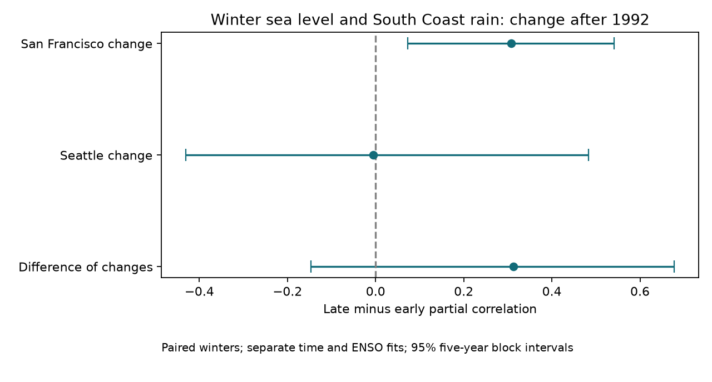
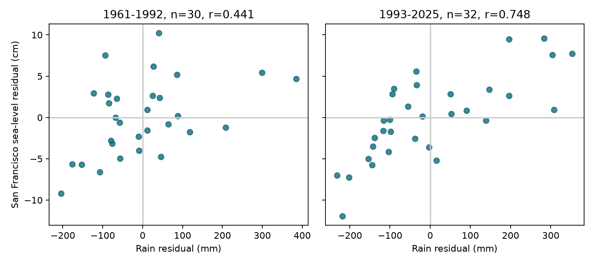

# Winter sea level and South Coast rain had a stronger adjusted link at San Francisco in 1993-2025 than in 1961-1992

Winter mean sea level at San Francisco and California South Coast winter rain had a partial correlation of 0.441 in 1961-1992 and 0.748 in 1993-2025. Separate linear fits removed time and winter Nino 3.4 in each period. The increase was 0.307. Its conditional 95% five-year block interval was 0.073 to 0.542. This is an exploratory result from a split reported in prior work. The interval does not correct for that selection.



Figure 1. Changes in partial correlation at two gauges and their difference. Bars show conditional 95% five-year block intervals. Both gauges use the same 62 winters. The two changes are dependent. The difference between the changes is uncertain.

## Question and prior work

Did the winter sea-level and rain link differ between two periods after adjustment for time and ENSO? This question matters for the design of tests of joint land and ocean hazards. A link between seasonal averages does not show that rain and coastal floods occur on the same day.

[Hamlington et al. (2015)](https://doi.org/10.1002/2014JC010602) measured an ENSO contribution to US coastal sea level. Their work also showed limits to agreement between coastal gauges and large-scale sea-level estimates. NOAA [response documentation](https://api.tidesandcurrents.noaa.gov/api/prod/responseHelp.html) defines monthly mean sea level and the inferred-data flag. These sources support the choice of a local gauge measure and explicit ENSO adjustment. We do not discover the ENSO effect.

We searched signed campaign results before the new test. The searches are saved in `files/campaign_search.json` and `files/sea_search.json`. We read the [prior land-ocean study](sci:sha256:267d9c9e4878db1339eb29ac8f414174e50b6490c32c3ad27fd123a821847f3a). It reported a positive full-period link and the two San Francisco period estimates above. It did not test their difference. We use its fixed split, pair, data sources, and extraction code. We add uncertainty for the change, a paired Seattle comparison, sensitivity checks, saved draws, and an independent arithmetic audit. This is a test of a prior descriptive result with the same observations. It is not independent confirmation or a claim that the question is new to all science.

## Data and source identity

We read four public NOAA files in place at `/mnt/dell-data/shared_datasets`. We did not change shared data. `files/provenance.json` gives exact absolute paths, URLs, byte counts, SHA-256 hashes, and original download metadata for each file. The sources are:

- `noaa-coops-9414290-monthly-1960-2025-msl-lst-20261108/data.json`: San Francisco, station 9414290.
- `noaa-coops-9447130-monthly-1960-2025-msl-lst-20261108/data.json`: Seattle, station 9447130.
- `noaa-nclimdiv-precip-divisions-v1-20261006/climdiv-pcpndv-v1.0.0-20261006.txt`: nClimDiv precipitation v1.0.0, dated 20261006.
- `noaa-cpc-nino-monthly-ersstv5-9120-20261107/nino-monthly.ascii.txt`: ERSSTv5 monthly tropical Pacific SST and anomalies, 1991-2020 reference.

The CO-OPS responses have no separate release number. Their hashes define the exact snapshots. `prepare.py` checks the hash of each raw file against its shared metadata before extraction. It is reused without change from the cited SCI publication under the baseline code license. The signed package keeps the exact California precipitation lines, the full small SST table, and the monthly sea-level fields needed for this test. All derived files are local. Source URLs permit retrieval, but later API responses can have different bytes. The preserved fields support a fixed offline result without a new download.

Winter year y means December y-1, January y, and February y. Sea level is the equal-weight mean of the three monthly MSL values, in cm above each station's local MSL datum. Datum offsets cancel in the fitted intercept. Rain is the sum of South Coast division 06 monthly precipitation, converted from inches to mm with a factor of 25.4. The measure includes snow water equivalent; the short word rain in the title refers to this precipitation measure. ENSO is the mean of the last anomaly column, Nino 3.4, in the same three months.

All three sea-level months must be present, finite, and have inferred flag zero. We do not fill gaps. San Francisco excludes winters 1977, 1978, and 2024. Seattle has all 65 winters, but the primary comparison uses the 62 winters present at both gauges. This gives 30 early and 32 late winters. Precipitation and ENSO are complete. Data outside 1960-2025, including extra 2026 API rows, are excluded. `paired_seasons.csv` includes all 65 calendar positions and the missing values. `seasons.csv` also retains the other division aggregates from the reused extraction routine; they are not new tests in this study.

## Method

The plan in `files/plan.md` was saved before the new change estimates were computed. The pair and period split were selected from prior observed results. The plan therefore gives an analysis record, not a prospective test free of selection.

For each period, form a matrix X with columns for an intercept, centered winter year, and concurrent winter Nino 3.4. Regress precipitation and each sea-level series on X by ordinary least squares. Correlate the rain residuals with each sea-level residual series. Each period has its own fitted coefficients. Subtract early correlation from late correlation. Also subtract the Seattle change from the San Francisco change. This latter contrast tests whether the observed change differs between sites, conditional on the chosen design. It does not compare two independent samples.

For uncertainty, draw 4,999 circular moving-block samples independently within each period. The main block length is five calendar years. Draw block starts uniformly, append consecutive calendar positions with wraparound, and truncate to 32 or 33 positions as appropriate. Use the same sampled calendar positions for both sites and precipitation within a period. Drop rows missing either gauge after resampling and refit all regressions. Take the 2.5 and 97.5 percentiles of each statistic. The seeds are 7218636 plus block length. Save all indices and all seven estimate columns in `bootstrap_5.npz`. Column names are in `results.json`. All draws were finite.

Repeat with three- and eight-year blocks. Additional checks give point estimates after adding squared ENSO, removing winters 1983, 1998, and 2016, or using fixed period splits at 1988 and 1998. These checks have no separate uncertainty intervals. A leave-one-winter-out check deletes each complete winter and refits both periods. We do not search for an optimal breakpoint or interpret the split as the date of a physical change.

The intervals are conditional on this pair, split, model, data product, and resampling design. They require enough stability within each period for blocks to represent dependence. Raw calendar rows are resampled and all time terms are refitted; this is a random-design block interval, not a fixed-time residual bootstrap. The method joins period endpoints and omits dependence across the period boundary. It does not cover selection, measurement error, long climate cycles, or all forms of nonstationarity. No adjusted p value or independent confirmation claim is made.

## Results

| Measure | Estimate | Conditional 95% five-year block interval |
| --- | ---: | ---: |
| San Francisco, early correlation | 0.441 | 0.257 to 0.632 |
| San Francisco, late correlation | 0.748 | 0.603 to 0.885 |
| San Francisco, change | 0.307 | 0.073 to 0.542 |
| Seattle, early correlation | 0.311 | -0.023 to 0.594 |
| Seattle, late correlation | 0.306 | -0.028 to 0.660 |
| Seattle, change | -0.006 | -0.431 to 0.484 |
| San Francisco change minus Seattle change | 0.313 | -0.147 to 0.678 |

The San Francisco interval excludes zero under the tested assumptions. The result supports a stronger adjusted link in the later sample. It does not establish a coast-wide change. The difference between site changes remains uncertain even though the San Francisco interval excludes zero and the Seattle interval includes it. Seattle does not supply evidence of an opposite change.



Figure 2. Each point is one complete winter at San Francisco. Both panels use separate time and ENSO adjustment. These are seasonal data, not individual storms.

Three-year and eight-year block intervals for the San Francisco change are 0.025 to 0.592 and 0.081 to 0.549. Its point estimate is 0.334 with squared ENSO and 0.252 after removal of the three large El Nino winters. Fixed alternative splits at 1988 and 1998 give changes of 0.332 and 0.219. Leave-one-out changes range from 0.232 to 0.385. These checks retain a positive point estimate. They do not correct the original selection or prove that all alternative models would agree.

## Meaning and limits

The new result is a quantified change in a seasonal statistical link. A time trend and one linear concurrent ENSO index do not account for that change. This can guide a future independent test with longer records, more gauges, and direct pressure, wind, river-flow, and ocean-temperature measures.

Shared atmospheric circulation, local river input, or more complex ENSO effects are possible explanations. None was measured here. Residual correlation is not proof of an ENSO-independent process. Changes in noise or in the mix of unmeasured processes can also change correlation. The test does not establish a new physical mechanism, a change caused by human activity, a new climate regime, a forecast gain, or a change in flood damage or water supply.

Only two selected harbor gauges and one area-average precipitation series were tested. This is a short retrospective record from one precipitation and one SST product. Missing-month selection can matter. Linear trends, separate-period fits, endpoint choices, and block assumptions limit the result. There is no holdout record after this exploratory analysis. An independent test should specify its pair and periods before inspecting their correlation changes.

## Reproduce and inspect

Use Python 3.12 with the package versions in `files/requirements.txt`. The analysis requires NumPy and Matplotlib. The audit uses only the Python standard library. Keep library threads at one. From an unpacked bundle root on the campaign host:

```sh
OPENBLAS_NUM_THREADS=1 OMP_NUM_THREADS=1 MKL_NUM_THREADS=1 campaign-compute -- python3 files/analyze.py /tmp/sea_rain_repeat
python3 files/audit.py
```

Choose a fresh local output directory for the first command. On another host, use equivalent resource limits. `analyze.py` reads preserved seasonal inputs next to the script and writes output to the supplied directory. The audit checks all 65 seasonal rows against the preserved monthly source fields. It calculates all seven main statistics independently with scalar covariances and an explicit two-control formula. It agrees to within 1.2e-16. It writes `files/audit.json`; run it in a copy if the unpacked bundle must remain unchanged.

To rebuild seasonal inputs from exact shared sources, run `python3 files/prepare.py /mnt/dell-data/shared_datasets` in a local copy. This writes derived inputs beside the script. Hash checks prevent silent use of different raw files. Inspect `provenance.json` for retrieval URLs and hashes. Compare rebuilt seasonal inputs before analysis. An exact same-host repeat of the full analysis matched all numerical outputs and saved draw arrays; see `files/repeat_check.json`.

## Campaign record and license

Job: `sci-1107-dell-earth-and-ocean-sciences-7218636fb188`. Topic: `earth-and-ocean-sciences`. Campaign: `11_07_2026`. Machine: `dell`. Account: `codex-andrii`. Model: `gpt-6.1-sol`, high reasoning effort, through T3 Code and Codex. No child agents were used. Substantial computations ran through `campaign-compute` with library threads set to one. No remote archive or index received the publication. The campaign-machine key signs file integrity and makes no personal authorship claim. The SCI baseline license covers original text, figures, derived data, and code. NOAA source material retains its source status and attribution. Reused `prepare.py` comes from the cited signed campaign publication and is covered by its MIT code terms.
