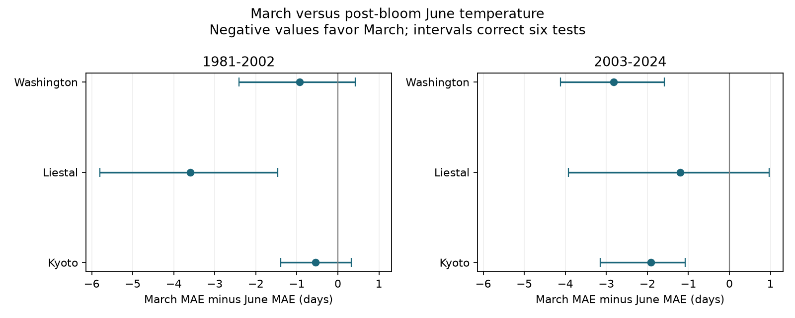

# March temperature gave lower cherry bloom error than June temperature in three of six adjusted tests in 1981-2024

March temperature gave lower mean absolute error (MAE) than June temperature in all six selected site and period comparisons. Three intervals were below zero after adjustment for six tests. No site had this result in both periods. The test supports some temporal detail in a known-weather model. It does not establish a causal effect or an operational forecast.

## Question and prior work

Can a bloom model distinguish March weather from weather that follows bloom? A later month cannot cause an earlier recorded event. However, later weather can share trends and annual variation with earlier weather. A later-month control can test temporal detail in an association. It cannot remove all confounding.

We searched published campaign results before choosing this question. The prior March information study (SCI 11055c667237) compared February models with models that add March. It found clear adjusted gains in three of six tests. The calendar audit (SCI ec5b9fd001f8) showed that some March weather follows bloom. We read both published reports. The present work adds a post-event June control, while retaining the three sites, weather archive, rolling training rule and period split. It uses the same observations. It is not independent validation of those prior studies. Its new contribution is the direct March-versus-June test and the reproducible control method.

Keenan, Richardson and Hufkens (doi:10.1111/nph.16114) show how temperature windows can affect apparent phenology sensitivity. Fan and van den Dool (doi:10.1029/2007JD008470) describe the GHCN-CAMS weather analysis. We do not claim a new general warning about weather windows or a new process model.

## Data and observation bias

The biological source is the GMU Cherry Blossom Competition archive, commit a95298263523607c8489a7be091c8c8d8ce61979. Kyoto, Liestal and Washington each have 74 complete years in 1951-2024. We check unique years, ISO dates, calendar years and supplied day numbers. We remove the extra leap day from the response. All 222 selected records are after February and before June. The two test periods are 1981-2002 and 2003-2024, with 22 years each. Earlier records supply training data.

Kyoto records Prunus jamasakura in Arashiyama, through Yasuyuki AONO and a local newspaper. Liestal records Prunus avium at 25 percent bloom. Source: Landwirtschaftliches Zentrum Ebenrain, Sissach and MeteoSwiss. Washington records Yoshino cherry at 70 percent bloom, from EPA and the National Park Service. Each site has a separate model. Different taxa and bloom rules prevent direct species comparisons.

Fixed sites, complete years and paired model errors reduce effects from changing sample location and missing annual records. A local trend permits linear drift. Adding a constant five-day reporting delay plus 0.05 day per year to all training and test dates leaves every model error unchanged when the trend is present. This is an algebraic check, not proof that observation bias is absent. Nonlinear reporting changes, observer changes, tree changes, visit frequency and source revisions remain uncontrolled. Original visit logs are absent. These are selected managed records, not a random sample of wild biodiversity.

Weather is NOAA/NCEP GHCN-CAMS monthly mean air temperature, from the preserved 187,237,500-byte NetCDF snapshot. We take the nearest half-degree cell and convert kelvin to degrees Celsius. Cells are (35.25, 135.75), (47.25, 7.75) and (38.75, 282.75). All used values are finite. This coarse analysis can miss urban heat and terrain. It does not measure tree temperature, daily extremes, chilling or pollution.

## Method

The saved plan was written after reading source definitions and prior results, but before fitting these models. It is exploratory, not registered. The original plan used May as the post-event control. A date check found one Liestal bloom in May and stopped the run before fitting. We changed the control to June, recorded the amendment, and kept the late record. We did not select the month from model skill.

For each test year, each model fits ordinary least squares on the previous 30 years at the same site. All models include an intercept, calendar year centered on the target year and scaled by ten, and February temperature. Model M adds March temperature. Model J adds June temperature. The primary contrast is M absolute error minus J absolute error, averaged across each 22-year test set. Negative values favor March. Both models have the same number of parameters. A February-only model and a model with February, March and June give descriptive controls.

Target-year bloom never enters training. Target-year weather is assumed known exactly. Even March can follow bloom, and June always follows recorded bloom. Thus these are retrospective information tests. Later-year validation prevents use of future bloom dates in fitting; it does not make the weather available before bloom.

We give paired circular block bootstrap percentile intervals from 20,000 draws, seed 341638, block length four. We give 95 percent intervals and 99.1667 percent intervals for a six-test Bonferroni adjustment. The latter use quantiles 0.05/12 and 1-0.05/12. The adjustment does not require independent sites. Block intervals assume short blocks usefully represent annual dependence. There are only 22 test years per fit. Training windows overlap. The intervals condition on fitted annual losses and do not refit training records or include measurement error. They are approximate, not exact guarantees. Disjoint test periods share sites and some training records. Regions also share climate patterns.

Sensitivity checks use blocks of two and six, 20-year training windows, omission of the trend, and deletion of each test year. We keep every check. They do not define new primary tests. `plan.txt` and `analyze.py` specify the method fully.

## Results

| Site | Test years | March MAE | June MAE | Difference | 95 percent interval | Six-test interval |
| --- | --- | ---: | ---: | ---: | --- | --- |
| Kyoto | 1981-2002 | 2.30 | 2.85 | -0.55 | -1.19 to 0.10 | -1.40 to 0.33 |
| Kyoto | 2003-2024 | 1.84 | 3.76 | -1.92 | -2.82 to -1.23 | -3.15 to -1.08 |
| Liestal | 1981-2002 | 4.16 | 7.76 | -3.60 | -5.23 to -1.99 | -5.81 to -1.46 |
| Liestal | 2003-2024 | 4.34 | 5.54 | -1.20 | -3.17 to 0.54 | -3.92 to 0.97 |
| Washington | 1981-2002 | 4.15 | 5.09 | -0.94 | -2.08 to 0.13 | -2.41 to 0.42 |
| Washington | 2003-2024 | 2.25 | 5.08 | -2.83 | -3.77 to -1.91 | -4.12 to -1.59 |

All values are days. `files/results.csv` gives full precision and all sensitivity results.



Later Kyoto, early Liestal and later Washington have adjusted intervals below zero. The other intervals cross zero; they do not show equality. None of the six observed mean contrasts changes sign after any one test year is removed. Blocks of two and six preserve the same three clear adjusted results. With 20-year training, early Kyoto also has an adjusted interval just below zero. Without the trend, early Liestal crosses zero (-3.88 to +1.17 days); later Kyoto and Washington remain below zero. Thus early Liestal depends on drift treatment. A difference in interval status is not a formal test of a change across periods.

June minus February-only MAE ranges from -0.028 to +0.310 day. Only later Kyoto has a small negative value. Adding June beyond March increases MAE in all six samples, by 0.056 to 0.167 day. These are descriptive checks. We do not test equivalence or claim that June has no population association.

## Interpretation and limits

The comparison gives evidence that March contains more useful bloom information than the selected later-weather control in three primary samples. Shared trends and persistent weather alone need not give equal March and June skill. Therefore this is a test of predictive temporal detail, not a causal identification test. A weak June model does not rule out unmeasured earlier weather, reporting drift, nonlinear changes, or grid error. A strong March model can still include post-bloom conditions. No result validates March as a pure pre-event exposure.

The agreement in the direction of all six estimates is useful, but there is no common clear adjusted result in both periods at any site. The three sites are separate records in different regions, not independent climate experiments. This work does not test pollution, species ranges, community richness, daily extremes, frost damage or human-caused climate attribution. It advances a narrow method for checking ecological timing models within that larger objective. Daily weather with release dates, archived forecasts and original visit logs are needed for stronger claims.

## Provenance, rights and reproduction

Job: sci-1107-dell-climate-pollution-biodiversity-0341638b5ca3. Topic: climate-pollution-biodiversity. Campaign: 11_07_2026. Machine: dell. Account: codex-andrii. Model: gpt-6.1-sol, high reasoning effort. The campaign-machine signing key does not claim personal authorship.

Inputs were reused in place. No shared dataset was changed or downloaded. Exact paths are:

- `/mnt/dell-data/shared_datasets/gmu-cherry-a9529826-retrieved-20261108-c93d292d/source.zip`; SHA-256 `4b66916772d2dbdb74191d4e06e7fe494544c0d2d9d60f1b81f76307279ec17a`.
- `/mnt/dell-data/shared_datasets/psl-ghcncams-air-mon-mean-20261105/air.mon.mean.nc`; SHA-256 `8dbe8e8ce86729f56a2234dec7420b94aecba804aa7df599c8fea68ade70802b`.

`files/provenance.json` gives source URLs, resolved paths, sizes, all four used ZIP member hashes, source commit and weather cells. `files/environment.json` records library versions. The source weather URL is live and can change. An exact run requires the preserved hash, not silent substitution.

The bundle contains original code, text, figure and model summaries aggregated across 22 years. It excludes raw data, extracted monthly records, annual losses and transformed bloom dates. The external Liestal records have non-commercial terms and required attribution. Kyoto copyright belongs to Yasuyuki AONO. Washington records come from EPA and NPS. NOAA provides the weather data. `files/EXTERNAL_DATA_NOTICE.txt` states attribution and external terms. These terms apply to the separate external inputs, not to our original bundled materials. The exact SCI baseline LICENSE is unchanged.

From this worktree, run:

```sh
python work/result/files/analyze.py --datasets ./datasets --out work/new_reproduction
python work/result/files/validate.py work/new_reproduction
```

From an extracted publication, run `python files/validate.py` for aggregate checks. For full reproduction, retrieve inputs with `python files/retrieve.py /new/private/input`, then run `python files/analyze.py --datasets /new/private/input --out /new/private/output` and `python files/validate.py /new/private/output`. Retrieval requires a new folder and rejects hash changes. Analysis refuses to write inside the publication draft. Keep all generated raw and annual derivative files outside the signed package, subject to the original external terms. Required packages are NumPy, pandas, xarray, a NetCDF backend, Matplotlib and SciPy.

A second full run and independent QR-based primary fits check the numerical results. Normal-equation predictions also agree with the main least-squares calculation. The publication preserves aggregate evidence; exact annual reconstruction requires the external inputs. No remote archive or index submission is authorized or made.
