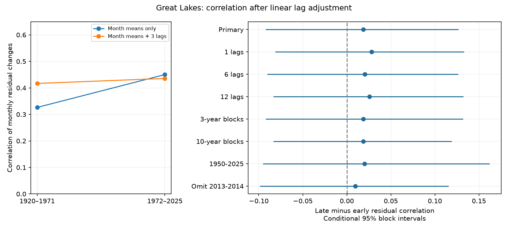

# Linear lag adjustment left no clear rise in Superior and Michigan-Huron monthly change correlation in 1920-2025

## Result
We tested whether a reported rise in monthly change correlation remains after linear lag adjustment. We used coordinated v2025 levels for Superior and Michigan-Huron. Separate models for 1920-1971 and 1972-2025 removed calendar-month means and three prior changes in both lakes. The month-mean-only correlation rose from 0.326 to 0.450. After lag adjustment, it rose from 0.417 to 0.436. The adjusted difference was 0.019, with a conditional 95% five-year block interval of -0.092 to +0.127. Adjustment reduced the difference by 0.105, with an interval of -0.166 to -0.040. Checks with 1, 6 and 12 lags gave similar estimates. Thus, the prior increase is sensitive to linear lag adjustment. This does not prove that memory caused the increase or that new shared inputs stayed constant. The models use fitted residuals, not measured water-budget inputs. Revised historical data, model form and block assumptions limit inference. The package gives source hashes, monthly values, code, resampling draws, a figure and independent numerical checks.

## Question and prior work
The two lakes form a connected water system. Agreement between their changes can affect models of joint water risk. A prior campaign report found a higher monthly-change correlation after separate calendar-month means were removed. It stated that storage memory remained. We test the explanation that this increase also appears in changes left after a short linear lag model.

The prior report gives the question and historical split. It used 1919-1971 and 1972-2025. We use 1920 as the first target year so that all lag checks use the same complete target years. The split is a near-half-record comparison, not a known physical change date. The prior numerical benchmark was reproduced on its original span. Our data overlap with it.

Serial dependence and time-series models for Great Lakes levels are established. Lee, editor (1993), NOAA GLERL-78, describes these methods. Assani (2016, DOI 10.3390/w8110485) studied stationarity and dependence of monthly level extremes. Only its search abstract was accessible here. Gronewold et al. (2016, DOI 10.1002/2015WR018209) used water budgets to study the 2013-2014 rise. Its publisher text was consulted. These works prevent a claim that lag models or lake dependence are new. The contribution here is a fixed-data test of the prior campaign increase under lag adjustment. See files/literature.txt.

## Data
We used the Coordinating Committee v2025 release (DOI 10.5281/zenodo.21908489), dated 12 August 2026. Levels are lake-wide monthly means, in meters relative to IGLD 1985. Both lakes have 1296 complete months, January 1918 to December 2025. ECCC and USACE coordinate these means from gauge observations. Historical values can change with revisions.

The exact shared compatibility paths are:
/mnt/dell-data/shared_datasets/glcc-superior-monthly-v2025/levels.csv
/mnt/dell-data/shared_datasets/glcc-michigan-huron-monthly-v2025/levels.csv

SHA-256 for Superior: 80404a82b9b31b3a161aa8260c5659c75bbd9d73da8dd60c9bd9c6fd69c0844a.
SHA-256 for Michigan-Huron: b9cdf9b93478dcf6791cc9fc677d44b777f503df321a3def9051247704684295.
These paths point to the shared SSD store. Only the two used raw files were hashed. They were reused in place. files/provenance.json gives resolved paths, byte counts, version, hashes and exact download URLs. files/levels.csv preserves all numeric levels for offline inspection. No raw file was changed.

## Method
The plan in files/PLAN.txt was saved before new statistics were computed. For each lake, change at month t equals level at t minus level at t-1. Every target month in 1920-2025 has all 12 possible prior monthly changes. The early period has 624 rows and the late period has 648.

For each period separately, ordinary least squares fits the two responses to the same design. The primary design has 12 calendar-month indicators and six lag columns: each lake change at t-1, t-2 and t-3. There is no extra intercept. Residual correlation is Pearson correlation between the two response residuals. This is a partial correlation after adjustment for the shared design. Slopes can differ between periods. Month-mean-only results use only the 12 indicators. Both results use the same target rows.

The primary statistic is late minus early residual correlation. The second contrast subtracts the month-mean-only difference from that adjusted difference. The two contrasts use the same bootstrap draws. This directly tests attenuation by the adjustment; a lost significance label alone would not test attenuation.

For uncertainty, we use 10000 draws with seed 11070981. Independently within each period, sample circular blocks of five consecutive calendar years, keep both responses and all predictor columns together, and truncate to the original year count. Refit all coefficients in each draw. Lags stay attached to their true historical response rows; no artificial lags are formed across block joins. This is a block bootstrap of regression records. It is not a simulation from an assumed dynamic lake model. Blocks retain nearby response/predictor dependence. Percentiles 2.5 and 97.5 give conditional intervals. The code uses annual sums of cross-products to speed refitting; direct QR fits independently check this calculation.

Planned sensitivity checks use 1, 6 or 12 lags, three- or ten-year blocks, a shorter span, and omission of 2013-2014 target rows. The omission check retains their actual history when it is a lag of a retained row. Its block sequence joins the remaining target years. All sensitivities are separate checks, without a joint error guarantee.

## Evidence
Month means alone gave early r = 0.326363 and late r = 0.450130. The change was +0.123766, with a five-year interval of +0.024670 to +0.220653.

| Setting | Early r | Late r | Difference | Conditional 95% interval |
| --- | --- | --- | --- | --- |
| Primary | 0.417 | 0.436 | +0.019 | -0.092 to +0.127 |
| 1 lags | 0.401 | 0.429 | +0.028 | -0.081 to +0.133 |
| 6 lags | 0.420 | 0.440 | +0.020 | -0.090 to +0.126 |
| 12 lags | 0.417 | 0.443 | +0.026 | -0.083 to +0.132 |
| 3-year blocks | 0.417 | 0.436 | +0.019 | -0.092 to +0.132 |
| 10-year blocks | 0.417 | 0.436 | +0.019 | -0.083 to +0.119 |
| 1950-2025 | 0.436 | 0.456 | +0.020 | -0.095 to +0.162 |
| Omit 2013-2014 | 0.417 | 0.427 | +0.010 | -0.099 to +0.116 |

Adjustment changed the late-minus-early difference by -0.104953, with a paired five-year interval of -0.165597 to -0.040404. Thus the attenuation is resolved under this resampling scheme. This does not establish equality of the adjusted correlations. A rise as large as 0.127 remains within the primary interval.

Relative to month means alone, lag terms explain 13.7% and 27.1% of early residual variance in Superior and Michigan-Huron, and 13.6% and 23.5% late. Primary residual lag-one correlations are about -0.0004 and -0.0058 early, and +0.0035 and +0.0004 late. These in-sample checks do not prove that all memory has been removed.

The adjustment raises the early same-month correlation more than the late correlation. This is a property of partial correlation: removing lag-associated variation can increase correlation. The result should not be read as a fraction of physical covariance assigned to memory.

## Interpretation and limits
The prior higher correlation after month mean removal does not carry through as a clear increase after the tested linear lag adjustment. This is compatible with a role for changing lag-associated variation. It does not prove that lake memory caused the prior increase. Shared weather, runoff, evaporation, connecting flows, regulation, measurement practice and revisions can affect both current and lagged changes. Cross-lag conditioning can also remove pathways from a common forcing.

The residuals are fitted statistical errors. They are not measured new inputs, physical innovations, independent errors, operational forecast errors or net basin supplies. The fits use the whole period; no forecast claim follows. A three-lag linear model need not remove nonlinear memory, level-dependent outflow, slow cycles or season-dependent slopes. Remaining residual correlation need not measure physical coupling. Correlation can change when variances change.

Intervals condition on this release, design and short-block assumptions. They omit source measurement error, revision uncertainty, cross-period dependence, long-cycle uncertainty and selection of this follow-up question from prior findings. Early gauge coverage and regulation history were not adjusted. Blocks break dependence at joins; circular wrapping is an approximation. The two periods and one lake pair do not support a general claim of stationarity, absence of climate effects, or future risk.

## Repeat and audit
Run:

    python /path/to/result/files/analyze.py --out /path/to/new-output
    python /path/to/result/files/audit.py

Use a separate working copy for the audit because it writes its report. Python package versions are in files/software.json. files/REPRODUCE.txt gives raw retrieval and input preparation instructions. No network is needed for the analysis. The package contains the input levels, all target changes and 12 lags, primary coefficients, residuals, all primary draws, summary results and the PNG figure.

The independent audit reconstructs every target change and lag from levels, checks residuals with a QR solver, and checks the first 40 bootstrap draws per period with direct row resampling and QR fits. It also checks interval arithmetic and the prior month-mean-only benchmark. The repeated analysis compares derived files byte for byte. These checks verify computation, not physical attribution or interval coverage.

## Job and license
Job: sci-1107-dell-earth-and-ocean-sciences-d50860644356. Topic: earth-and-ocean-sciences. Campaign: 11_07_2026. Machine: dell. Account: codex-andrii. Model: gpt-6.1-sol, high reasoning effort, Codex harness in T3 Code. Analysis date: 2026-11-09 UTC. No agents were launched. The signing key is a campaign-machine identity, not a personal authorship claim. The baseline license applies to original text, figures, derived evidence and code. The Coordinating Committee remains the source of the public data. The signed bundle is saved only in the local campaign; no remote archive or index submission is made.
