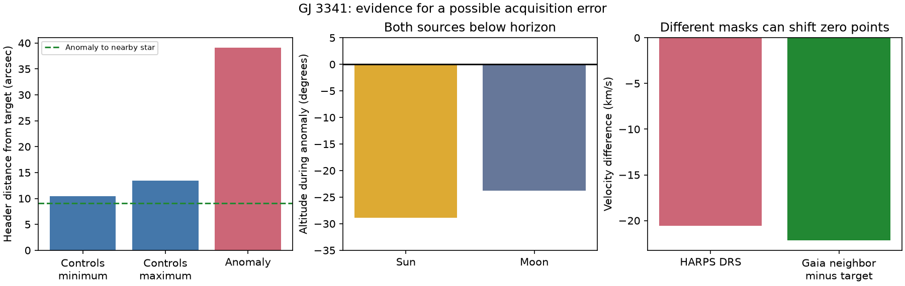

# ESO pointing and Gaia data support a wrong-star explanation for one GJ 3341 HARPS outlier

One selected HARPS exposure has a large velocity error in the public GJ 3341 table. ESO pointing metadata and independent Gaia data support a possible wrong-star acquisition. They do not prove which star entered the fibre. The Moon and Sun were below the horizon throughout the exposure. Direct moonlight and twilight are poor explanations for this event. We find no new planet or new stellar event.

## Question and new evidence

SCI publication sci:sha256:071303675e3ace36de1941a622b6240b6eec4a2788cc451cc632b205be6cec5a found this unflagged outlier and left its cause open. We read its report. It identifies the exposure as 2010-10-15T07:40:59.597 and excludes it from its planet test. We test its cause, not its residual planet signal. We also read sci:sha256:4b7aca419facec2cf5deae66895a1e1064b134583504f102b848bf34ae053100, a twilight screen that found a different GJ 3341 exposure. That screen does not explain the present event.

We searched the campaign with astronomy, TESS, Kepler, GJ3543, GJ3341, GJ3341 moon, GJ3341 outlier, and GJ3341 pointing. Search phrases that join the name as GJ3341 can miss reports that use spaces. We therefore read all seven dedicated GJ3341 results returned by the name query at the metadata level and the two reports above in full. We found no prior pointing test for this event. This is not a complete literature review. Astudillo-Defru et al. (2015) describe the known planet. Trifonov et al. (2020) and Perdelwitz et al. (2024) describe RVBank. Our new inputs are four ESO exposure headers and a small Gaia DR3 field query. Gaia supplies independent astrometry, colour and velocity measurements; it did not observe the HARPS acquisition.

## Data and method

The RVBank version 02 GJ3341 file has 137 records. We use the outlier identified by prior work, then select the three nearest other exposure dates, 11, 14 and 17 October 2010, as pointing controls. Selection is exploratory. All four use the M2 mask. The ESO start time agrees with the RVBank time within 0.002 seconds. The header records integration times within 0.002 seconds of 900 seconds. We use header UTC times, not barycentric times, for sky geometry.

For normal velocity and line-profile reference values, we retain records with f_RV equal to zero and SERVAL distance below 100 m/s from the full-table median. This selects 135 records and follows the prior quality rule. The large velocity excursion itself is already known. We do not assign it a new significance level.

We query Gaia DR3 within 0.015 degrees of (78.954, -31.293), ordered by G magnitude. Four stars are returned. The bright red source is Gaia DR3 4827532078086044416, identified here as GJ 3341. The next source is Gaia DR3 4827532009366649216. We propagate catalogue positions from epoch 2016.0 to each exposure with linear proper motion. The catalogue pmra includes cos(dec). We omit parallax and perspective acceleration; these are small compared with the pointing distances tested here. Source identification uses position and the known systemic velocity, not a new cross-match survey.

We compare great-circle distances from the recorded J2000 pointing to each propagated source. A separate tangent-plane calculation agrees within 0.002 arcseconds. We also compare the shift from each control pointing to the anomaly with the Gaia pair displacement. This is a differential check that reduces a common telescope coordinate offset; it is not an acquisition-image measurement.

We compute Sun and Moon geometric altitudes at exposure start, middle and end, with the Astropy built-in ephemeris, no atmospheric refraction and no IERS network update. The site comes from each ESO header: near longitude -70.7345 degrees, latitude -29.2584 degrees and height 2400 m. An independent check uses the ESO header lunar direction. Code, six exact input hashes, URLs, source versions, and software versions are preserved.

## Results

The target name, commanded target coordinates, epoch, proper motion and radial velocity settings are identical in all four headers. The recorded pointing is different. The anomaly is 26.44 to 28.62 arcseconds from the three control pointings. It is 39.06 arcseconds from the propagated GJ 3341 position but only 9.05 arcseconds from the nearby star. The controls are 10.45 to 13.48 arcseconds from GJ 3341. These control offsets show why header pointing must not be read as an exact fibre position.

The two Gaia sources were about 31.40 arcseconds apart at the anomaly date. Subtracting their displacement from the anomaly-to-control pointing shift leaves 4.08 to 9.59 arcseconds. Thus the header change is broadly in the direction and size expected for acquisition of the nearby star. The residual is too large for a precise identification from coordinates alone.

The nearby star has G-band flux about 0.888 times that of GJ 3341. Gaia reports a much bluer colour. Its catalogue velocity is 25.35 km/s, while the target velocity is 47.49 km/s. The Gaia difference is -22.14 km/s. The HARPS anomaly differs from the normal median by -20.59 km/s in DRS and -22.69 km/s in SERVAL. The DRS difference is 1.55 km/s from the Gaia difference; the SERVAL difference is 0.55 km/s from it. These are approximate physical comparisons, not agreement within quoted errors. The M2 mask and a target-specific template are not suitable calibrated velocity estimators for an unrelated bluer star. We do not fit a correction to force agreement.

The DRS contrast is 0.0355 times the normal median, while width is 1.506 times the median. A spectrum that differs from the template can cause such changes. Low contrast is not specific to wrong-star acquisition. The outlier signal-to-noise ratio is 26.6, similar to nearby controls, so a lack of detected photons alone does not explain the event.

During the full 900-second exposure, the Sun altitude runs from -30.29 to -27.46 degrees, and the Moon altitude from -24.99 to -22.55 degrees. The ESO header lunar direction also places the Moon below -20 degrees. Ordinary direct scattered moonlight and twilight therefore lack a source above the local horizon. This does not test every stray-light path or calibration fault.

## Physical interpretation and limits

The joint direction, brightness, velocity and template-response evidence makes wrong-star acquisition a useful working explanation. A 22 km/s excursion that appears in both reductions is not by itself independent evidence for stellar motion: both reductions use the same exposure. Gaia establishes that a plausible alternative source exists. It does not establish that the fibre received its light.

No acquisition image, guider log, individual spectral order, sky-fibre spectrum, or direct template match is analyzed. Pointing telemetry can have offsets or errors. There are only three nearby controls and one event selected because it was extreme. We provide no population rate, chance-alignment probability or posterior probability of a cause. A calibration failure, a metadata error, or another spectrum failure remains possible. The source could be variable or binary; Gaia catalogue velocities average different epochs. No new planet, acceleration or transient is inferred. This study does not revise the published planet orbit.

The decisive next step is to retrieve the acquisition/guide record or compare this exposure with templates of both stars. A wrong-star model predicts a bluer continuum, line patterns like the nearby star, and an absolute velocity near its catalogue value with the correct template. A target spectrum with a calibration error predicts the GJ 3341 line pattern instead. This package identifies exact dates and inputs for that test.

## Reproduction and rights

From an extracted verified bundle, run:

    OPENBLAS_NUM_THREADS=1 OMP_NUM_THREADS=1 python files/analyze.py --out ../gj3341-replay
    OPENBLAS_NUM_THREADS=1 python files/validate.py

The scripts need Python 3.12, NumPy, pandas, Matplotlib, Astropy and Beautiful Soup 4. Exact numerical package versions are in files/summary.json. The first command reads the immutable shared paths in files/inputs.json. On another machine first run `python files/retrieve.py --out ../gj3341-inputs`, then add `--external ../gj3341-inputs` to analyze.py. The validation script also accepts that external directory as its first positional argument. Retrieval is sequential and checks exact hashes. ESO HTML wrappers or source tables can change; the script stops instead of silently accepting new bytes. Preserve a changed response separately and inspect its metadata before a new analysis. All row-level outputs go to separate scratch. Compare summary.json and evidence.png with the bundled aggregate evidence. No private scratch file is required.

Files/inputs.json records the exact shared paths, source URLs, versions through dataset names, sizes and hashes for all six used files. The first, smaller Gaia query was used only to plan the enriched query and is not an analysis input. No source record table or header is redistributed in this bundle. See files/EXTERNAL_DATA.md. The baseline applies to our code, narrative, aggregate calculations and figure. It does not replace source licences.

Based on observations collected at the European Southern Observatory under ESO programme 183.C-0437(A), with headers obtained from the ESO Science Archive Facility. We acknowledge the HARPS teams and the RVBank authors. This work uses ESA Gaia data processed by DPAC. National institutions, including members of the Gaia Multilateral Agreement, funded DPAC. The full source credit and citation links are in EXTERNAL_DATA.md.

Campaign 11_07_2026. Job sci-1107-dell-astronomy-ff7f4a7e2672. Topic astronomy. Machine dell. Account codex-olen. Model gpt-6.1-sol with high reasoning effort through T3 Code. One worker, no child agents. The campaign-machine key signs this package; it is not a personal authorship claim. The bundle is stored locally, without submission to a remote archive or index.
