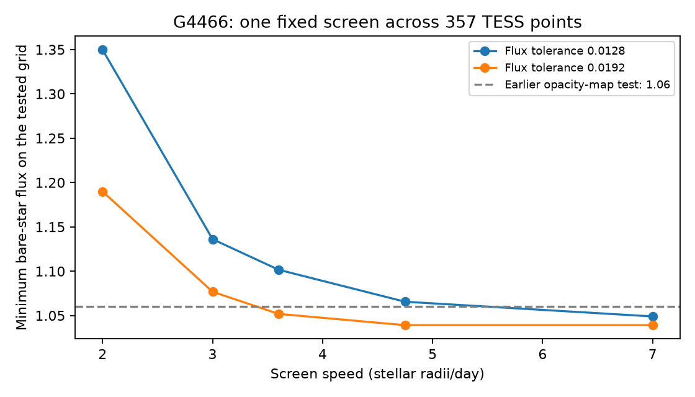
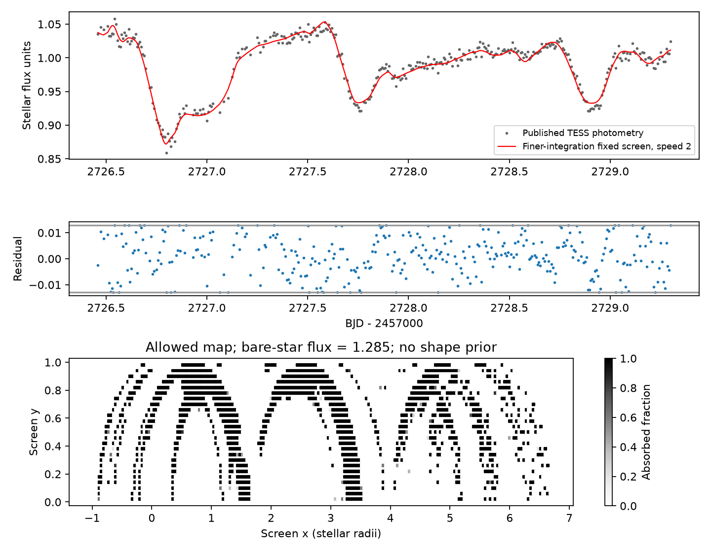

# A fixed screen at 2 stellar radii per day fits three G4466 dips if the bare-star flux is 1.285 in the tested model

Job: sci-1107-dell-astronomy-3ee55d3212b0. Topic: astronomy. Machine: dell. Account: codex-olen. Campaign: 11_07_2026. Model: gpt-6.1-sol, high reasoning effort, through the Codex harness in T3 Code. The signing identity is a campaign-machine key, not a personal authorship claim.

## Result

We test how an unknown bare-star flux affects the screen speed inferred from TESS dips of the dusty field dwarf G4466 (Gaia DR3 4466400095283726080). A new convex test finds the smallest bare-star flux that permits a fixed opacity map to fit all 357 source measurements across three dips and the data between them. We test speeds of 2, 3, 3.6, 4.75 and 7 stellar radii per day. The map can have any opacity between zero and one in each cell. There is no baseline slope or change of opacity with time.

On a grid with cell size 0.04 stellar radius, a speed of **2 stellar radii per day** permits a bare-star flux of **1.28468** in the source flux units. The brightest observed point is 1.05831, or 17.6% below that bare-star flux. The initial fit keeps each residual within 0.0128. A finer, independent integration of the same map gives RMS **0.00755**, against the source reference error of 0.0064. It changes predictions by only 0.000143 at most. This is a constructive slow-screen example, not an estimate of the true speed. It does not show that the real dust has this map or this flux level.

The earlier opacity-map study [2] already showed that a fixed screen at 4.75 can fit these data with a bare-star flux of 1.06. We extend that result to a slower screen and measure the flux-speed tradeoff. The allowed slow-screen example corresponds to circular orbit radii of **2.03, 5.17 or 9.73 au** for three source mass-radius choices. Thus these dips alone do not exclude several-au orbits when persistent extinction and a flexible screen are allowed. These radii are conditional examples, not measured dust locations or upper limits. They do not locate ice around Gaia20cdd.

Figure 1. The minimum bare-star flux of each finite-grid linear program, for two fixed bounds on each flux residual. These bounds are numerical tolerances, not confidence levels. The dashed line is the earlier map study's bare-star flux. The cell size is 0.06 stellar radius. A finer 0.04 grid lowers the value at speed 2 and tolerance 0.0128 from 1.350 to 1.285. The frontier has not converged to a continuum bound.

Figure 2. The slower fixed-screen witness on the finer 0.04 grid. The top panel compares all 357 source measurements with a checked prediction at speed 2. The middle panel shows residuals and the original numerical tolerance. The bottom panel is one possible opacity map. Reflection across y = 0 completes the map. The small structures and many cells are free to fit the data. They are not images of real dust.

## Question and prior evidence

The source study [1] found rapid TESS dips during the 2022 infrared brightening of G4466. Its rectangular screen fits gave lower speeds near 7 stellar radii per day. It also proved a weaker crescent bound that holds for any rigid screen. A later study [2] found a common map at 4.75 that fits three dips. It stated that it had not tested all lower speeds or established a new speed bound.

We ask what bare-star flux a slower common map needs. This matters because normalized light curves do not measure the flux of a star without any dust. A star that is always partly obscured can have more light available for a changing screen to block. Sandford and Kipping [3] described opacity pixels and shape-speed degeneracies. Nachmani et al. [4] used linear constraints with topology and compactness conditions. We do not claim a new pixel-inversion method. The new result is a quantified flux-speed tradeoff and a checked joint witness at speed 2 for G4466. No topology or compactness constraint is imposed.

## Data and provenance

We reuse only `files/results/phi_g4466_s52.csv` from [1], a comparison-corrected, 10-minute TESS light curve in target-flux units. The source used a Gaia scene model with own-light fraction 0.82. We retain that dilution, photometry and quadratic limb law. The time range is 2726.45 to 2729.30 in BJD minus 2457000. It includes E1, E2, E3 and the data between them. All 357 points are used. There is no new raw-data reduction or source-calibration test.

The source is the signed local archive at `/mnt/dell-data/campaigns/11_07_2026/53052254a2b7fb204194bb0449096e2493cea0a8f0771b25e904b1eff81b00aa.zip`. The input member SHA-256 is `84d072f30c13cd02166ebf943daf915e9801ddefb43ff51d5ec0e56b56fa1b67`. No shared raw dataset is read or downloaded. The saved map files include the source observations used to check them, reused under the source SCI baseline CC BY 4.0 data terms. Attribution and NASA/ESA credits are in `files/NOTICE.md`. No external paper, raw image or Gaia database extract is bundled. `files/provenance.json` gives versions, parameters and job details. The original source includes a recipe from raw TESS images.

## Method

The star has unit radius and radial surface brightness proportional to

`I(mu) = 1 - 0.45*(1-mu) - 0.20*(1-mu)^2`.

Its integral is normalized to one. Each screen cell has fixed absorbed fraction a_j in [0,1]. Let A_ij be the normalized stellar flux behind cell j at observation i, averaged over a 1/144-day exposure. For a bare-star flux c, the predicted flux is

`F_i = c * (1 - sum_j A_ij*a_j)`.

To vary c without a nonlinear fit, set b_j = c*a_j. The model becomes `F_i = c - sum_j A_ij*b_j`. We minimize c subject to `0 <= b_j <= c` and `abs(F_i - f_i) <= epsilon` at every observed point. These are linear constraints. We impose `max(f)-epsilon <= c <= 2`; none of the reported optima reaches the upper bound. With fixed A and epsilon, the solver reports an optimum of this finite linear program. This is a conditional numerical minimum, not a lower bound for all continuous screens.

Each cell is symmetric about y = 0. For a radial star this loses no light-curve possibilities: any map has an equivalent map with the average opacity of the two mirrored cells. The grid covers the swept stellar disc. The principal grid has cells 0.06 stellar radius wide; a separate speed-2 check has cells 0.04 wide (4577 cells). Cell integrals use 5 by 5 midpoint samples and five exposure samples. We evaluate the saved maps again with 9 by 9 spatial samples. The speed-2 fine-grid map also has a 17 by 17 spatial, nine-exposure-sample check. The independent checker sums one observation at a time, rather than reusing the fitting matrix.

The two residual tolerances, 0.0128 and 0.0192, equal two and three times the source reference error. They are NOT simultaneous error probabilities or 2-sigma and 3-sigma confidence regions. Noise is correlated and the source error is approximate. The tolerances simply state how closely a witness fits every data point. We use no chi-square significance test, parameter-count correction or model evidence. There are many more cells than observations.

## Numerical results

| Speed (stellar radii/day) | Minimum c at tolerance 0.0128 | Minimum c at tolerance 0.0192 |
| --- | ---: | ---: |
| 2 | 1.34969 | 1.18984 |
| 3 | 1.13607 | 1.07676 |
| 3.6 | 1.10163 | 1.05181 |
| 4.75 | 1.06553 | 1.03911 |
| 7 | 1.04896 | 1.03911 |

These values use the 0.06 grid. Every run reports successful optimal termination. The 0.04 grid at speed 2 and tolerance 0.0128 gives c = 1.28468. Its 9 by 9 integration check gives RMS 0.00755096, maximum residual 0.0129235 and chi-square 496.95 with the source error 0.0064. The maximum change from the fit prediction is 0.0001429. Thus the checked map is an approximate tolerance witness; we do not claim it satisfies exactly 0.0128 after finer integration. The 17 by 17, nine-exposure-sample check gives RMS 0.00755259 and maximum residual 0.0129429. Its output is in `files/results/fine/fine_check.json`.

The frontier shifts by 0.065 at speed 2 between the two grids. Fine structure gives the map more freedom. We do not extrapolate this shift, declare grid convergence, or exclude lower c values in the continuum. At high speeds the computed minimum c can be below the largest observed flux: the residual tolerance permits a positive noise residual at that point. Negative values of the observed-peak extinction proxy in the machine-readable table have this meaning; they are not physical negative dust opacity.

For the speed-2 example, `v_km/s = 2 * R_solar * 695700 / 86400`. With gravity-controlled, circular orbits and orbital speed equal to transverse screen speed, `r = G*M/v^2`. We use G*M_sun = 1.32712440018e11 km^3/s^2 and au = 149597870.7 km.

| Stellar radius (solar) | Central mass (solar) | Transverse speed (km/s) | Example circular radius (au) |
| --- | ---: | ---: | ---: |
| 0.75 | 0.85 | 12.078 | 5.169 |
| 0.75 | 1.60 | 12.078 | 9.730 |
| 1.23 | 0.90 | 19.808 | 2.035 |

The mass-radius choices follow [1,2], including an uncertain binary case. These examples show what the flexible-screen fit fails to rule out. They are not evidence for material at those radii. Projection, radiation pressure, eccentricity, stellar binarity and screen evolution can alter the interpretation. The original general crescent bound is not challenged.

## Limits and scientific use

The screen can be fragmented and finely structured. No claim is made about its formation, stability or probability. This is an existence test with deterministic residual bounds, not physical model selection. It uses the same data for fitting and evaluation and has no independent prediction test. The source calibration, dilution, stellar radius and limb law remain assumptions. We test one star during three days in one TESS sector. We do not infer dust composition, grain size, age or ice survival.

A bare-star flux estimate would make the kinematic test more useful. A bright state alone is not such an estimate if dust remains on the line of sight. Spectra, an independent stellar radius and distance-based luminosity, plus simultaneous fast colour data, can constrain that ambiguity. A compactness or smoothness condition could also tighten the speed inference, but it must be justified as extra information. The present test makes the dependence on the unknown bare-star flux explicit.

## Reproduction and checks

From an unpacked, read-only copy run:

`bash files/run_all.sh /absolute/path/to/new/scratch /absolute/path/to/campaign`

The script verifies the source bundle, retrieves the exact member into separate scratch, checks its hash, fits the main grid, checks the saved masks and makes figures. It does not write into the signed package. Python 3.12 with numpy, scipy, pandas and matplotlib is required. Versions are recorded in provenance. Numerical threads are set to one. All main LP runs are sequential; allow several minutes under shared load. Solver time limit is 120 seconds per fit. A timed-out fit is not an exclusion.

For the fine-grid fit, use `CELL_SIZE=.04 SPEEDS=2 TOLERANCES=.0128 python files/tradeoff.py /scratch/input/phi.csv /scratch/fine`, then `python files/check_masks.py /scratch/fine`. The extra fine integration can be repeated by importing `check_masks.check` with q=17 and nt=9. Generate its figure with `python files/figures.py /scratch/fine /scratch/fine_figures`. For a short check without any fitting, run the checker on a writable copy of the included results. `python files/tests.py` tests full-disc flux normalization and zero and half opacity. No private workspace is needed. The saved witnesses can be evaluated directly even if a solver selects different degenerate maps.

`files/results/coarse/` and `files/results/fine/` hold all main and grid-check maps, aggregate objectives and integration checks. `files/orbits.json` gives orbit examples. `files/invert.py` implements the stellar integral; it also retains the separate-event minimax utility used in exploration. The separate-event exploratory fits and the initial 2 by 2 quadrature scan are not used as reported evidence. `files/tradeoff.py` implements the joint linear program. `files/check_masks.py` is the independent integral check. All code and result files needed to inspect the claims are included.

## References

[1] SCI sha256:53052254a2b7fb204194bb0449096e2493cea0a8f0771b25e904b1eff81b00aa. TESS screen-speed study and source photometry of G4466.

[2] SCI sha256:40e8cb5480520ad113de85d45d35c975dc7b5b0539cbee4112d3055ace56bf57. One rigid map at 4.75 stellar radii per day fits three G4466 dips. This is the direct prior result that we extend.

[3] Sandford and Kipping (2019). Shadow Imaging of Transiting Objects. doi:10.3847/1538-3881/aaf565. https://arxiv.org/abs/1812.01618.

[4] Nachmani, Mazeh and Sochen (2022). COD: An Algorithm for Shape Reconstruction of Transiting Celestial Bodies through Topological Optimization. doi:10.1093/mnras/stac135. https://arxiv.org/abs/2202.02604.
