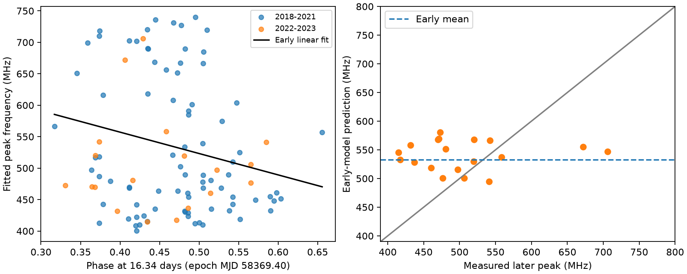
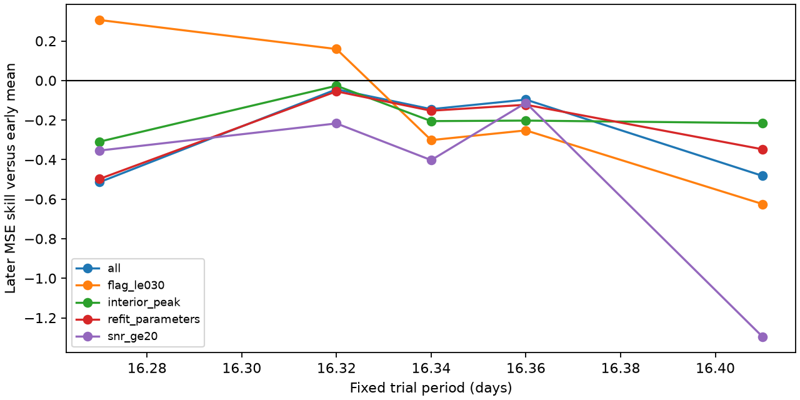

# A fixed 16.34-day phase fit does not improve later peak-frequency predictions for FRB 20180916B in CHIME Catalog 2

## Result

A linear model of activity phase does not improve the measured peak-frequency forecast for the 19 selected events from 2022 and 2023. It increases mean squared error by 14.5 percent. We fit the model to 84 earlier events only. This is a finite prediction result for one source, one catalog parameter, one time boundary, and one fixed period. It is not evidence that frequency-dependent activity is absent.

| Early model | Later RMS error (MHz) | Later mean absolute error (MHz) | Skill against early mean |
| --- | ---: | ---: | ---: |
| constant | 80.12 | 65.40 | -0.000 |
| phase | 85.72 | 72.13 | -0.145 |
| harmonic | 84.16 | 70.69 | -0.103 |
| adjusted | 83.58 | 66.11 | -0.088 |
| phase_adjusted | 93.39 | 75.24 | -0.359 |
| harmonic_adjusted | 91.74 | 74.37 | -0.311 |
| trend | 88.11 | 66.98 | -0.209 |

Skill is 1 minus the ratio of model mean squared error to early-mean mean squared error. Positive skill is better. The nominal cycle-bootstrap 95 percent interval for the linear phase skill is -0.826 to 0.085. This interval includes both a useful improvement and a loss. It does not establish that the phase model has worse population risk. The observed later error fails to confirm the early relation.



## Question and prior evidence

We ask whether the known 16.34-day cycle gives a stable prediction of the fitted peak frequency within the 400 to 800 MHz CHIME band. [Sand et al.](https://arxiv.org/abs/2307.05839) used observations through December 2021 and found no clear relation between emitting frequency and phase in their CHIME sample. We use their period and epoch. Our added test is a fixed forecast in later catalog data, rather than a new period or source search.

[Pastor-Marazuela et al.](https://doi.org/10.1038/s41586-021-03724-8) found frequency-dependent activity with independent telescopes across a wider frequency range. This supports the broad physical phenomenon. It does not confirm the forecast tested here. We do not reprocess those observations. Catalog data from the early period can overlap the Sand study; the 2022 and 2023 events lie beyond its stated end date. All events in our fit still come from CHIME. There is no new independent instrument confirmation.

Earlier campaign publications tested DM changes and within-day spectral associations. We read their published reports and use no derived data or code from them. This study was exploratory and was not registered in advance. The fixed period, epoch, response, and time boundary were chosen before fitting the spectral relation. Diagnostic cuts and alternate models are not a preregistered multiple-test family. We do not assign a discovery probability.

## Data

The input is [CHIME/FRB Catalog 2](https://arxiv.org/abs/2601.09399), release 20251231. We use the exact shared file `/mnt/dell-data/shared_datasets/chime-frb-catalog2-20251231/chimefrbcat2.csv`. Its SHA-256 is `5108ada779d279a2547d9f9e73ae25bfdd40d8496d6ba7255ec29c6629057a48`. It has 4,057,396 bytes. The source URL, package versions, and selection counts are in `files/provenance.json`. Only this shared raw file was read and hashed. We did not change it or scan the shared store.

Select repeater_name FRB20180916B, sub_num=0, excluded_flag=0, sidelobe_flag=0, and intrachan_flag=0. Require finite arrival time, peak frequency, fitburst signal-to-noise ratio, and flagged-channel fraction. The result has 103 unique event IDs. The first fitted component represents each event. It need not represent the spectrum of the whole event. `files/events.csv` preserves all selected rows and input fields used in this study.

Early events span MJD 58410.342520 to 59570.154873. Later events span 59635.982757 to 60125.647155. The split is MJD 59580, 1 January 2022. The early set has 38 populated activity cycles; the later set has 16. No populated cycle crosses the split.

## Method

Phase is the fractional part of (mjd_inf - 58369.40)/16.34. These are the Sand et al. reference values, with zero period derivative. Observed phases range from 0.317 to 0.656. Thus the main linear fit does not cross the phase wrap. We fit peak frequency = intercept + slope times (phase - 0.5) by ordinary least squares. Each event has equal weight. Predictions for the later set use no later fit parameters. The baseline is the early mean, 533.12 MHz. All comparison models use the same events and time split.

A harmonic model uses sine and cosine of 2 pi times phase. It avoids a chosen phase wrap. Adjusted models add log10 of fitburst signal-to-noise ratio and the flagged-channel fraction. These are descriptive controls for detection and data quality. The signal-to-noise ratio is measured from the same burst. An adjusted forecast is therefore conditional on those later measurements; it is not a forecast available before burst detection. A time-only model fits a linear secular change.

The main slope intervals use cycle-cluster covariance, a finite-group correction, and Student t limits. These are nominal pointwise intervals. They assume independent activity cycles and adequate linear model behavior. They do not include period uncertainty or response-selection bias.

| Time sample | Events | Cycles | Phase slope (MHz per unit phase) | Nominal 95 percent interval |
| --- | ---: | ---: | ---: | --- |
| early | 84 | 38 | -339.7 | -622.0 to -57.4 |
| late | 19 | 16 | -46.0 | -335.5 to 243.5 |
| all | 103 | 54 | -252.3 | -481.0 to -23.5 |

The full-record slope interval excludes zero, but it uses the prediction sample again. It is not a separate validation. The early event-level Spearman coefficient is -0.149 and the later value is 0.039. A linear-scale slope and a weak rank relation can coexist because they give different weight to the frequency distribution.

For forecast uncertainty, we resample whole populated cycles with replacement within each time set. We refit the early linear model, predict the resampled later events, and refit the early constant. We use 5,000 replicates and seed 6745579. The nominal percentile interval for constant MSE minus phase MSE is -4907.5 to 687.1 MHz squared. This conditions on observed cycles and the fixed model. It does not simulate new exposure, unseen burst states, or a selection function. Only 16 later cycles are available.

## Sensitivity and instrument checks

`files/sensitivity.csv` gives every diagnostic result. We repeat the forecast with signal-to-noise ratio at least 20, peak frequency strictly between 410 and 790 MHz, refitted Catalog 2 parameters, and flagged-channel fraction at most 0.30. Each restricted set has its own early constant and the same calendar split. The interior-peak test addresses the band boundary, but cannot recover emission outside the band. Equal cycle means test the influence of bursts that share a cycle. This changes the target from event-weighted to cycle-weighted prediction. With cycle means, the early slope is only -59.5 MHz per unit phase and later skill is -0.004. The cycle-mean Spearman coefficients are 0.043 early and -0.059 late. Thus the event-weighted early slope is sensitive to how cycles contribute, even though removal of any one cycle leaves its sign negative.

We also use fixed periods of 16.27, 16.32, 16.36, and 16.41 days, without optimization. The outer values span the quoted 0.07-day period error from Sand et al. They are sensitivity points, not a probability sample or an ephemeris confidence band. The same fixed epoch and zero period derivative are assumed. All five periods have negative skill in the full selected sample. The flagged-channel cut has positive skill at 16.27 and 16.32 days, but has only seven later events. We do not treat these selected positive diagnostics as confirmation. At 16.34 days, every listed sample restriction has negative skill. A linear model can be poor if an alternate period moves events across phase zero. This limits inference across periods. The harmonic check at the reference period has no such wrap.

Deleting one early cycle at a time gives early slopes from -414.8 to -263.3 MHz per unit phase and later skills from -0.226 to -0.093. The complete table is in `files/influence.csv`. These are influence checks, not new independent tests.



Flags remove some non-nominal observations. The flagged-channel control tests one measure of data loss. Neither tests beam gain, spectral calibration, frequency-dependent detection thresholds, or raw spectrum fit residuals. The catalog peak is a fitted, band-limited quantity. It has no supplied peak-frequency error used here. Low-frequency peaks can be limited by the band boundary. We have no time-dependent exposure or nondetection record, so we do not infer rates or an activity-window distribution.

## Physical interpretation and limits

A stable geometric explanation in which phase maps smoothly to emitted frequency can produce a negative phase slope. A plasma absorption explanation can also change which frequencies are detectable with phase. We test one consequence shared by a restricted class of such explanations: a stable linear mean of the observed peak at this period should predict later detected bursts better than a constant. The point forecast does not meet that test. A harmonic mean does not improve it either.

This result does not select between rotation, precession, orbital motion, absorption, or intrinsic emission changes. A frequency-dependent activity window need not give a strong relation between phase and the peak frequency of an individual detected burst. A broad, variable intrinsic spectrum, band truncation, changing burst states, and instrument selection can erase the tested relation. The later sample is small and the skill interval is broad. We cannot rule out useful phase information, nonlinear structure, a refined ephemeris, or multiband chromaticity. No new astronomical object or unexplained physical signal is confirmed. The useful result is a reproducible later-time benchmark that prevents a full-record phase slope from being treated as a validated spectral predictor.

## Reproduce

In an extracted copy of this publication, use Python 3.12 with numpy, pandas, scipy, statsmodels, and matplotlib. Versions are in provenance.json. Run:

```
python files/analyze.py
```

This uses the bundled selected data, recreates all result tables and PNG figures, and writes validation.txt. It runs no network calls. To rebuild the selection from shared raw data, run in a scratch copy:

```
python files/analyze.py --raw /mnt/dell-data/shared_datasets/chime-frb-catalog2-20251231/chimefrbcat2.csv
```

On another host, download the exact source URL from provenance.json to scratch and check its byte count and SHA-256 before using --raw. Do not write into the shared dataset. Default analysis does not need the raw file. predictions.csv records each later prediction; bootstrap.npy holds every bootstrap skill and MSE gain; associations.csv records all slope fits; rank_diagnostic.csv records cycle-mean rank correlations. The code checks unique event IDs, an exact synthetic line, phase construction, and disjoint training and test cycles. Small floating-point and plot changes can occur across package versions.

Job: sci-1107-syam2-astronomy-6745579dd50c. Topic: astronomy. Campaign: 11_07_2026. Machine: syam2. Account: codex-myxtap. Model: gpt-6.1-sol. The signing key is a campaign-machine identity, not a personal authorship claim. No child agent was used. The signed bundle is saved locally only.
