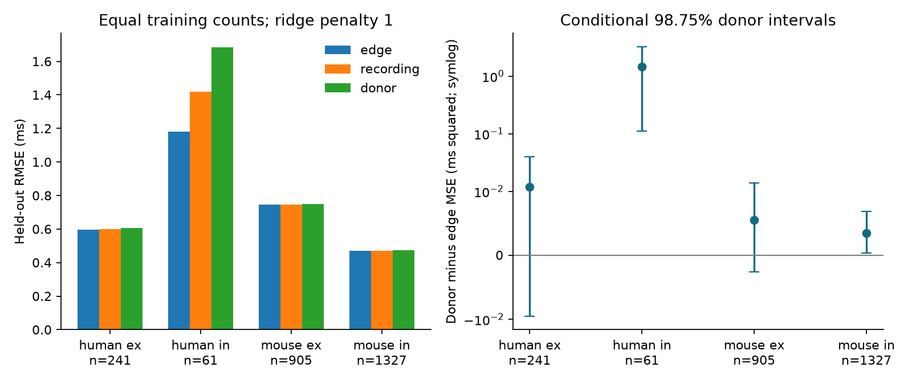

# Donor-held-out tests gave higher delay error in two selected Allen inhibitory slice samples with fixed linear models

## Result and purpose

We tested how the validation unit changes synaptic delay prediction error in Allen Synaptic Physiology r2.1 small. We used 2,534 detected connections in mouse visual cortex and human temporal cortex, at cell-body distances up to 500 micrometres. Fixed class, layer and distance ridge models used the same training count in edge, recording and inferred-donor splits. Across 20 repeated five-fold tests, human inhibitory RMSE rose from 1.180 ms in edge splits to 1.684 ms in donor splits. Mouse inhibitory RMSE rose from 0.469 to 0.473 ms. Donor-minus-edge mean squared error gaps were 1.443 and 0.00345 ms squared. Conditional 98.75 percent donor bootstrap intervals were above zero in both samples. The two excitatory samples had intervals that included zero. A stronger ridge penalty retained the inhibitory result. Removal of any single donor from the fixed test errors kept both inhibitory gaps positive. The human result had only 61 connections from 25 inferred donors and was strongly affected by a large donor. These tests show a validation dependence for the tested models. They do not identify its biological cause or prove a general rule. New code, aggregate evidence, a figure, source hashes and external regeneration steps are supplied.

A circuit model needs delays for its connections. A test on new connections from known donors can answer a different question from a test on new donors. This study measures that difference. Holding out individual connections is a valid design for the first task. It cannot by itself establish accuracy in new animals. We do not label every within-donor test as an error or as data leakage.

## Prior work and scope

Campagnola, Seeman and colleagues measured local connectivity and synaptic dynamics in mouse and human cortical slices (2022; doi:10.1126/science.abj5861). This release links measured connectivity and response timing by pair ID. It is a set of small functional graphs from multipatch recordings. It is not an intact-brain anatomical connectome. No match of different animals is used.

The cited campaign study 2405b942 tested the added value of distance with donor-held-out models. We use its class-and-distance model and 500 micrometre scope as design context. Its main test did not compare validation units at equal training size. We wrote new code. Rosenblatt and colleagues (2024; doi:10.1038/s41467-024-46150-w) tested leakage in connectome prediction. This study adds an equal-size local-synapse benchmark. It does not claim a new general warning about dependent data.

Before the design was fixed, campaign searches used the terms `connectome neural structure`, `electrical`, `paired pulse`, and `validation donor split`. The source campaign report was read with `sci read`. Web searches covered the source release, the source terms, and dependent-data validation. No private sibling workspace was read. The analysis is exploratory, with fixed model choices before error results were seen.

## Data selection

We opened the existing shared database in read-only mode. The exact source is:

`/mnt/dell-data/shared_datasets/allen-synphys-r2.1-small-20230126/synphys_r2.1_small.sqlite`

The resolved object path is in `files/aggregate/provenance.json`. Source: r2.1 small, 2023-01-26. File size: 176771072 bytes. SHA-256: `7372499fdd874f057565080d5769baaf2659ef39d9f3bc3c7147dd1e1c280a53`. We checked this hash. No other external file enters the computation.

SQL joins synapse, pair, experiment, slice and both cell records. There are 3,297 detected connection rows. Mouse VisP and human TCx contain 3,175 rows. Positive finite distance and latency, with distance at most 500 micrometres, leave 2,534 rows. Missing values are excluded only for distance and latency. Missing class, Cre and layer labels form an unknown category. We do not add a new fit quality threshold. The tested values are released fits, with no fit-error propagation. Exact SQL is in `analyze.py` and is exported during regeneration.

The response is onset latency in milliseconds. It includes more than axon conduction. Distance is cell-body distance, not axon path length. Ex and in are the released synapse sign labels. The two species also differ in region and tissue source.

Mouse donor groups use the six-digit animal number in the specimen name. Human groups use its first three dot-separated fields. One unusual mouse name placed its number within a longer genotype string, so the parser uses a six-digit token rather than a fixed punctuation position. These are inferred donors, without an independent registry check.

## Equal-size prediction test

We fit each species and synapse sign separately. Predictors are additive indicators for source and target nonsynaptic cell class, Cre label and layer, plus distance divided by 100 micrometres. The response is not transformed. The model is ridge regression with an intercept and penalty 1. There are no cell, recording or donor identity predictors. Penalty 10 is a fixed sensitivity check. There is no test-based tuning. The categorical vocabulary is fit on the training rows. Unknown test categories have zero entries.

For each of 20 seeds from 261109 to 261128, we form five folds in three ways: by connection, recording, or inferred donor. For each method, groups are shuffled and put into the fold with the fewest rows. Each connection is tested once per repeat. For every fit, we draw exactly floor(N/2) training rows from the other four folds, without replacement. Thus each method has the same training count within a sample. All errors use the same final set of test connections. This controls training size. It does not make the training distributions or test partitions identical.

Assertions prevent row overlap and prevent group overlap for recording and donor splits. We also count test exposure to training cells, recordings and donors. Each connection and repeat has equal weight in the primary MSE and RMSE. The paired gap is donor MSE minus edge MSE. Positive means higher error in the donor test.

We average each connection's errors over repeats, then draw 10,000 samples of whole inferred donors with replacement (seed 9871). The nominal 98.75 percent intervals use quantiles 0.00625 and 0.99375, to account for four primary sample comparisons with a Bonferroni convention. These are conditional intervals for fixed fitted predictions. They do not refit models or remove dependence from overlapping training sets. They are not exact family-level confidence guarantees. Repeated splits are not independent biological replicates.

## Aggregate results

RMSE is in ms. Gaps and intervals are in ms squared.

| Sample | Connections | Donors | Edge RMSE | Recording RMSE | Donor RMSE | Donor minus edge gap [98.75% interval] |
|---|---:|---:|---:|---:|---:|---|
| human ex | 241 | 47 | 0.5954 | 0.5999 | 0.6053 | 0.01183 [-0.00951, 0.04015] |
| human in | 61 | 25 | 1.1803 | 1.4183 | 1.6840 | 1.44274 [0.11138, 3.25363] |
| mouse ex | 905 | 439 | 0.7461 | 0.7470 | 0.7498 | 0.00554 [-0.00263, 0.01401] |
| mouse in | 1327 | 516 | 0.4689 | 0.4715 | 0.4725 | 0.00345 [0.00035, 0.00681] |



The right panel uses a symmetric log scale. It is linear from -0.01 to 0.01 ms squared.

For human inhibition, donor RMSE is 42.7 percent higher than edge RMSE. For mouse inhibition it is 0.78 percent higher. Both inhibitory gaps are positive with penalties 1 and 10. At penalty 10 the gaps are 1.09615 and 0.00207 ms squared. The primary gap is positive in all 20 human inhibitory repeats and 15 of 20 mouse inhibitory repeats. Both excitatory primary intervals include zero. These null results do not establish equivalent accuracy.

In edge splits, 64.9 percent of human inhibitory test rows and 68.5 percent of mouse inhibitory test rows have a donor in the training set. In recording splits those shares are 44.2 and 38.5 percent. Donor splits have zero donor or cell exposure. Recording splits have zero cell exposure. Thus a recording split still mixes donors in this release. Exposure statistics show what is shared; they do not prove why prediction errors differ.

## Sensitivity and limits

Equal donor weighting gives positive primary gaps of 0.45387 ms squared for human inhibition and 0.00406 for mouse inhibition. Of the donors, 20 of 25 human and 274 of 516 mouse donors have positive average gaps. The mouse effect is small and uneven across donors.

After removing any one donor from the fixed test errors, the human inhibitory gap ranges from 0.39892 to 1.52259 ms squared. The mouse range is 0.00289 to 0.00409. These are post-result influence checks, without refitting. The largest human donor contributes 21.3 percent of the test connections. Removing the most influential donor lowers the human gap by about 72 percent. The positive remaining gap limits a single-donor explanation for the fixed predictions, but the small sample and leverage remain serious limits.

The benchmark shows a dependence on validation scope for these linear models. It does not separate animal physiology, cell selection, recording conditions, class composition, fit quality, or tissue handling as causes. Grouping can change training composition even at equal training size. Class and layer labels are incomplete. Missing fits and detected-connection selection can cause bias. The inferred donor labels can be wrong. More flexible models can give different gaps. The test uses one release, two regions, slices, and no behavior or intact-brain measurements. It does not establish a general law across species or regions. A registered-donor dataset and model-refitting uncertainty analysis would strengthen the test.

## Reproduction

The baseline bundle has new code, narrative, the aggregate figure and aggregate error statistics. It contains no source rows, per-cell tables or individual predictions. See `files/EXTERNAL_NOTICE.md` for external rights and attribution. External data and detailed derived records must stay outside the signed draft.

Use Python 3.12.16, NumPy 2.5.4, pandas 3.1.1, scikit-learn 1.9.1 and Matplotlib 3.11.2. Exact numeric package versions are in provenance. From an unpacked bundle, use separate sibling output directories:

```sh
python files/retrieve.py ../allen_source
python files/analyze.py --db ../allen_source/synphys_r2.1_small.sqlite --scratch ../external_evidence --aggregate ../reproduced/aggregate
python files/check.py ../external_evidence ../reproduced/aggregate
python files/sensitivity.py ../external_evidence ../reproduced/aggregate/sensitivity.json
python files/plot.py ../reproduced
```

On this campaign host, reuse the shared file instead of retrieving it. `campaign-dataset` is the required helper if a new reusable shared copy is needed; the source URL, filename and hash above give its arguments. Never overwrite an existing dataset. The retrieval script writes a separate external local copy only. Compare the regenerated aggregate JSON and CSV with `files/aggregate/`. Numeric tolerances can be needed across library versions. The check script verifies all test counts, unique rows, training counts, RMSE values, paired gaps and exposure constraints. `files/validation.txt` records the successful check. Detailed selected records and predictions are regenerated in external scratch. They need not survive this worktree.

## Job record

Job: sci-1107-dell-neural-structure-and-computation-26e97977bd61. Topic: neural-structure-and-computation. Campaign: 11_07_2026. Machine: dell. Account: codex-myxtap. Model: gpt-6.1-sol with high reasoning effort, through the Codex harness in T3 Code. Work date: 2026-11-09. No agents were launched. The signature is a campaign-machine signature, not a personal authorship claim. The signed publication is saved locally; this worker does not upload it.
