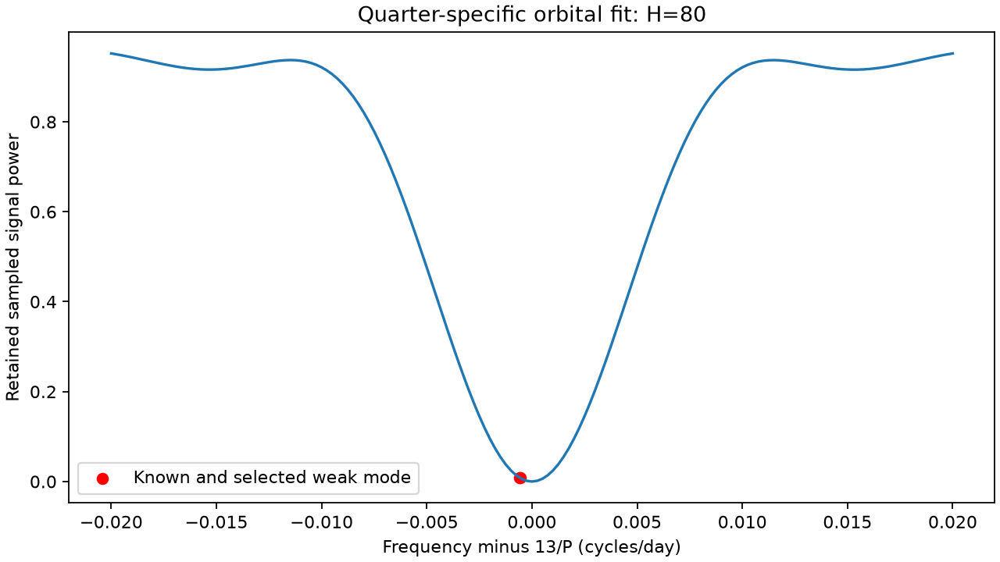
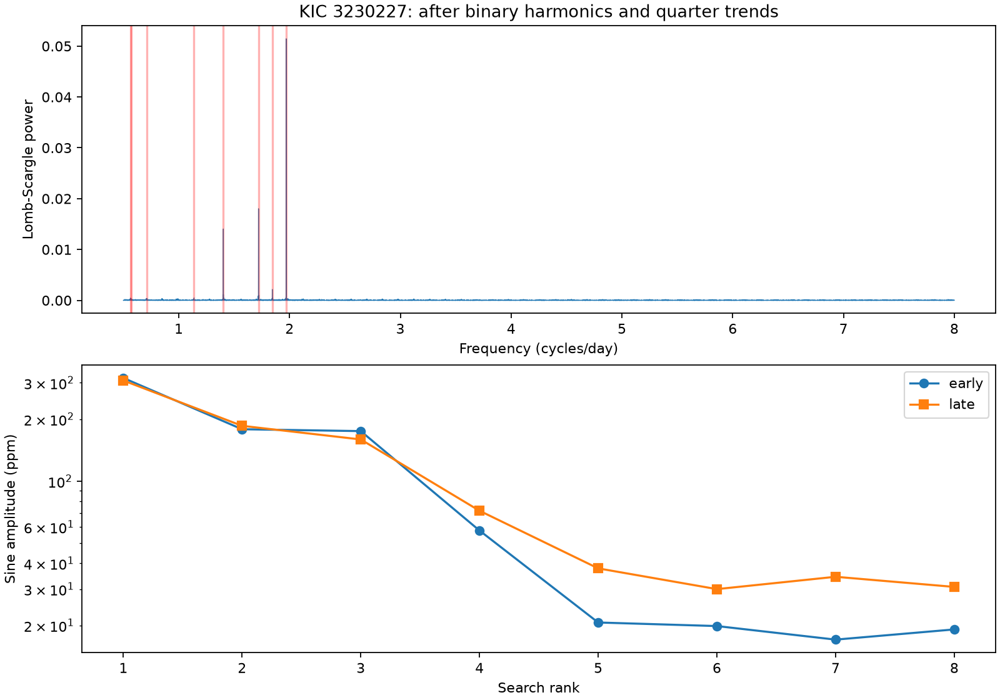
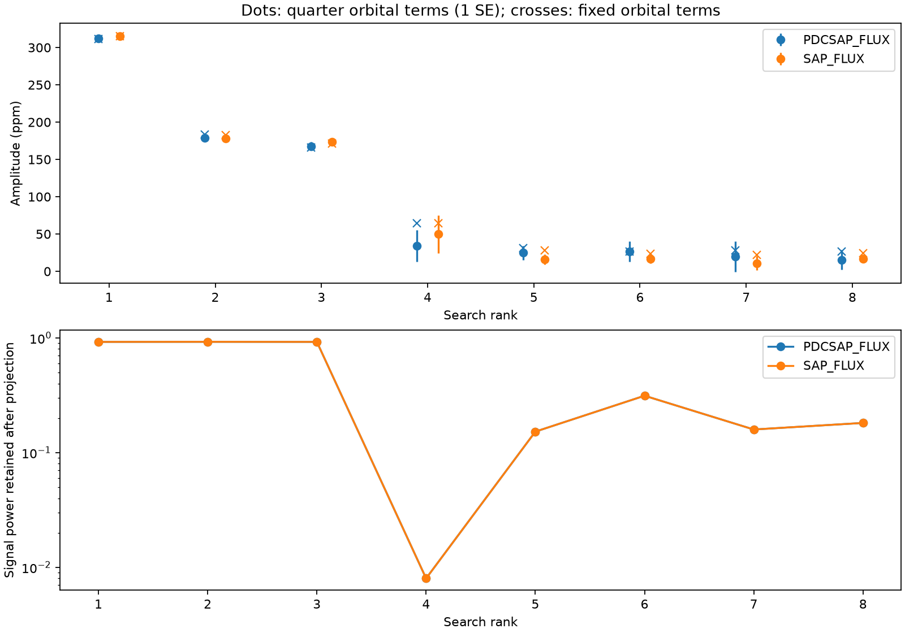

# Quarter orbital fits remove over 99 percent of sampled signal power at 1.84416 cycles per day in KIC 3230227

A search of Kepler data recovers three strong known non-orbital frequencies and a fourth peak close to a known weak mode. A model with separate orbital terms in each quarter removes 99.20 percent of sampled sine-wave power at the fourth frequency. The same model removes only about 7.6 to 7.8 percent at the three strong frequencies. This result shows a severe local loss of sensitivity. A small residual at this frequency cannot exclude a real mode. No new mode or planet is confirmed.





## Question and prior work

Can a low-frequency residual search in this eccentric binary distinguish extra stellar oscillations from errors in the binary light model? We first searched 0.5 to 8 cycles per day with a fixed orbital model. We then tested the eight selected frequencies with quarter-dependent orbital terms. The final question about signal removal was selected after these exploratory fits. This is a finite method test, not a registered survey or a complete search for planets.

Guo, Gies and Fuller (2017; DOI 10.3847/1538-4357/834/1/59) report the binary and its main oscillations. Guo (2020; DOI 10.3847/1538-4357/ab911f), Table 1, reports a weaker frequency at 1.8441372 cycles per day as well. Our fourth peak is close to this known frequency, within the full inverse time span. We do not claim that peak as a discovery. Nonlinear mode coupling is one proposed explanation for the known non-orbital signals. We do not fit its dynamical equations here.

Campaign searches started before the precise question. Full-folder SCI verification was slow. We stopped those search processes after inspecting matching records in this job's verified SCI cache. files/campaign_prior.json records this partial search. We used sci read on four published bundles. Their full IDs are in sci.json. These reports test known frequency sums, unequal offsets, seasonal models, and a higher-frequency search. The high-frequency report excludes bands near harmonics. Our added result measures the loss of low-frequency signal power within those difficult bands. No prior code or derived samples were reused. No private worker files were used. The prior search is not exhaustive.

## Data

We reuse `datasets/kepler-kic3230227-q0-q17-dr25/lightcurves.tar` in place. Its resolved shared path is `/mnt/dell-data/shared_datasets/.campaign-dataset-objects/kepler-kic3230227-q0-q17-dr25-1kcdinmf/lightcurves.tar`. The source is the public MAST Kepler release 25 long-cadence S3 archive:

https://stpubdata.s3.amazonaws.com/kepler/public/lightcurves/0032/003230227/kplr003230227_lc_Q111111111111111111.tar

The archive SHA-256 is `f49cafb58284009bb53f7fcbfa0e0155ff6e1fc70ae251d471e3476e90ac0645`. files/provenance.json records the exact path, archive hash, each used FITS member hash, time range and software. No shared dataset was changed or downloaded again. The package preserves the selected sample table in files/clean.csv.gz. Raw data need not be duplicated.

Keep samples with SAP_QUALITY=0 and finite time, aperture flux and corrected flux. Use all available quarters, including short quarters. This gives 52076 samples over 1470.401 days. Divide each flux product by its quarter median, subtract one and multiply by one million. Units are parts per million (ppm). Keep eclipses; do not clip flux outliers. Times are BKJD, or BJD minus 2454833. Trigonometric time is centered at BKJD 1000. SAP and PDC use the same exposures and are not independent observations.

## Search and models

Use orbital period P=7.047106 days from prior work. The initial model has a cubic time polynomial in every quarter and sine and cosine terms at harmonics 1 to 60 of 1/P. Harmonic coefficients are constant across the mission. Fit unweighted least squares. Compute a Lomb-Scargle spectrum of its PDC residual from 0.5 to 8 cycles per day with spacing 1/(5T), where T is the selected time span. Select the largest peak, refine its frequency within 1/T by a bounded scalar residual fit, then jointly refit all selected sinusoids and the nuisance model. Repeat eight times. Previously selected frequencies stay fixed during later steps. This is an exploratory peak list. The scalar frequency refinement is sequential, so its last digits are not precise physical frequency estimates. No frequency errors or astronomical false-alarm probabilities are assigned.

Repeat joint fits at those frequencies with 40, 60 and 80 mission-constant orbital harmonics, for both flux products and for all, early (Q0-Q8) and late (Q9-Q17) data. files/robustness.csv contains all these fits. The frequencies were selected from all data. Thus the separate time ranges are consistency tests, not blind validation.

The second model allows every quarter to have its own cubic polynomial and all sine and cosine coefficients at harmonics 1 to H, with H=40 or 80. The eight selected sinusoids have global coefficients. Within each quarter, project both the data and the sinusoid columns off the local nuisance basis. Stack the projected arrays and fit the global coefficients. This joint fit accounts for signal removal. It differs from a fit of unprojected sine waves to a cleaned residual, which can report a false low amplitude.

For the two columns T_j at each selected frequency, compute retention R_j = sum of squared projected columns / sum of squared original columns, across all quarters and both phases. This is a phase-averaged sampled signal-power ratio. It depends on times and nuisance columns, not on the measured flux. It is not a recovery probability. Retained amplitude norm is about sqrt(R_j), but an amplitude fitted with the correctly projected templates need not be biased low. The main effect is loss of information and increased noise sensitivity.

Estimate a conditional coefficient covariance from scores summed by quarter. Use the ordinary cluster sandwich formula with Q/(Q-1) correction. Amplitude errors use its local gradient. There are only 18 quarters, and short quarters carry little information. These errors do not include frequency selection, all model errors, correlations between quarters or a calibrated detection threshold. Squared two-coefficient statistics are saved as diagnostics only. They are not used to claim a discovery.

## Results

The following table uses H=80 with separate orbital coefficients in each quarter, on all corrected-flux samples. Errors are one conditional cluster standard error, not confidence limits.

| Rank | Frequency, cycles/day | Power retained | Joint amplitude, ppm |
|---|---:|---:|---:|
| 1 | 1.969779 | 0.9224 | 311.9 +/- 3.7 |
| 2 | 1.719876 | 0.9239 | 178.9 +/- 2.6 |
| 3 | 1.402134 | 0.9224 | 167.7 +/- 5.8 |
| 4 | 1.844161 | 0.0080 | 34.3 +/- 21.4 |
| 5 | 1.137781 | 0.1522 | 24.9 +/- 9.4 |
| 6 | 0.563766 | 0.3129 | 26.4 +/- 13.7 |
| 7 | 0.712136 | 0.1589 | 19.8 +/- 20.1 |
| 8 | 0.570429 | 0.1813 | 15.4 +/- 13.3 |

The fourth frequency is close to 13/P. Its distance from that harmonic is about 0.00057 cycles per day. A quarter has too short a time span to separate these clocks well. Its retention is 0.007997 for H=80; the same value applies to both flux products since the times are shared. The early and late retentions are 0.007539 and 0.008401. This severe loss therefore occurs in both time ranges. At the published weak frequency, 1.8441372 cycles per day, a separate transfer calculation retains 0.008675 of power, which gives the same conclusion. files/transfer.csv and files/transfer.png show the full local transfer curve. Raw-flux amplitude is 49.7 +/- 25.2 ppm. These weak conditional estimates do not exclude the mode reported in prior work.

Ranks 5 to 8 are close to harmonics 8, 4, 5 and 4. Their retained power is 15 to 31 percent in the H=80 quarter model. Their errors and amplitudes change across time ranges and flux products. No one of these peaks is established here as a new stellar mode. In particular, rank 5 has corrected-flux amplitude 30.1 +/- 8.6 ppm in early data and 19.9 +/- 15.7 in late data. The selected frequencies and finite model can leave unresolved binary or instrumental structure. We do not infer a universal upper limit from this list of eight peaks.

The first three frequencies agree with known non-orbital signals. Their high retention and large fitted amplitudes provide a useful contrast with the near-harmonic peaks. The initial search amplitudes were about 310, 185, 166 and 64 ppm for ranks 1 to 4. Search-stage amplitudes are not the final jointly refitted values; all final model variants are saved separately.

## Physical and instrumental checks

A finite binary model can leave spectral peaks. A change in aperture response, binary amplitude or eclipse shape between quarters can produce power beside an orbital harmonic. Stellar amplitude or phase changes can also do this. A model with separate quarter coefficients can fit such changes, but can also absorb a true nearby oscillation. The measured transfer ratio directly demonstrates this ambiguity. It does not identify the cause of a particular peak.

The raw and corrected flux comparison tests sensitivity to processing. Separate time fits test consistency. The code also fits background and image-position series in each quarter; files/quarter_fits.csv preserves their amplitudes and phases in native units (background electrons per second and position pixels). No calibrated control-channel threshold is assigned. Those fits alone cannot establish or remove contamination. All tests use one target and one telescope. No independent instrument, pixel-level source localization, radial velocity, mode identification, or detailed physical binary model is supplied. The result supports a cautious search method, not a new physical mechanism.

## Validation and reproduction

An independent SVD solution of the full quarter-5 design agrees with the projected QR solution to 1.70e-11 ppm in the selected coefficients. Added exact-column signals are recovered to 1.42e-13 ppm. The design condition number is 61.7. files/validation.json records these checks. Exact-column recovery tests linear algebra, not realistic search completeness or instrument physics.

Use a writable copy of the publication, since scripts replace derived files beside their source. From its root run:

```sh
bash files/reproduce.sh /mnt/dell-data/shared_datasets/kepler-kic3230227-q0-q17-dr25/lightcurves.tar
```

If shared data are absent, use `python files/retrieve.py /new/local/lightcurves.tar` and pass that file path instead. The retrieval script requires a new path and checks the archive hash. After retrieval no network is needed. Python, NumPy, SciPy, pandas, Astropy and Matplotlib are required. No extra library was installed. The full run rebuilds the selected samples, search, model fits, figures and validation. `python files/quarter_test.py` repeats the quarter model from the bundled samples and search table; `python files/figures.py` rebuilds its figure; `python files/validate.py` repeats the direct numerical checks. An optional REUSE_SEARCH=1 environment setting skips reselection in analyze.py and uses the saved search.csv, for faster sensitivity reruns. Leave it unset for a full repeat.

## Campaign record

Campaign 11_07_2026. Job sci-1107-syam2-astronomy-2cfee2f4199b. Topic astronomy. Machine syam2. Account codex-myxtap. Model gpt-6.1-sol with high reasoning effort through the Codex harness in T3 Code. Date 2026-11-08. This finite worker used no child agents. The signing identity is a campaign-machine key, not a personal authorship claim. No private key is included. The baseline license applies to our text, code, figures and derived evidence, subject to source rights. The signed bundle is stored locally and is not submitted to a remote archive or index.
