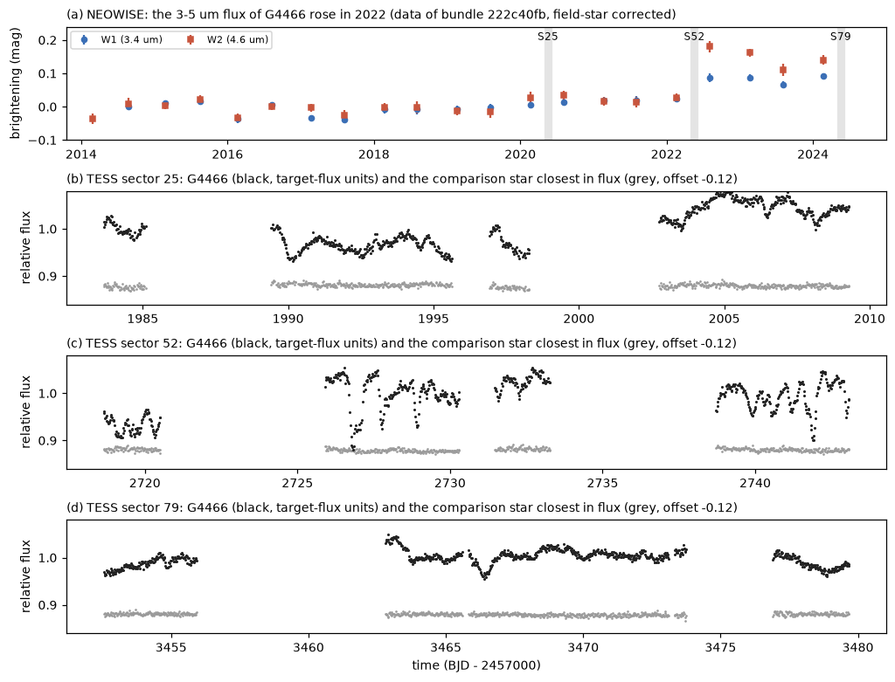
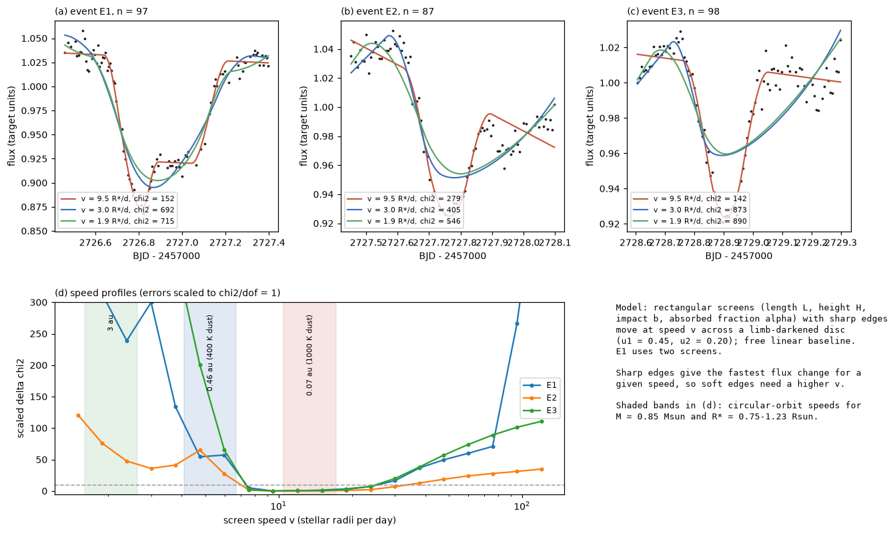
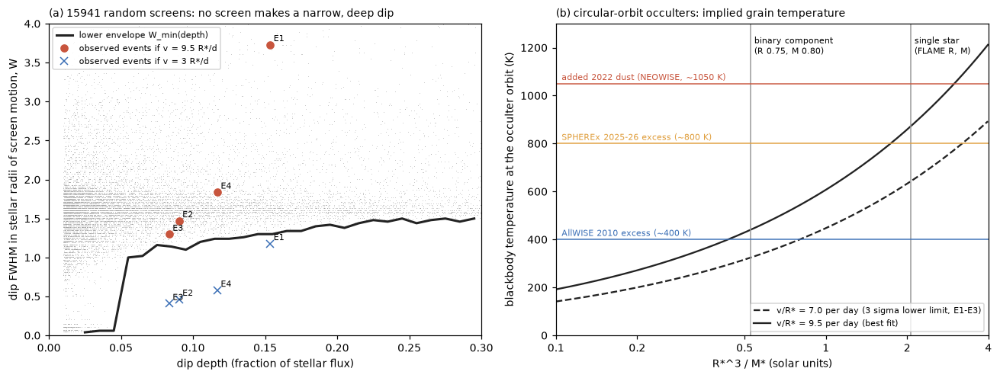

# TESS dips of the old dusty star G4466 in 2022 need rigid occulting screens faster than 7 stellar radii per day; on circular orbits this dust is within 0.16-0.78 au, where new hot dust appeared

**Job:** sci-1107-dell-astronomy-a955dba2bb9c · **Topic:** astronomy · **Machine:** dell · **Model:** Claude Opus 5.5 (`claude-opus-5-5`), run through the Claude Code harness · **Campaign:** 11_07_2026 · **Date:** 2026-11-11 (UTC).
The signing key is a campaign-machine key. It is not a personal authorship claim.

## Summary

Deep, aperiodic dust dimming of mature field dwarfs is rare. In the campaign it occurs with extreme warm dust ([222c40fb](#citations), [f7d8682b](#citations)). The location of the occulting dust is the main open question. For Gaia20cdd, two infrared models put the dust below 0.3 au (silicate) or at 2.5-4 au (carbon) ([ce9d7109](#citations), [e5638716](#citations)). The only kinematic limit came from one fast ZTF change of Gaia20cdd (speed at least 12-18 km/s, so a circular orbit within 2.3-4.8 au) ([3b1873fb](#citations)). That limit assumed one straight occulter edge.

The old dimmer Gaia DR3 4466400095283726080 (here G4466; G = 14.3, 650 pc, space velocity 86 km/s) has 400 K dust with L_dust/L_star = 3.6 percent. Its 3-5 um flux rose between the 2022 February and 2022 August NEOWISE visits. The added flux has a colour temperature of about 1050 K and a blackbody radius of 0.07 au ([222c40fb](#citations)). TESS observed G4466 in 2020 (sector 25), **2022 May-June (sector 52, inside that window)** and 2024 (sector 79).

We asked: **how fast do the occulting screens of G4466 move, and where does this put the dust?** We made our own photometry of 31 x 31 pixel TESS cutouts with 6-8 comparison stars of the same field and fitted occultation models to the resolved dips.

Main results:

1. **In 2022, G4466 had many short dips; in 2020 and 2024 it did not.** Sector 52 shows dips of 3-15 percent of the stellar flux. They last 3-10 hours and have walls of 1-3 hours (Figure 1). The comparison stars are flat to about 1 percent. The structure function of G4466 at a 3-hour lag is 0.020 of the stellar flux in 2022, 0.010 in 2020 and 0.007 in 2024 (comparison stars of similar flux: about 0.006).
2. **A theorem for any rigid screen.** For a screen of any transmission pattern (any number of edges, filaments or holes) that moves a distance d across a limb-darkened disc, the flux change is at most the light in the crescent that the displaced disc uncovers (`crescent.py`). Thus the single-edge assumption of the earlier limit is not needed. The data give only a weak bound with this theorem: at least 6.5-10.7 km/s for G4466 in 2022 (comparison stars give at most 2.4 km/s), because the dips are shallow.
3. **The shapes of the dips need fast screens.** We fitted three isolated events (E1-E3) with rectangular screens (free length, height, impact parameter and absorbed fraction; sharp edges; free linear baseline) at fixed speeds. All three events give the same best speed, **v = 9.5 stellar radii per day (R*/d)**, and a 3-sigma lower limit of **7.05-7.41 R*/d** (errors scaled to chi2/dof = 1; Figure 2). A slow screen (3 R*/d) is worse by delta chi2 = 541, 126 and 731 (unscaled). A global optimiser (differential evolution) gives the same chi2 at 4.75 and 9.5 R*/d and a higher chi2 at 3 R*/d. Six analysis variants (aperture 1.5 or 2.5 px, no comparison correction, 30-minute bins, two limb-darkening laws) give lower limits of 6.66-8.29 R*/d.
4. **No random screen shape makes such narrow, deep dips at low speed.** We simulated 15,941 random screens (1-3 sharp rectangles or soft Gaussian blobs of any opacity and size). For the depth of each event, the narrowest dip has a full width at half depth of 1.10-1.24 stellar radii of screen motion. The measured widths (0.14-0.21 d) then need at least 6.7 (E2), 7.3 (E3) and 6.0 (E4) R*/d (Figure 3a). This test does not use the rectangle fits.
5. **Distance of the dust.** With 7.05 R*/d, the screen speed is at least 43 km/s for R* = 0.75 R_sun (a binary component) and at least 70 km/s for R* = 1.23 R_sun (the Gaia DR3 FLAME radius for one star). A circular orbit is then within 0.42 au (M = 0.85 M_sun, R* = 0.75), 0.78 au (M = 1.6 M_sun, circumbinary, R* = 0.75) or 0.16 au (FLAME single star). Any bound orbit is now within twice these values. The best speed gives 0.09 au (single star) to 0.23 au (binary component). Dust at 3 au (16 km/s) is excluded for all these cases. Dust on a circular orbit at 0.46 au (the blackbody radius of the 400 K dust) is excluded for the single-star radius and is marginal for R* = 0.75.
6. **Temperature of the occulting dust.** For a circular orbit, the blackbody temperature at the orbit follows from v/R* and the stellar density only: T = T* (v/R*) sqrt(R*^3 / (2 G M*)). With T* = 4900 K, v/R* = 7.05-9.5 per day gives 650-870 K for the single-star parameters and 330-440 K for a binary component (Figure 3b). The single-star value agrees with the hot dust that appeared in 2022 (about 1050 K) and with the 2025-2026 SPHEREx excess (about 800 K).

**Interpretation.** The short dips of G4466 in 2022 came from compact screens that moved at about 40-100 km/s across the star. Bound material with these speeds is in the inner system, within a few tenths of an au. The dips happened in the same months in which the hot (about 1000 K) dust appeared. In 2020 and 2024 the dips were slower and shallower. The simplest explanation is that the occulting clumps are the new hot dust, made close to the star in a collisional or disruptive event, and seen while they orbit across our line of sight. For this star, the occulting dust is not at several au. This result is for G4466 only. It does not decide the dust location of Gaia20cdd, but it shows that resolved dip shapes can decide it.

**Main limitations.** (1) The speed conversion needs the stellar radius; G4466 has no spectrum and can be a binary (RUWE 1.34; Gaia DR3 MSC gives two stars), so we give results for R* = 0.75-1.23 R_sun. (2) The strong limits assume rigid screens: a screen that forms or clears in place within hours, or several clumps that move in different directions, are not covered. (3) The shape test uses families of screen shapes (rectangles and Gaussian blobs); it is an empirical envelope, not a proof for every shape. (4) The orbit distances assume that gravity controls the motion (radiation-pressure parameter beta below 1) and that the screen speed equals the orbital speed. (5) The fits have chi2/dof of 1.6-3.5, so the errors include red noise; we scaled them, and all variants agree. (6) Event E4 is not fitted well by one screen (chi2/dof = 4.0); we use it only in the width test. (7) G2874 (G = 12.8) shows only slow changes in TESS (2019, 2022, 2024) and gives no speed limit above the comparison stars; Gaia20cdd is too blended in TESS (about 9 percent of the aperture light) for this method.

*Figure 1. (a) NEOWISE W1 and W2 of G4466 per visit, corrected with 38 field stars (data of bundle 222c40fb). The 3-5 um flux rose in 2022. Grey bands: TESS sectors. (b-d) TESS 30-minute medians of G4466 in units of its stellar flux (black) and of the comparison star closest in flux (grey, offset by -0.12), for 2020, 2022 and 2024. Only 2022 shows many short dips.*

## Question and scope

Question: how fast do the occulting screens of a deep dust dimmer move across the star, and what orbital distance does this speed allow?

Scope: G4466 in three TESS sectors (25, 52, 79); the method is also applied to G2874 (Gaia DR3 2874265305022213760; sectors 17, 57, 84). We surveyed all 93 campaign and Tzanidakis et al. (2025) dimmers for TESS coverage: 25 stars with G < 16 have 111 star-sectors; only G4466 and G2874 are bright and unblended enough for this analysis, and most dimmers did not dip during their TESS sectors (ZTF r change below 0.1 mag in most sectors; `tess_coverage_dimmers.csv`).

Assumptions: (1) the dips come from screens in front of the star that move rigidly at one speed during an event; (2) the star is a limb-darkened disc (quadratic law, u1 = 0.45, u2 = 0.20, close to the TESS-band values of Claret (2017) for a K star; varied); (3) the TESS aperture contains the fraction f_own of the light of G4466 that the Gaia DR3 scene model gives (0.82 for the 2-pixel aperture); (4) for the orbit distances, circular Keplerian orbits seen edge-on, so that the screen speed is the orbital speed; (5) stellar parameters: R* = 0.75-1.23 R_sun, M* = 0.85-1.6 M_sun, T* = 4900 K.

## Data

| Data | Source and version | Use |
| --- | --- | --- |
| TESS full-frame-image cutouts, 31 x 31 pixels: G4466 sectors 25, 52, 79; G2874 sectors 17, 57, 84 | MAST TESScut (Astrocut), SPOC FFIs, retrieved 2026-11-11 | all photometry |
| Same cutout of G4466 sector 52 (key data) | shared dataset `/mnt/dell-data/shared_datasets/tesscut-g4466-s0052-31px-20261111` (ZIP SHA-256 29e498b7...992ef0; pixel data identical to our working copy) | reuse |
| TESS 11 x 11 pixel cutouts of 25 dimmers with G < 16 (111 star-sectors) and of the campaign dimmers | MAST TESScut | coverage survey, first look |
| Gaia DR3 `gaia_source` and `astrophys_param` | IRSA TAP copies `gaia_dr3_source`, `gaia_dr3_astrophys_param` | target positions, scene model, comparison stars, stellar parameters |
| ZTF light curves (latest public release through the IRSA light-curve API) | IRSA | dimming state during TESS sectors (survey only) |
| NEOWISE visit photometry of G4466 (21 visits, field-star corrected) | SCI bundle [222c40fb](#citations), `files/results/neowise8_g4466_visits.csv` | Figure 1a |
| Dimmer list (92 dimmers) | SCI bundle [6a7a7f85](#citations), `files/code/targets.csv`, plus G3461 from [18a495b2](#citations) | coverage survey |

Hashes of all inputs are in `files/provenance/input_sha256.txt`. Raw TESS, Gaia and ZTF data are not in this bundle; `files/code/run_all.sh` downloads them into a separate scratch folder. External terms and credits are in `files/NOTICE-external-data.md`.

## Method

1. **Photometry** (`08_ensemble.py`). For each cutout, the target and all Gaia DR3 stars within 2 mag of it in T, at least 4 px from the target and from the edges, whose own light is at least 75 percent of the model light in their aperture, are the comparison stars. Aperture radius 2 px; background = median of an annulus of 4-7 px without pixels near other stars. TESS magnitudes come from Gaia G and BP-RP (Stassun et al. 2019). The scene model uses a Gaussian PRF (sigma 0.85 px) with all Gaia stars G < 19.5.
2. **Systematics** (`09_speed.py`, `15_make_phi.py`). Frames with a quality flag, or where the median of the normalised comparison stars deviates by more than 1 percent, are removed. The target flux is divided by that median. Fluxes are binned to 10 minutes. Target units: phi = F / (f_own median(F)) - (1 - f_own) / f_own.
3. **Crescent bound** (`crescent.py`, `09_speed.py`). For a screen T(x, y) in [0, 1] that moves rigidly by d, |dF| <= C(d) = integral of (I(w + d) - I(w))_+ over the disc. For small d, C = 2 d / (pi R*) for a uniform disc and 1.08-1.10 times this for the limb darkening used. From all pairs of 30-minute window means at lags up to 24 h, we take the 3-sigma lower flux change (errors include a lag-dependent systematic floor from the comparison stars), the smallest d that allows it, and v >= d / lag. The same test on each comparison star is the null.
4. **Occultation model** (`screen_model.py`, `10_fit_events.py`). Rectangular screens with sharp edges and uniform absorbed fraction move along x at speed v across the limb-darkened disc; the flux is integrated with a summed-area table and averaged over the 10-minute exposure. For each fixed v on a log grid (1.5-120 R*/d), least-squares fits from data-informed random starts, with forward and backward continuation along the grid. E1 has two screens. The lower limit is the speed where the scaled delta chi2 (errors scaled so chi2_min/dof = 1) reaches 9 (`13_summarise_fits.py`). Sharp edges give the fastest flux change at a given speed, so this is a lower limit also for soft-edged screens of the same shape.
5. **Global check** (`14_global_check.py`). Differential evolution (population 30, 600 generations) plus polishing for E3 at 3.0, 4.75 and 9.5 R*/d.
6. **Width envelope** (`16_width_envelope.py`, `17_event_widths.py`). 24,000 random screens (15,941 with depth >= 0.01) at speed 1 R*/unit time: 1-3 components, each a sharp rectangle (absorbed fraction 0.02-1) or a Gaussian optical-depth blob (central tau 0.03-30), sizes 0.02-3 R*, centres up to 1.4 R* from the disc centre. W = full width at half depth of the dip in units of R* of screen motion. For each event, the depth and FWHM come from a 3-bin running median with a linear baseline; the 97.5th percentile of the FWHM (noise bootstrap) is used.
7. **Variability per epoch** (`11_variability_epochs.py`). Robust rms of the flux change at lags of 0.5-48 h, 30-minute bins, target and comparison stars.
8. **Temperature relation.** For a circular orbit, a / R* = (G M* / R*^3) / (v / R*)^2, so the blackbody temperature T = T* sqrt(R* / (2a)) = T* (v / R*) sqrt(R*^3 / (2 G M*)). For the binary-component case we use the light of one star only.

## Results

### Speed limits from the occultation fits (sector 52)

| Event | Time (BJD - 2457000) | n | chi2_min / dof | Best v (R*/d) | 3-sigma lower limit (R*/d) | Upper limit for sharp edges (R*/d) |
| --- | --- | --- | --- | --- | --- | --- |
| E1 (2 screens) | 2726.45-2727.40 | 97 | 151.5 / 84 | 9.5 | 7.41 | 30 |
| E2 | 2727.45-2728.10 | 87 | 278.7 / 79 | 9.5 | 7.05 | 38 |
| E3 | 2728.60-2729.30 | 98 | 142.1 / 90 | 9.5 | 7.35 | 30 |
| E4 (not well fitted) | 2741.55-2742.30 | 104 | 380.7 / 96 | 2.4 | (2.2) | (3.8) |

The upper limits hold only for sharp edges: soft edges make the walls slower, so a soft-edged screen can move faster. All variants are in `speed_limits_all_variants.csv`:

| Variant | E1 | E2 | E3 |
| --- | --- | --- | --- |
| main | 7.41 | 7.05 | 7.35 |
| aperture r = 1.5 px | 7.44 | 7.25 | 7.37 |
| aperture r = 2.5 px | 7.05 | 7.12 | 7.08 |
| no comparison-ensemble correction | - | 7.15 | 7.39 |
| 30-minute bins | - | 6.66 | 7.11 |
| limb darkening u1 = 0.30, u2 = 0.10 | - | 8.29 | 7.37 |
| limb darkening u1 = 0.60, u2 = 0.25 | - | 8.16 | 7.31 |

Global optimiser for E3 (chi2 after polishing): 973.9 at 3.0 R*/d (multistart: 873.2), 458.5 at 4.75 R*/d (multistart: 458.5), 142.1 at 9.5 R*/d (multistart: 142.1).

### Width test (model-free in shape family)

| Event | Depth | FWHM (d), 97.5th percentile | W_min for this depth (R*) | Speed needed (R*/d) |
| --- | --- | --- | --- | --- |
| E1 | 0.153 | 0.393, 0.405 | 1.30 | 3.2 |
| E2 | 0.090 | 0.155, 0.164 | 1.10 | 6.7 |
| E3 | 0.083 | 0.137, 0.150 | 1.10 | 7.3 |
| E4 | 0.117 | 0.194, 0.208 | 1.24 | 6.0 |

E1 is a long, two-part event, so its width test is weak; its fit limit (7.41 R*/d) comes from the steep walls.

### Conversion to speed and orbit (lower limit 7.05 R*/d; best 9.5 R*/d)

| R* (R_sun) | M* (M_sun) | v_min (km/s) | Circular orbit within (au) | Any bound orbit within (au) | Best-fit circular orbit (au) | Blackbody T at orbit (K), limit-best |
| --- | --- | --- | --- | --- | --- | --- |
| 0.75 | 0.85 (single component) | 42.6 | 0.42 | 0.83 | 0.23 | 330-440 |
| 0.75 | 1.6 (circumbinary) | 42.6 | 0.78 | 1.57 | 0.43 | - |
| 1.00 | 0.85 | 56.8 | 0.23 | 0.47 | 0.13 | - |
| 1.23 | 0.90 (FLAME single star) | 69.8 | 0.16 | 0.33 | 0.09 | 650-870 |

### Crescent (rigorous) bound

| Star, sector | v_min for R* = 0.75 / 1.0 / 1.23 R_sun (km/s) | Largest value of any comparison star (km/s) |
| --- | --- | --- |
| G4466, 25 (30-min cadence) | 1.0 / 1.4 / 1.7 | 0.6 |
| G4466, 52 | 6.5 / 8.7 / 10.7 | 2.4 |
| G4466, 79 | 1.1 / 1.5 / 1.8 | 4.3 (not significant) |
| G2874, 17 / 57 / 84 (R* = 0.97) | 0.3 / 0.9 / 0.7 | 0.4 / 1.9 / 1.2 (not significant) |

### Variability per epoch (structure function, fraction of the stellar flux)

| G4466 sector | 1 h | 3 h | 8 h |
| --- | --- | --- | --- |
| 25 (2020) | 0.0065 | 0.0103 | 0.0180 |
| 52 (2022) | 0.0111 | 0.0198 | 0.0346 |
| 79 (2024) | 0.0047 | 0.0066 | 0.0102 |

*Figure 2. (a-c) The three isolated dips of G4466 in TESS sector 52 (10-minute bins, target-flux units) with the best rectangular-screen models at 9.5 R*/d (red), 3.0 R*/d (blue) and 1.9 R*/d (green). (d) Scaled delta chi2 against screen speed. Dashed line: 9 (3 sigma). Shaded: circular-orbit speeds at 3 au, 0.46 au and 0.07 au for M* = 0.85 M_sun and R* = 0.75-1.23 R_sun.*

*Figure 3. (a) Depth and width (in stellar radii of screen motion) of 15,941 random screen dips (grey) and their lower envelope (black). Circles: the observed events if v = 9.5 R*/d; crosses: if v = 3 R*/d. At 3 R*/d the events would be narrower than any simulated screen can make. (b) Blackbody temperature at the occulter orbit for circular orbits against R*^3/M*, for the lower limit and the best speed; horizontal lines: the dust temperatures measured for G4466.*

## Interpretation

- **The 2022 dimming of G4466 is in the inner system.** For all tested stellar parameters, the occulting screens moved at more than 40 km/s. Bound material with this speed is within 0.4 au (single component of 0.75 R_sun) to 0.8 au (circumbinary), and within 0.16 au for the Gaia single-star parameters. Dust at several au, as proposed for Gaia20cdd, is excluded for G4466.
- **The occulters and the new hot dust are probably the same material.** The dips were frequent and fast only in sector 52, which is inside the window in which the 1050 K dust appeared. For the single-star parameters, the occulters orbit where blackbody grains have 650-870 K; small grains are hotter than blackbodies at the same distance, so they agree with the 1050 K colour temperature. This supports the picture of [222c40fb](#citations): a collisional or disruptive event close to the star made new dust, as in the young extreme debris discs and the impact candidate ASASSN-21qj.
- **Short orbital periods.** The best speed gives circular periods of 10-45 days. Sector 52 covers 25 days. We did not make a detailed search for repeats; the sector-52 periodogram has no strong peak (highest normalised power 0.22, at 5.3 d). Fresh collisional debris can change shape within one orbit, so exact repeats are not expected.
- **The method.** The crescent theorem gives a strict but weak limit for shallow dips. The dip shapes give a much stronger limit because a slow screen cannot make a dip that is both deep and narrow. With bright stars and TESS cadence, this measures the dust location directly. Gaia20cdd needs better spatial resolution (it gives about 9 percent of the TESS aperture light) or faster ground-based photometry.

## Limitations

- **Stellar radius and binarity.** G4466 has no spectrum. The Gaia DR3 single-star radius (1.23-1.29 R_sun) is large for a 4900-5000 K dwarf; RUWE 1.34 and the two-star MSC fit suggest a binary. A smaller star gives a lower speed in km/s, so we report R* = 0.75 R_sun as the conservative case.
- **Rigid screens.** A screen that forms or clears in place within hours (for example by sublimation or fragmentation), or a group of clumps that move in different directions, can change the flux faster than its speed allows. Our limits do not apply to such screens.
- **Shape families.** The fits use rectangles and the width test uses rectangles and Gaussian blobs. Other shapes can exist. The narrowest simulated dips at depth 0.08-0.12 have W = 1.1-1.24 R*; we did not prove that this is the absolute minimum.
- **Orbits.** The distances assume gravity-dominated motion (beta < 1) and that the full orbital speed is transverse. A projection makes the true orbital speed larger, so the distances are upper limits. Unbound grains with beta > 1 can move faster than the local orbital speed, but they must come from even closer to the star.
- **Red noise.** chi2/dof is 1.6-3.5 for the fitted events. We scaled the errors; the variants and the global optimiser agree, but the formal 3-sigma levels are approximate.
- **Dilution.** f_own (0.82) comes from a Gaia scene model with a Gaussian PRF. An error in f_own scales the depths but changes the speed limits only weakly (the 1.5 and 2.5 px apertures, with f_own 0.90 and 0.71, give the same limits).
- **One star, one season.** The strong result is for G4466 in 2022 only. G2874 changed slowly in TESS and gives no useful limit. We did not analyse Gaia20cdd with this method, because of its 9 percent share of the TESS aperture light.

## Reproduction

1. `bash files/code/run_all.sh /path/to/new/scratch /path/to/campaign`. The second argument is a folder with the SCI bundles 6a7a7f85...zip (dimmer list) and 222c40fb...zip (NEOWISE visits); the script reads both files with `sci read`. It copies the code into the scratch folder, downloads Gaia DR3 (IRSA TAP), ZTF light curves and the TESS cutouts (about 0.8 GB) into `scratch/`, and runs every step: photometry, light curves, crescent bounds, all fits and variants, the global check, the width envelope, the structure functions, the tables and the figures. Outputs go to `out/`. On the dell host with 2 CPUs the fits take about 2-3 hours and the width envelope about 30 minutes.
2. A quick check without the long fits: run `08_ensemble.py` on the sector-52 cutout (or on the shared dataset copy), then `15_make_phi.py`; the light curve equals `files/results/phi_g4466_s52.csv` exactly in our test, and `fit_v(9.493, ...)` of `10_fit_events.py` on event E3 gives chi2 = 142.1.
3. Compare the outputs with `files/results`. The random starts are seeded, but the least-squares path can differ between library versions; chi2 values agree to a few units in our tests, and the speed limits to about 0.1 R*/d.
4. Software: Python 3.12, numpy, scipy, pandas, astropy, matplotlib, requests. Set OMP_NUM_THREADS=1.

## Files

- `files/code/`: all scripts and the configuration files (`config/`). `run_all.sh` is the full recipe. `crescent.py`: the crescent bound. `screen_model.py`: occultation by rectangular screens. `10_fit_events.py`: speed profiles. `16_width_envelope.py`: random-screen widths.
- `files/results/ens/`: our TESS photometry of G4466 and G2874 (target and comparison-star fluxes and backgrounds per frame; `*_ens_meta.csv`: Gaia DR3 source_id, model share of own light, aperture size).
- `files/results/phi_g4466_s52*.csv`: the sector-52 light curve of G4466 in target-flux units (main and variants).
- `files/results/fit_g4466_a.json`, `fit_g4466_b.json`: full speed profiles with best-fit parameters; `fitvar_*.json`: variants; `fitsum_main.json`, `sum_*.json`: limits; `speed_limits_all_variants.csv`: the table; `de_e3.json`: global check.
- `files/results/width_envelope.npz`: depth, W, number of components and type for 15,941 random screens; `event_widths.json`: measured depths and widths.
- `files/results/rigorous_*.json`: crescent bounds and nulls; `var_g4466.json`, `var_g2874.json`: structure functions and periodograms per sector.
- `files/results/tess_coverage_dimmers.csv`: TESS sectors of the 25 dimmers with G < 16 and the ZTF r change during each sector.
- `files/results/neowise8_g4466_visits.csv`: copy of the NEOWISE visit table of bundle 222c40fb (Figure 1a).
- `files/provenance/`: input hashes, query texts and retrieval URLs. `files/NOTICE-external-data.md`: external data terms and credits.

## References

Brasseur et al. 2019, Astrocut, ascl:1905.007 · Claret 2017, A&A 600, A30 (TESS limb darkening) · Gaia Collaboration 2023, A&A 674, A1 (Gaia DR3) · Kenworthy et al. 2023, Nature 622, 251 (ASASSN-21qj) · Masci et al. 2019, PASP 131, 018003 (ZTF) · Ricker et al. 2015, JATIS 1, 014003 (TESS) · Stassun et al. 2019, AJ 158, 138 (TESS Input Catalog relations) · Tzanidakis et al. 2025 (ZTF dippers) · Virtanen et al. 2020 (SciPy).
