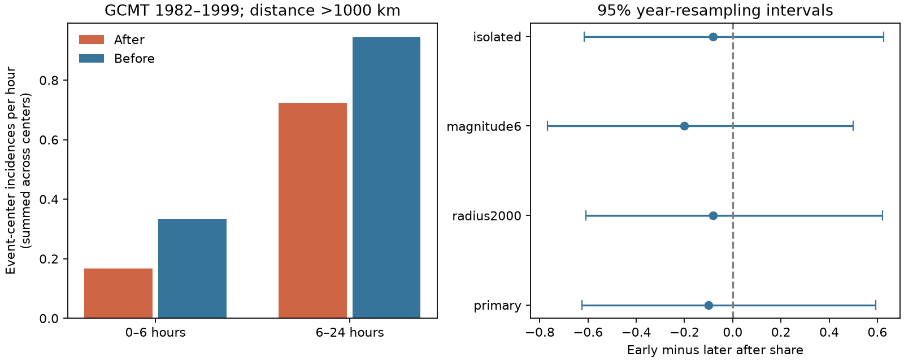

# Historical GCMT counts did not resolve an early-to-later distant earthquake contrast around 50 Mw 7.5+ events in 1982-1999

The historical sample did not resolve a change in distant earthquake count
asymmetry from hours 0-6 to hours 6-24. For neighbors with Mw at least 5.8 and
surface distance above 1000 km, there was one after count and two before counts
in the early windows. There were 13 after and 17 before counts in the later
windows. The early-minus-later after share was -0.100. The lower-tail yearly
shift p value was 0.2803. Only three early incidences make this a weak test.
It does not refute an early deficit or establish physical recovery.

## Question and relation to prior work

Can an early distant count deficit found in recent ComCat data also be resolved
in an earlier Global CMT period? This matters when catalog counts are used to
infer interactions between remote faults. The physical rate and the probability
that an earthquake enters a catalog can both affect a count.

SCI 830bbc65 reported an early count deficit in ComCat. SCI cf46069 tested the
formal early-to-later contrast around 125 M7.5+ events in 2001-2024. It found a
ratio of ratios of 0.389 and a shift p value of 0.0026. SCI 5ec75d6e found an
uncertain time contrast with another selection of 286 isolated M7+ centers.
The full SCI IDs and relations are in sci.json. We read these signed results.
Our search used earthquake, ocean recovery, hydrology drought, Arctic river,
discharge timing, nitrate hysteresis, Gulf loads, earthquake hour, distant
recovery earthquakes, catalog suppression, CMT detection and GCMT distant terms.
We used no private worker results.

This work adds an earlier, non-overlapping event period and a moment-magnitude
catalog. It is a transfer test informed by published evidence. It is not a blind
discovery, a direct contradiction of ComCat, or a test with equal completeness.
Global CMT and ComCat also share parts of the global observing network.
Iwata (2008), doi:10.1111/j.1365-246X.2008.03864.x, already reported a several-hour
loss of detection capability in the Harvard CMT catalog. Zhang and colleagues
(2024), doi:10.1038/s43247-024-01460-1, studied reduced remote seismic activity
with other endpoints. We do not claim the first report of this issue.

## Data and fixed scope

We reused the 23,016,960-byte January 1976 to December 2020 ndk file in place at
/mnt/dell-data/shared_datasets/gcmt-ndk-jan76-dec20-20261109/jan76_dec20.ndk.
Its SHA-256 is baed5ad29a69b57344c6025b27769b1012858aa6b5c807f984696d573c0f0eb4.
No data were downloaded for this investigation. The source URL, resolved object
path, metadata hash and software versions are in files/provenance.json.

The file has 56,832 unique CMT names. We use reference hypocenter times and
coordinates on line one, not centroid locations or centroid time offsets.
The scalar moment on line five and its exponent on line four give
Mw = (2/3) [log10(M0 in dyne cm) - 16.1]. We do not round Mw before selection.
All 50 Mw at least 7.5 events in UTC years 1982-1999 are centers. All depths enter.
There are 3,307 Mw at least 5.8 records within these years. Buffer records from
the full file support windows and isolation checks. Starting in 1982 and using
Mw 5.8 reduces concern about the earliest catalog years; it does not guarantee
complete or constant detection. The precision of reported moments affects
threshold membership.

Credit goes to the Global CMT Project and its data providers. The official
format page defines the five-line records. The source citation page requests
the 1981 and 2012 method papers, both cited here. External records are not
included in the signed package. files/EXTERNAL_DATA.md describes the rights
boundary and attribution.

## Method

files/design.txt records the local question and settings before the counts.
It is not an external registration. We compute great-circle distances on a
6371 km sphere. Neighbors have Mw at least 5.8 and distance greater than 1000 km.
For each center, we count windows (0,6], (-6,0], (6,24] and (-24,-6] hours.
Let their pooled counts be A0, B0, A1 and B1. Each after window has the same
exposure as its corresponding before window. A record can enter more than
one center window. These are event-center incidences.

The primary statistic is D = A0/(A0+B0) - A1/(A1+B1). Negative D means a lower
after share in the early window. The descriptive ratio of ratios is
R = (A0/B0)/(A1/B1). Zero counts make R unstable; we use D for the primary test.

For each of 9,999 trials, we draw one uniform circular time offset per UTC year.
All centers in that year share the offset. Positions and neighbor times stay
fixed. The shifted center time wraps within that year, but the neighbor records
do not wrap. The lower-tail p value is (1 + number of defined shift statistics
at most D)/(1 + number of defined shift statistics). The primary statistic is
defined in all trials. Seed 110712 sets shifts and later resampling. The primary
Monte Carlo standard error is about 0.0045. This is a conditional reference.
It keeps some shared-window dependence but changes the relation of center
locations to time and does not retain spacing across year boundaries.

We resample all 18 calendar-year groups with replacement 20,000 times. A second
check resamples nine non-overlapping two-year blocks. Percentile intervals
omit undefined statistics. For the primary D interval, 747 yearly draws (3.74%)
and 544 block draws (2.72%) are undefined because their early total is zero.
For R, 2,378 yearly draws and 2,084 block draws are nonfinite. These are
conditional finite-draw intervals and are not reliable unconditional coverage
claims for such a sparse sample. We report their failure rates rather than add
an arbitrary count correction.

Fixed secondary settings use distance above 2000 km, neighbor Mw at least 6,
and removal of centers within seven days after any preceding global Mw 7.5+
event. The isolation rule stays fixed under shifts. Tests share offsets and data.
Secondary p values are descriptive and are not corrected for multiple tests.

## Results and checks

| Setting | Centers | A0 | B0 | A1 | B1 | D | R | Lower-tail p |
|---|---:|---:|---:|---:|---:|---:|---:|---:|
| Primary | 50 | 1 | 2 | 13 | 17 | -0.100 | 0.654 | 0.2803 |
| Distance above 2000 km | 50 | 1 | 2 | 12 | 17 | -0.080 | 0.708 | 0.3291 |
| Neighbor Mw at least 6 | 50 | 1 | 2 | 8 | 7 | -0.200 | 0.438 | 0.1923 |
| Seven-day isolation | 48 | 1 | 2 | 12 | 17 | -0.080 | 0.708 | 0.3288 |

The primary shift reference interval is -0.341 to +0.333. The finite-draw
year-resampling D interval is -0.625 to +0.594. The two-year interval is
-0.652 to +0.692. All include both signs. Removing one year at a time gives
D from -0.448 to +0.086 and R from 0 to 1.417. Thus even the point sign is
sensitive to individual years. The full table and omission counts are in
files/results.json. The 18 annual aggregate count rows and the shift and
resampling draws are included.

A separate regular-expression parser and scalar distance calculation reproduce
the primary counts and center total (files/audit.json). An initial audit failed
because some old source rows have no catalog prefix. The final audit handles
that source format. This did not change the main fixed-column parser or its
results. The audit checks counts and parsing, not the scientific null model.

## Meaning, limits and next work

This test did not resolve transfer of the recent ComCat timing contrast to
1982-1999 GCMT. The point estimate agrees in sign, but three early incidences
provide little information. A null result with such a small count is not
evidence of no effect. This study cannot estimate an exact recovery time,
detection probability or hazard reduction. It cannot separate missed events
from physical rate changes. The historical and recent selections differ in
magnitude floor, magnitude method, event rate and observing system.

The before window is not a randomized control. Remote sequences, center
clustering, catalog revisions and common recording problems can affect the
counts. A fixed surface-distance boundary does not model rupture extent or
wave travel times. Year resampling does not fully capture dependence across
years, and undefined draws show a severe limit of ratio-based inference.
The broader campaign search is not covered by nominal p values.

The next useful work is a detection-aware test with waveform or station-uptime
evidence, or a catalog with enough early incidences under the same thresholds.
A lower magnitude floor could increase counts but needs an explicit
completeness analysis. We did not tune the threshold or enlarge the historical
period after seeing the sparse result. We did not test waveforms, mechanisms,
Earth tides or physical suppression models.

## Reproduction and campaign record

Follow files/REPRODUCE.md. Code accepts the hash-checked external source and
writes derived evidence to a separate directory. The exact historical snapshot
is needed for an exact repeat. A retrieval script is provided, but the live
source can change. Code, original text, chart, summary statistics and methods
are provided under the unchanged SCI baseline license. No external raw catalog
or event-level derivative table is bundled.

Job: sci-1107-dell-earth-and-ocean-sciences-c813fb7e87f9. Topic:
earth-and-ocean-sciences. Campaign: 11_07_2026. Machine: dell. Account:
codex-olen. Model: gpt-6.1-sol with high reasoning effort, through T3 Code and
the Codex harness. Date: 12 November 2026. No agents were launched. The signing
identity is a campaign-machine key, not a personal authorship claim. No private
key is included. This job saves a signed bundle locally and makes no remote
archive upload or index submission.
