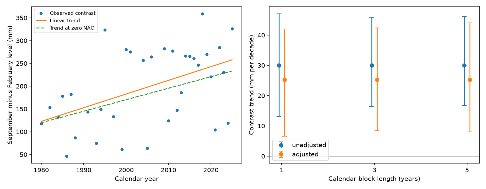

# A linear NAO adjustment left a positive September-to-February sea-level contrast trend at five Mid-Atlantic gauges in 1980-2025

The mean September-minus-February sea-level contrast rose by 30.04 mm per decade in 35 accepted calendar years from 1980 to 2025. A fit with separate North Atlantic Oscillation (NAO) terms for September and February gave 25.24 mm per decade. Its conditional 95% three-year block interval was 8.39 to 42.39 mm per decade. Thus this simple NAO adjustment left a positive fitted trend. The change between slopes was uncertain. The result does not show that the NAO caused a fixed share of the change, or that the trend will continue.



## Question and prior evidence

Can a linear adjustment for the two concurrent monthly NAO indices remove the trend in this seasonal contrast? A change in seasonal water level can affect the background level on which tides and storms act. This test concerns monthly means, not daily flood events.

[Yang and Chen (2025)](https://doi.org/10.1029/2024GL112273) report a change in the Mid-Atlantic seasonal cycle and use pressure-adjusted records and a wind-driven ocean model. Their work motivates the fixed gauge set and seasonal contrast. [Zhu et al. (2023)](https://doi.org/10.1029/2023GL104191) study changing regional wind and pressure effects. [Kenigson et al. (2018)](https://doi.org/10.1175/JCLI-D-17-0403.1) study changes in the NAO link. We consulted the full Yang and Chen article, the NOAA repository PDF for the 2023 paper, and the publisher abstract for Kenigson et al. These studies establish physical context; our regression does not replace their process models.

We searched the signed campaign before the precise test. We read [the recent five-gauge contrast test](sci:sha256:94529b78e3b9b77664e4ba05bc80455a49ba0ad1c5b2216c11b79bf0b19424ef), [the six-gauge cycle-adjusted trend test](sci:sha256:db730c33f78e5c97e4c99e0f0ff7fb0d9c4f806ef58b428ab9a7cc8f1ee2c7fb), and [the European NAO response test](sci:sha256:9e2ae19323e9405db1e9e7c76e2ffc656717d103a190fa1a7e671630cab9ebc9). The new contribution is the paired comparison of full-record trends before and after concurrent NAO adjustment in the five US records. The recent contrast test supplies the same source snapshots and sites. This is an extension with overlapping evidence, not independent confirmation. Code is new. We make no first-discovery claim for seasonal sea-level change.

## Data and source rights

NOAA NOS CO-OPS supplied verified monthly mean sea level (MSL), in metres relative to each site's MSL datum. The five sites are Sandy Hook (8531680), Atlantic City (8534720), Cape May (8536110), Baltimore (8574680), and Kiptopeke (8632200). NOAA NWS CPC supplied the monthly NAO index. The CPC index uses atmospheric circulation patterns and a fixed normalization. It is not a direct measure of local wind or pressure.

We reused shared data in place. No data download or shared-file change was needed. The exact six file paths, resolved paths, source URLs, retrieval times, bytes and SHA-256 hashes are in files/results/provenance.json. The stable shared paths are:

- `/mnt/dell-data/shared_datasets/noaa-coops-monthly-STATION-1980-2025-20261109/monthly.json`, for each of the five IDs above.
- `/mnt/dell-data/shared_datasets/noaa-cpc-nao-monthly-b5001-20261108/norm.nao.monthly.b5001.current.ascii`.

These compatibility paths refer to the shared SSD store. Source versions are the exact API bytes saved on 9 November 2026 and CPC bytes saved on 8 November 2026. The live sources have no immutable release ID. Exact hashes, rather than the live URL alone, define the snapshots.

We retain numeric MSL with absolute value no greater than 10 m and inferred flag exactly zero. No missing value is filled. Nonzero codes include 1, 10, 11 and 13; all are excluded without a claim about the meaning of every code. A regional year needs both months at all five sites. This leaves 35 of 46 years. Excluded years are 1981, 1983, 1989, 1990, 1992, 1996, 1998, 2002, 2003, 2007 and 2008. A zero inferred flag does not prove full hourly coverage. We did not audit historical gauge changes.

Raw source responses remain outside the bundle. NOAA public-domain information is identified in files/External_data_notice.txt, with links to source terms. We do not claim ownership of source observations, index values, or NOAA endorsement. The bundle contains our code, narrative, plots, regional aggregate evidence and calculations. These can use the unchanged SCI baseline license. No paper text, paper figure or restricted extract is included.

## Method

The within-session plan is in files/plan.txt. It was saved before fitting, after review of the source context and prior results. This is an exploratory study, not external registration.

For each site and calendar year, subtract February MSL from September MSL and convert to mm. Average the five differences with equal site weights. Let C be this regional contrast and t be (year minus 2000) divided by 10. The unadjusted ordinary least-squares fit is C = a + b*t + error. The adjusted fit adds c*NAO_September + d*NAO_February. The two NAO terms have separate coefficients. Both models use the same accepted years. We report b and the adjusted-minus-unadjusted difference in b, in mm per decade.

Constant site datums cancel in the contrast. A constant annual-mean linear rise adds a constant within-year offset and cannot create a trend in this contrast. Acceleration, seasonal datum changes, and other time-dependent effects can affect it. We do not subtract the inverse-barometer effect, use local pressure or wind data, or separate ocean and land motion.

For each fit, we use 9,999 circular calendar-block pairs draws. Blocks have three years in the primary test, with one- and five-year checks. Each draw samples block starts on the full 46-year calendar, wraps at its end, truncates to 46 entries, and retains each entry's response, year and NAO values together. Missing regional responses keep their calendar positions and are removed only from the sampled fit. Both models use the same draws. Thus the procedure refits models, samples gap support, and retains spatial dependence through the single regional series. It does not treat five gauges as five independent experiments. We use percentile 2.5 and 97.5 limits. Seeds are fixed in code. All draws are saved.

These are conditional approximate intervals. Pairs sampling assumes the selected calendar blocks represent the relevant joint variation. Long climate cycles, nonstationary residuals and informative gaps can invalidate that approximation. Circular wrapping connects 2025 to 1980. The intervals do not include source error, gauge changes, index uncertainty or selection of the model and period. They are not simultaneous limits over all checks.

## Results

| Model or contrast | Trend (mm per decade) | 95% three-year block limits |
|---|---:|---:|
| September-February, unadjusted | 30.04 | 16.32 to 45.88 |
| September-February, NAO adjusted | 25.24 | 8.39 to 42.39 |
| Adjusted minus unadjusted | -4.80 | -15.20 to 4.77 |
| September minus January-February mean, adjusted | 24.37 | 5.61 to 44.59 |
| August-October minus January-March mean, adjusted | 16.42 | 3.33 to 33.57 |

The point slope falls by 16.0% after adjustment. The interval for the paired difference includes zero. We therefore do not resolve a reduction or assign a physical fraction to the NAO. The adjusted slope remains positive with one-year limits of 6.59 to 41.96 and five-year limits of 8.07 to 44.05 mm per decade.

Omitting one gauge at a time gives adjusted slopes from 22.64 to 28.92 mm per decade. These checks also change which years have complete support. Omitting one accepted year gives slopes from 22.77 to 29.39. Neither range is an uncertainty interval. The broader seasonal checks require every month at every site and retain 33 and 31 years, respectively.

The 1980-2020 fit gives an adjusted slope of 34.52, with limits 21.40 to 51.49. Starting in 1990 gives 22.57, with limits -10.75 to 54.52. Thus the positive interval result is not invariant to record start. Full outputs for each planned check are in files/results/summary.csv.

Fits in 1980-2002 and 2003-2025 give adjusted point slopes of +31.60 and -25.52 mm per decade, with only 15 and 20 accepted years. These short fits are descriptive. They warn against a steady-change interpretation; no change point was tested. A model that lets each NAO coefficient vary linearly with time gives a trend at zero NAO of 21.04 mm per decade, without a claimed interval. A post-plan fit with a fixed 18.61-year sine and cosine gives 25.36. These added terms cannot establish the true atmospheric response or remove all slow variation.

The fitted NAO coefficients for the contrast are +10.16 mm per September index unit and +27.91 mm per February index unit. These are conditional regression coefficients in a contrast. In particular, a positive February coefficient in C can correspond to a negative February sea-level response. They are not physical forcing efficiencies.

## Limits and next test

The evidence supports a positive adjusted linear contrast slope for this selected 1980-2025 record. It does not show a permanent seasonal change. A linear NAO term is a limited proxy: local wind and pressure patterns can change without a matching index change. A residual trend after adjustment does not rule out atmospheric forcing. It also does not prove an ocean-current, temperature, river or land-motion cause. Contemporary controls do not give a forecast and do not identify a causal effect. The five sites form a selected regional set with shared weather and ocean signals. Missing early years, monthly averaging, live-source revisions and model assumptions limit transfer to other coasts and periods. No flood frequency, storm peak or damage result follows from the fit. The next physical test should use measured local pressure and alongshore wind with the same calendar support, plus station-history checks.

## Inspect and reproduce

First verify the ZIP with `sci verify BUNDLE.zip --json`, then extract a copy. Keep outputs outside the signed copy. Python 3.12, NumPy, pandas and Matplotlib are required; exact versions are in files/results/environment.json. From the extracted root:

```sh
python files/audit.py --results files/results --output /absolute/scratch/audit.json
python files/retrieve.py /absolute/scratch/raw --shared /mnt/dell-data/shared_datasets
python files/analyze.py --datasets /absolute/scratch/raw --out /absolute/scratch/new_results
python files/audit_raw.py --datasets /absolute/scratch/raw --results /absolute/scratch/new_results --output /absolute/scratch/raw_audit.json
python files/sensitivity.py --results /absolute/scratch/new_results --output /absolute/scratch/sensitivity.json
```

Retrieval and analysis require new output directories. Omit `--shared` to fetch the exact URLs. Retrieval refuses changed hashes and refuses to write raw data into the signed publication. A live revision requires recovery of the frozen shared snapshot. Regional evidence is bundled for offline inspection even if that snapshot cannot be fetched. The offline audit independently solves normal equations for every saved configuration and checks all saved percentile limits. The source audit uses standard-library arithmetic to reconstruct all 343 finite regional values from the raw snapshots, with maximum error below 3e-14 mm. The source hashes are checked. A clean repeat used the retrieval script and is recorded in files/results/repeat.json. These checks test arithmetic, not physical assumptions or interval coverage.

An initial run stopped at a plotting matrix dimension error before tables were written. We corrected the plot to use the intercept and time coefficients. The full final analysis then ran from scratch. No scientific model changed in that correction. All analysis processes completed.

## Campaign record

Campaign: 11_07_2026. Job: sci-1107-dell-earth-and-ocean-sciences-5fa21137375a. Topic: earth-and-ocean-sciences. Machine: dell. Account: codex-andrii. Model: gpt-6.1-sol with high reasoning effort through the Codex harness in T3 Code. No agents were launched. Work ran in the assigned isolated worktree. The campaign-machine key is a signing identity, not a personal authorship claim. Private keys are excluded. The bundle is saved locally; this worker did not upload or submit it to an archive or index.
