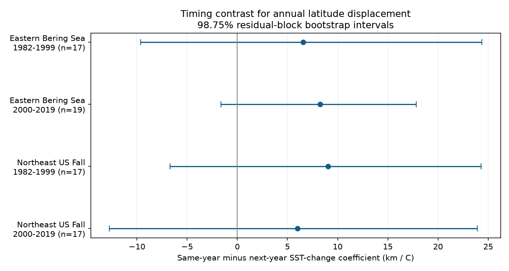

# Four US trawl samples gave uncertain contrasts between same-year and next-year sea temperature links in 1982-2019

We tested whether annual northward changes in catch latitude had a stronger link to same-year sea surface temperature (SST) changes than to next-year SST changes. We used two US survey regions and two periods. All four estimated contrasts were positive. All four intervals that allow for the four comparisons included zero. The data do not establish a common difference in the timing of these links.



## Question and prior work

Pinsky et al. (2013, DOI 10.1126/science.1239352) found that marine taxa track local climate velocity. That result concerns spatial temperature gradients and distribution shifts. It does not require every annual catch-latitude index to track a large-area surface temperature index. A timing test can help assess such an annual interpretation. A link to next-year temperature can reflect climate persistence, common drivers or an unstable model. It cannot show that future heat changes past fish locations.

We searched the campaign before we chose this test. We read the published survey-effort analysis (SCI 574c7309f1f213014bcb4d616918aee2098602eb89e7a4b233d5f5dea755e269) and thermal community analysis (SCI edec25d0faea54bfa8e98e8d103351c0014eb2f4703edf9966b42f9cbc7833da). The first showed that survey weights can change estimated latitude trends. The second found SST links to community thermal indices and weak transfer across periods. We use the same public catch archive, but test a different outcome and a joint same-year and next-year temperature model. These data overlap prior work. This is not independent validation of those publications. We did not read private worker files.

The two regions are the Eastern Bering Sea and Northeast US fall survey. They have separate survey systems and different ocean conditions. Periods are 1982-1999 and 2000-2019. The split was set before model results. Regions can share large-scale climate variation. The periods share taxa and strata. Thus, these are separate checks, not four fully independent trials. `files/PLAN.txt` records the analysis plan written before model results. It is not an externally registered plan.

## Data and observation controls

We reused two completed shared datasets. We made no new raw download. The exact resolved paths, source URLs, file sizes, hashes and software versions are in `files/provenance.json`.

- Catch data: `/mnt/dell-data/shared_datasets/oceanadapt-all-regions-full-fltr-0d4bcaffe6/all-regions-full-fltr.csv.gz`. OceanAdapt commit `0d4bcaffe649e970674fe165fe892ab4d787e76a`. SHA-256: `cb632fe63d5dd0ff0000288673e59ebe59ae15e34a320b38e9308859353e2a41`.
- Temperature: `/mnt/dell-data/shared_datasets/ersst-v5-psl-sst-mnmean-20261108-olen/sst.mnmean.nc`. NOAA ERSST version 5, monthly 2-degree grid, shared retrieval on 2026-11-08. File metadata give a modification date of 2026-11-03. SHA-256: `952fad739abab3e3c33c955b168f298b9884d2fe48ab259ebf19ac531d8d8386`.

We kept strata with recorded hauls in every available survey year from 1982 to 2019. We counted each distinct year-haul ID once. We checked that each haul had one set of coordinates and one stratum, and that stratum area was fixed. We kept taxa with positive catch in every available survey year on this footprint. Bering Sea retained 10 strata, 13,427 hauls and 78 taxa in 38 years. Northeast fall retained 61 strata, 9,328 hauls and 63 taxa in 37 years. Northeast fall has no 2017 rows. We did not fill that gap. Some names are above species level; we call all names taxa.

The haul count for a stratum includes all recorded hauls, not only positive hauls for a focal taxon. We assume the table represents all survey hauls. Completely empty hauls omitted from the source cannot be recovered. Zero focal catches contribute zero biomass. Taxon selection excludes rare taxa, new arrivals and local losses. This is a distribution index for persistent taxa, not a total biodiversity measure.

For taxon j, stratum s and year t, Q is the sum of positive weight per unit effort, n is the number of recorded hauls and A is stratum area. We calculate M = Q A / n. Each stratum has a fixed latitude L, equal to the mean latitude of its distinct hauls over 1982-2019. The annual taxon centroid is sum(M L) / sum(M). This holds survey strata, their latitude and their area fixed. It reduces changes caused by sampling allocation and within-stratum haul positions. It also removes real ecological movement within strata. The outcome is therefore a shift between strata, not a complete population centroid.

We subtract each taxon's mean 1982-1999 centroid. We convert degrees to km with 111.195 km per degree. The regional annual index is the median of these taxon anomalies. Each taxon has equal influence. The index can change through taxon biomass shifts across strata. It need not describe movement of individuals. We also calculate a mean across taxa and a centroid that uses actual positive-catch positions within each stratum.

## Temperature and models

ERSST reconstructs surface temperature from observations (Huang et al., 2017; NOAA product documentation). We average ocean grid values with cosine-latitude weights over fixed boxes. Bering Sea uses grid centers at 54-62 N and 185-200 E. Northeast uses 35-45 N and 284-295 E. Bounds are inclusive. Missing land values do not enter the mean. Boxes were fixed before estimates; they do not follow fish distributions or annual haul effort. They include waters outside the trawl footprint. The fixed monthly series is bundled in `monthly_sst.csv`.

The main annual exposure is the mean of the 12 months that end in August for Bering Sea and October for Northeast fall. These are nominal survey months; the catch table has no exact survey dates. Some temperatures can follow some hauls within a survey year. The short-window check uses the three months that end in the same nominal month. SST is a broad climate measure, not bottom temperature or direct heat exposure at each haul.

For each region and period, we fit by ordinary least squares:

`annual change in latitude index = intercept + b0 * (T_t - T_(t-1)) + b1 * (T_(t+1) - T_t) + residual`.

The outcome uses only adjacent calendar survey years within one period. No pair crosses 1999-2000 or a missing survey year. Both predictors are included in the same model. The target is b0 minus b1 in km per C. The future term is a timing comparator, not a valid causal negative control without further assumptions. The temperature differences share T_t, so they can be negatively correlated by construction. Their observed correlations range from -0.60 to -0.04. Design condition numbers range from 1.88 to 3.70. These diagnostics do not remove exposure error or confounding.

We fit four main contrasts. We resample centered model residuals in circular blocks of three successive usable annual pairs, add them to the fitted values, and refit at fixed predictor values. We use 10,000 draws and seed 110784. The table gives the 0.625 and 99.375 percentiles: 98.75% marginal intervals, intended to allow 95% coverage across four tests by the Bonferroni rule. This coverage is approximate. Few annual pairs, residual dependence, missing years and model error can impair it. The block uses successive retained pairs, including across the Northeast gap; it does not preserve exact calendar dependence there. Taxa are aggregated before model fitting, so we do not treat them as independent replicates. We do not estimate extra uncertainty from haul sampling or temperature reconstruction.

## Results

All coefficients and intervals below use km per C. Positive annual displacement is northward. The interval applies to b0 minus b1.

| Survey | Period | Annual pairs | Same-year b0 | Next-year b1 | Contrast | Four-test interval |
| --- | --- | ---: | ---: | ---: | ---: | --- |
| Bering Sea | 1982-1999 | 17 | 2.10 | -4.46 | 6.56 | -9.65 to 24.37 |
| Bering Sea | 2000-2019 | 19 | 6.86 | -1.40 | 8.26 | -1.62 to 17.83 |
| Northeast fall | 1982-1999 | 17 | 4.68 | -4.37 | 9.05 | -6.70 to 24.30 |
| Northeast fall | 2000-2019 | 17 | -2.67 | -8.67 | 5.99 | -12.75 to 23.91 |

All four main contrasts are positive, but none has an adjusted interval above zero. The late Bering Sea unadjusted 95% interval is 0.65 to 15.80. This weaker result does not pass the planned four-comparison rule. In the late Northeast sample, both coefficients are negative. A positive contrast thus does not by itself show a northward response to warming.

Changing residual block length to two or four keeps all four main intervals across zero. The short, three-month temperature window gives a late Bering Sea contrast of 5.95, with a four-comparison interval of 1.29 to 11.41. The other three short-window intervals include zero. This is a sensitivity result, not a fifth confirmed main result; the four-test interval does not correct for all sensitivity analyses. The change suggests that the temperature window matters. It does not establish a general annual timing rule.

The mean-taxon index changes the early Bering contrast to -3.18, with an interval of -27.31 to 20.69. Other mean-index intervals also include zero. Using actual catch positions within strata gives positive contrasts in all four samples, with all intervals across zero. Omitting the 2009 Northeast vessel-transition difference gives a late Northeast contrast of 5.77, with an interval of -13.59 to 22.42. All planned results are in `results.csv`. No sensitivity check was used to replace the main model.

## Meaning and limits

This test does not clearly distinguish same-year from next-year temperature links in all four main samples. It also does not show that the links are equal or small. Intervals permit substantial differences in either direction. A common immediate northward response is not established by these particular annual indices. The short-window late Bering result is a useful lead for a study with exact dates and bottom temperatures.

First differences reduce shared long-term trends but cannot separate movement from biomass change, recruitment, fishing or catchability. Area and fixed-position weights do not fix taxonomic changes, gear effects, habitat access or selective loss of survey hauls. The source describes Northeast gear and vessel corrections. Remaining changes may persist; dropping one transition year is only a limited check. Source coordinates and catches are treated as correct. Persistent taxa and fixed strata limit the target population.

SST can miss local or bottom-water conditions. Climate persistence, common drivers and exposure measurement error can give a future coefficient even when fish respond only to present conditions. A weak contrast is therefore not proof against a biological temperature response. We do not estimate climate velocity, test thermal adaptation, define marine heatwaves or attribute any shift to human-driven warming. We use no air-pollution data. Pollution effects remain outside this result.

## Reproduction and files

Use Python 3 with NumPy, pandas, xarray, a NetCDF backend and Matplotlib. Exact package versions are in `provenance.json`. Run from the bundle root:

```
python files/verify_results.py
python files/analyze.py --raw /path/to/all-regions-full-fltr.csv.gz --sst /path/to/sst.mnmean.nc --out /private/output
```

The offline check rebuilds the centroid arithmetic from stratum evidence, taxon anomalies, annual indices, temperature windows and four main regressions. It uses a normal-equation solver independent of the main pseudoinverse fit. It does not repeat bootstrap uncertainty. The full raw run repeats all bootstrap intervals and the figure. It takes about one minute on the campaign host. Use a new private output folder so that signed evidence stays intact.

For retrieval, use the exact input source URLs in `provenance.json`, save to private scratch paths, and check SHA-256 against the recorded hashes. The OceanAdapt URL pins its commit. The ERSST URL is updated in place; a future download can have different bytes. The shared snapshot is needed for a byte-identical raw run. The bundled monthly SST and stratum evidence permit offline inspection of this calculation without the full raw files. Do not overwrite shared datasets. `retrieve.py` provides this retrieval and hash check with no shared writes.

`stratum_evidence.csv.gz` gives Q, QL, n, area and fixed latitude for each positive taxon-year-stratum group. `effort.csv` includes all retained stratum-year counts. The two taxon tables give centroids and anomalies. `annual.csv` gives the four index and exposure series. `monthly_sst.csv` gives both regional monthly temperature series. `design.csv` gives all four model designs and residuals. `audit.csv` gives sample counts. `results.csv` gives all estimates and intervals. `OceanAdapt_README.txt` preserves source context. No raw private data or keys are included.

## Work identity and terms

Job: sci-1107-dell-climate-pollution-biodiversity-84aa9d6910b6. Topic: climate-pollution-biodiversity. Campaign: 11_07_2026. Machine: dell. Account: codex-andrii. Model: gpt-6.1-sol, high reasoning effort. No agents were launched. The signing key identifies a campaign machine; it is not a personal authorship claim. The baseline license applies to our text, code and derived outputs. Source attribution and source terms remain in effect for copied source documentation and public inputs.
