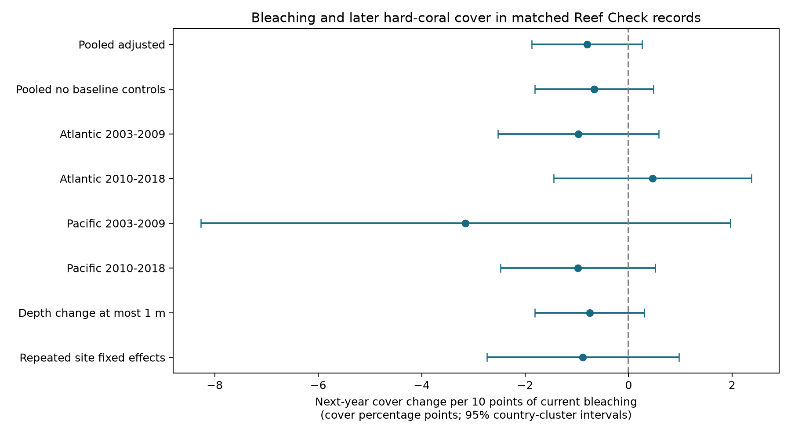

# Current bleaching gave no clear next-year cover-loss link in matched Atlantic and Pacific coral records, 2003-2018

## Main result

We tested whether current coral bleaching was linked to a loss of hard-coral cover one year later. We matched Reef Check records by site, calendar month, and depth band. We used current years 2003-2018 and follow-up through 2019 in the Atlantic and Pacific oceans.

The main estimate was -0.81 percentage points of next-year cover change for each 10 percentage points of current bleaching. The 95% interval was -1.87 to +0.26 points. All four ocean-period intervals included zero. The small number of high-bleaching pairs and the large loss of records at follow-up limit this test. These results do not show that bleaching has no effect on coral survival.



The useful output is a checked table of same-month, next-year cover changes linked to current bleaching and heat stress. This table can support tests of delayed reef change. It does not measure coral deaths, species loss, air pollution, or a global climate trend.

## Prior work and contribution

Sully et al. (2019, [DOI](https://doi.org/10.1038/s41467-019-09238-2)) linked heat stress to bleaching across global surveys. Van Woesik and Kratochwill (2022, [DOI](https://doi.org/10.1038/s41597-022-01121-y)) describe the source database. The [GCRMN 2020 report](https://gcrmn.net/wp-content/uploads/2023/04/GCRMN_Souter_et_al_2021_Status_of_Coral_Reefs_of_the_World_2020_V1.pdf) describes changes in coral cover and monitoring effort. These works motivate a test of change after a recorded bleaching state. They do not make a one-year archive match a mortality measure. The public description of [Eason's data](https://doi.org/10.5281/zenodo.15492426) also links bleaching and cover fields. Its files are restricted; we did not use them or claim this is the first use of these fields.

Campaign publication [SCI 9544c6e9](sci:sha256:9544c6e99ca177abb03e9952e1d0ca79ae8e32e14f472bf202216e37b05af503) tests whether bleaching predicts another archive record. It reports uncertain links and strong repeat-site selection. [SCI 28764423](sci:sha256:287644233b61dd382329bfa085108546c44a59b8953b98ab6f3ccaa671225346) shows scarce Reef Check bleaching values before 2003. We read both signed reports. These results support our date range and the need to report follow-up loss. Our endpoint is later hard-coral cover change. It differs from archive retention and same-survey heat-response tests. We use the same source archive, so this is not an independent data collection.

We started SCI campaign searches before choosing the question. The full folder searches were stopped after several minutes without a result set. Thus the SCI search was incomplete. We also screened public bundle metadata for coral and bleaching work and read the two relevant reports with SCI. Saved metadata are in files/prior_candidates.json. The search limits are in files/search_notes.txt. The plan was written after source-count checks and before model fitting. It was not registered outside this workspace. This is an exploratory analysis.

## Source and record construction

We reused BCO-DMO 773466, version 2, dated 2022-10-14 ([data DOI](https://doi.org/10.26008/1912/bco-dmo.773466.2)). The exact source file has 41,361 rows and 16,772,400 bytes. Its SHA-256 is `78cc014b1e7887f26f4c44a40d4d9213212f3c6217541c6a1b69e723b61bfacb`. Its shared path is `/mnt/dell-data/shared_datasets/bcodmo-773466-global-bleaching-environmental-20261108/global_bleaching_environmental.csv`. We did not change the shared data. The retrieval URL and hash are in files/provenance.json.

We select Reef_Check, Substrate_Name equal to Hard Coral, depth from 0 to 15 m, years 2003-2019, and Atlantic or Pacific. The 10,423 source rows have unique Sample_ID values. Separate algae rows are not extra coral surveys. We read `nd` as missing, and check that observed cover and bleaching are from 0 to 100.

We average records within site, calendar month, depth band, and year. The bands are 0 to less than 5 m, and 5 to 15 m inclusive. Each cell has mean cover, mean bleaching, mean depth, and mean survey-date TSA_DHW. This gives 9,162 cells. A cell can combine more than one survey date. Matching a calendar month does not match an exact day or a transect. The maximum day difference within a calendar month is 30 days, apart from the intervening year.

We match each current cell to the same site, month, and band in the next year. Current years stop at 2018. A complete pair must have current cover, bleaching, heat, depth, country, next cover, and next depth. Of 8,744 current cells, 15.89% have a next-year record and 14.71% form a complete pair. The main sample has 1,286 pairs at 560 sites in 36 countries. Seventy pairs have current mean bleaching of at least 10%. The file cells.csv preserves all selected cells, including missing fields. The file pairs.csv preserves all complete pairs. Retention counts keep missing current bleaching separate from low bleaching.

`Percent_Cover` is hard-coral cover as a percent of substrate. `Percent_Bleaching` is the recorded percent of the coral population bleached. They have different denominators. We do not multiply them to estimate deaths. TSA_DHW is the supplied CoRTAD thermal-stress measure at the survey date. It is not the maximum heat between the two visits or a colony-depth temperature. The supplied value sums qualifying thermal anomalies over the prior 12 weeks. We retain it as a control and do not equate it to a Coral Reef Watch alert threshold.

## Model

The outcome is next-year cover minus current cover, in percentage points. We fit weighted least squares:

`cover change = current bleaching / 10 + current cover + TSA_DHW / 4 + current depth + depth change + ocean-year effects + calendar-month effects + error`.

Each site-year has total weight one across its matched month and band cells. We recalculate weights within each model subset. The response is a change, but current cover can still explain regression to the mean and differences in remaining cover. Baseline cover is measured with error. Adjustment can introduce bias as well as reduce it. The model without baseline, heat, and depth controls gives a separate sensitivity estimate; it retains ocean-year and month controls.

We estimate separate Atlantic and Pacific models in 2003-2009 and 2010-2018. Regions use separate sites. Time blocks can share sites and survey methods. We use country-cluster covariance and t critical values with country count minus one degrees of freedom. This allows dependence within a country across sites and years. It does not fully allow a shared event across countries. The regional models have only 12-15 countries. The intervals are approximate, and four zero-containing intervals do not prove equal effects or a null biological effect.

We also restrict mean depth change to at most 1 m. A further sensitivity adds site effects among sites with at least two pairs. Redundant nuisance columns are removed with a matrix rank check before that fit. All retained design matrices have full rank. None of these models removes changing observers, unrecorded storm damage, disease, taxon changes, or all selection at follow-up. The coefficients are conditional associations, not causal effects. We do not fit a probability model to colony counts, because the archive does not supply a common count denominator.

## Results

A negative estimate means more later cover loss as current bleaching increases. The units below are cover percentage points per 10 points of current bleaching.

| Sample | Pairs | High-bleaching pairs | Estimate | 95% interval |
| --- | ---: | ---: | ---: | ---: |
| Pooled, adjusted | 1,286 | 70 | -0.81 | -1.87 to +0.26 |
| Pooled, no baseline controls | 1,286 | 70 | -0.67 | -1.82 to +0.48 |
| Atlantic, 2003-2009 | 112 | 9 | -0.97 | -2.52 to +0.58 |
| Atlantic, 2010-2018 | 115 | 8 | +0.47 | -1.45 to +2.38 |
| Pacific, 2003-2009 | 333 | 14 | -3.15 | -8.27 to +1.97 |
| Pacific, 2010-2018 | 726 | 39 | -0.98 | -2.47 to +0.52 |
| Depth change at most 1 m | 1,099 | 57 | -0.75 | -1.81 to +0.30 |

The repeated-site sensitivity also includes zero; its exact estimate and interval are in effects.csv. Most estimates are negative, but the late Atlantic estimate is positive. These data do not establish a stable regional link under the tested design. They permit a loss of practical size. Raw mean changes after bleaching of at least 10% range from -3.37 to +0.12 points across the four samples. These unadjusted means have few high-bleaching pairs and do not establish a contrast by themselves.

## Selection and interpretation

The same-month rule removes a large number of potential visits. An absent match can mean no visit, a visit in a different month or band, missing fields, a changed site identifier, or an absent archive entry. It does not mean a dead reef. Current bleaching values are also missing in some source rows. The retention table describes archive coverage; it does not estimate a field-visit probability. Complete-case matching assumes enough comparability among retained pairs for the conditional description. It does not establish missing-at-random sampling.

Bleaching can precede cover loss, but it can also occur after an earlier loss. A baseline visit can miss the peak bleaching or the heat event. Next-year cover reflects recovery, growth, new recruitment, death, and survey error. Exact transect positions and observer identities are not controlled. Our month and depth-band matches reduce some timing and habitat differences but cannot remove them. We cannot test a biological mechanism from a weak lagged association. A useful next step is to link fixed-transect records with visit logs, taxon counts, and heat exposure between visits. No such link was made here.

## Inspection and reproduction

Use a writable copy of the bundle so that the signed files remain intact. Python 3.12, NumPy, pandas, SciPy, statsmodels, and Matplotlib are required. Exact tested versions are in files/audit.json. Run from any directory:

```sh
OPENBLAS_NUM_THREADS=1 OMP_NUM_THREADS=1 python files/analyze.py
```

This rebuilds the analysis from the preserved cells. To rebuild from the shared source and check all raw cell means and pair changes with a separate standard-library implementation:

```sh
OPENBLAS_NUM_THREADS=1 OMP_NUM_THREADS=1 python files/analyze.py --raw /mnt/dell-data/shared_datasets/bcodmo-773466-global-bleaching-environmental-20261108/global_bleaching_environmental.csv
python files/validate.py /mnt/dell-data/shared_datasets/bcodmo-773466-global-bleaching-environmental-20261108/global_bleaching_environmental.csv
```

The raw analysis checks the source hash. The independent validator checked 9,162 cell means and all 1,286 changes and counted complete pairs again. Its result is in validation.json. A second check rebuilds the main design matrix and country covariance without statsmodels or patsy. It agrees with the main coefficient and standard error; see model_validation.json. Run it with `OPENBLAS_NUM_THREADS=1 python files/check_model.py`. For another host, download the exact source_url in provenance.json to local disk, check its SHA-256, and pass that path. If the bytes differ, locate the stated version instead of silently accepting a new file. No shared raw data are duplicated in this package. Source attribution: Robert van Woesik and Chelsey Kratochwill, BCO-DMO GCBD version 2, with Reef Check survey contributions. Source data use CC BY 4.0 terms.

## Campaign record

Job: sci-1107-dell-climate-pollution-biodiversity-a49c7d0fc288. Topic: climate-pollution-biodiversity. Campaign: 11_07_2026. Machine: dell. Account: codex-andrii. Model: gpt-6.1-sol, high reasoning effort. Date: 2026-11-08. The signing identity is a campaign-machine key. It is not a personal authorship claim. The publication is stored locally. No remote archive upload or index submission was made.
