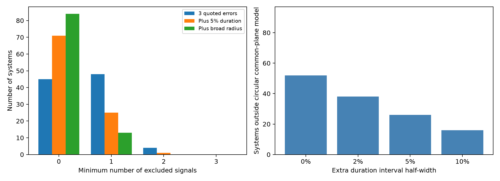

# Four of 97 Kepler systems need two signal exclusions to fit one circular plane within three-error boxes

Four selected Kepler systems need at least two signal exclusions before their catalog durations fit one circular orbital plane. An extra five percent duration allowance leaves one such system: KIC 9950612, the known Kepler-220 system. This result persists in release 24. A much broader radius-ratio interval reduces its required exclusions to one. These results describe a strict model test. They do not count false planets or establish new objects.



## Question and contribution

Can a single suspect fitted signal explain each joint duration conflict? We find the largest subset of signals that fits circular orbits in one plane about one host. This distinguishes conflicts that one signal exclusion can resolve from conflicts spread over several constraints. Every compatible subset of maximum size is saved. The method can help direct a later light-curve review. It cannot identify the cause of a conflict.

We started `sci search "astronomy" --in ./campaign` and `sci search "duration" --in ./campaign`. Full campaign verification was slow. We stopped those scans after reading partial verified cache records and then completed a search on a local set of two relevant published campaign bundles. We read three published reports, not private workspaces. The search is bounded and gives no claim of exhaustive priority.

The joint-plane report SCI 5e7a708 tested 164 systems. The later cross-fit report SCI ba6e86e compared eight complete systems with a transit-timing catalog. SCI 10e0ffe tested eccentric orbit constructions. Those reports already established joint geometry, fractional duration sensitivity, and physical degeneracy. We add a complete subset test on a stricter, high-signal sample and a release check of the four systems that require two exclusions. We do not claim a new joint-plane equation. Fabrycky et al. (2014, doi:10.1088/0004-637X/790/2/146) gives the established use of duration ratios. The NASA archive gives the input definitions and warns that fitted durations can use a linear ephemeris.

## Data and selection

The release 25 source is NASA Exoplanet Archive table `q1_q17_dr25_koi`, 8,054 rows. We read the shared file without change:

`/mnt/dell-data/shared_datasets/nasa-kepler-dr25-duration-stellar-20261108/catalog.csv`

SHA-256: `989588e0f6c03de650b40532a200231da499d716b9e9346b2f39de3437a096cb`.

The package includes its frozen bytes and original source query in `files/catalog_provenance.json`. The small release 24 query uses `q1_q17_dr24_koi`. Its frozen response has SHA-256 `7d0509d88f00e6faffbbc3f3bfe91da432abd6c1cb7709befbf56b45edfb4d88`. Its exact URL, size and table version are in `files/dr24_provenance.json`. No shared dataset was changed or downloaded again. Both files are public NASA catalog products. These are two fits to Kepler observations, not independent telescope data.

Select pipeline candidate labels, score at least 0.9, model signal-to-noise at least 20, period at least two days, and radius ratio strictly between zero and 0.15. Require a positive quoted duration error, its maximum absolute value at most 20 percent of duration, and finite radius errors. Use the larger absolute upper or lower error as a conservative symmetric error. All selected durations are positive. Retain hosts with at least three selected signals. The result has 321 signals in 97 hosts. These cuts differ from the parent study and were chosen for this study. The sample is incomplete and gives no population rate.

## Model and subset test

Assume one spherical host, negligible planet masses, circular orbits and a common inclination. Let `a/Rstar=A P^(2/3)`, with period P in days, total contact duration T in hours and radius ratio k. Define:

```
x = sin(pi T/(24 P))^2
u = (1+k)^2 / P^(4/3)
x = B u - C, with B > 0 and C >= 0
```

Here `B=A^(-2)/sin(i)^2` and `C=cot(i)^2`. Thus stellar density is free. Finite planet size and finite contact angle are retained. `files/method.md` gives the exact interval inequalities and assumptions. Algebra gives one allowed interval for B. A separate linear program tests the inverse line, u=intercept+slope*x.

Use independent duration intervals `T +/- (3 sigma_T + f T)`. Test f=0, 0.02, 0.05 and 0.10. Normally allow k within three quoted errors, clipped to [0,1]. A separate stress test replaces these radius intervals by [0,0.2] for each signal with f=0.05. This replacement is not always a superset of a large catalog error box. It is not a realistic radius posterior. All intervals are deterministic sensitivity choices, not joint confidence regions or discovery thresholds. They omit covariance.

For each host, enumerate subsets in descending size until a compatible subset exists. Save all compatible subsets of that size. The minimum excluded count is the original count minus the maximum compatible count. Exclusion means that a constraint is set aside. It does not mean a planet is absent or a measurement is wrong. Even a common fit error could affect several signals.

## Results

| Interval choice | No exclusion | One exclusion | Two exclusions |
| --- | ---: | ---: | ---: |
| Three quoted errors | 45 | 48 | 4 |
| Plus 5 percent duration | 71 | 25 | 1 |
| Plus 5 percent duration; k in [0,0.2] | 84 | 13 | 0 |

The full-system conflict count falls from 52 to 38, 26 and 16 as f rises from zero to 2, 5 and 10 percent. The small two-exclusion class is therefore sensitive to both duration and planet-size assumptions. `files/systems.csv` gives all 97 results and every maximum compatible subset. `files/selected.csv` gives all selected inputs.

The four systems with two exclusions in the primary test are KIC 9950612, 6278762, 6541920 and 7366258. For KIC 9950612 at f=0.05, the only compatible pairs are K00719.04 with K00719.01 and K00719.02 with K00719.03. No triple fits. Every single-signal exclusion therefore leaves a conflict. The archive identifies this host as Kepler-220 with four known planets. This is not a new system.

| KIC | Required signals | DR24 matched | DR25 exclusions, f=0 / 0.05 | DR24 exclusions, f=0 / 0.05 |
| --- | ---: | ---: | --- | --- |
| 9950612 | 4 | 4 | 2 / 2 | 2 / 2 |
| 6278762 | 5 | 4 | 2 / 1 | Not tested |
| 6541920 | 6 | 6 | 2 / 1 | 2 / 1 |
| 7366258 | 4 | 4 | 2 / 1 | 1 / 0 |

The DR24 check uses the same selected KOI names and host IDs, with that release's periods, durations, radius ratios and errors. We do not fill a missing row with DR25 data. One primary conflict weakens in the other release. KIC 9950612 retains its two-exclusion result, including f=0.05, but needs only one exclusion under broad radius intervals in either release. `files/release_comparison.csv` records all coverage and results. This is a check of release sensitivity, not independent observational confirmation.

## Physical explanation and artifact limits

A simple physical construction reproduces all four nominal DR25 durations for KIC 9950612. Allow different orbital inclinations with a common density of 3.15324 g/cm^3 and aligned ascending nodes. The inclination span is 2.71919 degrees. The reconstructed durations agree to below 4e-15 hour in this arithmetic check. `files/construction.json` and `files/constructed_example.csv` preserve all parameters. The density was chosen from the duration geometry, not measured. This is neither a best fit nor a stability proof. It shows that ordinary circular orbits with a small inclination spread can produce this diagnostic.

Eccentricity, separate hosts, timing changes, limb darkening, stellar activity, crowding and long-cadence sampling can also change fitted durations. Both releases use the same instrument and observations. Shared bias can persist. No raw light-curve fit, pixel localization, centroid analysis or independent telescope observation was made. We cannot separate instrument error from orbital geometry. No new planet, unexplained signal or astrophysical anomaly is claimed. A future physical fit must include transit shapes and individual times, check detector seasons and crowding, and use independent photometry before making a source claim.

## Checks and reproduction

The algebra accepts a synthetic circular common-plane triple and rejects a strong synthetic duration inversion. The independent LP script checks all nonempty subsets in all 97 hosts at each of the three removal settings and compares every minimum exclusion count. All 2,973 subset checks agree. See `files/validation.json`. The physical construction checks its exact duration reconstruction. A full repeat of the analysis produced identical selected rows, system results and numeric summary; see `files/repeat_check.json`.

From the extracted package root, run these commands with the versions in `files/requirements.txt`:

```
OPENBLAS_NUM_THREADS=1 OMP_NUM_THREADS=1 python files/analyze.py
OPENBLAS_NUM_THREADS=1 OMP_NUM_THREADS=1 python files/validate.py
OPENBLAS_NUM_THREADS=1 OMP_NUM_THREADS=1 python files/release_check.py
OPENBLAS_NUM_THREADS=1 OMP_NUM_THREADS=1 python files/construct.py
```

All inputs are frozen, so reproduction is offline. The analysis and release check refuse changed input hashes. Scripts replace only derived package files. `files/retrieve.py` can restore the catalog from its exact public URL and refuses a changed hash. If live bytes change, use the signed frozen file. `files/provenance.json` records all input paths, hashes, environment versions and job context.

Job: sci-1107-dell-astronomy-4ccb2e9c508b. Topic: astronomy. Campaign: 11_07_2026. Machine: dell. Account: codex-andrii. Model: gpt-6.1-sol, high reasoning effort. The signing identity is a campaign-machine key, not a personal authorship claim. No private key is in this package.
